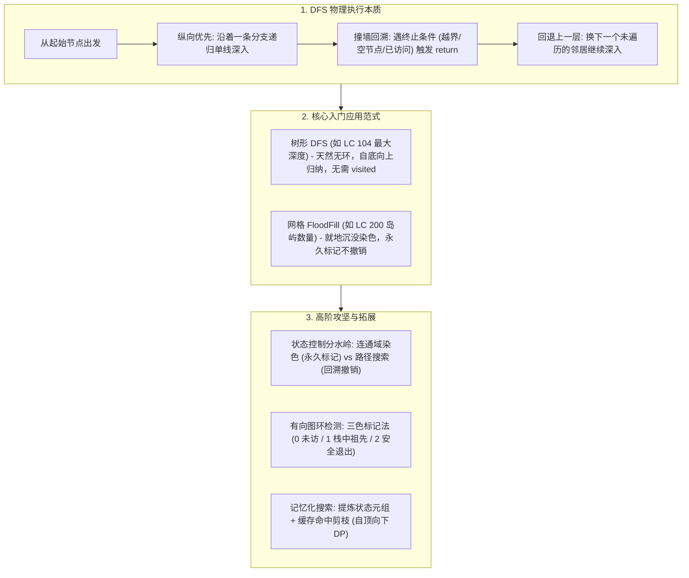

# 06 · DFS 深度优先搜索：树形遍历、连通域染色与状态空间搜索

> [!abstract] 一句话第一性原理
> **深度优先搜索（Depth-First Search, DFS）** 的本质是**利用栈结构（函数调用栈或显式栈）在树或图的拓扑空间上执行“单路深入、不撞南墙不回头”的穷举遍历**。其核心机制是通过深入叶子节点后回溯，完成自底向上的信息归纳或全状态空间的覆盖。

---

## 知识全景图



---

## 一、 破除玄学：DFS 到底是怎么动起来的？

### 1.1 核心动作：“不撞南墙不回头”
DFS 的物理运动轨迹极其单纯：
1. **单线深入**：只要前面还有路，就优先往最深处钻；
2. **遇阻返回**：当走到尽头（遇到空节点、超出边界、或者遇到了已经访问过的节点），立刻执行 `return`；
3. **分岔换路**：退回到最近的一个分岔路口，尝试下一条还没有走过的分支。

---

### 1.2 关键认知：为什么树不用 visited，而图必须用 visited？
初学者最常犯的错误，是在树形问题里乱加 `visited`，或在图问题里漏写 `visited`：
- **树（Tree）天然无环**：树的结构自顶向下延伸，父子关系唯一。除了无向树需要传入 `parent` 防止往回倒流以外，普通二叉树单向向下递归，**绝不可能走回祖先节点，因此根本不需要任何 `visited` 数组**！
- **图（Graph）与网格（Grid）充满环路**：从 $A$ 走到 $B$，$B$ 又能走回 $A$。**若不维护访问标记，程序将在环内无限递归自旋，瞬间引发 JVM 栈溢出（`StackOverflowError`）**。

---

## 二、 DFS 通用代码骨架（两大标准范式）

### 骨架 1：树形 DFS 递归骨架（信息自底向上汇聚）
```java
public int dfsTree(TreeNode root) {
    // 1. 基线条件 (Base Case)：撞墙即停
    if (root == null) {
        return 0;
    }

    // 2. 递归深入子节点，拿到子问题的解
    int leftResult = dfsTree(root.left);
    int rightResult = dfsTree(root.right);

    // 3. 当前层逻辑：根据子结果归纳出当前节点的结果
    return Math.max(leftResult, rightResult) + 1;
}
```

---

### 骨架 2：二维网格 / 图论 DFS 遍历骨架（连通域扩散）
```java
public void dfsGrid(char[][] grid, int r, int c) {
    // 1. 越界与合法性剪枝 (撞墙检查)
    if (r < 0 || r >= grid.length || c < 0 || c >= grid[0].length || grid[r][c] != '1') {
        return;
    }

    // 2. 标记当前节点 (染色，防止环路与重复访问)
    grid[r][c] = '0'; // 例如直接就地修改为已访问

    // 3. 沿四个方向继续深入扩散
    dfsGrid(grid, r + 1, c); // 下
    dfsGrid(grid, r - 1, c); // 上
    dfsGrid(grid, r, c + 1); // 右
    dfsGrid(grid, r, c - 1); // 左
}
```

---

## 三、 经典场景入门题（从入门到熟练两大经典场景）

### 场景 1：二叉树的最大深度（LC 104. 纯净树形 DFS）

> **题目描述**：给定一个二叉树 `root`，返回其最大深度。
> **思路建模**：整棵树的最大深度，等于左右两棵子树深度的最大值加 1。无需任何额外标记数组，后序遍历自然回传。

```java
class Solution104 {
    public int maxDepth(TreeNode root) {
        // 撞到空节点，深度为 0
        if (root == null) return 0;
        
        // 分别深入左右子树
        int left = maxDepth(root.left);
        int right = maxDepth(root.right);
        
        // 自底向上汇总结果
        return Math.max(left, right) + 1;
    }
}
```

---

### 场景 2：岛屿数量（LC 200. 二维网格 FloodFill 染色）

> **题目描述**：给你一个由 `'1'`（陆地）和 `'0'`（水）组成的的二维网格，请你计算网格中岛屿的数量。
> **核心机制（沉没算法）**：
> 1. 双重循环遍历网格，一旦撞见陆地 `'1'`，说明发现了新岛屿，计数加 1；
> 2. 随即触发 DFS 将与该陆地相连的所有 `'1'` 全部沉没修改为 `'0'`；
> 3. 后续循环再撞见被修改后的 `'0'` 就会直接跳过，杜绝重复计数。

```java
class Solution200 {
    public int numIslands(char[][] grid) {
        if (grid == null || grid.length == 0) return 0;
        int count = 0;

        for (int r = 0; r < grid.length; r++) {
            for (int c = 0; c < grid[0].length; c++) {
                if (grid[r][c] == '1') {
                    count++;
                    sink(grid, r, c); // 沉没该连通块
                }
            }
        }
        return count;
    }

    private void sink(char[][] grid, int r, int c) {
        // 越界或遇水则停止
        if (r < 0 || r >= grid.length || c < 0 || c >= grid[0].length || grid[r][c] != '1') {
            return;
        }

        grid[r][c] = '0'; // 永久标记访问，绝不撤销！

        // 深入四方向扩散
        sink(grid, r + 1, c);
        sink(grid, r - 1, c);
        sink(grid, r, c + 1);
        sink(grid, r, c - 1);
    }
}
```

---

## 四、 高阶攻坚与拓展知识（进阶查阅）

### 4.1 状态控制分水岭：连通块染色 vs 路径回溯
解决搜索问题时，绝大多数错误源于混淆了**“是否需要恢复现场”**：

| 模式 | 核心目标 | 标记方式 | 是否恢复现场 | 复杂度 | 代表题目 |
| :--- | :--- | :--- | :---: | :---: | :--- |
| **模式 A：连通域染色（FloodFill）** | 统计区域数量、连通性检查 | 永久置位（如变 `'0'`） | **绝不撤销** | $O(V + E)$ | 岛屿数量、被围绕的区域 |
| **模式 B：路径回溯（Backtracking）** | 寻找满足条件的所有具体路径 | 成对置位（试探后恢复） | **必须撤销** | $O(b^d)$ 指数级 | 单词搜索（LC 79）、全排列 |

---

### 4.2 有向图环检测神技：三色标记法（Three-Color Marking）
普通布尔数组只有 `true/false`，无法区分某个节点是**“正在当前递归调用链中（祖先）”**还是**“已经完全探索完毕安全返回”**。
为了精准检测有向图中的环，引入三种颜色状态：
- **白色（0）**：未访问；
- **灰色（1）**：正在当前 DFS 递归调用栈中（属于当前路径的祖先）。**若 DFS 遇到灰色节点，必定存在有向环！**
- **黑色（2）**：该节点及其所有后代均已遍历完毕，已证实安全出栈。后续若遇黑色节点直接跳过（剪枝）。

> [!example]- 点击展开：LC 207. 课程表（三色标记法环检测完整实现）
> - 🔗 **LeetCode 题目直通车**：[LeetCode 207. 课程表 ↗](https://leetcode.cn/problems/course-schedule/)
> - **题目描述**：你这个学期必须选修 `numCourses` 门课程，记为 `0` 到 `numCourses - 1`。在选修某些课程之前需要一些先修课程。先修课程按数组 `prerequisites` 给出，其中 `prerequisites[i] = [ai, bi]` ，表示如果要学习课程 `ai` 则必须先修课程 `bi`。请判断是否可能完成所有课程的学习（即图中是否存在环）。
> **示例**：输入 `numCourses = 2, prerequisites = [[1,0]]` $\to$ 输出 `true`（学完 0 再学 1 即可）；输入 `numCourses = 2, prerequisites = [[1,0],[0,1]]` $\to$ 输出 `false`（存在依赖循环，无法修完）。
> **思路**：建有向图（`bi -> ai`）。使用三色标记法：0=白色（未访问）、1=灰色（当前递归调用栈中）、2=黑色（已完全探索无环）。若遍历中撞见灰色节点，说明遇到回边存在有向环，返回 `false`。
> ```java
> class Solution207 {
>     private static final int WHITE = 0, GRAY = 1, BLACK = 2;
>     public boolean canFinish(int numCourses, int[][] prerequisites) {
>         List<List<Integer>> graph = new ArrayList<>();
>         for (int i = 0; i < numCourses; i++) graph.add(new ArrayList<>());
>         for (int[] p : prerequisites) graph.get(p[1]).add(p[0]); // p[1] -> p[0]
> 
>         int[] color = new int[numCourses];
>         for (int i = 0; i < numCourses; i++) {
>             if (color[i] == WHITE && hasCycle(graph, color, i)) return false;
>         }
>         return true;
>     }
>     private boolean hasCycle(List<List<Integer>> graph, int[] color, int u) {
>         color[u] = GRAY; // 入栈
>         for (int v : graph.get(u)) {
>             if (color[v] == GRAY) return true; // 发现后向边，撞到环！
>             if (color[v] == WHITE && hasCycle(graph, color, v)) return true;
>         }
>         color[u] = BLACK; // 出栈，安全
>         return false;
>     }
> }
> ```

---

### 4.3 记忆化搜索（Memoization：自顶向下 DP）
当 DFS 搜索的分支存在大量**重叠子问题**时，暴搜会退化为指数级。
只需在函数入口查表、出口存表，即可剪掉全量子树：
1. **声明备忘录**：`int[][] memo`，统一初始化为未计算标记（如 `-1`）；
2. **入口查表**：`if (memo[i][j] != -1) return memo[i][j];`；
3. **出口存表**：在计算出结果 `res` 后，写入 `return memo[i][j] = res;`。

---

## 五、 常见避坑清单与自测过关

1. **图搜索忘记标记访问引发爆栈**：
   - 只要搜索对象存在环路或双向边，访问节点后第一件事必须打上标记；
2. **混淆染色与回溯**：
   - 只求连通块时若误写了 `visited[r][c] = false`，会导致同一区域被重复搜索成千上万次，直接引发超时（TLE）；
3. **递归深度极限**：
   - JVM 默认栈深度通常在 $10^4$ 级别。若网格规模极大（如 $1000 \times 1000$ 连通），深度递归可能爆栈，工业场景下需转为显式数据栈或 BFS。
