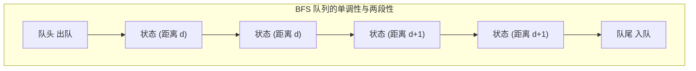
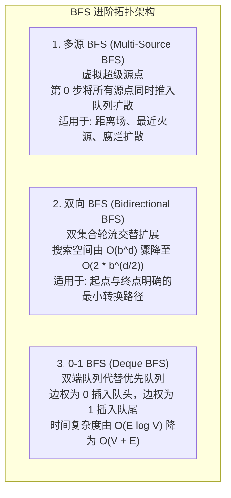

# BFS 广度优先搜索

> **核心定义**：
> 广度优先搜索（Breadth-First Search, BFS）是一种按层推进的状态空间遍历算法。其物理模型类似于**水波纹的同心圆扩散**：从起始状态出发，先访问所有距离为 1 的状态，再访问所有距离为 2 的状态，依次递增。在**无权图或边权全等**的环境中，BFS 能够严格保证首次探索到目标节点时所经历的路径步数最少。

---

## 1. 为什么 BFS 首次到达目标必然是最短路径？

在无权图（所有边权均为 1）中，“BFS 首次出队的目标状态即为全局最短路径”是由**队列的单调性与两段性定理**严格保证的。



### 单调性与两段性数学推导
1. **两段性（Two-Segment Property）**：
   - 在任意执行时刻，BFS 队列中容纳的节点至多只有两种不同的距离值：前半段节点的距离为 $d$，后半段节点的距离为 $d + 1$。
2. **单调性（Monotonicity Property）**：
   - 队列中节点的距离随着入队次序单调不减。即从队头到队尾，距离序列始终形如 $[d, d, \dots, d, d+1, d+1, \dots, d+1]$。
3. **传递不变性证明**：
   - 当从队头弹出一个距离为 $d$ 的节点 $u$，去扩展其未访问的邻居 $v$ 时，$v$ 的距离必为 $dist[v] = dist[u] + 1 = d + 1$。
   - 新节点 $v$ 插入队尾，此时队尾距离依然为 $d + 1$。
   - 只有当队列中所有距离为 $d$ 的节点全部出队处理完毕后，队头才会开始弹出距离为 $d + 1$ 的节点，进而扩展出距离为 $d + 2$ 的新节点。
4. **结论**：
   - 算法严格按照距离从小到大的顺序考察每一个节点。任何节点若第一次被加入队列并访问，其对应的搜索树深度必为从源点出发的最短可能跳数。

---

## 2. 分层遍历标准模板（Layer-by-Layer Template）

通过在 `while (!queue.isEmpty())` 内部固定 `int size = queue.size()`，可以在逻辑上将连续队列严格切割为离散的“层”。

```java
public class BFSTemplate {

    public int bfs(Node start, Node target) {
        Queue<Node> queue = new ArrayDeque<>();
        Set<Node> visited = new HashSet<>();

        // 1. 初始化起点入队并标记
        queue.offer(start);
        visited.add(start);

        int step = 0; // 当前扩散步数/层数

        // 2. 层序遍历
        while (!queue.isEmpty()) {
            int size = queue.size(); // 必须固定当前层的节点数量

            // 批量处理当前层的全部节点
            for (int i = 0; i < size; i++) {
                Node cur = queue.poll();

                // 目标检查
                if (cur.equals(target)) {
                    return step;
                }

                // 扩展所有邻居
                for (Node neighbor : cur.getNeighbors()) {
                    // 入队即打标：防止同一节点被当前层或后续节点重复压入
                    if (!visited.contains(neighbor)) {
                        visited.add(neighbor);
                        queue.offer(neighbor);
                    }
                }
            }
            step++; // 扩散完一层，步数加 1
        }
        return -1; // 目标不可达
    }
}
```

> [!IMPORTANT] 黄金法则：入队即打标
> 必须在**将节点加入队列的瞬间**就将它标记为已访问，严禁推迟到出队时再打标。如果出队时才打标，同一层的多个兄弟节点可能会同时发现并重复入队同一个邻居，导致队列长度呈指数级暴增，极易引发 `OutOfMemoryError`。

---

## 3. 三大进阶拓扑形态



### 3.1 多源 BFS（Multi-Source BFS）
- **核心思维：虚拟超级源点（Super Source）**
  - 当题目存在多个起始点（如矩阵中有多个腐烂的橘子），求任意空格到“最近起点”的最短距离时，若对每个起点分别做一次单源 BFS，总耗时为 $O(k \cdot MN)$，必定超时。
  - **正解**：假设存在一个虚拟超级源点 $S^*$，它到所有真实源点的边权均为 0。
  - **工程落地**：在算法初始化阶段，**将全部真实源点在第 0 步一次性全部入队**，并全部打上访问标记。随后执行标准的分层 BFS，各源点会同步向外扩散，谁先到达某格子，谁就是距离该格子最近的源点。

### 3.2 双向 BFS（Bidirectional BFS）
- **数学本质：搜索树指数爆炸剪枝**
  - 设搜索树的每个分支因子为 $b$（每个节点平均有 $b$ 个邻居），最短路径深度为 $d$。
  - **单向 BFS**：访问节点规模为 $O(b^d)$。
  - **双向 BFS**：从起点与终点同时向中间对向扩展，两波水波纹在 $d/2$ 深度相遇。总访问节点数仅为 $O(2 \cdot b^{d/2})$。
  - **数量级差距**：若 $b = 10, d = 6$，单向需遍历 $10^6 = 1,000,000$ 个状态；双向仅需 $2 \times 10^3 = 2,000$ 个状态，运算量骤减 500 倍！
- **双向集合轮换技巧（Two-Set Optimization）**：
  - 维护两个哈希集合 `beginSet` 与 `endSet`。
  - 每次循环开始时，检查两集合大小：`if (beginSet.size() > endSet.size()) swap(beginSet, endSet);`。
  - **永远只从较小的集合侧进行扩展**，保证搜索树的分支数始终受到最严格抑制。

### 3.3 0-1 BFS（双端队列加权最短路）
- **适用场景**：图中的边权非负，且**边权仅有 0 和 1 两种**（例如：沿当前方向移动代价为 0，转向或翻转代价为 1）。
- **破局逻辑**：普通 Dijkstra 算法由于优先队列内部堆调整，复杂度为 $O(E \log V)$。而边权为 0 和 1 时，可以通过 `Deque`（双端队列）替代最小堆：
  - 若经过当前边产生的增量距离为 **0**：通过 `deque.addFirst(neighbor)` 将其插入**队头**（优先在当前距离批次中处理）；
  - 若经过当前边产生的增量距离为 **1**：通过 `deque.addLast(neighbor)` 将其插入**队尾**（在下一批次处理）；
- **效果**：依然严格维持了队列中节点的单调性与两段性，使得总时间复杂度退化至完美的线性 $O(V + E)$。

---

## 4. 经典母题手撕：LeetCode 127. 单词接龙（双向 BFS 双集合模板）

> **题目描述**：
> 字典 `wordList` 中从单词 `beginWord` 到 `endWord` 的 **转换序列** 是一个按下述规格形成的序列：
> 1. 序列中第一个单词是 `beginWord`；
> 2. 序列中最后一个单词是 `endWord`；
> 3. 每次转换只能改变一个字母；
> 4. 转换过程中的每个中间单词必须是字典 `wordList` 中的单词。
>
> 给你两个单词 `beginWord` 和 `endWord` 以及一个字典 `wordList`。请你找出从 `beginWord` 到 `endWord` 的**最短转换序列中的单词数目**。如果不存在这样的转换序列，返回 `0`。
>
> **输入输出示例**：
> - 示例 1：
>   - 输入：`beginWord = "hit", endWord = "cog", wordList = ["hot","dot","dog","lot","log","cog"]`
>   - 输出：`5`
>   - 解释：一个最短转换序列是 `"hit" -> "hot" -> "dot" -> "dog" -> "cog"`，总共包含 5 个单词。
> - 示例 2：
>   - 输入：`beginWord = "hit", endWord = "cog", wordList = ["hot","dot","dog","lot","log"]`
>   - 输出：`0`
>   - 解释：`endWord` `"cog"` 不在字典中，所以不存在有效转换序列。

### 4.1 算法建模与双向搜索优势
- **隐式图建模**：每个单词为一个节点，若两个单词仅相差 1 个字母，则存在一条无权边（距离为 1）。求最短序列长度本质就是求无权图中的单源最短路径。
- **单向 vs 双向的指数差距**：若单向从 `hit` 扩展，若深度为 $d$，搜索规模为 $O(26^L \dots)$；采用双向 BFS，维护 `beginSet` 与 `endSet`，每次选择元素数量较小的集合向对向扩展，当两端波纹发生交集时搜索立刻终止，搜索空间直接开根号（从 $O(b^d)$ 降至 $O(b^{d/2})$）。

### 4.2 标准 Java 实现（双向 Set 优化）

```java
public class SolutionWordLadder {

    public int ladderLength(String beginWord, String endWord, List<String> wordList) {
        // 1. 将 wordList 转为 HashSet 提升查询效率
        Set<String> dict = new HashSet<>(wordList);
        if (!dict.contains(endWord)) return 0;

        // 2. 双向搜索集合
        Set<String> beginSet = new HashSet<>();
        Set<String> endSet = new HashSet<>();
        Set<String> visited = new HashSet<>();

        beginSet.add(beginWord);
        endSet.add(endWord);
        visited.add(beginWord);
        visited.add(endWord);

        int step = 1; // 序列包含起点本身，初始长度为 1

        while (!beginSet.isEmpty() && !endSet.isEmpty()) {
            // 核心剪枝：优先扩展体量更小的一端
            if (beginSet.size() > endSet.size()) {
                Set<String> temp = beginSet;
                beginSet = endSet;
                endSet = temp;
            }

            Set<String> nextLevelSet = new HashSet<>();

            // 扩展 beginSet 中的每一个单词
            for (String word : beginSet) {
                char[] chs = word.toCharArray();
                for (int i = 0; i < chs.length; i++) {
                    char old = chs[i];
                    // 尝试替换 26 个小写英文字母
                    for (char c = 'a'; c <= 'z'; c++) {
                        if (c == old) continue;
                        chs[i] = c;
                        String nextWord = new String(chs);

                        // 相遇判定：两个扩散波纹相交，返回总距离
                        if (endSet.contains(nextWord)) {
                            return step + 1;
                        }

                        // 合法过渡状态加入下一层
                        if (dict.contains(nextWord) && !visited.contains(nextWord)) {
                            visited.add(nextWord);
                            nextLevelSet.add(nextWord);
                        }
                    }
                    chs[i] = old; // 还原字符数组
                }
            }

            beginSet = nextLevelSet;
            step++;
        }

        return 0; // 无法相遇
    }
}
```

---

## 5. 典型算法应用速览

| 题目 | 难度 | 核心 BFS 模式 |
| :--- | :--- | :--- |
| **LC 994. 腐烂的橘子** | 中等 | **多源 BFS**：统计初始所有腐烂橘子入队，每分钟向四周扩散，最后校验新鲜橘子剩余数 |
| **LC 542. 01 矩阵** | 中等 | **多源 BFS**：将所有值为 0 的格子作为超级多源入队，向值为 1 的格子反向扩散计算最近距离 |
| **LC 1091. 二进制矩阵中最短路径** | 中等 | **单源网格 BFS**：8 个移动方向，层序遍历，首次到达右下角 `(n-1, n-1)` 即最短步数 |
| **LC 1368. 使网格至少有一条有效路径的最小代价** | 困难 | **0-1 BFS**：按箭头指示方向走代价为 0（`addFirst`），修改箭头代价为 1（`addLast`），求到达终点最小代价 |
| **LC 752. 打开转盘锁** | 中等 | **双向 BFS**：4 位密码锁每次旋转 1 位有 8 种子状态，双向集合搜索快速绕过死亡密码 `deadends` |

> [!example]- 展开查看：LC 994. 腐烂的橘子（多源 BFS 标准实现）
> **题目描述**：在给定的 `m x n` 网格 `grid` 中，每个单元格可以有以下三个值之一：
> - 值 `0` 代表空单元格；
> - 值 `1` 代表新鲜橘子；
> - 值 `2` 代表腐烂的橘子。
> 每分钟，腐烂的橘子周围 4 个方向上相邻的新鲜橘子都会腐烂。返回直到单元格中没有新鲜橘子为止所经过的最小分钟数。如果不可能使所有新鲜橘子都腐烂，返回 `-1`。
> **示例**：输入 `grid = [[2,1,1],[1,1,0],[0,1,1]]`，输出 `4`。
> **思路**：将所有腐烂橘子在第 0 步同时入队作为超级多源点，按层扩散（一圈一分钟），每扩散一圈时间加 1 并更新新鲜橘子剩余数。
> ```java
> class SolutionLC994 {
>     public int orangesRotting(int[][] grid) {
>         int m = grid.length, n = grid[0].length;
>         Queue<int[]> queue = new ArrayDeque<>();
>         int freshCount = 0;
> 
>         // 1. 扫描矩阵，所有腐烂橘子多源入队，统计新鲜橘子数量
>         for (int i = 0; i < m; i++) {
>             for (int j = 0; j < n; j++) {
>                 if (grid[i][j] == 2) {
>                     queue.offer(new int[]{i, j});
>                 } else if (grid[i][j] == 1) {
>                     freshCount++;
>                 }
>             }
>         }
> 
>         if (freshCount == 0) return 0;
> 
>         int minutes = 0;
>         int[][] dirs = {{1, 0}, {-1, 0}, {0, 1}, {0, -1}};
> 
>         // 2. 多源层序扩散
>         while (!queue.isEmpty() && freshCount > 0) {
>             int size = queue.size();
>             for (int i = 0; i < size; i++) {
>                 int[] cur = queue.poll();
>                 for (int[] d : dirs) {
>                     int r = cur[0] + d[0], c = cur[1] + d[1];
>                     if (r >= 0 && r < m && c >= 0 && c < n && grid[r][c] == 1) {
>                         grid[r][c] = 2; // 腐烂并打标
>                         freshCount--;
>                         queue.offer(new int[]{r, c});
>                     }
>                 }
>             }
>             minutes++;
>         }
> 
>         return freshCount == 0 ? minutes : -1;
>     }
> }
> ```

> [!example]- 展开查看：LC 1368. 使网格至少有一条有效路径的最小代价（0-1 BFS 双端队列实现）
> **题目描述**：给你一个 `m x n` 的网格 `grid`。每个单元格都有一个数字，表示方向：`1` 向右，`2` 向左，`3` 向下，`4` 向上。你可以花费代价 `1` 修改一个单元格的方向。返回从左上角 `(0, 0)` 到右下角 `(m-1, n-1)` 的最小修改代价。
> **示例**：输入 `grid = [[1,1,1,1],[2,2,2,2],[1,1,1,1],[2,2,2,2]]`，输出 `3`。
> **思路**：边权只有 0（顺着箭头方向走）和 1（修改箭头走）两种。用双端队列 Deque 实现 0-1 BFS，代价为 0 加到队首，代价为 1 加到队尾，以 $O(M \times N)$ 线性时间替代 Dijkstra 的优先队列。
> ```java
> class SolutionLC1368 {
>     public int minCost(int[][] grid) {
>         int m = grid.length, n = grid[0].length;
>         int[][] dirs = {{0, 1}, {0, -1}, {1, 0}, {-1, 0}}; // 右、左、下、上
>         int[][] dist = new int[m][n];
>         for (int[] row : dist) Arrays.fill(row, Integer.MAX_VALUE);
> 
>         Deque<int[]> deque = new ArrayDeque<>();
>         deque.offerFirst(new int[]{0, 0});
>         dist[0][0] = 0;
> 
>         while (!deque.isEmpty()) {
>             int[] cur = deque.pollFirst();
>             int r = cur[0], c = cur[1];
> 
>             if (r == m - 1 && c == n - 1) return dist[r][c];
> 
>             for (int i = 0; i < 4; i++) {
>                 int nr = r + dirs[i][0], nc = c + dirs[i][1];
>                 if (nr < 0 || nr >= m || nc < 0 || nc >= n) continue;
> 
>                 // 若移动方向与格子箭头一致，代价为 0，否则代价为 1
>                 int weight = (grid[r][c] == i + 1) ? 0 : 1;
>                 if (dist[r][c] + weight < dist[nr][nc]) {
>                     dist[nr][nc] = dist[r][c] + weight;
>                     if (weight == 0) {
>                         deque.addFirst(new int[]{nr, nc}); // 0 权重放队头
>                     } else {
>                         deque.addLast(new int[]{nr, nc});  // 1 权重放队尾
>                     }
>                 }
>             }
>         }
>         return dist[m - 1][n - 1];
>     }
> }
> ```

---

## 6. 工程考量与核心易错点

1. **状态高维扩展（状态压缩与元组）**：
   - 很多图论问题中，一个状态不仅是坐标 $(x, y)$，还绑定了业务属性。例如“收集所有钥匙的最小步数（LC 864）”，状态必须定义为 `(x, y, keyState)`，其中 `keyState` 为二进制位掩码。`visited` 数组必须开成三维 `boolean[m][n][1 << K]`。
2. **Java 队列选型**：
   - 严禁使用 `LinkedList` 作为 BFS 队列实现。`LinkedList` 内部维护大量前后指针的 `Node` 包装对象，存在高频 GC 和指针跳跃导致的 CPU 缓存行失效；
   - 始终优先选用 `ArrayDeque`，底层为连续环形数组，内存紧凑且性能最优。
