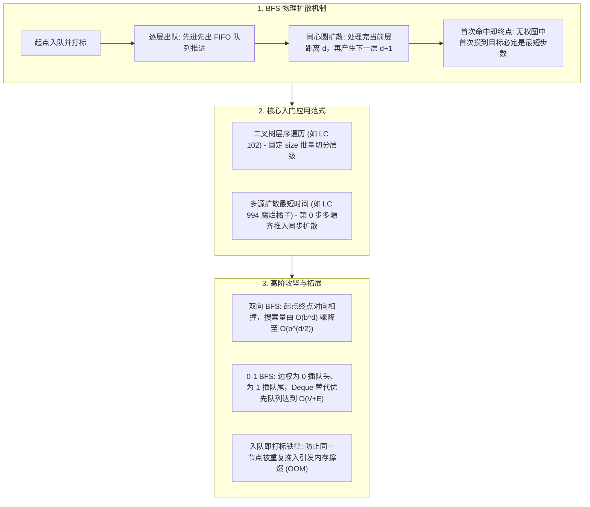

# 07 · BFS 广度优先搜索：层序推进、无权最短路与多源扩散

> [!abstract] 一句话第一性原理
> **广度优先搜索（Breadth-First Search, BFS）** 的本质是**利用先进先出（FIFO）队列在状态空间上执行“按层向外辐射（水波纹扩散）”的穷举遍历**。在无权图或边权均等场景中，队列的单调性与两段性从数学上严格保证了**首次访问到目标状态所经历的步数必为全局最短路径**。

---

## 知识全景图



---

## 一、 破除玄学：BFS 到底是怎么动起来的？

### 1.1 核心动作：“水波纹同心圆扩散”
BFS 的运动轨迹就像朝平静的湖面扔下一块石头，水波纹一圈一圈向外荡开：
1. **第 0 层**：只有起始节点自己（距离为 0）；
2. **第 1 层**：所有与起点直接相邻的一步可达节点（距离为 1）；
3. **第 2 层**：从第 1 层节点出发走一步可达的新节点（距离为 2）；
4. ……每扩展一圈，搜索深度（步数）严格加 1。

---

### 1.2 为什么 BFS 首次到达目标必然是“最短步数”？
很多初学者背熟了“BFS 找最短路”，但不知道底层为什么必然是最短路：
- 计算机在利用队列遍历时，队列内部始终维持着**单调性**：
  - 队列里只可能同时存在两批节点：前半截距离全是 $d$，后半截距离全是 $d + 1$；
  - **所有的 $d$ 步节点没有完全处理完之前，绝不可能产生任何 $d + 2$ 步的节点**！
- 因此，当我们在队列中**第一次**摸到终点目标时，走过的步数必定是全图最小步数。

---

### 1.3 黄金生死法则：“入队即标记（防止重复入队）”
初学者写 BFS 最容易引发 **内存溢出（OOM）或超时（TLE）** 的陷阱：
- **错误写法**：节点从队列**弹出来的时候**才标记 `visited`。
  - 后果：在网格或图里，一个节点可能同时被 4 个邻居在同一层看见，结果被重复放进队列 4 次！下一层又裂变为 16 次，队列瞬间爆炸！
- **正确铁律**：**只要把一个节点塞进队列（`offer`），必须在同一时间立刻打上 `visited` 标记！** 抢先占位，绝不允许任何其他节点再把它重复推入队列。

---

## 二、 BFS 通用代码骨架（分层遍历标准模板）

绝大多数求最短步数、层序遍历的问题，都严格使用以下分层模板：

```java
public int bfs(Node start, Node target) {
    Queue<Node> queue = new ArrayDeque<>();
    Set<Node> visited = new HashSet<>();

    // 1. 起点入队并立刻标记
    queue.offer(start);
    visited.add(start);

    int step = 0; // 扩散步数

    // 2. 逐层推进
    while (!queue.isEmpty()) {
        int size = queue.size(); // 核心关键：必须固定当前层的节点数量

        // 批量清空当前层的所有节点
        for (int i = 0; i < size; i++) {
            Node cur = queue.poll();

            // 首次命中目标即为最短路
            if (cur.equals(target)) {
                return step;
            }

            // 遍历所有邻居节点
            for (Node neighbor : cur.getNeighbors()) {
                if (!visited.contains(neighbor)) {
                    visited.add(neighbor); // 入队即打标！
                    queue.offer(neighbor);
                }
            }
        }
        step++; // 当前层全部处理完毕，步数加 1
    }
    return -1; // 目标不可达
}
```

---

## 三、 经典场景入门题（两大经典核心范式）

### 场景 1：二叉树的层序遍历（LC 102. 最纯净分层收集）

> **题目描述**：给你二叉树的根节点 `root`，返回其节点值的 **层序遍历**（即逐层地，从左到右访问所有节点）。
> **核心机制**：利用 `int size = queue.size()`，每次循环把刚好一整层的节点一次性收集到一个列表中。

```java
class Solution102 {
    public List<List<Integer>> levelOrder(TreeNode root) {
        List<List<Integer>> ans = new ArrayList<>();
        if (root == null) return ans;

        Queue<TreeNode> queue = new ArrayDeque<>();
        queue.offer(root);

        while (!queue.isEmpty()) {
            int size = queue.size(); // 当前层的节点数
            List<Integer> currentLevel = new ArrayList<>();

            for (int i = 0; i < size; i++) {
                TreeNode node = queue.poll();
                currentLevel.add(node.val);

                if (node.left != null) queue.offer(node.left);
                if (node.right != null) queue.offer(node.right);
            }
            ans.add(currentLevel); // 收集整层
        }
        return ans;
    }
}
```

---

### 场景 2：腐烂的橘子（LC 994. 多源起点最短时间扩散）

> **题目描述**：网格中 `0` 表示空单元格，`1` 表示新鲜橘子，`2` 表示腐烂橘子。每分钟腐烂橘子会使上下左右相邻的新鲜橘子腐烂。返回直到单元格中没有新鲜橘子为止所经过的最小分钟数。
> **核心破局（多源超级起点）**：
> - 网格里可能有多个腐烂橘子同时开始扩散，若对每个橘子单独做 BFS 会重复遍历无数次；
> - **正解**：第 0 分钟**把所有腐烂橘子一次性全部放进队列**，它们会像水波纹一样同步向四周同时推进一步。

```java
class Solution994 {
    public int orangesRotting(int[][] grid) {
        int rows = grid.length, cols = grid[0].length;
        Queue<int[]> queue = new ArrayDeque<>();
        int freshCount = 0;

        // 1. 扫描网格：统计新鲜橘子总数，并把所有腐烂橘子同时入队 (多源起点)
        for (int r = 0; r < rows; r++) {
            for (int c = 0; c < cols; c++) {
                if (grid[r][c] == 2) {
                    queue.offer(new int[]{r, c});
                } else if (grid[r][c] == 1) {
                    freshCount++;
                }
            }
        }

        if (freshCount == 0) return 0; // 无需扩散

        int minutes = 0;
        int[][] dirs = {{1,0}, {-1,0}, {0,1}, {0,-1}};

        // 2. 标准分层扩散
        while (!queue.isEmpty() && freshCount > 0) {
            int size = queue.size();
            for (int i = 0; i < size; i++) {
                int[] cur = queue.poll();
                for (int[] d : dirs) {
                    int nr = cur[0] + d[0], nc = cur[1] + d[1];
                    // 邻居是新鲜橘子才扩散
                    if (nr >= 0 && nr < rows && nc >= 0 && nc < cols && grid[nr][nc] == 1) {
                        grid[nr][nc] = 2; // 入队即打标 (直接原地标记为腐烂)
                        freshCount--;
                        queue.offer(new int[]{nr, nc});
                    }
                }
            }
            minutes++;
        }

        return freshCount == 0 ? minutes : -1;
    }
}
```

---

## 四、 高阶攻坚与拓展知识（进阶查阅）

### 4.1 双向 BFS（Bidirectional BFS：终极搜索剪枝）
- **核心数学本质**：
  - 设搜索树分叉度为 $b$，最短路径深度为 $d$。
  - 单向 BFS 遍历节点数为 $O(b^d)$（指数级暴增）；
  - 若从起点与终点**同时相对向中间扩散**，两波水波纹在 $d/2$ 深度相碰，遍历节点数骤减为 $O(2 \cdot b^{d/2})$！
  - 例如 $b = 10, d = 6$，单向需访问 $10^6 = 100$ 万个节点；双向仅需 $2 \times 10^3 = 2000$ 个节点，提速 **500 倍**！

> [!example]- 点击展开：LC 127. 单词接龙（双向 BFS 双集合优化完整实现）
> - 🔗 **LeetCode 题目直通车**：[LeetCode 127. 单词接龙 ↗](https://leetcode.cn/problems/word-ladder/)
> - **题目描述**：字典 `wordList` 中从单词 `beginWord` 到 `endWord` 的转换序列是一个存有单词的序列，满足：每对相邻单词之间仅相差一个字母；所有中间单词都在 `wordList` 中。给你两个单词 `beginWord` 和 `endWord` ，以及一个字典 `wordList`，返回从 `beginWord` 到 `endWord` 的最短转换序列中的单词数目；若不存在则返回 0。
> **示例**：输入 `beginWord = "hit", endWord = "cog", wordList = ["hot","dot","dog","lot","log","cog"]` $\to$ 输出 `5`（最短路径 `"hit" -> "hot" -> "dot" -> "dog" -> "cog"`，共 5 个单词）。
> **思路**：求最短步数是经典无权图最短路（BFS）。普通单向 BFS 会因为搜索树宽度随层数指数级扩散而超时，采用**双向 BFS（双集合交替扩展）**：始终从较小规模的一端扩散，一旦两端相遇立即得到全局最短路径，时空复杂度由 $O(b^d)$ 锐减至 $O(b^{d/2})$。
> ```java
> class Solution127 {
>     public int ladderLength(String beginWord, String endWord, List<String> wordList) {
>         Set<String> dict = new HashSet<>(wordList);
>         if (!dict.contains(endWord)) return 0;
> 
>         Set<String> beginSet = new HashSet<>(), endSet = new HashSet<>();
>         Set<String> visited = new HashSet<>();
>         beginSet.add(beginWord); endSet.add(endWord);
>         int step = 1;
> 
>         while (!beginSet.isEmpty() && !endSet.isEmpty()) {
>             // 核心技巧：永远选择体量更小的一端进行扩展
>             if (beginSet.size() > endSet.size()) {
>                 Set<String> temp = beginSet; beginSet = endSet; endSet = temp;
>             }
>             Set<String> nextLevel = new HashSet<>();
>             for (String word : beginSet) {
>                 char[] chs = word.toCharArray();
>                 for (int i = 0; i < chs.length; i++) {
>                     char old = chs[i];
>                     for (char c = 'a'; c <= 'z'; c++) {
>                         chs[i] = c;
>                         String target = String.valueOf(chs);
>                         if (endSet.contains(target)) return step + 1; // 两端相撞相遇！
>                         if (dict.contains(target) && !visited.contains(target)) {
>                             visited.add(target);
>                             nextLevel.add(target);
>                         }
>                     }
>                     chs[i] = old;
>                 }
>             }
>             beginSet = nextLevel;
>             step++;
>         }
>         return 0;
>     }
> }
> ```

---

### 4.2 0-1 BFS（双端队列线性最短路）
- **适用场景**：图的边权只有 `0` 和 `1` 两种（例如：向前走代价为 0，转向代价为 1）；
- **破局逻辑**：普通最短路用 Dijkstra（小顶堆）需要 $O(E \log V)$。而用双端队列 `Deque` 可以达成 $O(V + E)$：
  - 若边权为 **0**：通过 `deque.addFirst(neighbor)` 插到**队头**（本轮立刻处理）；
  - 若边权为 **1**：通过 `deque.addLast(neighbor)` 插到**队尾**（下一轮批次处理）。

---

## 五、 常见避坑清单与自测过关

1. **出队才打标引发内存爆炸**：
   - 必须牢记：只要节点入队（`offer`），必须**当场立刻标记为已访问**。
2. **忘记使用固定大小 `int size = queue.size()`**：
   - 如果直接在循环条件里写 `for (int i = 0; i < queue.size(); i++)`，循环体内又有新节点入队，会导致当前层与下一层混杂，分层逻辑彻底错乱。
3. **BFS 空间消耗特性**：
   - BFS 的空间复杂度取决于**最宽一层的节点数**。对于高度平衡的树，最底层有 $N/2$ 个节点，内存开销为 $O(N)$；树非常深但很窄时（退化为链表），BFS 空间表现优于递归 DFS。
