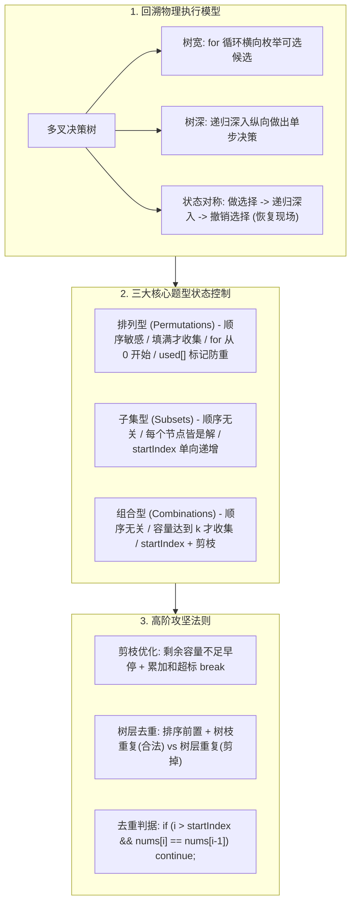
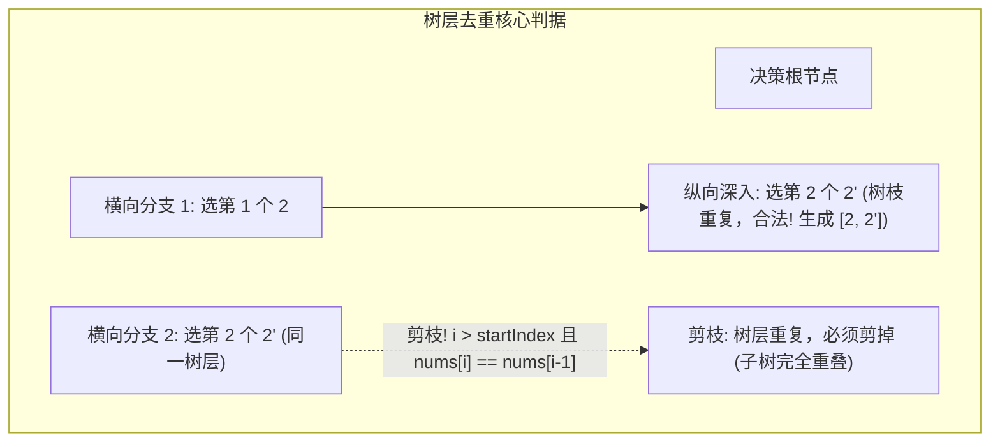

# 08 · 回溯算法：决策树模型、状态回退机制与高频解题范式

> [!abstract] 一句话第一性原理
> **回溯算法（Backtracking）** 的本质是**在隐式多叉决策树上的深度优先搜索（DFS）**。其核心机制是在递归探索分支后，**通过物理对称的状态撤销（恢复现场），将同一个可变状态容器复用于整棵树的所有分支搜索**，以 $O(N)$ 空间穷举指数级解空间。

---

## 知识全景图



---

## 一、 破除玄学：回溯到底是怎么动起来的？

### 1.1 核心动作：为什么成功了也要“撤销选择”？
以三个数字 `1, 2, 3` 的全排列为例：
1. 第一位选 `1` $\to$ 第二位选 `2` $\to$ 第三位选 `3`，得到第一个解 `[1, 2, 3]`；
2. **记录完 `[1, 2, 3]` 之后，如何得到 `[1, 3, 2]`？**
   - 计算机不可能凭空跳跃，为了复用这套位置，必须**原路退回（恢复现场）**：
   - 撤销第 3 位的 `3`（退回为 `[1, 2]`，第 3 位无其他可选）；
   - 撤销第 2 位的 `2`（退回为 `[1]`）；
   - 第 2 位换选下一个候选 `3`（变为 `[1, 3]`）；
   - 第 3 位填入候选 `2`（得到 `[1, 3, 2]`）。

> [!important] 核心认知
> **撤销选择不是“做错了”才退回，而是为了“换一条路继续寻找下一个解”必须执行的物理复位动作！**

---

### 1.2 物理执行真相：递归返回后，代码到底走到哪里？

回溯的核心代码骨架只有三行：
```java
path.add(nums[i]);                 // 1. 做选择
backtrack(nums, path, used, ans);  // 2. 递归深入下一层
path.remove(path.size() - 1);      // 3. 撤销选择 (恢复现场)
```

**初学者最大困惑**：当内层递归触发 `return` 后，程序从哪里继续跑？
- **代码物理执行铁律**：
  1. `return` 结束的仅仅是**当前这一个栈帧**，绝不是退出整个程序；
  2. 上一层栈帧立刻从 **`backtrack(...)` 调用的紧接着下一行接续执行**，也就是立刻执行 `path.remove(...)`；
  3. 随后上一层的 `for` 循环执行 `i++`，继续尝试当前层的下一个候选！各层栈帧的局部变量 `i` 完全隔离，互不干扰。

---

### 1.3 初学者三大高频疑问澄清

| 疑问点 | 物理本质与正确做法 | 错误写法后果 |
| :--- | :--- | :--- |
| **为什么必须 `ans.add(new ArrayList<>(path))`？** | `path` 全局唯一引用。必须做一次**快照浅拷贝**存留。 | 若写成 `ans.add(path)`，最终 `ans` 全是空列表 `[]`。 |
| **为什么撤销是 `path.remove(path.size() - 1)`？** | 刚刚把候选追加入末尾，撤销时必须以 $O(1)$ 移除末尾元素。 | 若写成 `remove(nums[i])` 会被误判为删除下标，引发越界或错删。 |
| **全排列每层都从 `i = 0` 开始，为什么不重复？** | 维护了 `boolean[] used` 数组，已在路径上的数会被 `if (used[i]) continue` 拦截。 | 若没有 `used` 会无限自循环选同一个数。 |

---

## 二、 三大核心题型极简对比（排列 vs 子集 vs 组合）

刷题不需要背十几道模板，掌握以下三种状态控制差异，就攻克了 90% 的基础回溯题：

| 题型维度 | 排列型（LC 46） | 子集型（LC 78） | 组合型（LC 77） |
| :--- | :--- | :--- | :--- |
| **顺序敏感度** | **顺序敏感**（`[1,2]` 与 `[2,1]` 算两个解） | **顺序无关**（`[1,2]` 等价于 `[2,1]`） | **顺序无关** |
| **for 循环起点** | **必须从 0 开始**：每层全量检索未选元素 | **从 `startIndex` 开始**：只许向后选 | **从 `startIndex` 开始**：只许向后选 |
| **防重机制** | 依赖 `boolean[] used` 标记路径占用 | 依赖 `startIndex` 自然消除逆序重复 | 依赖 `startIndex` 自然消除逆序重复 |
| **收集时机** | 达到全长：`if (path.size() == n)` | **每个节点都收集**：进入函数直接 `add` | 达到容量：`if (path.size() == k)` |

### 核心代码片段对比

```java
// 1. 排列型：从 0 开始，依赖 used 数组防重
for (int i = 0; i < nums.length; i++) {
    if (used[i]) continue;
    path.add(nums[i]); used[i] = true;
    backtrack(nums, used, path, ans);
    path.remove(path.size() - 1); used[i] = false;
}

// 2. 子集型：进入即收集，传 i + 1 单向推进
ans.add(new ArrayList<>(path)); // 每一个节点都是合法子集
for (int i = startIndex; i < nums.length; i++) {
    path.add(nums[i]);
    backtrack(nums, i + 1, path, ans);
    path.remove(path.size() - 1);
}

// 3. 组合型：达到 k 收集，配合数量剪枝
if (path.size() == k) { ans.add(new ArrayList<>(path)); return; }
int maxStart = n - (k - path.size()) + 1; // 剩余元素不足 k 个时早停
for (int i = startIndex; i <= maxStart; i++) {
    path.add(i);
    backtrack(n, k, i + 1, path, ans);
    path.remove(path.size() - 1);
}
```

> [!example]- 展开查看：三大基础题型完整题目描述与标准实现
> #### 1. LC 46. 全排列（Permutations）
> - **题目描述**：给定一个不含重复数字的整数数组 `nums`，返回其所有可能的全排列。你可以按任意顺序返回答案。
> - **输入输出示例**：输入 `nums = [1,2,3]` $\to$ 输出 `[[1,2,3],[1,3,2],[2,1,3],[2,3,1],[3,1,2],[3,2,1]]`。
> - **核心考点**：顺序敏感，必须从 0 检索，维护 `used[]` 防止重复选用同一个位置的元素。
> ```java
> class Solution46 {
>     public List<List<Integer>> permute(int[] nums) {
>         List<List<Integer>> ans = new ArrayList<>();
>         boolean[] used = new boolean[nums.length];
>         backtrack(nums, used, new ArrayList<>(), ans);
>         return ans;
>     }
>     private void backtrack(int[] nums, boolean[] used, List<Integer> path, List<List<Integer>> ans) {
>         if (path.size() == nums.length) { 
>             ans.add(new ArrayList<>(path)); // 填满时浅拷贝存入
>             return; 
>         }
>         for (int i = 0; i < nums.length; i++) {
>             if (used[i]) continue;
>             path.add(nums[i]); used[i] = true;
>             backtrack(nums, used, path, ans);
>             path.remove(path.size() - 1); used[i] = false; // 镜像撤销
>         }
>     }
> }
> ```
>
> ---
>
> #### 2. LC 78. 子集（Subsets）
> - **题目描述**：给你一个整数数组 `nums`（元素互不相同）。返回该数组所有可能的子集（幂集），解集不能包含重复的子集。
> - **输入输出示例**：输入 `nums = [1,2,3]` $\to$ 输出 `[[],[1],[2],[1,2],[3],[1,3],[2,3],[1,2,3]]`。
> - **核心考点**：顺序无关，每个树节点本身就是一个合法子集，必须一进函数就立刻收集；递归传 `i + 1` 单向递增消除逆序重复。
> ```java
> class Solution78 {
>     public List<List<Integer>> subsets(int[] nums) {
>         List<List<Integer>> ans = new ArrayList<>();
>         backtrack(nums, 0, new ArrayList<>(), ans);
>         return ans;
>     }
>     private void backtrack(int[] nums, int startIndex, List<Integer> path, List<List<Integer>> ans) {
>         ans.add(new ArrayList<>(path)); // 每一个节点都是合法解，包括空集
>         for (int i = startIndex; i < nums.length; i++) {
>             path.add(nums[i]);
>             backtrack(nums, i + 1, path, ans); // 单向推进，绝不回头
>             path.remove(path.size() - 1);
>         }
>     }
> }
> ```
>
> ---
>
> #### 3. LC 77. 组合（Combinations）
> - **题目描述**：给定两个整数 `n` 和 `k`，返回范围 `[1, n]` 中所有可能的 `k` 个数的组合。你可以按任意顺序返回答案。
> - **输入输出示例**：输入 `n = 4, k = 2` $\to$ 输出 `[[1,2],[1,3],[1,4],[2,3],[2,4],[3,4]]`。
> - **核心考点**：顺序无关且严格限定长度为 $k$。配合剩余可用元素不足时的**数量剪枝**（`i <= n - (k - path.size()) + 1`）。
> ```java
> class Solution77 {
>     public List<List<Integer>> combine(int n, int k) {
>         List<List<Integer>> ans = new ArrayList<>();
>         backtrack(n, k, 1, new ArrayList<>(), ans);
>         return ans;
>     }
>     private void backtrack(int n, int k, int startIndex, List<Integer> path, List<List<Integer>> ans) {
>         if (path.size() == k) { 
>             ans.add(new ArrayList<>(path)); // 达到容量 k 才收集
>             return; 
>         }
>         int maxStart = n - (k - path.size()) + 1; // 数量剪枝
>         for (int i = startIndex; i <= maxStart; i++) {
>             path.add(i);
>             backtrack(n, k, i + 1, path, ans);
>             path.remove(path.size() - 1);
>         }
>     }
> }
> ```

---

## 三、 高阶攻坚：剪枝优化与树层去重

### 3.1 剪枝的两大通用法则
1. **数量剪枝**：如组合问题，剩余可选数不足以填满目标长度时提前终止循环；
2. **累加和剪枝（超标早停）**：正数数组升序排序后，若 `sum + nums[i] > target`，后续必定更大，直接 **`break` 终止整层循环**。

---

### 3.2 终极难点：含重复元素时的“树层去重”

当输入数组**本身含有重复数值**时（如 `nums = [1, 2, 2']`）：



- **树枝重复（合法）**：纵向一条路径先后选两个 `2`，构成 `[2, 2']`，属于合法组合；
- **树层重复（必须剪掉）**：横向同层循环中，分支 1 已经把“以第一个 2 为起点”的所有子集搜完了；紧接着分支 2 又试图以“第二个 2' 为起点”重新搜一遍，必然导致完全相同的重复解！

#### 去重金标准判据：
1. **前置条件**：必须先排序 `Arrays.sort(nums)`，让相同元素相邻；
2. **组合/子集去重判据**：
   ```java
   if (i > startIndex && nums[i] == nums[i - 1]) continue;
   ```
   - `i == startIndex` 是当前层尝试的第 1 个数，允许执行；
   - `i > startIndex` 说明当前层前一个相同的数已处理并回退了，此时再选相同的数就是重复劳动，必须跳过！
3. **排列去重判据**：
   ```java
   if (i > 0 && nums[i] == nums[i - 1] && !used[i - 1]) continue;
   ```
   - `!used[i - 1]` 说明前一个同值元素在同一树层刚被撤销为 `false`，当前属于横向重复。

---

### 3.3 经典母题手撕：LC 40. 组合总和 II（累加和剪枝 + 树层去重）

> **题目描述**：给定数组 `candidates`（含重复元素）和目标数 `target`，找出所有使数字和为 `target` 的组合。每个数字每个组合限用一次，解集不能重复。
> **输入输出示例**：`candidates = [10,1,2,7,6,1,5], target = 8` $\to$ `[[1,1,6],[1,2,5],[1,7],[2,6]]`。

```java
class Solution40 {
    public List<List<Integer>> combinationSum2(int[] candidates, int target) {
        List<List<Integer>> ans = new ArrayList<>();
        if (candidates == null || candidates.length == 0) return ans;

        Arrays.sort(candidates); // 排序为剪枝与去重前提
        backtrack(candidates, target, 0, 0, new ArrayList<>(), ans);
        return ans;
    }

    private void backtrack(int[] nums, int target, int startIndex, int sum,
                          List<Integer> path, List<List<Integer>> ans) {
        if (sum == target) {
            ans.add(new ArrayList<>(path));
            return;
        }

        for (int i = startIndex; i < nums.length; i++) {
            // 剪枝 1：累加和超标早停 (数组升序，后续必定更大，直接 break 砍掉整层)
            if (sum + nums[i] > target) break;

            // 剪枝 2：树层去重 (同一层跳过相同数值)
            if (i > startIndex && nums[i] == nums[i - 1]) continue;

            path.add(nums[i]);
            backtrack(nums, target, i + 1, sum + nums[i], path, ans);
            path.remove(path.size() - 1); // 撤销现场
        }
    }
}
```

---

## 四、 常见避坑清单与时间复杂度判定

1. **结果集引用污染**：严禁 `ans.add(path)`，必须快照浅拷贝 `ans.add(new ArrayList<>(path))`。
2. **状态撤销物理对称**：严禁在 `for` 循环内部做选择后提前 `return`，否则后续状态未恢复将永久污染整个决策树。
3. **复杂度数学估算模型**：
   - 子集型：$O(N \cdot 2^N)$，额外空间 $O(N)$；
   - 组合型：$O(K \cdot C_N^K)$，额外空间 $O(K)$；
   - 全排列型：$O(N \cdot N!)$，额外空间 $O(N)$。

---

## 五、 核心机制自测清单（闭卷速查）

> [!question]- Q1：在递归回溯中，最深层调用执行 return 后，上一层程序从哪里继续跑？
> **答案**：立刻回到调用它的那一行 `backtrack(...)` 紧接着下一行，执行 `path.remove(...)` 完成现场复位；随后当前层的 `for` 执行 `i++` 尝试下一个候选。

> [!question]- Q2：为什么全排列必须用 used 数组，而子集和组合只需要 startIndex？
> **答案**：排列顺序敏感，`[1,2]` 与 `[2,1]` 都是合法答案，必须从 0 开始扫，所以需要 `used` 防止重复选同一位置；子集和组合顺序无关，`startIndex` 强制规定只向后选，天生消除逆序重复，因此不再需要 `used`。

> [!question]- Q3：树层去重为什么条件是 `i > startIndex` 而不是 `i > 0`？
> **答案**：`i == startIndex` 是当前层尝试的第一个元素，必须允许它向下展开（否则无法生成 `[1, 1]` 这样的合法树枝重复）；只有当 `i > startIndex` 时，才表示同一层的前一个相同候选已经处理完毕，当前是横向重复，必须跳过。
