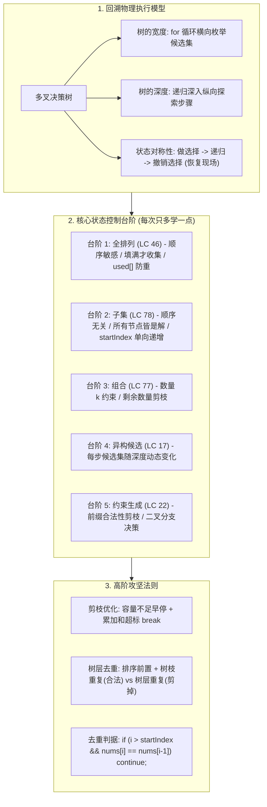
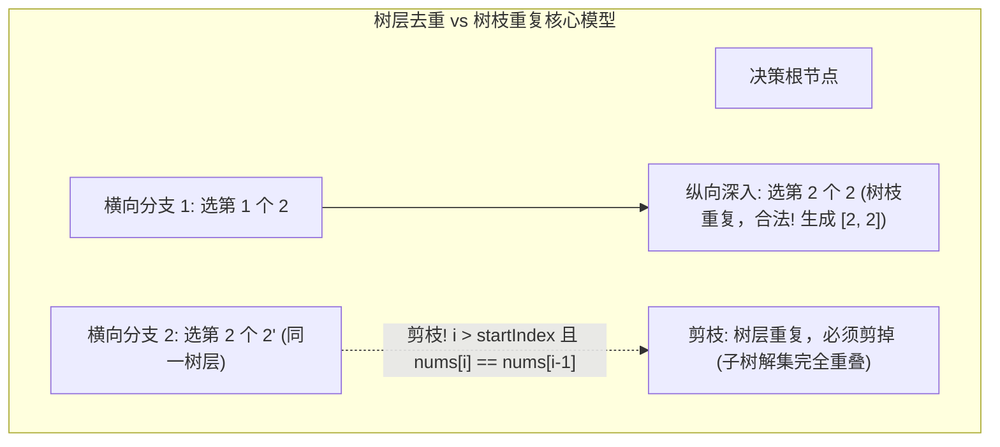

# 08 · 回溯算法：决策树模型、状态回退机制与高频解题范式

> [!abstract] 一句话第一性原理
> **回溯算法（Backtracking）** 的本质不是盲目尝试的黑盒魔法，而是**在隐式多叉决策树上的深度优先搜索（DFS）**。其核心机制是在递归探索分支后，**通过物理对称的状态撤销（恢复现场），将同一个可变状态容器复用于整棵树的所有分支搜索**，从而以极低的空间开销穷举所有可能解。

---

## 知识全景图



---

## 一、 破除玄学：回溯算法的底层物理模型（从全排列透视执行本质）

### 1.1 问题具象化：为什么必须“尝试与回退”？
以最基础的排列问题为例：给定三个数字 `1, 2, 3`，要求列出所有排列（共 6 种）：
`[1,2,3], [1,3,2], [2,1,3], [2,3,1], [3,1,2], [3,2,1]`

在计算机执行过程中，程序只能按部就班地做出单步决策：
1. **第 1 层决策**：在第 1 个位置选 `1`；
2. **第 2 层决策**：在第 2 个位置选 `2`；
3. **第 3 层决策**：在第 3 个位置选 `3`。
此时填满了三个位置，成功记录第一个解 `[1, 2, 3]`。

**关键提问：记录下 `[1, 2, 3]` 之后，程序如何得到 `[1, 3, 2]`？**
- 计算机**绝不可能直接从 `[1, 2, 3]` 瞬移到 `[1, 3, 2]`**。
- 为了探索以 `[1]` 为前缀的其他可能性，必须把最后一步做出的选择**主动撤销（物理复位）**：
  1. 撤销第 3 位的 `3` $\to$ 路径退回为 `[1, 2]`。此时第 3 位没有其他候选元素可用；
  2. 进一步撤销第 2 位的 `2` $\to$ 路径退回为 `[1]`；
  3. 此时第 2 位换选下一个候选 `3` $\to$ 路径变为 `[1, 3]`；
  4. 随后第 3 位填入仅剩的候选 `2` $\to$ 路径变为 `[1, 3, 2]`，成功收集第二个解！

> [!important] 核心认知
> **撤销选择不是“出错了”才做的事，而是为了“换一条路继续寻找下一个解”必须执行的物理复位动作！**

---

### 1.2 回溯代码执行的物理真相（90% 初学者最大的卡点）
在 Java 中，回溯的核心骨架呈现出高度的镜像对称：
```java
path.add(nums[i]);                 // 1. 做选择 (变更当前状态)
backtrack(nums, path, used, ans);  // 2. 递归深入 (进入下一层栈帧)
path.remove(path.size() - 1);      // 3. 撤销选择 (恢复现场)
```

**初学者的最大困惑**：当递归深入到最深层并执行 `return` 后，程序到底回到了哪里？从哪一行接续执行？

#### 栈帧回溯的时序还原表（以 `[1,2,3] -> [1,3,2]` 为例）
| 步骤 | 调用栈层级 | 当前循环状态 | 执行动作 | `path` 容器内容 | 说明 |
| :---: | :--- | :--- | :--- | :--- | :--- |
| 1 | 栈帧 1（第 1 位） | `i = 0`（选 `1`） | `path.add(1)`，进入栈帧 2 | `[1]` | 栈帧 1 在 `backtrack` 处暂停挂起 |
| 2 | 栈帧 2（第 2 位） | `i = 1`（选 `2`） | `path.add(2)`，进入栈帧 3 | `[1, 2]` | 栈帧 2 在 `backtrack` 处暂停挂起 |
| 3 | 栈帧 3（第 3 位） | `i = 2`（选 `3`） | `path.add(3)`，进入栈帧 4 | `[1, 2, 3]` | 栈帧 3 在 `backtrack` 处暂停挂起 |
| 4 | 栈帧 4（终止判定）| 达到长度 3 | `ans.add(new ArrayList<>(path))`，触发 `return` | `[1, 2, 3]` | **栈帧 4 销毁，程序返回栈帧 3** |
| 5 | **栈帧 3 唤醒** | **仍在 `i = 2`** | **从 `backtrack` 下一行继续执行**：`path.remove(2)` | `[1, 2]` | 撤销 `3`，栈帧 3 的 `for` 循环结束并隐式返回 |
| 6 | **栈帧 2 唤醒** | **仍在 `i = 1`** | **从 `backtrack` 下一行继续执行**：`path.remove(1)` | `[1]` | 撤销 `2`，准备执行栈帧 2 的下一轮循环 |
| 7 | 栈帧 2 继续循环 | `i++` 变为 `2`（选 `3`） | `path.add(3)`，再次进入栈帧 3 | `[1, 3]` | 换路成功！栈帧 2 选择了新的分支 |
| 8 | 栈帧 3（第 3 位） | `i = 1`（选 `2`） | `path.add(2)`，进入栈帧 4 | `[1, 3, 2]` | 栈帧 4 收集新解 `[1, 3, 2]` 并返回 |

**代码物理执行铁律**：
- `return` 结束的仅仅是**当前这一个栈帧的生命周期**，绝不是退出整个方法；
- 调用返回后，上一层栈帧立刻从 **`backtrack(...)` 调用的紧接着下一行接续执行**；
- 每一个栈帧都有自己独立的局部变量 `i`，下一层循环无论从几开始，都**绝对不会干扰上一层循环的 `i` 值**！

---

### 1.3 初学者高频疑问深度澄清

#### 疑问 1：为什么必须写 `ans.add(new ArrayList<>(path))`，而不能直接 `ans.add(path)`？
- **本质**：在 Java 中，`path` 是在整个递归过程中全局复用的同一个对象引用（内存地址唯一）。
- 若写成 `ans.add(path)`，添加到结果集中的只是该对象的引用。后续回溯撤销元素时，`ans` 内部引用的那个列表也会被同步修改！最终整个回溯结束时，`path` 被清空为空列表，导致 `ans` 里保存的全部是空列表 `[]`。
- `new ArrayList<>(path)` 执行了一次**快照浅拷贝**，开辟新内存空间把此刻 `path` 中的元素复制存留，后续对 `path` 的修改绝不影响已保存的快照。

#### 疑问 2：为什么撤销操作是 `path.remove(path.size() - 1)`？
- 因为当前选择是刚刚追加在列表末尾的（`path.add(candidate)`），因此撤销时也必须精准移除列表末尾的元素。
- 注意：Java 中 `List<Integer>` 提供了 `remove(int index)` 和 `remove(Object o)` 两种重载。若误写成 `remove(nums[i])`，Java 会优先将其识别为删除“下标为 `nums[i]` 的元素”，导致抛出 `IndexOutOfBoundsException` 或误删元素。直接传末尾索引 `path.size() - 1` 是最安全、效率最高（$O(1)$）的操作。

#### 疑问 3：在全排列中，每一层 `for` 循环都从 `i = 0` 开始，为什么不会重复选同一个数？
- 因为维护了辅助数组 `boolean[] used`。
- 循环从 `0` 开始是为了“无论当前是第几位，都要全量检索未使用的候选元素”；但一旦发现 `used[i] == true`（说明当前数字已经在当前路径上了），就会直接 `continue` 跳过，因此绝不会重复选中同一个位置的元素。

---

## 二、 回溯算法标准实现骨架与状态控制范式

回溯算法的代码结构有着高度统一的数学对称美感，其标准框架如下：

```java
public void backtrack(参数列表, int startIndex, List<Integer> path, boolean[] used, List<List<Integer>> ans) {
    // 1. 基线条件 (Base Case)：达到终止条件时收集结果并返回
    if (终止条件) {
        ans.add(new ArrayList<>(path)); // 快照浅拷贝
        return;
    }

    // 2. 横向遍历决策树当前层的可选候选集
    for (int i = startIndex; i < nums.length; i++) {
        // 剪枝判断：若当前候选无法产生合法解，提前跳过或早停
        if (剪枝条件) {
            continue; // 或 break
        }

        // 3. 做选择 (变更当前状态)
        path.add(nums[i]);
        used[i] = true;

        // 4. 递归深入 (进入下一层决策树)
        backtrack(nums, nextStartIndex, path, used, ans);

        // 5. 撤销选择 (严格镜像对称，恢复现场)
        path.remove(path.size() - 1);
        used[i] = false;
    }
}
```

---

## 三、 核心题型进阶阶梯：五大经典场景（每次只多学一点）

掌握回溯不需要死记硬背十几道题，掌握以下 5 个递进台阶，就能系统覆盖绝大部分面试题型：

### 台阶 1：LC 46. 全排列（顺序敏感，填满才收集）
- **核心机制**：
  - 顺序不同算不同解：`[1, 2, 3]` 与 `[2, 1, 3]` 是不同排列。
  - **状态控制**：严禁使用 `startIndex`！每一层都从 `i = 0` 开始扫描全数组；必须使用 `boolean[] used` 数组记录当前路径已占用的下标。
  - **收集时机**：当 `path.size() == nums.length` 填满时才触发收集并 `return`。

```java
class Solution46 {
    public List<List<Integer>> permute(int[] nums) {
        List<List<Integer>> ans = new ArrayList<>();
        if (nums == null || nums.length == 0) return ans;
        boolean[] used = new boolean[nums.length];
        backtrack(nums, used, new ArrayList<>(), ans);
        return ans;
    }

    private void backtrack(int[] nums, boolean[] used, List<Integer> path, List<List<Integer>> ans) {
        // 终止条件：路径长度填满所有元素
        if (path.size() == nums.length) {
            ans.add(new ArrayList<>(path));
            return;
        }

        for (int i = 0; i < nums.length; i++) {
            if (used[i]) continue; // 已在路径上的元素不可复选

            path.add(nums[i]);
            used[i] = true;

            backtrack(nums, used, path, ans);

            path.remove(path.size() - 1); // 撤销现场
            used[i] = false;
        }
    }
}
```

---

### 台阶 2：LC 78. 子集（顺序无关，所有节点皆是解）
- **相比排列多学的一点**：
  1. **收集时机变了**：子集中，`[]`、`[1]`、`[1, 2]` 每一个前缀本身都是合法答案！因此**一进入函数就立刻收集答案**，不需要任何 `if` 拦截。
  2. **顺序无关防重机制**：选了 `[1, 2]` 后绝不能再产生 `[2, 1]`。通过引入 `startIndex` 指针，强制规定“下一层只能从当前元素后面的位置选”，自然杜绝顺序重复，且不再需要 `used` 数组。

```java
class Solution78 {
    public List<List<Integer>> subsets(int[] nums) {
        List<List<Integer>> ans = new ArrayList<>();
        if (nums == null) return ans;
        backtrack(nums, 0, new ArrayList<>(), ans);
        return ans;
    }

    private void backtrack(int[] nums, int startIndex, List<Integer> path, List<List<Integer>> ans) {
        // 关键：每一个树节点都是一个合法子集，直接收集（包括空集）
        ans.add(new ArrayList<>(path));

        for (int i = startIndex; i < nums.length; i++) {
            path.add(nums[i]);
            backtrack(nums, i + 1, path, ans); // 递归传 i + 1，单向后移
            path.remove(path.size() - 1);
        }
    }
}
```

---

### 台阶 3：LC 77. 组合（在子集基础上增加固定容量 $k$ 约束）
- **相比子集多学的一点**：
  - 从子集的“所有长度都要”退化为“只要长度恰好为 $k$ 的解”。
  - 收集时机：只有当 `path.size() == k` 时才收集并 `return`。
  - **数量剪枝（极致提速）**：如果当前已选了 `path.size()` 个，还需 `k - path.size()` 个。如果数组剩余未遍历元素根本不够凑满 $k$ 个，直接停止循环：
    $$\text{循环上界：} i \le n - (k - path.size()) + 1$$

```java
class Solution77 {
    public List<List<Integer>> combine(int n, int k) {
        List<List<Integer>> ans = new ArrayList<>();
        if (n <= 0 || k <= 0 || k > n) return ans;
        backtrack(n, k, 1, new ArrayList<>(), ans);
        return ans;
    }

    private void backtrack(int n, int k, int startIndex, List<Integer> path, List<List<Integer>> ans) {
        if (path.size() == k) {
            ans.add(new ArrayList<>(path));
            return;
        }

        // 剪枝优化：限制 i 的上界，剩余元素不足以凑满 k 个时不再穷举
        int maxStart = n - (k - path.size()) + 1;
        for (int i = startIndex; i <= maxStart; i++) {
            path.add(i);
            backtrack(n, k, i + 1, path, ans);
            path.remove(path.size() - 1);
        }
    }
}
```

---

### 台阶 4：LC 17. 电话号码的字母组合（候选集随递归深度而变）
- **相比组合多学的一点**：
  - 每一步选择的候选集不再是同一个数组，而是由当前深度 `index` 所映射的按键字符串决定（例如第 0 步选 `'2'` 对应的 `"abc"`，第 1 步选 `'3'` 对应的 `"def"`）。
  - 用 `StringBuilder` 充当路径容器，添加 `append(c)` 与撤销 `deleteCharAt(len - 1)` 对称对应。

```java
class Solution17 {
    private static final String[] MAP = {
        "", "", "abc", "def", "ghi", "jkl", "mno", "pqrs", "tuv", "wxyz"
    };

    public List<String> letterCombinations(String digits) {
        List<String> ans = new ArrayList<>();
        if (digits == null || digits.length() == 0) return ans;
        backtrack(digits, 0, new StringBuilder(), ans);
        return ans;
    }

    private void backtrack(String digits, int index, StringBuilder path, List<String> ans) {
        if (index == digits.length()) {
            ans.add(path.toString());
            return;
        }

        String letters = MAP[digits.charAt(index) - '0'];
        for (int i = 0; i < letters.length(); i++) {
            path.append(letters.charAt(i));
            backtrack(digits, index + 1, path, ans);
            path.deleteCharAt(path.length() - 1); // 撤销字符
        }
    }
}
```

---

### 台阶 5：LC 22. 括号生成（前缀合法性动态约束，二叉分支决策）
- **相比前面多学的一点**：
  - 这里没有明显的 `for` 循环，因为每一步只有两个明确的决策分支：**放左括号** 或 **放右括号**。
  - **动态剪枝约束**：
    1. 只要左括号数量未达到上限（`open < n`），就能放左括号；
    2. 必须当前已放置的右括号少于左括号（`close < open`），才能放右括号，否则必然出现无法配对的前缀 `")"`。

```java
class Solution22 {
    public List<String> generateParenthesis(int n) {
        List<String> ans = new ArrayList<>();
        if (n <= 0) return ans;
        backtrack(n, 0, 0, new StringBuilder(), ans);
        return ans;
    }

    private void backtrack(int n, int open, int close, StringBuilder path, List<String> ans) {
        if (open == n && close == n) {
            ans.add(path.toString());
            return;
        }

        // 分支 1: 放左括号
        if (open < n) {
            path.append('(');
            backtrack(n, open + 1, close, path, ans);
            path.deleteCharAt(path.length() - 1);
        }

        // 分支 2: 放右括号 (必须保证前缀合法)
        if (close < open) {
            path.append(')');
            backtrack(n, open, close + 1, path, ans);
            path.deleteCharAt(path.length() - 1);
        }
    }
}
```

---

### 核心台阶状态对比矩阵
| 题目 | 答案收集时机 | 候选集来源与控制 | 防重/约束手段 |
| :--- | :--- | :--- | :--- |
| **46. 全排列** | 路径填满 `nums.length` | 全数组遍历，`i` 每次从 0 开始 | `boolean[] used` 标记当前路径元素 |
| **78. 子集** | **每个节点都收集** | 全数组遍历，`i` 从 `startIndex` 开始 | 递归传 `i + 1`，单向推进 |
| **77. 组合** | 路径长度达到 $k$ | 全数组遍历，`i` 从 `startIndex` 开始 | 递归传 `i + 1` + 剩余数量上限剪枝 |
| **17. 电话号码** | 深度达到输入长度 | 当前按键映射的字符集 | 递归传 `index + 1` 深入下一个按键 |
| **22. 括号生成** | 左右括号各放满 $n$ 个 | 只有 `'('` 和 `')'` 两个分支 | `open < n` 与 `close < open` 动态前缀约束 |

---

## 四、 进阶攻坚：剪枝优化与树层去重（最高难度关卡）

### 4.1 剪枝的两大通用法则
1. **剩余数量剪枝**：如 LC 77 所示，剩余候选数不足以填满目标长度时直接早停。
2. **累加和剪枝（超标早停）**：
   - 前提：数组元素全为正数。
   - 策略：先将原数组**升序排序**。当 `currentSum + nums[i] > target` 时，由于数组非递减，后续元素必定更大更超标，直接 **`break` 终止整层 `for` 循环**！

---

### 4.2 终极难点：含重复元素时的“树层去重”
当输入数组**本身含有重复数值**时（如 `nums = [1, 2, 2']`），直接回溯会生成重复解集。
如何保证结果集不重复？必须区分**树枝重复**与**树层重复**！



- **树枝重复（合法）**：在同一条向下深入的路径上，先选第 1 个 `2`，再选第 2 个 `2'`，得到 `[2, 2']`，这是合法的解。
- **树层重复（非法）**：在同一个 `for` 循环中，分支 1 已经把“以第一个 2 为起点”的所有可能性全部穷举完了；如果同一层的后一个循环又以“第二个 2' 为起点”重新搜一遍，必然生成完全相同的重复解！

#### 去重金标准判据：
1. **必须先排序**：`Arrays.sort(nums)`，让相同的数值聚集相邻；
2. **组合/子集去重判据**：
   ```java
   if (i > startIndex && nums[i] == nums[i - 1]) {
       continue; // 同一层跳过相同数值
   }
   ```
   - **原理解析**：当 `i == startIndex` 时，是当前层尝试的第一个元素，必须允许执行；只有当 `i > startIndex` 时，说明当前层前面的 `nums[i - 1]` 已经完整遍历并回退了，此时再选相同的 `nums[i]` 就是毫无意义的树层重复！
3. **排列去重判据**：
   ```java
   if (i > 0 && nums[i] == nums[i - 1] && !used[i - 1]) {
       continue;
   }
   ```
   - `!used[i - 1]` 说明 `nums[i - 1]` 在同层的左侧兄弟分支中刚被使用过并已被回溯撤销，当前属于同一树层横向重复，必须跳过！

---

### 4.3 经典母题手撕：LC 40. 组合总和 II（带重元素 + 累加和剪枝 + 树层去重）

> **题目描述**：
> 给定一个候选人编号的集合 `candidates` 和一个目标数 `target` ，找出 `candidates` 中所有可以使数字和为 `target` 的组合。
> `candidates` 中的每个数字在每个组合中只能使用 **一次** 。解集不能包含重复的组合。
>
> **输入输出示例**：
> - 输入：`candidates = [10,1,2,7,6,1,5], target = 8`
> - 输出：`[[1,1,6],[1,2,5],[1,7],[2,6]]`
> - 解释：排序后为 `[1, 1', 2, 5, 6, 7, 10]`。解集中允许 `[1, 1', 6]`（树枝重复，合法），但不能产生两份 `[1, 7]`（树层重复，剪枝）。

```java
class Solution40 {
    public List<List<Integer>> combinationSum2(int[] candidates, int target) {
        List<List<Integer>> ans = new ArrayList<>();
        if (candidates == null || candidates.length == 0) return ans;

        // 1. 排序：累加和早停剪枝与树层去重的前提
        Arrays.sort(candidates);

        backtrack(candidates, target, 0, 0, new ArrayList<>(), ans);
        return ans;
    }

    private void backtrack(int[] nums, int target, int startIndex, int sum,
                          List<Integer> path, List<List<Integer>> ans) {
        if (sum == target) {
            ans.add(new ArrayList<>(path));
            return;
        }

        for (int i = startIndex; i < nums.length; i++) {
            // 剪枝 1：累加和超标早停 (数组升序，后续必定更大，直接 break 砍掉整层)
            if (sum + nums[i] > target) {
                break;
            }

            // 剪枝 2：树层去重 (同一层跳过相同数值)
            if (i > startIndex && nums[i] == nums[i - 1]) {
                continue;
            }

            path.add(nums[i]);
            backtrack(nums, target, i + 1, sum + nums[i], path, ans); // i + 1 防止单元素复用
            path.remove(path.size() - 1); // 撤销现场
        }
    }
}
```

---

## 五、 典型算法应用速览与题目线索识别

### 从题目描述线索秒判回溯模型
1. **“所有排列 / 顺序不同算不同解 / 输入无重”** $\to$ **LC 46 全排列**（`for` 从 0 开始 + `used[]` 标记）
2. **“所有排列 / 输入有重复值 / 解集不能重复”** $\to$ **LC 47 全排列 II**（排序 + `used[]` + `!used[i-1]` 树层去重）
3. **“所有子集 / 幂集 / 顺序无关”** $\to$ **LC 78 子集**（每个节点直接收集 + `startIndex` 单向推进）
4. **“所有子集 / 输入有重 / 解集不能重复”** $\to$ **LC 90 子集 II**（排序 + 每个节点直接收集 + `i > startIndex && nums[i] == nums[i-1]` 树层去重）
5. **“恰好选 k 个 / 组合总和 / 每个数只能用一次”** $\to$ **LC 77 组合 / LC 40 组合总和 II**（`startIndex` + 数量/累加和剪枝 + 树层去重）
6. **“棋盘摆放 / 互不攻击”** $\to$ **LC 51 N 皇后**（按行枚举 + 列/主副对角线布尔数组快速 $O(1)$ 冲突校验）

---

## 六、 避坑清单与时间复杂度判定

1. **快照浅拷贝防坑**：
   - 严禁 `ans.add(path)`，必须 `ans.add(new ArrayList<>(path))`。
2. **状态撤销物理对称**：
   - 严禁在 `for` 循环内部做选择后提前 `return`，否则后续状态未恢复将永久污染整个决策树。
3. **回溯算法时间复杂度统一数学模型**：
   - **子集型**：$O(N \cdot 2^N)$。共 $2^N$ 个子集，每个子集拷贝耗时 $O(N)$。
   - **组合型**：$O(K \cdot C_N^K)$。共 $C_N^K$ 个叶子，每个解拷贝耗时 $O(K)$。
   - **全排列型**：$O(N \cdot N!)$。共 $N!$ 种叶子排列，每个解拷贝耗时 $O(N)$。
   - **空间复杂度**：额外辅助空间取决于**递归调用栈深度与临时容器**，通常为 $O(N)$（不计用于存放答案的全局 `ans` 空间）。

---

## 七、 核心机制自测清单（过关检测）

在进入下一章节前，请闭卷回答以下 4 个问题检验心智模型是否建立：

> [!question]- Q1：在全排列递归中，最深层调用执行 return 后，上一层程序从哪里继续跑？
> **答案**：立刻回到调用它的那一行 `backtrack(...)` 之后，接续执行 `path.remove(path.size() - 1)` 和 `used[i] = false`，完成状态恢复；随后当前层的 `for` 循环执行 `i++` 继续尝试下一个候选。

> [!question]- Q2：已经找到了完整的 [1, 2, 3]，为什么代码还要执行撤销操作？
> **答案**：因为全局只复用同一个 `path` 容器。如果不撤销，容器一直处于被占满状态，无法复用它去探索 `[1, 3, 2]`、`[2, 1, 3]` 等其他可能的分支。撤销是为了“复位现场以换另一条路探索”。

> [!question]- Q3：为什么 ans.add(path) 最终会导致结果集里全都是空列表 []？
> **答案**：因为 `path` 是对象引用。如果不执行拷贝，`ans` 存储的所有元素都指向同一个内存地址。当全树遍历完毕最终回溯到底时，`path` 会被清空为 `[]`，导致此前保存的所有引用全部呈现为空列表。

> [!question]- Q4：写了递归调用，就代表使用了回溯算法吗？
> **答案**：不等于。递归只是一种“函数调用自身”的代码控制流；而回溯是一种“在决策树上做出选择、深入探索、并在返回时撤销选择（恢复现场）以复用状态”的系统性搜索算法范式。例如递归求斐波那契或单链表反转，并不包含分支选择与撤销恢复，因而不属于回溯。
