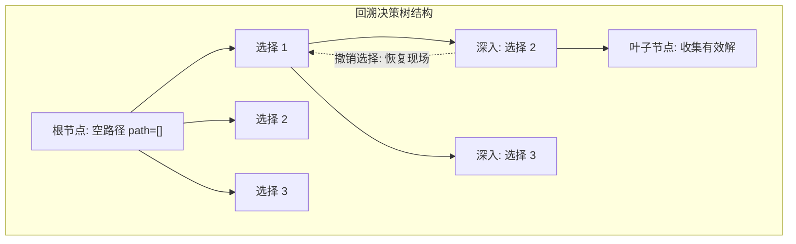
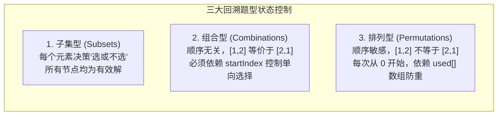

# 回溯算法与剪枝

> **第一性原理**：
> 回溯（Backtracking）的本质是**在隐式树形决策空间上的 DFS 遍历与状态恢复**。
> 回溯面对的问题通常是穷举组合爆炸问题（解空间为指数级或阶乘级）。它通过系统性地尝试每一种候选路径，在发现当前分支无法导向有效解时，**主动撤销最后一步选择（恢复现场）**并退回上一决策点，换另一条路继续探索。

---

## 1. 回溯树形模型与核心三步曲

回溯算法的全部逻辑可以完全映射为一颗**多叉决策树**：
- **树的宽度**：由当前层做决策时可选候选集的 `for` 循环宽度决定；
- **树的深度**：由递归调用栈的深度决定（通常对应决策步骤总数）。



### 回溯代码骨架三步曲
```java
// 核心范式：选择 -> 递归深入 -> 撤销选择 (绝对镜像对称)
path.add(candidate);                 // 1. 做选择 (改变状态)
backtrack(nums, nextIndex, path);    // 2. 深入下一层决策
path.remove(path.size() - 1);        // 3. 撤销选择 (恢复现场)
```

---

## 2. 三大核心题型标准框架剖析

回溯问题 90% 以上归结为以下三大经典题型，其状态控制机制有着严格的判定界限：



### 2.1 模型一：子集型问题（Subsets）
- **特点**：寻找集合的所有可能子集（规模为 $2^n$）。树上的**每一个节点都是合法解**，而不仅仅是叶子节点。
- **两种设计范式**：
  1. **横向遍历多叉树（推荐）**：在进入函数时立即 `ans.add(new ArrayList<>(path))`，然后使用 `for (int i = startIndex; i < n; i++)` 遍历。
  2. **选与不选二叉树**：每个元素分出两条二叉树分支——左分支“选当前元素并递归”，右分支“不选当前元素并递归”，递归到数组末尾叶子时收集结果。

### 2.2 模型二：组合型问题（Combinations）
- **特点**：从 $n$ 个元素中选出 $k$ 个，或选取若干元素和为 `target`。元素相对顺序无关。
- **状态控制**：必须传入 `startIndex`。下一层递归时传入 `i + 1`（每个元素只能用一次）或 `i`（元素可无限次重复使用）。
- **两大剪枝杀招**：
  1. **剩余元素数量剪枝**：当需要 $k$ 个元素，当前已有 `path.size()` 个，还需 `k - path.size()` 个。如果剩余未遍历元素数量不足，直接早停：
     $$\text{循环上界：} i \le n - (k - path.size()) + 1$$
  2. **累加和剪枝**：将原数组升序排序后，若当前元素加上已有和已超标 `pathSum + nums[i] > target`，直接 `break`（当前分支及其后续所有更大的分支一并砍掉）。

### 2.3 模型三：排列型问题（Permutations）
- **特点**：顺序敏感，$[1, 2]$ 与 $[2, 1]$ 属于不同排列。
- **状态控制**：**严禁使用 `startIndex`**。每一层选择都必须从下标 `0` 开始扫描全数组，但必须维护 `boolean[] used` 数组标记当前路径上已被占用的下标。

---

## 3. 回溯最高难度关卡：树层去重（Tree-Level Deduplication）

当输入数组中**含有重复元素**时（如 `[1, 2, 2']`），朴素回溯会导致解集中出现重复。必须做去重剪枝。

```mermaid
flowchart TD
    subgraph DeDup["树层去重 vs 树枝重复"]
        Root["决策根节点"]
        B1["分支 1: 选第 1 个 2"]
        B2["分支 2: 选第 2 个 2' (同一树层)"]
        B1 --> S1["深入下一层: 选第 2 个 2' (树枝重复，合法!)"]
        B2 -.->|剪枝! i > startIndex 且 nums[i] == nums[i-1]| Cut["剪掉该分支! 避免产生完全相同的解集"]
    end
```

### 3.1 去重铁律与前提
- **前置条件**：**必须先对原数组排序 `Arrays.sort(nums)`！** 只有排序后，相同数值的元素才会聚集相邻。

### 3.2 区分“树枝重复”与“树层重复”
- **树枝重复（同一调用链向下）**：在一条从根到叶的路径上，先选了第 1 个 `2`，下一步又选了第 2 个 `2'`。这属于选不同位置的同值元素，构成的 `[2, 2']` 是**合法**的。
- **树层重复（同一分岔口横向）**：在同一个 `for` 循环中，分支 A 已经尝试过以第 1 个 `2` 为起点的所有组合；紧接着分支 B 又试图以第 2 个 `2'` 为起点发起探索。由于后续可选集合完全一样，分支 B 必然生成分支 A 的全量子集，属于**完全重复劳动**，必须剪掉！

### 3.3 经典去重判据代码解析
1. **组合/子集去重判据**：
   ```java
   if (i > startIndex && nums[i] == nums[i - 1]) {
       continue; // 跳过同一树层中的重复数值
   }
   ```
   - **推导**：当 `i == startIndex` 时，是当前层尝试的第一个元素，必须允许执行；只有当 `i > startIndex` 时，说明当前层前一个相同的数已经被完整遍历并回退了，此时再选相等的 `nums[i]` 就是树层重复！
2. **排列去重判据**：
   ```java
   if (i > 0 && nums[i] == nums[i - 1] && !used[i - 1]) {
       continue; // !used[i - 1] 说明 nums[i - 1] 在当前树层刚才被使用过并已撤销
   }
   ```
   - **为什么是 `!used[i - 1]`**：
     - 若 `used[i - 1] == true`，说明 `nums[i - 1]` 位于当前分支的父节点（正处在同一树枝深度探索中），合法；
     - 若 `used[i - 1] == false`，说明 `nums[i - 1]` 在同一层的左侧兄弟分支中刚被选过且已经回溯撤销为 `false`，当前正在同一树层横向遍历，必须立刻跳过！

---

## 4. 经典母题手撕：LeetCode 40. 组合总和 II（带重元素 + 树层剪枝）

> **题目描述**：
> 给定一个候选人编号的集合 `candidates` 和一个目标数 `target` ，找出 `candidates` 中所有可以使数字和为 `target` 的组合。
> `candidates` 中的每个数字在每个组合中只能使用 **一次** 。
> 解集不能包含重复的组合。
>
> **输入输出示例**：
> - 示例 1：
>   - 输入：`candidates = [10,1,2,7,6,1,5], target = 8`
>   - 输出：`[[1,1,6],[1,2,5],[1,7],[2,6]]`
>   - 解释：排序后为 `[1, 1, 2, 5, 6, 7, 10]`。解集中可以包含两个 `1`（`[1, 1, 6]`，树枝重复合法），但不能产生两份 `[1, 7]`（树层重复必须剪枝）。
> - 示例 2：
>   - 输入：`candidates = [2,5,2,1,2], target = 5`
>   - 输出：`[[1,2,2],[5]]`

### 4.1 算法模型与剪枝双法则
- **搜索树结构**：利用 `startIndex` 推进单向选择，防止生成 `[2, 6]` 和 `[6, 2]` 这类不同顺序的重复组合。
- **剪枝法则 1（累加和超标早停）**：必须先对原数组升序排序。当 `currentSum + nums[i] > target` 时，由于数组非递减，后续所有的数更大，必定全部超标，直接 `break` 终止当前层的循环！
- **剪枝法则 2（树层去重）**：同一层横向 `for` 循环中，若 `i > startIndex && nums[i] == nums[i - 1]`，说明前一个相同的数在这一层已经被完整探索过了，当前数再作为起点必然产生完全重叠的子树解集，必须 `continue` 剪枝。

### 4.2 标准 Java 实现

```java
public class SolutionCombinationSum2 {

    public List<List<Integer>> combinationSum2(int[] candidates, int target) {
        List<List<Integer>> ans = new ArrayList<>();
        if (candidates == null || candidates.length == 0) return ans;

        // 1. 排序是树层去重和早停剪枝的前提
        Arrays.sort(candidates);

        List<Integer> path = new ArrayList<>();
        backtrack(candidates, target, 0, 0, path, ans);
        return ans;
    }

    private void backtrack(int[] nums, int target, int startIndex, int currentSum,
                          List<Integer> path, List<List<Integer>> ans) {
        // 终止条件：找到目标和
        if (currentSum == target) {
            ans.add(new ArrayList<>(path)); // 必须拷贝新实例
            return;
        }

        for (int i = startIndex; i < nums.length; i++) {
            // 剪枝 1：累加和超标早停 (数组已有序，后续元素均比当前大)
            if (currentSum + nums[i] > target) {
                break;
            }

            // 剪枝 2：树层去重 (同一层跳过相同数值)
            if (i > startIndex && nums[i] == nums[i - 1]) {
                continue;
            }

            // 做选择
            path.add(nums[i]);
            // 深入下一层：i + 1 保证每个元素只使用一次
            backtrack(nums, target, i + 1, currentSum + nums[i], path, ans);
            // 撤销选择：恢复现场
            path.remove(path.size() - 1);
        }
    }
}
```

---

## 5. 典型算法应用速览

| 题目 | 难度 | 核心回溯策略 |
| :--- | :--- | :--- |
| **LC 46. 全排列** | 中等 | **基础排列**：无重元素，使用 `boolean[] used` 标记每个下标是否在当前路径中 |
| **LC 47. 全排列 II** | 中等 | **含重排列**：排序 + `used[i]` + 树层去重 `if (i > 0 && nums[i] == nums[i-1] && !used[i-1]) continue;` |
| **LC 78. 子集** | 中等 | **基础子集**：无重元素，每个节点均加入 `ans`，通过 `startIndex` 单向递增推进 |
| **LC 90. 子集 II** | 中等 | **含重子集**：排序 + 树层去重 `if (i > startIndex && nums[i] == nums[i-1]) continue;` |
| **LC 51. N 皇后** | 困难 | **棋盘回溯约束**：逐行放置皇后，使用三组集合/布尔数组快速 $O(1)$ 检查列、主对角线、副对角线冲突 |

> [!example]- 展开查看：LC 47. 全排列 II（含重复元素树层去重实现）
> **题目描述**：给定一个可包含重复数字的序列 `nums` ，按任意顺序返回所有不重复的全排列。
> **示例**：输入 `nums = [1,1,2]`，输出 `[[1,1,2],[1,2,1],[2,1,1]]`。
> **思路**：全排列需要使用 `used[i]` 数组记录当前路径已选元素。通过前置排序 + 树层去重条件 `if (i > 0 && nums[i] == nums[i-1] && !used[i-1]) continue;`，精准跳过同层重复元素，杜绝冗余分支。
> ```java
> class SolutionLC47 {
>     public List<List<Integer>> permuteUnique(int[] nums) {
>         List<List<Integer>> ans = new ArrayList<>();
>         Arrays.sort(nums); // 排序为去重前提
>         boolean[] used = new boolean[nums.length];
>         backtrack(nums, used, new ArrayList<>(), ans);
>         return ans;
>     }
> 
>     private void backtrack(int[] nums, boolean[] used, List<Integer> path, List<List<Integer>> ans) {
>         if (path.size() == nums.length) {
>             ans.add(new ArrayList<>(path));
>             return;
>         }
>         for (int i = 0; i < nums.length; i++) {
>             if (used[i]) continue;
>             // 树层去重：同层前一个相同元素刚使用完毕并回退 (!used[i-1])
>             if (i > 0 && nums[i] == nums[i - 1] && !used[i - 1]) {
>                 continue;
>             }
> 
>             used[i] = true;
>             path.add(nums[i]);
>             backtrack(nums, used, path, ans);
>             path.remove(path.size() - 1);
>             used[i] = false;
>         }
>     }
> }
> ```

> [!example]- 展开查看：LC 51. N 皇后（位集合极速冲突检测回溯实现）
> **题目描述**：按照国际象棋的规则，皇后可以攻击与之处在同一行或同一列或同一斜线上的棋子。输入整数 `n` ，返回所有不同的 `n` 皇后问题的解决方案（用 `'Q'` 和 `'.'` 表示）。
> **示例**：输入 `n = 4`，输出两组解：`[[".Q..","...Q","Q...","..Q."],["..Q.","Q...","...Q",".Q.."]]`。
> **思路**：逐行放置皇后，天生避开“行冲突”。用三个布尔数组分别标记“列”和“两条主副对角线”的占用状态（主对角线特征为 `r - c + n` 恒定，副对角线特征为 `r + c` 恒定），达到 $O(1)$ 判定冲突并回溯。
> ```java
> class SolutionLC51 {
>     private List<List<String>> ans = new ArrayList<>();
>     private boolean[] cols;
>     private boolean[] diag1; // 主对角线: r - c + n
>     private boolean[] diag2; // 副对角线: r + c
> 
>     public List<List<String>> solveNQueens(int n) {
>         cols = new boolean[n];
>         diag1 = new boolean[2 * n];
>         diag2 = new boolean[2 * n];
>         char[][] board = new char[n][n];
>         for (char[] row : board) Arrays.fill(row, '.');
> 
>         dfs(board, 0, n);
>         return ans;
>     }
> 
>     private void dfs(char[][] board, int row, int n) {
>         if (row == n) {
>             List<String> snapshot = new ArrayList<>();
>             for (char[] r : board) snapshot.add(new String(r));
>             ans.add(snapshot);
>             return;
>         }
> 
>         for (int col = 0; col < n; col++) {
>             int d1 = row - col + n;
>             int d2 = row + col;
>             if (cols[col] || diag1[d1] || diag2[d2]) continue; // 冲突剪枝
> 
>             // 放置皇后并更新约束
>             board[row][col] = 'Q';
>             cols[col] = diag1[d1] = diag2[d2] = true;
> 
>             dfs(board, row + 1, n);
> 
>             // 撤销状态
>             board[row][col] = '.';
>             cols[col] = diag1[d1] = diag2[d2] = false;
>         }
>     }
> }
> ```

---

## 6. 避坑清单与时间复杂度判定

1. **结果集添加浅拷贝陷阱**：
   - 在 Java 中，`path` 是一个在整个回溯过程中复用的引用对象。若写成 `ans.add(path)`，最终 `ans` 里的所有元素都将是空的或者同一个被修改后的列表。**必须强制浅拷贝**：`ans.add(new ArrayList<>(path))`。
2. **回溯状态对称性**：
   - 做选择与撤销选择的代码必须在物理位置上严格对称包夹递归调用。若在 `for` 循环内使用了分支提前 `return`，必须保证返回前状态已被妥善清理，否则会导致整个后续决策树状态污染。
3. **回溯算法复杂度数学估算模型**：
   - 子集型：$O(n \cdot 2^n)$，共 $2^n$ 个子集，每个子集拷贝耗时 $O(n)$；
   - 组合型：$O(k \cdot C_n^k)$；
   - 全排列型：$O(n \cdot n!)$，共 $n!$ 种叶子排列，每个排列拷贝耗时 $O(n)$。
