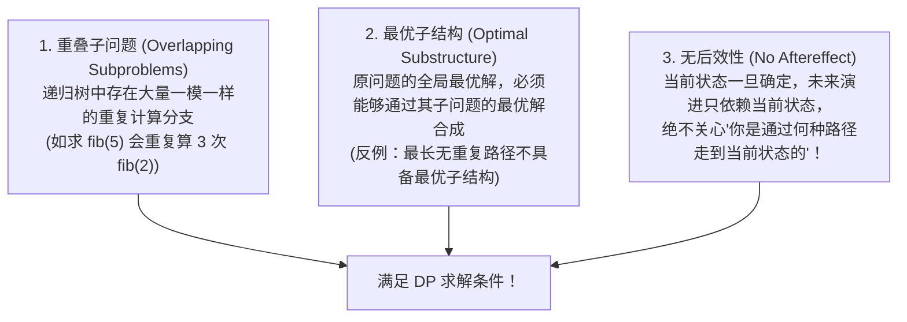

# 算法思想：动态规划核心演进与状态转移方程推导法

> **第一性原理**：动态规划（Dynamic Programming, DP）的数学本质就是——**在有向无环图（DAG）上进行有拓扑序的记忆化穷举！**
> 任何复杂的 DP，其根源都是**“暴力递归找重叠 -> 加 Memo 备忘录缓存 -> 自底向上填表递推 -> 滚动数组空间压缩”**的自然演进过程！

---

## 1. 动态规划三大不可或缺基石

一个问题能不能用动态规划解决，必须严格通过“三大物理检验”：



---

## 2. 动态规划通关“黄金五步法”

无论遇到任何简单、中等或困难的 DP 题，严格按这五步拆解，绝不卡壳：


1. **第一步：定义 `dp[i]` 或 `dp[i][j]` 的物理含义（最关键的一步！）**
   - 常见两类含义：
     - **“前缀型”**：`dp[i]` 表示前 $i$ 个元素中的最优解（如背包问题）；
     - **“尾部型”**：`dp[i]` 表示**必须以第 $i$ 个元素结尾**的最优解（如最大子数组和、最长上升子序列）。
2. **第二步：推导状态转移方程**
   - 站在第 $i$ 个位置，思考：**“我最后这一步做了什么决策？我可以从哪些已知的历史子状态转移过来？”**
3. **第三步：确立初始值（Base Case）与哨兵**
   - 求最小值时，未到达状态必须初始化为无穷大（`INF`）；求最大值时通常初始化为 0 或负无穷。
4. **第四步：确定遍历顺序**
   - 铁律：**计算当前状态时，它所依赖的所有历史子状态必须已经被完全计算出来了！**
5. **第五步：空间压缩（滚动数组）**
   - 若 `dp[i]` 只依赖 `dp[i - 1]`，二维表可降维为一维数组，一维数组可降维为两个简单变量。

---

## 3. 从暴力递归到最优 DP 的四重蜕变（LC 300 最长递增子序列 LIS）

题目：给定未排序整数数组 `nums`，找到其中最长严格递增子序列的长度。

### 3.1 动态规划标准推导（$O(N^2)$）
- **状态定义**：`dp[i]` 表示**以 `nums[i]` 结尾的最长严格递增子序列的长度**。
- **状态转移**：对于每一个位置 $i$，向前扫描所有比它小的元素 $j$（$0 \le j < i$ 且 `nums[j] < nums[i]`）：
  $$dp[i] = \max_{0 \le j < i, \text{nums}[j] < \text{nums}[i]} (dp[j]) + 1$$
- **Base Case**：每个元素自身都可以构成长度为 1 的子序列，因此全部初始为 1。

```java
class LISSolutionDP {
    public int lengthOfLIS(int[] nums) {
        if (nums == null || nums.length == 0) return 0;
        int n = nums.length;
        int[] dp = new int[n];
        Arrays.fill(dp, 1); // 每个位置默认最少长度为 1

        int maxLen = 1;
        for (int i = 1; i < n; i++) {
            for (int j = 0; j < i; j++) {
                if (nums[j] < nums[i]) {
                    dp[i] = Math.max(dp[i], dp[j] + 1);
                }
            }
            maxLen = Math.max(maxLen, dp[i]);
        }
        return maxLen;
    }
}
```

---

### 3.2 终极升华：耐心排序与二分贪心（$O(N \log N)$）
大厂面试如果要打出满分评价，必须掌握基于“**纸牌游戏耐心排序（Patience Sorting）**”的二分优化：
- **贪心思想**：如果我们要让子序列尽可能长，我们希望上升的步伐走得尽可能慢！即**长度为 $k$ 的递增子序列的末尾元素越小越好**！
- 维护一个数组 `tails`，其中 `tails[k]` 表示**长度为 $k+1$ 的所有递增子序列中，结尾最小的那个元素值**。
- `tails` 数组具有严格的单调递增性，因此新元素入场时，可以使用**二分查找**在 $O(\log N)$ 内更新它！

```java
class LISSolutionBinarySearch {
    public int lengthOfLIS(int[] nums) {
        int[] tails = new int[nums.length];
        int size = 0; // 当前最长子序列的长度

        for (int x : nums) {
            // 二分查找第一个 >= x 的位置
            int l = 0, r = size;
            while (l < r) {
                int mid = l + (r - l) / 2;
                if (tails[mid] >= x) {
                    r = mid;
                } else {
                    l = mid + 1;
                }
            }
            tails[l] = x; // 将其替换或追加在末尾
            if (l == size) {
                size++; // 无法替换任何现有堆，新建一堆，长度加 1
            }
        }
        return size;
    }
}
```

---

## 4. 大厂面试 30 秒绝杀（动态规划底层本质）

### Q1：贪心算法（Greedy）与动态规划（DP）有什么本质区别？为什么贪心不能解决所有最优子结构问题？
> **答题标杆**：
> 1. **选择机制的区别**：
>    - **贪心算法**是**“鼠目寸光、决不后悔”**的单向选择。它在当前做出局部最优选择之后，这个选择就永远定死，绝不会回头穷举其他分支。它要求问题必须满足严格的“贪心选择性质”（局部最优必定导致全局最优）。
>    - **动态规划**是**“全局纵观、备忘权衡”**的多阶段决策。它虽然依赖子问题最优解，但它在当前阶段会**穷举所有可能转移过来的历史子状态**（通过 $\max/\min$），综合权衡后才决定当前状态的最优解。
> 2. **反例场景**：例如“0-1 背包问题”，贪心按性价比挑选可能导致背包剩余零碎空间浪费，无法得到全局最优；而动态规划能全面遍历每种放与不放的容量组合，求出真正的全局极值。

---

## 5. 一分钟复盘记忆卡

```text
======================= 动态规划通关口诀 =======================
动态规划记心中，记忆穷举在拓扑。
重叠子题加缓存，最优子构大破竹；
无后效性只看现，前因后果莫踌躇；
状态定义五步法，BaseCase定基石铺；
转移方程最后步，倒推顺推顺序督；
一维序列两指针，二维匹配双串筑；
空间压缩滚动过，大厂面试神明助！
======================================================================
```
