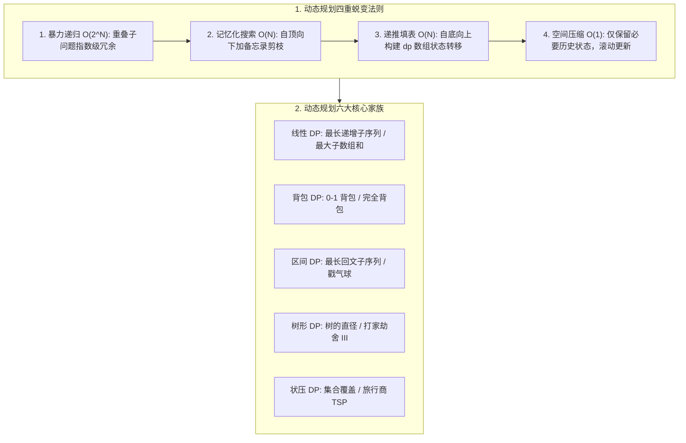
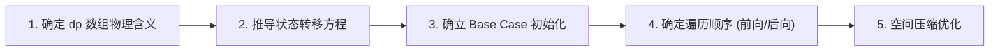

# 09 · 动态规划入门：核心演进、状态定义与经典模型

> [!abstract] 一句话第一性原理
> **动态规划（Dynamic Programming, DP）** 的本质是**在有向无环图（DAG）上进行有拓扑序的记忆化穷举**。其核心演进路径是：**通过识别重叠子问题，将指数级的暴力递归，通过备忘录自顶向下剪枝，进一步翻转为自底向上的递推填表，最终通过滚动变量完成空间压缩**。

---

## 知识全景图



---

## 一、 破除玄学：从爬楼梯透视 DP 的“四重蜕变”

很多初学者觉得动态规划玄学，是因为直接去背复杂的递推方程。
以经典问题 **LC 70. 爬楼梯**（每次走 1 或 2 阶，求登上 $n$ 阶的方法数）为例，看一个算法如何一步步脱胎换骨演进为动态规划：

### 阶段 1：暴力递归（指数爆炸 $O(2^n)$）
- **思路**：要到达第 $n$ 阶，最后一步要么从第 $n-1$ 阶跨 1 步，要么从第 $n-2$ 阶跨 2 步。因此 $f(n) = f(n-1) + f(n-2)$。
```java
public int climbStairs(int n) {
    if (n <= 2) return n;
    return climbStairs(n - 1) + climbStairs(n - 2); // 存在大量重复计算，必定超时！
}
```

---

### 阶段 2：记忆化搜索（自顶向下剪枝 $O(n)$ 时间，$O(n)$ 空间）
- **破局**：在计算 $f(5)$ 时，$f(3)$ 会被计算多次。使用数组记录算过的结果，遇到已计算状态直接 $O(1)$ 查表返回。
```java
public int climbStairs(int n) {
    int[] memo = new int[n + 1];
    return dfs(n, memo);
}
private int dfs(int i, int[] memo) {
    if (i <= 2) return i;
    if (memo[i] != 0) return memo[i]; // 命中缓存，直接返回
    return memo[i] = dfs(i - 1, memo) + dfs(i - 2, memo);
}
```

---

### 阶段 3：自底向上递推填表（真正的动态规划 $O(n)$ 时间，$O(n)$ 空间）
- **翻转思考**：不用递归的函数调用栈，直接从已知的地基 $dp[1]=1, dp[2]=2$ 出发，用 `for` 循环从小到大按顺序填表。
```java
public int climbStairs(int n) {
    if (n <= 2) return n;
    int[] dp = new int[n + 1];
    dp[1] = 1;
    dp[2] = 2;
    for (int i = 3; i <= n; i++) {
        dp[i] = dp[i - 1] + dp[i - 2]; // 状态转移
    }
    return dp[n];
}
```

---

### 阶段 4：空间压缩（滚动变量 $O(n)$ 时间，$O(1)$ 空间）
- **极致优化**：计算 $dp[i]$ 时，仅仅依赖紧邻的前两项 $dp[i-1]$ 与 $dp[i-2]$，更早的历史值完全不需要保留！用两个滚动变量交替推进，直接省去一整个数组。
```java
public int climbStairs(int n) {
    if (n <= 2) return n;
    int prev = 1, curr = 2;
    for (int i = 3; i <= n; i++) {
        int sum = prev + curr;
        prev = curr;
        curr = sum;
    }
    return curr;
}
```

---

## 二、 动态规划通关“黄金五步法”

无论遇到任何简单或困难的 DP 题，严格按这五步拆解，绝不卡壳：



1. **第一步：确定 `dp[i]` 的物理含义（最核心的一步！）**
   - **“前缀型”**：`dp[i]` 表示前 $i$ 个元素的最优值（如背包容量为 $i$ 时的最大价值）；
   - **“尾部型”**：`dp[i]` 表示**必须以第 $i$ 个元素结尾**的最优解（如最长递增子序列、最大子数组和）。
2. **第二步：推导状态转移方程**
   - 站在第 $i$ 个位置思考：**“我最后这一步做了什么决策？我可以从哪些已知的历史状态转移过来？”**
3. **第三步：确立初始值（Base Case）与哨兵**
   - 转移的起点与地基。求最小值时通常初始化为正无穷，求最大值时通常初始化为 0 或负无穷。
4. **第四步：确定遍历顺序**
   - 铁律：**计算当前状态时，它所依赖的所有历史子状态必须已经被完全计算出来了！**
5. **第五步：空间压缩（滚动数组）**
   - 若当前状态只依赖上一轮或前几项，通过取模或临时变量将空间由 $O(N^2) \to O(N)$ 或 $O(N) \to O(1)$。

---

## 三、 经典场景入门题：最长递增子序列（LC 300. LIS）

> **题目描述**：给你一个整数数组 `nums`，找到其中最长严格递增子序列的长度。
> **子序列特征**：可以不连续，但必须保持原数组中的先后相对顺序。

### 1. 五步法推导（$O(N^2)$ 标准 DP）
- **第一步（状态定义）**：`dp[i]` 表示**以 `nums[i]` 结尾的最长严格递增子序列的长度**。
- **第二步（状态转移）**：要让以 `nums[i]` 结尾的序列尽可能长，向前寻找所有比它小的元素 `nums[j]`（$0 \le j < i$ 且 `nums[j] < nums[i]`）：
  $$dp[i] = \max_{0 \le j < i, \text{nums}[j] < \text{nums}[i]} (dp[j]) + 1$$
- **第三步（初始状态）**：每个元素自身都可以构成长度为 1 的递增子序列，因此全部初始化为 1。
- **第四步（遍历顺序）**：两层循环，$i$ 从左到右遍历，$j$ 从 0 到 $i-1$ 扫描。

```java
class Solution300 {
    public int lengthOfLIS(int[] nums) {
        if (nums == null || nums.length == 0) return 0;
        int n = nums.length;
        int[] dp = new int[n];
        Arrays.fill(dp, 1); // 每个位置默认自身长度为 1

        int maxLen = 1;
        for (int i = 1; i < n; i++) {
            for (int j = 0; j < i; j++) {
                if (nums[j] < nums[i]) {
                    dp[i] = Math.max(dp[i], dp[j] + 1);
                }
            }
            maxLen = Math.max(maxLen, dp[i]);
        }
        return maxLen;
    }
}
```

---

## 四、 高阶攻坚与拓展知识（进阶查阅）

### 4.1 LIS 终极升华：贪心 + 二分查找（$O(N \log N)$ 耐心排序）
- **贪心直觉**：为了让递增子序列更长，我们希望序列增长得尽可能慢，即**长度为 $k$ 的递增子序列末尾元素越小越好**。
- 维护一个数组 `tails`，其中 `tails[k]` 表示长度为 $k+1$ 的递增子序列中结尾最小的元素。
- `tails` 数组天然单调递增，遇到新元素时使用二分查找在 $O(\log N)$ 内替换或延长。

> [!example]- 点击展开：LC 300. 贪心 + 二分优化实现 ($O(N \log N)$)
> - 🔗 **LeetCode 题目直通车**：[LeetCode 300. 最长递增子序列 ↗](https://leetcode.cn/problems/longest-increasing-subsequence/)
> - **题目描述**：给你一个整数数组 `nums` ，找到其中最长严格递增子序列的长度。子序列是由数组派生而来的序列，删除（或不删除）数组中的元素而不改变其余元素的顺序。
> **示例**：输入 `nums = [10,9,2,5,3,7,101,18]` $\to$ 输出 `4`（最长递增子序列是 `[2,3,7,101]` 或 `[2,5,7,101]` 等，长度均为 4）。
> **思路**：维护数组 `tails`，其中 `tails[i]` 存储所有长度为 `i + 1` 的递增子序列的**最小末尾元素**（越小对后序元素越有利，贪心原则）。遍历 `nums` 时，在单调递增的 `tails` 中二分查找首个 $\ge x$ 的位置并替换；若全小于 $x$ 则扩充 `tails` 长度。
> ```java
> class Solution300BinarySearch {
>     public int lengthOfLIS(int[] nums) {
>         int[] tails = new int[nums.length];
>         int size = 0;
>         for (int x : nums) {
>             int l = 0, r = size;
>             while (l < r) {
>                 int mid = l + (r - l) / 2;
>                 if (tails[mid] >= x) r = mid;
>                 else l = mid + 1;
>             }
>             tails[l] = x;
>             if (l == size) size++;
>         }
>         return size;
>     }
> }
> ```

---

### 4.2 动态规划三大不可或缺基石
一个问题能否用 DP 解决，必须通过三大物理检验：
1. **重叠子问题**：递归树中存在大量重复子树，备忘录才能避免重复劳动；
2. **最优子结构**：大问题的最优解可以由子问题的最优解合成；
3. **无后效性**：已经求解的子状态不受未来后续决策的影响。

---

## 五、 常见避坑清单与自测过关

1. **混淆“子数组”与“子序列”**：
   - 子数组（Subarray）必须连续，通常用滑动窗口或前缀和；
   - 子序列（Subsequence）允许跳跃不连续，通常用动态规划。
2. **状态定义未覆盖全局最优**：
   - 对于 LIS，全局最优答案是 `max(dp[0...n-1])`，而不是最后一个元素 `dp[n-1]`，因为最长子序列不一定以最后一个元素结尾。
3. **遍历顺序颠倒**：
   - 必须确保在计算当前状态时，它所依赖的历史子状态已完全就绪。
