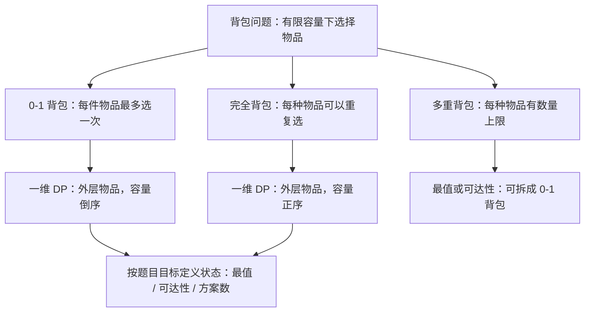

---
title: 10-02 · 背包问题：状态推导、遍历顺序与经典题型
tags:
  - 领域/算法
  - 类型/算法思想
  - 算法/背包问题
  - 算法/动态规划
created: 2026-10-27
status: 学习笔记
---

# 10-02 · 背包问题：状态推导、遍历顺序与经典题型

> [!abstract] 一句话理解背包问题
> **背包问题就是在有限容量下选择物品**：每件物品消耗一定容量，根据题目要求，求最大价值、判断能否恰好装满，或者统计方案数。物品能选几次、是否要求恰好装满，决定了状态转移和遍历方式。

## 知识全景图



## 一、从一个例子理解 0-1 背包

背包容量为 4，有三件物品，每件只能选一次：吉他（重量 1、价值 15）、音响（重量 3、价值 20）、电脑（重量 4、价值 30）。选电脑的价值为 30；选吉他和音响，重量刚好为 4，价值为 35。因此答案是 **35**。
物品很多时无法靠手算枚举，但处理每件物品时，始终只有两种选择：**选或不选**。0-1 背包的动态规划，就是把这两种选择产生的结果记录下来。

### 1.1 状态定义与转移

定义 `dp[i][c]`：**只考虑前 `i` 件物品，背包容量为 `c` 时能得到的最大价值**。这里的容量是上限，不要求装满。例如 `dp[1][4] = 15`：只考虑吉他时，虽然容量为 4，也只能得到价值 15。
假设当前物品重量为 `w`、价值为 `v`，容量为 `c`：
- **不选当前物品**：沿用上一行结果 `dp[i-1][c]`。
- **选当前物品**：先占用 `w` 的容量，剩余容量只能从前 `i-1` 件物品中选择，得到 `dp[i-1][c-w] + v`。只有 `c >= w` 才能选。
- **取最大值**：`dp[i][c] = max(dp[i-1][c], dp[i-1][c-w] + v)`；若 `c < w`，只能不选。

| 已考虑的物品 | 容量 0 | 容量 1 | 容量 2 | 容量 3 | 容量 4 |
| :--- | :---: | :---: | :---: | :---: | :---: |
| 无 | 0 | 0 | 0 | 0 | 0 |
| 吉他 | 0 | 15 | 15 | 15 | 15 |
| 吉他、音响 | 0 | 15 | 15 | 20 | 35 |
| 吉他、音响、电脑 | 0 | 15 | 15 | 20 | 35 |

以最后一个格子为例：不选电脑是 `dp[2][4] = 35`；选电脑是 `dp[2][0] + 30 = 30`。两者取大，得到 `dp[3][4] = 35`。右边始终读取上一行，因为当前物品只能使用一次。

### 1.2 空间压缩：为什么容量要倒序？

当前行只依赖上一行，可以把二维数组压缩成一维 `dp[c]`。但压缩后，上一行和当前行共用同一数组，必须避免读取已经被当前物品更新过的值。
只看一把重量为 1、价值为 15 的吉他，背包容量为 2，初始 `dp = [0, 0, 0]`：
- **正序更新**：先得到 `dp[1] = 15`，再用刚更新的 `dp[1]` 算出 `dp[2] = 30`，相当于同一把吉他被选了两次，错误。
- **倒序更新**：先计算 `dp[2]`，此时 `dp[1]` 还是处理吉他之前的 0，得到 `dp[2] = 15`；再更新 `dp[1]`，每个状态都只使用了一次吉他。

> [!important] 核心认知
> 在**外层遍历物品、内层遍历容量**的一维 0-1 背包中，容量倒序是为了让 `dp[c-w]` 保留上一轮的结果，避免重复使用当前物品。

```java
// weights、values 分别为物品的重量和价值，capacity 为背包容量
int[] dp = new int[capacity + 1];
for (int i = 0; i < weights.length; i++) {
    int w = weights[i], v = values[i];
    for (int c = capacity; c >= w; c--) {
        dp[c] = Math.max(dp[c], dp[c - w] + v);
    }
}
// dp[capacity] 是不超过容量时的最大价值
```

设物品数为 `n`、容量为 `C`，时间复杂度为 `O(nC)`，空间复杂度为 `O(C)`。初始值全为 0，是因为这里允许不装满，什么都不选也是合法选择。

## 二、0-1 背包实战：分割等和子集（LC 416）

题目：给定一个正整数数组，能否将全部元素分成两个子集，使两个子集的元素和相等？例如 `[1, 5, 11, 5]` 可以分成 `[11]` 和 `[1, 5, 5]`，答案为 `true`。

### 2.1 题目转化：为什么只需要找一个子集？

数组总和为 `sum`。如果两个子集的和相等，那么每个子集的和都必须是 `sum / 2`。因此：**只要找到一个和为 `sum / 2` 的子集，剩余元素的和自然也是 `sum / 2`**，不需要同时搜索两边。如果 `sum` 是奇数，则无法平分，可以直接返回 `false`。
例如 `[1, 5, 11, 5]` 的总和是 22，问题就变成：能否从数组中选出若干元素，使它们的和恰好为 11？选出 `[11]` 后，其余元素自动组成另一组。这一步的目的，就是把“分成相等的两边”转化成“找到一个目标和”。

### 2.2 对照背包模型：物品是什么，目标是什么？

| 背包概念 | 本题对应的内容 |
| :--- | :--- |
| 物品 | 数组中的每个元素；同值的不同位置是不同物品 |
| 物品重量 | 元素的数值 `num` |
| 背包容量 | `target = sum / 2` |
| 使用次数 | 每个元素最多选一次，因此是 0-1 背包 |
| 求解目标 | 能否**恰好**凑出 `target`，而不是求最大价值 |

定义 `dp[c]` 表示：**从已处理的元素中，能否选出一些元素，使它们的和恰好为 `c`**。初始 `dp[0] = true`，因为不选任何元素就能凑出 0；其余位置为 `false`。
处理数字 `num` 时，如果原来就能凑出 `c`，或者原来能凑出 `c-num` 并再选上 `num`，那么现在就能凑出 `c`：

```text
dp[c] = dp[c] || dp[c - num]   // c >= num，容量倒序遍历
```

以 `[1, 5, 11, 5]`、`target = 11` 为例：初始可达的和是 `{0}`；处理 1 后为 `{0, 1}`；再处理第一个 5 后为 `{0, 1, 5, 6}`；处理 11 后可以达到 11，因此返回 `true`。
为什么必须倒序？对于 `[1, 2, 5]`，目标为 4，实际无法凑出。如果处理数字 1 时正序更新，就会用刚得到的 `dp[1]` 算出 `dp[2]`，再依次算出 `dp[3]`、`dp[4]`，相当于把同一个 1 使用了四次。

```java
class CanPartitionSolution {
    public boolean canPartition(int[] nums) {
        int sum = 0;
        for (int num : nums) sum += num;
        if (sum % 2 != 0) return false;
        int target = sum / 2;
        boolean[] dp = new boolean[target + 1];
        dp[0] = true;
        for (int num : nums) {
            for (int c = target; c >= num; c--) {
                dp[c] = dp[c] || dp[c - num];
            }
            if (dp[target]) return true;
        }
        return dp[target];
    }
}
```

**复杂度**：设数组长度为 `n`，时间复杂度为 `O(n × target)`，空间复杂度为 `O(target)`。

## 三、完全背包：同一种物品可以重复选择

如果每种物品数量无限，同一种物品可以选多次，这就是**完全背包**。例如一把吉他重 1、价值 15，若吉他数量无限，容量为 2 时就可以选择两把，价值为 30。
此时恰好需要读取当前物品已经更新的结果：先由 `dp[0]` 得到 `dp[1] = 15`，再由新的 `dp[1]` 得到 `dp[2] = 30`。因此在外层遍历物品的一维写法中，容量应当**正序**遍历。

| 对比项 | 0-1 背包 | 完全背包 |
| :--- | :--- | :--- |
| 每种物品可选次数 | 最多一次 | 可以重复选 |
| 一维数组的容量遍历 | 倒序 | 正序 |
| `dp[c-w]` 的含义 | 当前物品处理前的结果 | 可以包含当前物品的结果 |

```java
// 最大价值：外层物品，内层容量正序
int[] dp = new int[capacity + 1];
for (int i = 0; i < weights.length; i++) {
    int w = weights[i], v = values[i];
    for (int c = w; c <= capacity; c++) {
        dp[c] = Math.max(dp[c], dp[c - w] + v);
    }
}
```

### 3.1 完全背包实战：零钱兑换（LC 322）

题目：给定若干不同面额的硬币，每种硬币数量无限，求凑出金额 `amount` 所需的**最少硬币数**；无法凑出时返回 `-1`。例如 `coins = [1, 3, 4]`、`amount = 6`，选择 `3 + 3` 只需 2 枚；如果每次选最大面额，则得到 `4 + 1 + 1`，需要 3 枚，不能保证最优。
- **背包模型**：金额是容量，硬币是物品，每种硬币可以重复选，属于完全背包。
- **状态定义**：`dp[c]` 表示恰好凑出金额 `c` 所需的最少硬币数。选一枚 `coin` 后，候选结果为 `dp[c-coin] + 1`，与原结果取较小值。
- **初始化**：`dp[0] = 0`；其余设为 `amount + 1`，表示暂时不可达。面额是正整数，任何有效方案的硬币数都不会超过 `amount`。

```java
import java.util.Arrays;
class CoinChangeSolution {
    public int coinChange(int[] coins, int amount) {
        int unreachable = amount + 1;
        int[] dp = new int[amount + 1];
        Arrays.fill(dp, unreachable);
        dp[0] = 0;
        for (int coin : coins) {
            for (int c = coin; c <= amount; c++) { // 正序，允许重复使用 coin
                dp[c] = Math.min(dp[c], dp[c - coin] + 1);
            }
        }
        return dp[amount] == unreachable ? -1 : dp[amount];
    }
}
```

以面额 3 为例，`dp[3]` 可由 `dp[0] + 1` 得到 1，之后 `dp[6]` 可由刚更新的 `dp[3] + 1` 得到 2，也就是使用两枚 3。设面额种数为 `n`，时间复杂度为 `O(n × amount)`，空间复杂度为 `O(amount)`。

## 四、方案数：组合和排列的循环顺序

如果题目问“有多少种方案”，先确认**顺序是否影响答案**。例如数字 `[1, 2]` 可重复使用，目标为 3：若 `1+2` 和 `2+1` 算同一种，有 2 种组合；若算不同方案，有 3 种序列：`[1,1,1]`、`[1,2]`、`[2,1]`。
下面假设数字互不相同且均为正整数，每种数字可重复使用。令 `dp[c]` 为凑出 `c` 的方案数，初始 `dp[0] = 1`，因为空选择是凑出 0 的一种基础方案。

### 4.1 顺序无关：外层物品，内层容量（LC 518）

零钱兑换 II 求硬币**组合数**。先遍历硬币，再正序遍历金额，相当于按固定的硬币顺序引入每一种面额，因此 `1+2` 和 `2+1` 不会重复统计。

```java
int[] dp = new int[amount + 1];
dp[0] = 1;
for (int coin : coins) {
    for (int c = coin; c <= amount; c++) {
        dp[c] += dp[c - coin];
    }
}
```

### 4.2 顺序有关：外层容量，内层物品（LC 377）

组合总和 IV 的题意规定，顺序不同的序列算不同方案。先从小到大遍历目标和，再枚举**最后一个数字**：目标 3 的最后一个数为 1 时，可得到 `[1,1,1]`、`[2,1]`；最后一个数为 2 时，可得到 `[1,2]`，共 3 种。

```java
int[] dp = new int[target + 1];
dp[0] = 1;
for (int c = 1; c <= target; c++) {
    for (int num : nums) {
        if (c >= num) dp[c] += dp[c - num];
    }
}
```

> [!important] 适用范围
> 上述组合与排列模板针对**可重复使用**的正整数。若每件物品只能使用一次，不能直接照搬排列模板；实际统计时还要根据题目数据范围选择 `int`、`long` 或取模。循环顺序始终要结合状态定义和题目条件判断。

## 五、多重背包：每种物品数量有限

若一种物品最多选 `k` 个，属于多重背包。直接做法是枚举选 0 到 `k` 个；当数量较大时，可以针对**最大价值或可达性**使用二进制拆分，转化为若干只能选一次的物品包。
例如最多 13 个，可拆成 `1、2、4、6` 四包。每包的重量和价值分别乘以包内数量，再按 0-1 背包处理；四包可以组合出 0 到 13 的所有件数。一般按 `1、2、4、…` 依次取包，最后把剩余数量作为一包，只需 `O(log(k+1))` 个包。
**注意计数边界**：拆包不保证同一件数的表示唯一。例如 6 件既可以选择 `6` 包，也可以选择 `2+4` 包；对原问题来说都是“选 6 件”，直接按拆包后的 0-1 背包统计方案数会重复。

## 六、不同目标如何初始化？

初始化要回答的是：**还没有选择任何物品时，哪些状态成立？**

| 目标 | `dp[c]` 的含义 | 初始化 |
| :--- | :--- | :--- |
| 不要求装满，求最大价值 | 不超过容量 `c` 的最大价值 | 全为 0：什么都不选始终合法 |
| 恰好装满，求最大价值 | 恰好达到 `c` 的最大价值 | `dp[0]=0`，其余为负无穷 |
| 恰好凑出，求最少个数 | 凑出 `c` 的最少个数 | `dp[0]=0`，其余为正无穷 |
| 判断能否恰好凑出 | 是否能凑出 `c` | `dp[0]=true`，其余为 `false` |
| 统计恰好凑出的方案数 | 凑出 `c` 的方案数 | `dp[0]=1`，其余为 0 |

对恰好装满的最值问题，如果使用正、负无穷作为哨兵，转移前应检查前一个状态是否可达，避免哨兵运算导致溢出或产生假结果。零钱兑换中的 `amount + 1` 是有界哨兵，超过该值的候选不会被 `min` 选中。

## 七、做题时如何识别背包？

1. **找容量和目标**：总金额、目标和、可用时间等都可能是容量；明确题目求最值、可达性还是方案数，以及是否要求恰好达到。
2. **看每个物品能选几次**：最多一次是 0-1 背包；无限次是完全背包；有限多次是多重背包。
3. **定义状态并推导选择**：写清楚 `dp[c]` 的完整含义，再考虑选或不选当前物品分别从哪里转移。
4. **确定初始化和顺序**：先判断空选择对应什么状态，再检查转移需要读取上一轮还是当前轮；统计方案时，还要确认顺序是否算不同方案。

| 题目 | 物品使用次数 | 目标 | 一维写法 |
| :--- | :--- | :--- | :--- |
| 基础 0-1 背包 | 每件最多一次 | 不超过容量，求最大价值 | 外层物品，容量倒序 |
| 分割等和子集 | 每个元素最多一次 | 恰好凑出一半，判断可达 | 外层元素，目标和倒序 |
| 零钱兑换 | 每种硬币无限次 | 恰好凑出金额，求最少个数 | 外层硬币，金额正序 |
| 零钱兑换 II | 每种硬币无限次 | 统计无序组合 | 外层硬币，金额正序 |
| 组合总和 IV | 每个数字无限次 | 统计有序序列 | 外层目标和，内层数字 |

**记住推导**：先明确物品能选几次、状态表示什么，再检查转移依赖，循环方向自然就有了依据。
