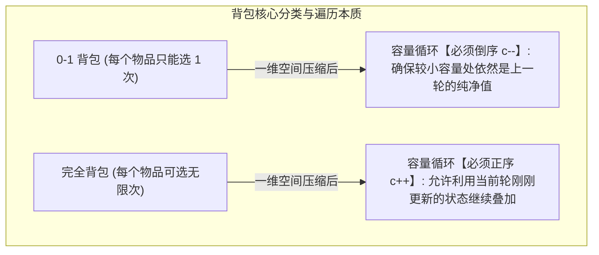
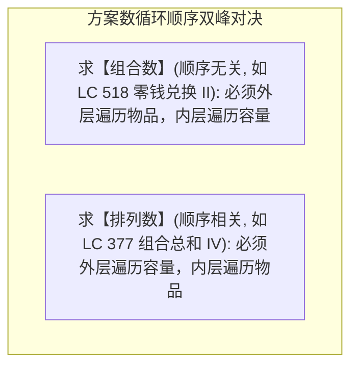

# 10 · 背包问题：0-1背包、完全背包与空间压缩本质

> **第一性原理**：背包问题是在**有限资源（背包容量）约束下，进行离散物品选择以求达到收益极值**的经典多阶段决策模型。
> 面试中所有复杂的变种题（零钱兑换、分割等和子集、目标和），本质上都是**0-1 背包**或**完全背包**在“最值、存在性、计数”上的数学马甲！

---

## 1. 背包双雄：0-1 背包 vs 完全背包本质对比



### 1.1 为什么 0-1 背包必须“倒序”，而完全背包必须“正序”？

所谓的“正序”和“倒序”，指的就是遍历**背包容量**的那一层 `for` 循环的方向：

```java
// 0-1 背包：容量【倒序】从大到小 (C -> w[i])
for (int c = C; c >= w[i]; c--) {
    dp[c] = Math.max(dp[c], dp[c - w[i]] + v[i]);
}

// 完全背包：容量【正序】从小到大 (w[i] -> C)
for (int c = w[i]; c <= C; c++) {
    dp[c] = Math.max(dp[c], dp[c - w[i]] + v[i]);
}
```

> [!tip] 极简数字实验：为什么倒序只拿 1 次，正序能拿无数次？
> 假设：背包容量 $C = 4$；只有 **1 个物品**，重量 $w = 1$，价值 $v = 10$。
> 按照 0-1 背包规则，全宇宙只有这 1 件物品，不管背包多大，**最多只能拿 1 次，最大价值永远只能是 10**！
> 
> 初始数组全是 0：`dp = [0, 0, 0, 0, 0]`（下标 0~4 对应容量 0~4）。
> 
> **❌ 实验 A：如果容量用【正序遍历】（从小到大 `c = 1 -> 4`）：**
> - `c = 1`：`dp[1] = dp[0] + 10 = 10` $\to$ 数组变为 `[0, 10, 0, 0, 0]`（容量 1 放了该物品）
> - `c = 2`：我们要看 `dp[1]`，**但此时 `dp[1]` 刚在上一步被改成了 10！**
>   `dp[2] = dp[1] + 10 = 10 + 10 = 20`！$\to$ **同一个物品被拿了第 2 次！**
> - `c = 3`：`dp[3] = dp[2] + 10 = 20 + 10 = 30`！$\to$ **同一个物品被拿了第 3 次！**
> - `c = 4`：`dp[4] = dp[3] + 10 = 30 + 10 = 40`！$\to$ **同一个物品被拿了第 4 次！**
> - **结论**：正序从小到大推，算大容量时用到了**刚被刷新过的小容量**，导致同一个物品被反复叠加！这就是**物品无限拿的“完全背包”**。
> 
> **✅ 实验 B：如果容量用【倒序遍历】（从大到小 `c = 4 -> 1`）：**
> - `c = 4`：看 `dp[3]`，此时 `dp[3]` **还没被动过，依然是干净的 0**！`dp[4] = 0 + 10 = 10`
> - `c = 3`：看 `dp[2]`，此时 `dp[2]` **也依然是干净的 0**！`dp[3] = 0 + 10 = 10`
> - `c = 2`：看 `dp[1]`，还是 0！`dp[2] = 0 + 10 = 10`
> - `c = 1`：看 `dp[0]`，还是 0！`dp[1] = 0 + 10 = 10`
> - 遍历结束，数组为：`[0, 10, 10, 10, 10]`！
> - **结论**：大容量回头看左边的小容量时，左边全是**上一轮未受污染的历史纯净值**，绝对保证了**每个物品只被拿了 1 次**！

---

## 2. 0-1 背包经典实战：分割等和子集（LC 416）

🔗 **力扣直通车**：[LC 416. 分割等和子集 ↗](https://leetcode.cn/problems/partition-equal-subset-sum/)  
**题目**：给你一个正整数数组 `nums`（如 `[1, 5, 11, 5]`），判断是否可以将这个数组分割成两个子集，使得两个子集的元素和相等。

### 2.1 为什么这道题是 0-1 背包？（做题实战思考流）

很多同学读完这道题一头雾水：“题目里连‘背包’两个字都没提，到底跟背包有什么关系？为什么要学破局转化？”

#### 痛点：为什么不能暴力穷举？
如果用回溯算法暴搜，每个数要么放左边集合、要么放右边集合。题目中数组长度达到 200，组合数多达 $2^{200}$ 种，**直接超时（TLE）得 0 分**！

#### 破局：两步将集合题“降维翻译”为背包模板题

- **第 1 步翻译：把“两边的麻烦”，变成“只看一边”**
  - 先计算数组总和 `sum = 1 + 5 + 11 + 5 = 22`；
  - 若 `sum` 是奇数，绝对不可能平分，直接返回 `false`！
  - 若 `sum` 是偶数，如果真能平分，**每一堆的和必须严格等于 11（即 sum / 2）**！
  - **关键点来了**：你根本不需要去操心怎么分两堆！你只要问自己——**“我能不能从里面挑选出几个数，让它们的和恰好等于 11？”**
  - 只要你能挑出凑齐 11，剩下的数字加起来必定也是 11，另一半不需要你管！
  - $\implies$ **原问题变成：能否从数组中挑选若干数字，和恰好为 11？**

- **第 2 步翻译：对号入座 0-1 背包**
  - 目标和 `target = sum / 2 = 11` $\implies$ **这就是背包的容量上限**；
  - 数组中的每一个数字 `num` $\implies$ **这就是各种重量的物品**（数字 5 占 5 点容量）；
  - 每个数字只能选一次 $\implies$ **标准 0-1 背包（不可重复选）**；
  - 题目求“能否凑出 11” $\implies$ **问容量为 11 的背包能否恰好装满（存在性问题）**！

- **状态定义（为什么是布尔值？）**：
  普通背包求最大金额（存数字），这里只问能不能装满，所以用布尔数组：
  - `dp[c] = true`：表示容量为 `c` 的背包**能够被恰好凑出**；
  - `dp[c] = false`：表示无法凑出容量 `c`。

### 2.2 标准 AC 代码（直接套 0-1 背包倒序模板）

```java
class Solution416 {
    public boolean canPartition(int[] nums) {
        int sum = 0;
        for (int num : nums) sum += num;
        if (sum % 2 != 0) return false; // 奇数绝对不可能平分成两份

        int target = sum / 2; // 背包目标容量
        boolean[] dp = new boolean[target + 1];
        dp[0] = true; // 容量为 0 时，什么都不选即为合法凑出

        // 标准 0-1 背包骨架
        for (int num : nums) {               // 外层遍历物品
            for (int c = target; c >= num; c--) { // 内层容量倒序（保证每个数字只用 1 次）
                // 选当前数字：dp[c - num] 能凑出，则当前 c 就能凑出
                // 不选当前数字：保持原值 dp[c]
                dp[c] = dp[c] || dp[c - num];
            }
            // 剪枝提速：如果已经能够凑出 target，无需继续计算后面的物品
            if (dp[target]) return true;
        }

        return dp[target]; // 看容量 target 是否能被恰好装满
    }
}
```

---

## 3. 完全背包经典实战：零钱兑换（LC 322 最值模型）

🔗 **力扣直通车**：[LC 322. 零钱兑换 ↗](https://leetcode.cn/problems/coin-change/)  
**题目**：给定不同面额的硬币 `coins`（如 `[1, 2, 5]`）和一个总金额 `amount`（如 `11`），求凑成总金额所需的**最少硬币个数**。每种硬币数量无限。

### 3.1 为什么贪心拿大面额会暴毙？
很多人第一反应是用贪心算法：先拿最大的硬币。
**反例**：`coins = [1, 3, 4], amount = 6`
- 贪心策略：先拿最大的 4，剩下 2 只能拿 1 + 1，总共用了 **3 枚硬币**（`4 + 1 + 1`）；
- 最优解：直接拿两枚 3，总共只需 **2 枚硬币**（`3 + 3`）！
- **结论**：面额之间不是倍数关系时，贪心必然暴毙，必须用完全背包动态规划！

### 3.2 为什么是完全背包？
- 每种硬币**数量无限**（可以重复拿） $\implies$ **完全背包模型**；
- 容量循环**必须正序从小到大（`c++`）**：允许用刚放入的这枚硬币继续累加！
- 目标：求最少硬币数 $\implies$ 状态存最小值，初始值用虚拟无穷大哨兵填充。

### 3.3 标准 AC 代码

```java
class Solution322 {
    public int coinChange(int[] coins, int amount) {
        int max = amount + 1; // 虚拟无穷大（因为最多全用 1 元硬币，最多 amount 枚，amount+1 即为不可能达到的上限）
        int[] dp = new int[amount + 1];
        Arrays.fill(dp, max);
        dp[0] = 0; // 凑出金额 0 需要 0 枚硬币

        // 外层物品，内层容量正序（完全背包）
        for (int coin : coins) {
            for (int c = coin; c <= amount; c++) {
                // 如果能凑出 c - coin，再加上当前这枚 coin
                dp[c] = Math.min(dp[c], dp[c - coin] + 1);
            }
        }

        return dp[amount] > amount ? -1 : dp[amount];
    }
}
```

---

## 4. 多重背包与二进制拆分优化（化归为 0-1 背包）

### 4.1 问题的物理场景
- **0-1 背包**：每种物品只有 1 件；
- **完全背包**：每种物品有无限件；
- **多重背包**：第 $i$ 种物品有**确定的数量上限 $K_i$ 个**（既不是 1，也不是无限）。

> **暴力展开的痛点**：如果把 $K_i$ 个物品拆成 $K_i$ 个独立的物品，当数量很大（如 $K_i = 10^5$）时，总物品数暴增，必然超时。

### 4.2 二进制拆分打包思想（ACM/笔试必备）
任何正整数 $K$，都可以拆解为若干个 2 的幂（$1, 2, 4, 8, \dots$）与最后剩下的一个余数 $R$。
- 例如：某物品有 13 件，可以打包成 4 个新捆包：**`[1件包, 2件包, 4件包, 6件包]`**。
- 这 4 个捆包能且仅能组合出 $0 \sim 13$ 之间的任意件数！
- 于是，原本要循环 13 次的物品，**变成了只有 4 个只能选 1 次的新物品（化归为标准的 0-1 背包）**！复杂度直接从 $O(K)$ 降到 $O(\log K)$！

```java
class MultiKnapsackBinarySplit {
    public int multiKnapsack(int capacity, int[] weights, int[] values, int[] counts) {
        int n = weights.length;
        List<Integer> newWeights = new ArrayList<>();
        List<Integer> newValues = new ArrayList<>();

        // 1. 二进制拆分打包成新物品
        for (int i = 0; i < n; i++) {
            int w = weights[i], v = values[i], k = counts[i];
            for (int base = 1; k >= base; base <<= 1) {
                newWeights.add(base * w);
                newValues.add(base * v);
                k -= base;
            }
            if (k > 0) {
                newWeights.add(k * w);
                newValues.add(k * v);
            }
        }

        // 2. 直接套用 0-1 背包倒序模板
        int[] dp = new int[capacity + 1];
        for (int i = 0; i < newWeights.size(); i++) {
            int w = newWeights.get(i), v = newValues.get(i);
            for (int c = capacity; c >= w; c--) {
                dp[c] = Math.max(dp[c], dp[c - w] + v);
            }
        }

        return dp[capacity];
    }
}
```

---

## 5. 背包高阶分水岭：组合数 vs 排列数（循环顺序决定命运）

当题目要求求“有多少种凑齐方案”时，两层 `for` 循环谁在外面谁在里面，决定了你算的是**组合**还是**排列**！



### 5.1 为什么顺序换一下，结果完全不同？

假设只有两种硬币：`[1, 2]`，目标凑出金额 `3`。

#### 模式 A：外层遍历物品，内层遍历容量 $\implies$ 【组合数】（[LC 518. 零钱兑换 II](https://leetcode.cn/problems/coin-change-ii/)）
- 硬币是**排着队依次进场的**：
  1. 先把硬币 1 全盘考虑完；
  2. 再把硬币 2 放进来。
- 硬币 2 **永远不可能排在硬币 1 的前面**被使用！
- 凑成 3 的方案只会有 `1 + 1 + 1` 和 `1 + 2`，**绝对不会生成 `2 + 1`**！
- 所以算出来的是**无序的【组合数】**。

#### 模式 B：外层遍历容量，内层遍历物品 $\implies$ 【排列数】（[LC 377. 组合总和 IV](https://leetcode.cn/problems/combination-sum-iv/)）
- 站在每个容量（如金额 3）的视角，**所有的硬币都可以作为最后一步塞进去的那枚硬币**：
  - 最后一步塞 1 $\implies$ 从金额 2 转移过来（产生 `2 + 1 = 3`）；
  - 最后一步塞 2 $\implies$ 从金额 1 转移过来（产生 `1 + 2 = 3`）；
- 两种顺序都会被独立计算一次！
- 所以算出来的是**有序的【排列数】**。

---

## 6. 大厂面试 30 秒绝杀（背包初始化规则速查）

| 求解目标 | 初始化规则 | 典型原因 |
| :--- | :--- | :--- |
| **求最大价值（Max）** | `dp` 全填 `0` | 初始收益为 0，随着物品放入不断增大 |
| **求最小个数（Min）** | 除了 `dp[0] = 0`，其余填 **`amount + 1` (无穷大)** | 防止被初始值污染，求最小必须从大往下压 |
| **求方案数（Count）** | **必须令 `dp[0] = 1`**，其余填 `0` | 容量为 0 时“什么都不选”本身就是 1 种合法基础方案 |
| **求能否装满（Boolean）** | **`dp[0] = true`**，其余填 `false` | 0 容量不选物品即为已满 |

---

## 7. 一分钟复盘记忆卡

```text
======================= 背包问题通关口诀 =======================
有限容量装乾坤，01完全两极分。
01背包防重用，容量倒序压一轮；
完全背包无限取，容量正序累加深；
多重拆成二进制，对数加速01奔；
求最少时初始大，方案数必dp零存；
外层物品内容量，组合无序方案均；
外层容量内物品，排列次序步步审；
循环顺序定乾坤，大厂手撕秒封神！
======================================================================
```
