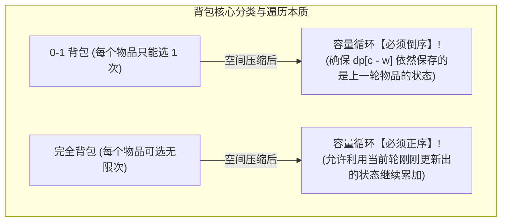
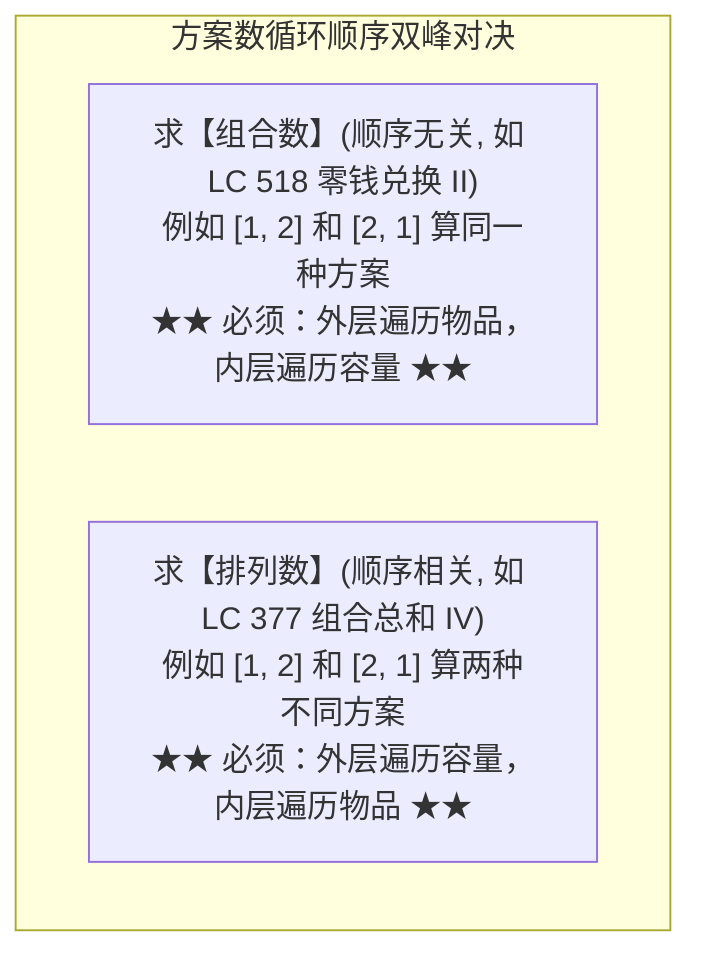

# 算法思想：背包问题全家桶（0-1/完全/组合排列与空间压缩本质）

> **第一性原理**：背包问题是在**有限资源（背包容量）约束下，进行离散物品选择以求达到收益极值**的经典多阶段决策模型。
> 面试中所有复杂的变种题（零钱兑换、分割等和子集、目标和），本质上都是**0-1 背包**或**完全背包**在“最值、存在性、计数”上的数学马甲！

---

## 1. 背包双雄：0-1 背包 vs 完全背包本质对比



### 1.1 为什么 0-1 背包必须“倒序”，而完全背包必须“正序”？（数学推导）
- **0-1 背包二维原始方程**：
  $$dp[i][c] = \max(dp[i - 1][c], \ dp[i - 1][c - w[i]] + v[i])$$
  注意：右侧第二项依赖的是 **$i - 1$（上一行/尚未放入当前物品时的状态）**！
- **降维成一维数组 `dp[c]`**：
  - 如果我们**从大到小倒序计算 `c`**（$C \to w[i]$）：当我们计算 `dp[c]` 时，较小下标处的 `dp[c - w[i]]` 还没有被当前物品刷新，它依然**保存着上一层 $i - 1$ 的历史纯净值**！完全符合二维方程的物理含义！
  - 如果我们**正序计算 `c`**（$w[i] \to C$）：当算到大的容量时，较小容量的 `dp[c - w[i]]` 早已经被当前物品加过一次了，此时再次叠加，**相当于同一个物品被拿了 2 次、3 次甚至无数次！直接蜕变为了完全背包！**

---

## 2. 0-1 背包经典实战：分割等和子集（LC 416）

题目：判断一个正整数数组是否可以分割成两个子集，使得两个子集的元素和相等。

### 2.1 破局转化
- 计算数组总和 `sum`。若 `sum` 为奇数，绝对不可能对半分，直接返回 `false`。
- 目标：从数组中挑选一些数字，能否恰好装满容量为 $\text{target} = \text{sum} / 2$ 的背包？每个数字只能选一次！**标准的 0-1 背包存在性问题**！

```java
class CanPartitionSolution {
    public boolean canPartition(int[] nums) {
        int sum = 0;
        for (int num : nums) sum += num;
        if (sum % 2 != 0) return false; // 奇数不可等分

        int target = sum / 2;
        // dp[c] 表示容量为 c 的背包能否恰好装满
        boolean[] dp = new boolean[target + 1];
        dp[0] = true; // 0 容量什么都不装即为满

        for (int num : nums) {
            // 0-1 背包铁律：容量倒序遍历，防止同一个数字被重复使用！
            for (int c = target; c >= num; c--) {
                dp[c] = dp[c] || dp[c - num];
            }
            // 剪枝提速：如果已经能凑出 target，直接提前返回
            if (dp[target]) return true;
        }

        return dp[target];
    }
}
```

---

## 3. 完全背包经典实战：零钱兑换（LC 322 最值模型）

题目：给定不同面额的硬币 `coins` 和一个总金额 `amount`，求凑成总金额所需的**最少硬币个数**。每种硬币数量无限。

- **模型**：完全背包求最小值。
- **状态转移**：$dp[c] = \min(dp[c], \ dp[c - \text{coin}] + 1)$
- **Base Case 初始化**：由于求最小值，除了 `dp[0] = 0` 以外，其余全部初始化为一个大于 `amount` 的极大值（如 `amount + 1`），代表初始无法凑齐。

```java
class CoinChangeSolution {
    public int coinChange(int[] coins, int amount) {
        int max = amount + 1; // 虚拟无穷大哨兵
        int[] dp = new int[amount + 1];
        Arrays.fill(dp, max);
        dp[0] = 0; // 凑成 0 元需要 0 枚硬币

        // 外层物品，内层容量正序（完全背包）
        for (int coin : coins) {
            for (int c = coin; c <= amount; c++) {
                dp[c] = Math.min(dp[c], dp[c - coin] + 1);
            }
        }

        return dp[amount] > amount ? -1 : dp[amount];
    }
}
```

---

## 4. 背包高阶分水岭：组合数 vs 排列数（循环顺序决定命运）

当题目要求求“有多少种装满方案”时，两层 `for` 循环的内外层顺序具有决定性生死影响！



### 4.1 为什么“外物品内容量”是组合，“外容量内物品”是排列？
- **外层物品**：物品是依次进场的。只有先考虑完硬币 1，才开始考虑硬币 2。硬币 2 永远不可能排在硬币 1 前面被放入，天然避免了乱序重排，因此算出来的是**组合数**！
- **外层容量**：站在容量 $c$ 的视角，每次填入最后一步时，所有的物品（1 和 2）都可以作为最后放入的那一枚。因此既能生成 `1 + 2 = 3`，也能生成 `2 + 1 = 3`，算出来的是**排列数**！

---

## 5. 大厂面试 30 秒绝杀（背包高频深度考点）

### Q1：背包问题中，不同目标（最值、存在性、方案数）的初始化规则有什么根本区别？
> **答题标杆**：
> 1. **求最大价值（Max）**：`dp` 数组通常全部初始化为 `0`；若要求“必须恰好装满”，除了 `dp[0]=0` 外，其余初始为负无穷 `-INF`。
> 2. **求最少元素个数（Min）**：除了 `dp[0]=0` 外，其余全部初始化为正无穷 `INF`（或 `amount + 1`），防止被初始值污染。
> 3. **求方案数（Count）**：必须令 **`dp[0] = 1`**！含义是“容量为 0 时，什么都不装也是 1 种合法方案”。若初始全填 0，后续加法累加全为 0，答案必定错误。
> 4. **求能否装满（Boolean）**：`dp[0] = true`，其余全为 `false`。

---

## 6. 一分钟复盘记忆卡

```text
======================= 背包问题通关口诀 =======================
有限容量装乾坤，01完全两极分。
01背包防重用，容量倒序压一轮；
完全背包无限取，容量正序累加深；
求最少时初始大，方案数必dp零存；
外层物品内容量，组合无序方案均；
外层容量内物品，排列次序步步审；
循环顺序定乾坤，大厂手撕秒封神！
======================================================================
```
