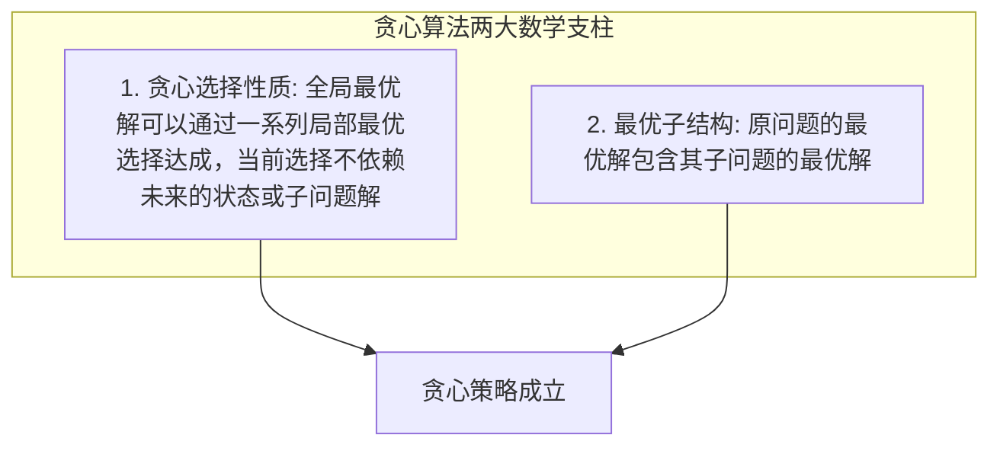
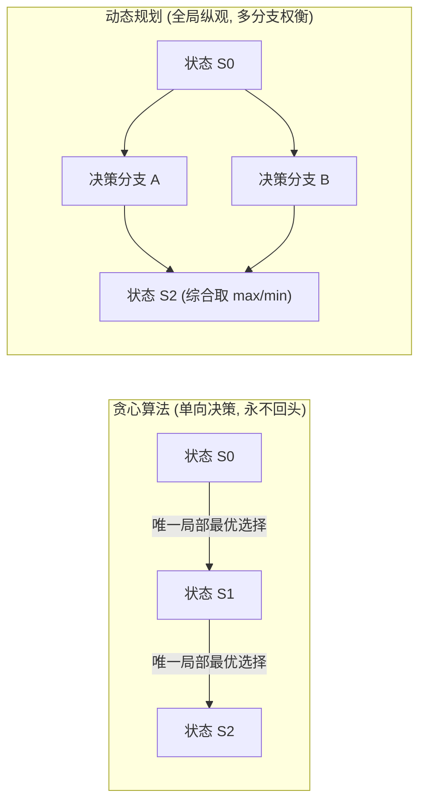

# 算法思想：贪心算法核心模型与证明策略

> **第一性原理**：贪心算法（Greedy Algorithm）的本质是——**每一步均做出在当前看来最好的选择，通过局部最优解的严格无退化传递，直接推导至全局最优解！**
> 贪心算法的核心难点永远不在于代码编写，而在于**贪心策略的正确性证明**以及**辨析何时局部最优会沦为全局陷阱**。

---

## 1. 贪心的本质与两大数学支柱

一个问题能够使用贪心算法解决，必须严格满足以下两大物理性质：



### 1.1 贪心正确性的三大证明套路
在面试中，直觉往往是贪心的起点，但论证才是拿满分的关键：
1. **交换论证法（Exchange Argument，最核心证明法）**：
   - 假设存在一个全局最优解 $OPT$ 与贪心解 $A$ 不同；
   - 找到它们第一个做出不同选择的位置，将 $OPT$ 中的该步骤替换为贪心选择；
   - 证明替换后的解 $OPT'$ 的总收益**不会变差**（$\ge OPT$）；
   - 通过有限次替换，可将 $OPT$ 逐步改造成贪心解 $A$ 且收益不降，从而证明贪心解即为全局最优解。
2. **数学归纳法（Mathematical Induction）**：
   - 证明规模为 1 时贪心策略正确；
   - 假设规模为 $k$ 时贪心选择依然保持最优子结构；
   - 推出规模为 $k+1$ 时做一步贪心选择仍能保持全局最优。
3. **反证法（Proof by Contradiction）**：
   - 假设贪心策略得不到最优解，必存在某一反例使得非贪心选择更优，由此推导出与题目约束或客观极值相违背的逻辑矛盾。

---

## 2. 贪心算法 vs 动态规划的核心分野

许多初学者容易混淆贪心与动态规划，二者在决策机制与状态图搜索上有根本性差异：



| 维度 | 贪心算法（Greedy） | 动态规划（DP） |
| :--- | :--- | :--- |
| **选择方式** | **单向不可逆**，每步只挑当下最好，不回头看 | **多路权衡**，穷举所有可行前驱状态并取极值 |
| **子问题依赖** | 子问题只在贪心选择做出之后才被求解 | 先解决所有可能子问题，再择优合成大问题 |
| **后效性要求** | 极严苛，局部决策绝不能封死未来的更优组合 | 具备无后效性即可，允许在状态中升维记录必要约束 |
| **时间复杂度** | 通常为 $O(N \log N)$（带排序）或 $O(N)$ | 通常为 $O(N^2)$、$O(N \cdot C)$ 或更高 |
| **经典反例** | 0-1 背包问题中按“性价比”贪心会导致空间浪费从而失败 | 0-1 背包需穷举容量转移，必须使用 DP |

---

## 3. 经典核心模型精讲与代码模板

### 3.1 区间调度模型（Interval Scheduling）

#### 核心命题
给定若干开/闭区间，求**互不重叠的最大区间数量**（LC 435 无重叠区间 / LC 452 用最少数量的箭引爆气球）。

#### 为什么必须按“右端点升序”排序？（交换论证）
- **按右端点升序排序**：优先选择**结束时间最早**的区间。
- **直观理解**：区间结束得越早，留给剩余区间的可用时间跨度就越大，因此未来能够容纳的相容区间数量必定不小于其他选择。
- **反例辨析**：
  - 若按左端点升序：区间 `[0, 100]` 排在最前，一旦选它，就会破坏其内部包含的 `[1, 2], [3, 4], [5, 6]` 等多个小区间。
  - 若按区间长度升序：短区间 `[4, 6]` 可能会同时截断 `[1, 5]` 和 `[5, 9]` 两个互不冲突的长区间（选 1 个 vs 选 2 个）。

```java
class IntervalScheduling {
    /**
     * LC 435: 计算需要移除的最小区间数，使得剩余区间互不重叠
     * 等价于：总区间数 - 互不重叠的最大区间数
     */
    public int eraseOverlapIntervals(int[][] intervals) {
        if (intervals == null || intervals.length == 0) return 0;

        // 1. 严格按区间右端点升序排序 (防止溢出使用 Integer.compare)
        Arrays.sort(intervals, (a, b) -> Integer.compare(a[1], b[1]));

        int count = 1; // 互不重叠的最大区间数量
        int end = intervals[0][1]; // 首个选中区间的右边界

        for (int i = 1; i < intervals.length; i++) {
            // 若当前区间的起点 >= 上一个选中区间的终点，说明不重叠，果断选取
            if (intervals[i][0] >= end) {
                count++;
                end = intervals[i][1]; // 推进右边界
            }
        }

        return intervals.length - count;
    }
}
```

---

### 3.2 跳跃游戏模型（Jump Game，维护最远覆盖范围）

#### 核心命题
数组中每个位置代表能向前跳跃的最大步数，求**能否到达终点**（LC 55）或**到达终点的最少跳跃次数**（LC 45）。

#### 思维模型：维护能够到达的最远边界 `Reach`
无需模拟每一步到底落在哪个具体格子上，只需要把目光聚焦在**“当前步数内，所能覆盖的最大范围”**：
- **LC 55（能否到达）**：线性扫描，维护 `maxReach`。只要当前下标 $i \le maxReach$，就可以用 $i + nums[i]$ 扩展 `maxReach`。若 `maxReach >= n - 1`，则必定可达。
- **LC 45（最少步数）**：两段式边界跳跃。维护当前跳跃步数的右边界 `curEnd`，以及在当前范围中能探查到的下一步最远边界 `nextEnd`。当遍历指针到达 `curEnd` 时，强制进行一次跳跃，步数加 1，并将 `curEnd` 刷新为 `nextEnd`。

```java
class JumpGame {
    /**
     * LC 45: 跳跃游戏 II - 求到达最后一个位置的最少跳跃次数
     */
    public int jump(int[] nums) {
        int n = nums.length;
        if (n <= 1) return 0;

        int jumps = 0;
        int curEnd = 0;   // 当前步数所能覆盖的右边界
        int nextEnd = 0;  // 在当前范围内探索到的下一步最远边界

        // 注意：只需遍历到 n - 2，到达 n - 1 时不需要再发起跳跃
        for (int i = 0; i < n - 1; i++) {
            nextEnd = Math.max(nextEnd, i + nums[i]);

            // 到达当前这步的极限边界，必须消耗一次跳跃机会迈向下一阶段
            if (i == curEnd) {
                jumps++;
                curEnd = nextEnd;
                if (curEnd >= n - 1) break; // 提前剪枝
            }
        }

        return jumps;
    }
}
```

---

### 3.3 反悔贪心模型（Regret Greedy / PriorityQueue）

#### 核心命题
普通的贪心一旦做出选择便不可更改。但在某些问题中，**当下的最优决策可能会在未来产生副作用**，导致全局失衡。
反悔贪心的核心机制：**“先贪心吃下收益，但把决策放入优先队列作为备忘；一旦后续发现更优的选择或遇到危机，从队列中吐出历史最劣决策，实现安全反悔！”**

#### 经典实战：最低加油次数（LC 871）
- **场景**：汽车初始油量有限，途经若干加油站。目标是到达终点且加油次数最少。
- **反悔策略**：
  1. 汽车能往前开就一直开，经过加油站时，**不立即停下加油**，而是把该站的油量放进**大顶堆（反悔备用池）**；
  2. 只有当油量不够支撑到达下一个站点或终点时，才从大顶堆中**取出油量最大的历史油站**进行补给；
  3. 如果大顶堆已空仍无法向前推进，说明彻底无法到达，返回 -1。

```java
class MinRefuelStopsSolution {
    public int minRefuelStops(int target, int startFuel, int[][] stations) {
        // 大顶堆：存储历史经过、但尚未加过的加油站油量
        PriorityQueue<Integer> maxHeap = new PriorityQueue<>(Collections.reverseOrder());

        int curFuel = startFuel;
        int refuelCount = 0;
        int i = 0;
        int n = stations.length;

        while (curFuel < target) {
            // 1. 将当前油量能到达的所有加油站放入反悔堆
            while (i < n && stations[i][0] <= curFuel) {
                maxHeap.offer(stations[i][1]);
                i++;
            }

            // 2. 油量耗尽且历史无可反悔加的油，任务失败
            if (maxHeap.isEmpty()) {
                return -1;
            }

            // 3. 反悔贪心：从历史经过的油站中，假装加了油量最大的一家
            curFuel += maxHeap.poll();
            refuelCount++;
        }

        return refuelCount;
    }
}
```

---

## 4. 典型算法应用速览

| 题目 | 分类模型 | 核心贪心策略（一句话） |
| :--- | :--- | :--- |
| **LC 455 分发饼干** | 双指针贪心 | 排序后用最小尺寸饼干优先满足胃口最小的孩子 |
| **LC 55 跳跃游戏** | 覆盖范围维护 | 遍历下标维护可达最远下标 `maxReach`，判断能否覆盖终点 |
| **LC 45 跳跃游戏 II** | 两段边界跳跃 | 维护 `curEnd` 与 `nextEnd`，到达当前跳跃边界时步数加 1 |
| **LC 435 无重叠区间** | 区间调度 | 严格按右端点升序排序，留给后续可用时间最长 |
| **LC 452 投飞镖刺破气球** | 区间重叠交集 | 按右端点升序排序，每支箭射在当前重叠区间的最小右端点 |
| **LC 56 合并区间** | 区间连续合并 | 按左端点升序排序，动态扩展当前连续重叠块的最大右端点 |
| **LC 763 划分字母区间** | 边界贪心合并 | 预处理各字符最后出现下标，贪心扩展当前片段的最远右界 |
| **LC 134 加油站** | 净收益前缀和 | 遍历时累加净剩余油量，一旦为负则起点重置为下一站，总油量 $\ge 0$ 必有解 |
| **LC 871 最低加油次数** | 反悔贪心 | 能走则走，沿途油量入大顶堆，缺油时反悔补最大油量 |
| **LC 406 根据身高重建队列** | 排序插桩贪心 | 矮个子不影响高个子视线，先按身高降序排序，再按 $k$ 值插入对应下标 |

---

## 5. 经典代表题完整落地方案

> [!example]- 展开查看：LC 56 合并区间（按左端点排序的标准区间合并）
> ```java
> class MergeIntervalsSolution {
>     public int[][] merge(int[][] intervals) {
>         if (intervals.length <= 1) return intervals;
> 
>         // 1. 按区间起点升序排序
>         Arrays.sort(intervals, (a, b) -> Integer.compare(a[0], b[0]));
> 
>         List<int[]> merged = new ArrayList<>();
>         int[] cur = intervals[0];
>         merged.add(cur);
> 
>         for (int i = 1; i < intervals.length; i++) {
>             int[] next = intervals[i];
>             if (next[0] <= cur[1]) {
>                 // 产生重叠，贪心扩展当前区间的最大右边界
>                 cur[1] = Math.max(cur[1], next[1]);
>             } else {
>                 // 无重叠，开启全新独立区间
>                 cur = next;
>                 merged.add(cur);
>             }
>         }
> 
>         return merged.toArray(new int[merged.size()][]);
>     }
> }
> ```

> [!example]- 展开查看：LC 763 划分字母区间（边界探索模型）
> ```java
> class PartitionLabelsSolution {
>     public List<Integer> partitionLabels(String s) {
>         // 1. 统计每个字符最后出现的下标
>         int[] lastIndex = new int[26];
>         for (int i = 0; i < s.length(); i++) {
>             lastIndex[s.charAt(i) - 'a'] = i;
>         }
> 
>         List<Integer> result = new ArrayList<>();
>         int start = 0;
>         int maxEnd = 0;
> 
>         // 2. 遍历字符串，贪心维护当前片段必须覆盖的最远边界
>         for (int i = 0; i < s.length(); i++) {
>             maxEnd = Math.max(maxEnd, lastIndex[s.charAt(i) - 'a']);
>             if (i == maxEnd) {
>                 result.add(maxEnd - start + 1);
>                 start = i + 1; // 开启下一分段
>             }
>         }
> 
>         return result;
>     }
> }
> ```

---

## 6. 大厂面试 30 秒绝杀

### Q1：在算法面试中提出贪心解法后，该如何条理清晰地向面试官论证其正确性？
> **答题标杆**：
> 1. **表态思想**：“我采用的是贪心策略，通过局部做出最优选择，无需回溯或遍历分支。”
> 2. **给出排序/度量标准**：“我以［右端点/最远可达边界/性价比］作为贪心度量标准，因为这种选择方式能够为后续决策留出最大的自由度。”
> 3. **运用交换论证简述**：“假设全局最优解中选取的并非我的贪心选择，我们可以把最优解的第一个决策替换为当前贪心决策。由于贪心决策留出的空间/资源只多不少，替换后原最优解后续决策依然合法且收益不减。由此通过数学归纳法可推知，贪心策略可逐步转化为最优解，证明其正确性。”

### Q2：贪心算法如果被证明有后效性，应该如何自救重构？
> **答题标杆**：
> 1. **反悔机制（优先队列）**：如果做错选择后依然可以在后续阶段以确定代价撤销，改用**反悔贪心**（将历史决策入堆，发现更优时吐出最差项）。
> 2. **升维转向动态规划**：如果贪心在某维度上的局部最优会破坏其他维度的收益（如 0-1 背包、最长递增子序列），说明问题具备重叠子问题和多阶段依赖，必须立即放弃贪心，改用**动态规划定义状态方程**进行拓扑记忆化求解。

---

## 7. 一分钟复盘记忆卡

```text
======================= 贪心算法通关口诀 =======================
贪心单向选最优，鼠目寸光不回头。
选择性质子结构，交换论证解千愁；
区间相容右端排，腾挪空隙未来留；
区间合并左端起，右界延伸并合流；
跳跃游戏看覆盖，两段边界步数收；
倘若贪婪恐有悔，大顶堆内把劣休；
无后效性是铁律，若有纠缠DP求！
======================================================================
```
