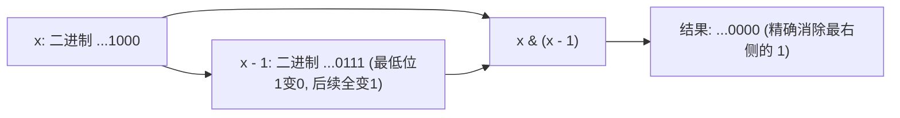

# 12 · 位运算：位操作速查、集合压缩与三大神技

> **第一性原理**：计算机底层一切皆二进制，位运算（Bit Manipulation）是在固定位宽整数上操作二进制位；常见操作为常数时间，具体指令周期取决于硬件与编译结果。
> 位运算的数学本质是：**将 32 位整型视作元素上限为 32 的紧凑集合（Bitset）**，通过布尔代数（AND/OR/XOR/NOT）与位移操作，在 $O(1)$ 时间内完成集合并交差运算与状态检索。

---

## 1. 核心操作速查与三大神奇神技

### 1.1 基础位运算符与运算优先级警示
在 Java 中，位运算符的优先级**显著低于算术运算（`+`, `-`）和关系比较运算（`==`, `!=`, `<`, `>`）**！任何复合位运算表达式**必须无条件加括号**！

| 运算符 | 运算名称 | 核心规则 | 典型场景 |
| :---: | :--- | :--- | :--- |
| `&` | 按位与（AND） | 两位均为 1 才为 1，有 0 则 0 | 提取指定位、掩码过滤、集合求交 |
| `\|` | 按位或（OR） | 两位有 1 则为 1，全 0 才 0 | 设置指定位为 1、集合求并 |
| `^` | 按位异或（XOR） | 相同为 0，不同为 1（**不进位加法**） | 消除成对元素、翻转指定位、无辅助变量交换 |
| `~` | 按位取反（NOT） | 0 变 1，1 变 0（全部符号位一同取反） | 构造掩码补集、配合 `&` 实现集合求差 |
| `<<` | 算术左移 | 高位丢弃，低位补 0（相当于乘 $2^k$） | 生成二进制权值 `1 << i` |
| `>>` | 算术右移 | 低位丢弃，**高位补符号位**（有符号数按 $2^k$ 向下取整，不等同于 Java 负数整数除法的向零截断） | 正负数带符号减半 |
| `>>>` | 逻辑右移 | 低位丢弃，**高位一律补 0**（无符号右移） | 纯二进制位扫描（避免负数符号位死循环） |

> [!WARNING] 优先级踩坑警告
> 表达式 `if (val & 1 == 0)` 会被编译器解析为 `if (val & (1 == 0))`，导致类型编译错误！
> 正确写法必须加括号：**`if ((val & 1) == 0)`**。

---

### 1.2 神技一：`x & (x - 1)`（消除最低位 1）



#### 经典应用
1. **统计二进制中 1 的个数（Brian Kernighan 算法，LC 191）**：
   循环次数等于数字中 1 的个数；1 较少时迭代更少，实际性能需结合编译结果测量。
2. **快速判断是否为 2 的幂（LC 231）**：
   若 $x > 0$ 且为 2 的幂，其二进制表示中有且仅有一个 1：`x > 0 && (x & (x - 1)) == 0`。
3. **快速判断是否为 4 的幂（LC 342）**：
   在正数且为 2 的幂的基础上，1 只能出现在从 0 开始编号的偶数位上：`x > 0 && (x & (x - 1)) == 0 && (x & 0xaaaaaaaa) == 0`。

```java
public int hammingWeight(int n) {
    int count = 0;
    while (n != 0) {
        n &= (n - 1); // 每次单步消去最低位的 1
        count++;
    }
    return count;
}
```

---

### 1.3 神技二：`x & -x`（提取最低位 1，Lowbit）

根据计算机补码原理：负数等于原码按位取反加一，即 `-x = (~x) + 1`。
- 设 $x$ 的二进制表示形如：`[前缀...] 1 [00...0]`；
- 取反 `~x` 为：`[~前缀...] 0 [11...1]`；
- 取反加一 `-x` 为：`[~前缀...] 1 [00...0]`；
- 二者按位与：`x & -x` 将前缀全部抵消为 0，**精确提取出最低位的二进制 1，其余全为 0**！

#### 经典应用
1. **树状数组（Binary Indexed Tree / Fenwick Tree）**：核心步进函数 `lowbit(x) = x & -x`；
2. **状态压缩分组**：用于找两个互异数字在异或和中的任意不同位。

```java
int lowbit = x & -x; // 保留最低位的 1，其余位全部清零
```

---

### 1.4 神技三：`x ^ y`（不进位加法与加法器模拟）

二进制加法的本质量化：
- **无进位加法结果**：`sum = x ^ y`（$0+0=0, 0+1=1, 1+1=0$）；
- **产生的进位项**：`carry = (x & y) << 1`（只有均为 1 时产生进位，向左移 1 位）；
- 不断迭代加法与进位，直到进位为 0，即可在**不使用 `+` 运算符的情况下实现两数求和（LC 371）**。

```java
public int getSum(int a, int b) {
    while (b != 0) {
        int carry = (a & b) << 1; // 计算进位
        a = a ^ b;                 // 计算无进位累加
        b = carry;                 // 循环直至进位完全消化
    }
    return a;
}
```

---

## 2. “只出现一次”系列全家桶（Single Number 专题）

面试中位运算最常考的题族，解题技巧从初级异或到数字电路状态机逐步演进。

### 2.1 基础款：其余出现 2 次，1 个出现 1 次（LeetCode 136）

> **题目描述**：
> 给你一个 **非空** 整数数组 `nums` ，除了某个元素只出现一次以外，其余每个元素均出现两次。找出那个只出现了一次的元素。
> 你必须设计并实现线性时间复杂度 $O(N)$ 且只使用常数额外空间 $O(1)$ 的算法。
>
> **输入输出示例**：
> - 示例 1：
>   - 输入：`nums = [2,2,1]`
>   - 输出：`1`
> - 示例 2：
>   - 输入：`nums = [4,1,2,1,2]`
>   - 输出：`4`

#### 核心性质与解法

**为什么想到异或？** 题目明确“其余恰好两次”，需要一种运算能把两个相等值抵消，又保留落单值。哈希计数会占 $O(N)$ 空间，排序通常需要 $O(N\log N)$ 时间，不满足题目的组合要求；异或恰好满足抵消规律，且可用一个变量线性累积。这个推导依赖出现次数保证，不能推广为任意重复次数。

异或运算满足交换律和结合律，且有：
$$a \oplus a = 0, \quad a \oplus 0 = a$$
对数组全体元素做异或累加，所有成对出现的数字全部抵消为 0，最后留下的就是孤立项。

```java
public int singleNumberI(int[] nums) {
    int ans = 0;
    for (int x : nums) {
        ans ^= x;
    }
    return ans;
}
```

---

### 2.2 进阶款：其余出现 3 次，1 个出现 1 次（LeetCode 137）

> **题目描述**：
> 给你一个整数数组 `nums` ，除某个元素仅出现 一次 外，其余每个元素都恰好出现 三次 。请你找出并返回那个只出现了一次的元素。
> 你必须设计并实现线性时间复杂度 $O(N)$ 且只使用常数额外空间 $O(1)$ 的算法。
>
> **输入输出示例**：
> - 示例 1：
>   - 输入：`nums = [2,2,3,2]`
>   - 输出：`3`
> - 示例 2：
>   - 输入：`nums = [0,1,0,1,0,1,99]`
>   - 输出：`99`

#### 方法 A：通用按位统计法（模 $K$ 计数，最易理解与推广）

**为什么不能继续全体异或？** 三个相同数异或后仍留下该数，无法消掉三次重复。改看每一位：重复数对该位的贡献必为 0 或 3，取模 3 后都归零，只剩落单数的这一位。32 位宽度固定，所以逐位扫描仍是 $O(N)$ 时间、$O(1)$ 额外空间，也能处理负数的补码表示。

- 考虑 32 位整型的每一位 $i$（$0 \le i < 32$）：
- 统计所有数字在第 $i$ 位上 1 的出现总次数 `bitCount`；
- 每个出现 3 次的数字必然对 `bitCount` 贡献 3 的倍数（$3 \times 1 = 3$ 次）；
- 如果 `bitCount % 3 != 0`，说明那个唯一只出现 1 次的数字在第 $i$ 位上必定为 1！

```java
public int singleNumberII_Count(int[] nums) {
    int ans = 0;
    for (int i = 0; i < 32; i++) {
        int bitSum = 0;
        for (int x : nums) {
            bitSum += (x >>> i) & 1; // 取第 i 位；固定 0..31 位配合 &1 时也可使用 >>
        }
        if (bitSum % 3 != 0) {
            ans |= (1 << i);
        }
    }
    return ans;
}
```

#### 方法 B：数字电路状态机（$O(N)$ 时间 + $O(1)$ 空间极致性能）
- 每一位统计模 3，对应三种状态：`00`（出现 0 次）、`01`（出现 1 次）、`10`（出现 2 次）。
- 用两个变量 `ones` 与 `twos` 作为状态寄存器，根据输入位 $x$ 驱动三进制时钟信号：

```java
public int singleNumberII_Circuit(int[] nums) {
    int ones = 0, twos = 0;
    for (int x : nums) {
        ones = (ones ^ x) & ~twos;
        twos = (twos ^ x) & ~ones;
    }
    return ones;
}
```

---

### 2.3 进阶款：其余出现 2 次，2 个出现 1 次（LeetCode 260，分组异或流）

> **题目描述**：
> 给你一个整数数组 `nums`，其中恰好有两个元素只出现一次，其余所有元素均出现两次。
> 找出只出现一次的那两个元素。你可以按 **任意顺序** 返回答案。
> 你必须设计并且实现线性时间复杂度且仅使用常数额外空间的算法。
>
> **输入输出示例**：
> - 示例 1：
>   - 输入：`nums = [1,2,1,3,2,5]`
>   - 输出：`[3,5]`（也可以返回 `[5,3]`）
> - 示例 2：
>   - 输入：`nums = [-1,0]`
>   - 输出：`[-1,0]`

#### 破局逻辑

**为什么需要分组？** 全体异或只能得到 `a^b`，不能直接恢复两个值。但 `a!=b` 保证至少一位不同；按这位分组后，两个落单数被分开，重复数的两份却总在同组，于是每组重新变成“一个落单数、其余两次”的基础题。提取 `lowbit` 的目的就是找到这个分组条件，而不是按数值大小或正负分组。

设只出现一次的两个数字为 $a$ 和 $b$（$a \neq b$）：
1. **全局异或**：全体异或后得到 `xorSum = a ^ b`；
2. **提取分流位**：由于 $a \ne b$，`xorSum` 中至少存在一个二进制位为 1。利用神技 `lowbit = xorSum & -xorSum` 取出最低的不同位；
3. **两军对垒**：根据数组中每个数字在该位上是 1 还是 0，将数组严格划分为两个子集：
   - $a$ 和 $b$ 必定被分在不同子集；
   - 任何成对出现的数字，在该位上必定相同，因此必定被成对分进同一个子集；
4. 每个子集分别做异或累加，分别消解出 $a$ 和 $b$！

```java
public int[] singleNumberIII(int[] nums) {
    int xorSum = 0;
    for (int x : nums) {
        xorSum ^= x;
    }

    // 提取 lowest set bit 作为分组基准
    // 注意边界：若 xorSum 为 Integer.MIN_VALUE，-xorSum 会溢出，按位与仍正确
    int diff = xorSum & -xorSum;

    int a = 0, b = 0;
    for (int x : nums) {
        if ((x & diff) == 0) {
            a ^= x; // 分组 1
        } else {
            b ^= x; // 分组 2
        }
    }

    return new int[]{a, b};
}
```

---

## 3. 状态压缩位运算工具集（State Compression）

在状态压缩动态规划（状压 DP）、搜索剪枝与子集枚举中，整型数字 `mask` 用于映射元素规模 $N \le 30$ 的集合。

### 3.1 集合代数与位运算操作对照全集

| 集合代数操作 | 位运算表达式 | 含义解析 |
| :--- | :--- | :--- |
| **空集** | `0` | 所有位均为 0 |
| **全集（含 $n$ 个元素）** | `(1 << n) - 1` | 低 $n$ 位均为 1 |
| **单点包含判断** | `((mask & (1 << i)) != 0)` | 检查第 $i$ 个元素是否存在于集合中 |
| **加入元素 $i$** | `mask | (1 << i)` | 将第 $i$ 位置为 1 |
| **移除元素 $i$** | `mask & ~(1 << i)` | 将第 $i$ 位置为 0 |
| **翻转元素 $i$ 状态** | `mask ^ (1 << i)` | 若存在则删除，不存在则添加 |
| **并集（$A \cup B$）** | `A | B` | 二者元素相合 |
| **交集（$A \cap B$）** | `A & B` | 仅保留公共元素 |
| **差集（$A \setminus B$）** | `A & ~B` | 从 $A$ 中扣除属于 $B$ 的元素 |
| **全集下的补集** | `~A & ((1 << n) - 1)` | 仅在有效长度 $n$ 范围内取反 |
| **集合大小（元素总数）** | `Integer.bitCount(mask)` | 统计二进制中 1 的个数 |

---

### 3.2 两大黄金子集枚举模板

#### 模板 1：枚举大小为 $n$ 的全集的所有子集（复杂度 $O(2^n)$）
```java
int n = 4;
for (int mask = 0; mask < (1 << n); mask++) {
    // 处理子集 mask
}
```

#### 模板 2：枚举固定 `mask` 的非空子集（复杂度 $O(2^k)$，k 为 mask 中 1 的个数）
固定 mask 有 $2^k-1$ 个非空子集。只有外层再枚举全部 n 位 mask、内层枚举每个 mask 的子集时，总复杂度才为 $O(3^n)$；每位分别属于“mask 外、mask 内 sub 外、sub 内”三种状态。

```java
// 从大到小枚举 mask 的每一个非空子集，包含 mask 本身
for (int sub = mask; sub > 0; sub = (sub - 1) & mask) {
    // sub 是 mask 的非空子集，不一定是真子集
}
```

**为什么 `(sub - 1) & mask` 能不漏不重地枚举子集？**
- `sub - 1` 会将 `sub` 中最右侧的 1 变为 0，并将其右侧所有的 0 全部置为 1；
- 紧接着做 `& mask`，就把所有**不属于 `mask` 的多余 1 位全部过滤掉**，只保留原本属于 `mask` 的有效位；
- 这相当于在 `mask` 的二进制位子空间内进行“二进制自减计数”，自然保证严格降序且绝无遗漏！

---

## 4. 典型算法应用速览

| 题目 | 分类模型 | 核心位运算策略（一句话） |
| :--- | :--- | :--- |
| **LC 191 位 1 的个数** | 神技消 1 | `n & (n - 1)` 循环消除最低位 1 直至为 0 |
| **LC 231 2 的幂** | 二进制特性 | 正整数且二进制中仅有 1 个 1：`n > 0 && (n & (n - 1)) == 0` |
| **LC 342 4 的幂** | 掩码过滤 | 正数、仅有一个 1 且位于从 0 编号的偶数位：`n > 0 && (n & (n - 1)) == 0 && (n & 0x55555555) != 0` |
| **LC 136 只出现一次的数字** | 异或抵消 | 全体异或，成对元素 $x \oplus x = 0$ 自动消去 |
| **LC 137 只出现一次的数字 II** | 按位模 3 | 统计每一位 1 的总和对 3 取模，还原出独立数字 |
| **LC 260 只出现一次的数字 III** | 分组异或 | 异或总和提取 `lowbit`，将数组按该位划分成两组分别异或 |
| **LC 371 两整数之和** | 逻辑加法器 | 异或做无进位加法，按位与左移 1 位做进位，迭代至进位为 0 |
| **LC 78 子集** | 状态压缩枚举 | 外层枚举 `0 ~ (1 << n) - 1`，内层根据位的 0/1 收集元素 |
| **LC 52 N 皇后** | 状压回溯 | 用 3 个 `int` 分别记录列、左斜线、右斜线的占用掩码，位运算加速检测 |

### 从题目描述判断算法

#### LC 191：位 1 的个数
> 🔗 **LeetCode 题目直通车**：[LeetCode 191. 位 1 的个数 ↗](https://leetcode.cn/problems/number-of-1-bits/)

- **题目线索**：统计固定宽度整数的二进制表示里有多少个 1。
- **为什么用消除最低位 1**：每次 `n & (n-1)` 恰好去掉一个 1，计数目标直接对应一次操作，不必分别检查所有零位。
- **解题步骤**：非零时消去一个 1 并加一，直到为零。例如 `101100` 依次变为 `101000`、`100000`、`000000`，结果为 3。

#### LC 231：2 的幂
> 🔗 **LeetCode 题目直通车**：[LeetCode 231. 2 的幂 ↗](https://leetcode.cn/problems/power-of-two/)

- **题目线索**：判断整数是否等于某个非负整数指数的 $2^k$。
- **为什么看是否只有一个 1**：正整数 $2^k$ 的二进制恰有一个置位，而消去这个置位后结果为零。
- **解题步骤**：判断 `n > 0 && (n & (n-1)) == 0`。正数条件不能省，零也会通过第二项，负数中的符号位也不能当作合法幂。

#### LC 342：4 的幂
> 🔗 **LeetCode 题目直通车**：[LeetCode 342. 4 的幂 ↗](https://leetcode.cn/problems/power-of-four/)

- **题目线索**：判断是否为 $4^k=2^{2k}$，比 2 的幂要求更强。
- **为什么加位位置掩码**：只有一个 1 还可能是 2、8、32；4 的幂要求该 1 位于从 0 开始的偶数位。`0x55555555` 恰好保留这些位置。
- **解题步骤**：先保证 `n>0` 且只有一个 1，再判断 `(n & 0x55555555) != 0`。例如 8 是 `1000`，置位在第 3 位，因此不通过。

#### LC 136：只出现一次的数字
> 🔗 **LeetCode 题目直通车**：[LeetCode 136. 只出现一次的数字 ↗](https://leetcode.cn/problems/single-number/)

- **题目线索**：一个值出现一次，其余都出现两次，要求线性时间和常数空间。
- **为什么用异或**：两份相同值抵消，异或的交换律允许它们即使不相邻也被消掉，无需保存频次。
- **解题步骤**：从 0 开始累积全部异或，最终值就是答案；出现次数不符合题设时没有这一保证。

#### LC 137：只出现一次的数字 II
> 🔗 **LeetCode 题目直通车**：[LeetCode 137. 只出现一次的数字 II ↗](https://leetcode.cn/problems/single-number-ii/)

- **题目线索**：一个值出现一次，其余都恰好三次，空间仍要求常数。
- **为什么用按位模 3**：全体异或不能消去三份副本，但逐位统计的三次贡献能被模 3 消掉。
- **解题步骤**：扫描 32 位，每位统计 1 的次数取模 3，再设回答案对应位。理解此方法后才考虑用 `ones`、`twos` 并行编码模 3 状态。

#### LC 260：只出现一次的数字 III
> 🔗 **LeetCode 题目直通车**：[LeetCode 260. 只出现一次的数字 III ↗](https://leetcode.cn/problems/single-number-iii/)

- **题目线索**：两个不同值各出现一次，其余出现两次，需找出两个值。
- **为什么用分组异或**：总异或提供两个答案的不同位，按该位分组可把答案分开，同时让每对重复值继续在同组抵消。
- **解题步骤**：算总异或，取 `xorSum & -xorSum`，按该位是否为 0 分别异或。例如 3 与 5 的异或为 `110`，取低位 `010` 就能分开它们。

#### LC 371：两整数之和
> 🔗 **LeetCode 题目直通车**：[LeetCode 371. 两整数之和 ↗](https://leetcode.cn/problems/sum-of-two-integers/)

- **题目线索**：要求不用 `+`、`-` 计算两个整数的和。
- **为什么模拟二进制加法器**：异或给出不含进位的和，同时为 1 的位通过按位与产生进位，再左移一位，二者恰好拆解一次加法。
- **解题步骤**：先保存 `(a & b) << 1`，再更新 `a = a ^ b`、`b = carry`，直到进位为 0。Java 固定 32 位下高位溢出被截断，符合 `int` 加法行为。

#### LC 78：子集
> 🔗 **LeetCode 题目直通车**：[LeetCode 78. 子集 ↗](https://leetcode.cn/problems/subsets/)

- **题目线索**：返回无重复元素集合的所有子集，每个元素只有选与不选两种状态。
- **为什么可以位掩码枚举**：N 个二元选择可一一对应 N 位二进制数，0 到 $2^N-1$ 恰好覆盖所有子集，不漏不重。
- **解题步骤**：枚举 mask，位 i 为 1 就收集 `nums[i]`，mask=0 对应空集。原题 N 较小，枚举可行；复制输出仍需 $O(N2^N)$ 时间，位运算不会消除输出规模。

#### LC 52：N 皇后 II
> 🔗 **LeetCode 题目直通车**：[LeetCode 52. N 皇后 II ↗](https://leetcode.cn/problems/n-queens-ii/)

- **题目线索**：小棋盘上逐行放皇后，只统计合法方案数量，不需要输出棋盘。
- **为什么用位运算辅助回溯**：放置选择仍需搜索，但一行各列的攻击状态只有占用与未占用两种，能压进整数位；同时检查多列比逐列查询更直接，且无需保存完整棋盘。
- **解题步骤**：用列掩码和当前行两种斜线攻击掩码求 `available = fullMask & ~(col | ld | rd)`；不断提取低位 1 作为候选列，递归下一行时左、右移斜线掩码。必须限制在棋盘有效位，回溯搜索本身仍具有组合规模。

---

## 5. 经典代表题完整落地方案

> [!example]- 展开查看：LC 52 N 皇后（位运算极致常数优化）
> - 🔗 **LeetCode 题目直通车**：[LeetCode 52. N 皇后 II ↗](https://leetcode.cn/problems/n-queens-ii/)
> - **题目描述**：`n` 皇后问题研究的是如何将 `n` 个皇后放置在 `n × n` 的棋盘上，并且使皇后彼此之间不能相互攻击。给你一个整数 `n` ，返回 `n` 皇后问题不同的解决方案的数量。
> **示例**：输入 `n = 4`，输出 `2`。
> **思路**：用 3 个整型的二进制位（`col`, `ld`, `rd`）分别表示列攻击、左斜线攻击、右斜线攻击。通过 `~(col | ld | rd)` 一步取出所有可用空位，用 `lowbit` 逐位提取并下探，极致常数压缩搜索时间。
> ```java
> class NQueensBitwise {
>     private int count = 0;
> 
>     public int totalNQueens(int n) {
>         count = 0; // 每次查询重新统计
>         solve(0, n, 0, 0, 0);
>         return count;
>     }
> 
>     /**
>      * @param row 当前填写的行
>      * @param n   棋盘大小
>      * @param col 列攻击掩码 (1 表示受攻击)
>      * @param ld  左斜对角线攻击掩码 (row + col 映射)
>      * @param rd  右斜对角线攻击掩码 (row - col 映射)
>      */
>     private void solve(int row, int n, int col, int ld, int rd) {
>         if (row == n) {
>             count++;
>             return;
>         }
> 
>         // 1. 获取当前行所有可以放置皇后的空闲位置 (0 表示空闲，1 表示受攻击)
>         // ~(col | ld | rd) 将受攻击位置取反，转换为 1 表示可放置
>         // ((1 << n) - 1) 限制只取前 n 位有效棋盘
>         int availablePositions = ((1 << n) - 1) & ~(col | ld | rd);
> 
>         // 2. 逐一尝试每个可放置的位置
>         while (availablePositions != 0) {
>             // 提取最低位的 1 (lowbit) 作为当前选中的格子
>             int position = availablePositions & -availablePositions;
> 
>             // 将该位置从可用空间中剔除
>             availablePositions &= availablePositions - 1;
> 
>             // 递归下一行：
>             // 列攻击向下传递：col | position
>             // 左斜线向下传递左移 1 位：(ld | position) << 1
>             // 右斜线向下传递右移 1 位：(rd | position) >>> 1
>             solve(row + 1, n, col | position, (ld | position) << 1, (rd | position) >>> 1);
>         }
>     }
> }
> ```

---

## 6. 大厂面试 30 秒绝杀

### Q1：为什么 `x & (x - 1)` 能精准消除最低位的 1？
> **答题标杆**：
> 1. 设 $x$ 的最低位 1 位于第 $k$ 位，则其二进制末尾结构为 `100...0`（后面跟着若干个 0）。
> 2. 当执行 $x - 1$ 时，第 $k$ 位因借位翻转为 0，而其右侧的所有 0 全部变为 1，形成 `011...1`，而第 $k$ 位左侧的所有高位完全保持不变。
> 3. 将 $x$ 与 $x - 1$ 进行按位与（`&`）运算时，第 $k$ 位（`1 & 0 = 0`）及其右侧所有位（`0 & 1 = 0`）全部归零，而高位未受影响保持原样。因此，该运算精准地且仅消除了原数字中最右侧的那个 1。

### Q2：在 Java 中进行位移运算时，`>>` 和 `>>>` 有什么本质区别？如果不小心写错会引发什么严重 Bug？
> **答题标杆**：
> 1. **`>>` 是算术右移**：在向右移动时，高位补**符号位**（正数补 0，负数补 1）。
> 2. **`>>>` 是逻辑无符号右移**：向右移动时，高位**一律补 0**，不保留符号。
> 3. **致命 Bug 场景**：在位扫描循环条件为 `while (n != 0)` 时，如果对负数执行算术右移 `n = n >> 1`，高位会持续填充 1，导致 $n$ 最终变成 `-1`（全 1 二进制码）陷入**永久死循环**！因此处理纯二进制位逻辑时，必须坚决使用 `>>>`。

---

## 7. 一分钟复盘记忆卡

```text
======================= 位运算通关口诀 =======================
底层极速位运算，三十两代数集合宽。
减一相与消尾一，计数判幂秒手攀；
取反加一得相反，与上本身Lowbit还；
异或无进加法立，与移配合进位传；
成双消去留孤项，分组分流借尾看；
枚举子集有妙手，减一与上掩码圈；
括号常加防陷阱，逻辑右移避循环！
======================================================================
```
