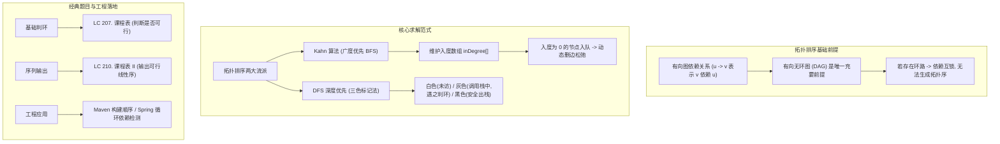

# 13 · 拓扑排序与 DAG：Kahn 算法、依赖解析与成环检测

> [!abstract] 一句话第一性原理
> **拓扑排序（Topological Sort）** 的本质是**将有向图中的“偏序依赖关系”转化为一条线性的“全序执行序列”**。其数学前提是图必须为**有向无环图（DAG）**。核心策略是**贪心消除“入度为 0（零前置依赖）”的节点并动态松弛其后继依赖，若最终无法消灭所有节点，则证实存在循环死锁**。

---

## 知识全景图



---

## 一、 底层核心机制：入度、出度与 Kahn 算法

### 1. 什么是入度（In-degree）与出度（Out-degree）？
- **入度（In-degree）**：有多少条边指向该节点（即该任务有多少个**前置依赖条件**）；
- **出度（Out-degree）**：该节点指向了多少个后继节点（即完成了该任务可以解锁哪些后续任务）。

---

### 2. Kahn 算法四大执行步骤（BFS 流派，推荐度 100%）
Kahn 算法模拟了人类处理任务的最自然方式：
1. **建图并统计所有节点的入度**：维护一个入度数组 `int[] inDegree` 和邻接表 `List<List<Integer>> graph`；
2. **零入度入队**：将所有入度为 0 的节点塞入队列 `Queue<Integer>`（这些任务可以直接开工，无任何先决条件）；
3. **出队并消除依赖**：
   - 从队首弹出一个节点 `u`，将其加入结果序列；
   - 遍历 `u` 的所有后继节点 `v`，执行 `inDegree[v]--`；
   - 若 `inDegree[v] == 0`，说明 `v` 的所有先决条件已被满足，将 `v` 入队；
4. **环路判定**：
   - 若结果序列中的节点数恰好等于节点总数 $N$，拓扑排序成功；
   - 若结果节点数 $< N$，**说明剩余节点形成了循环依赖死锁（存在有向环）**！

---

## 二、 通用代码骨架（Kahn 算法标准模版）

```java
import java.util.*;

public class TopologicalSortTemplate {
    /**
     * @param numNodes 节点总数 (0 到 numNodes - 1)
     * @param edges    有向边列表 [u, v] 表示 u -> v (u 是 v 的前置任务)
     * @return 拓扑排序序列；如果存在环，返回空数组
     */
    public int[] kahnTopologicalSort(int numNodes, int[][] edges) {
        List<List<Integer>> graph = new ArrayList<>();
        for (int i = 0; i < numNodes; i++) graph.add(new ArrayList<>());
        int[] inDegree = new int[numNodes];

        // 1. 建图并统计入度
        for (int[] e : edges) {
            int u = e[0], v = e[1];
            graph.get(u).add(v);
            inDegree[v]++;
        }

        // 2. 将所有入度为 0 的节点入队
        Queue<Integer> queue = new ArrayDeque<>();
        for (int i = 0; i < numNodes; i++) {
            if (inDegree[i] == 0) {
                queue.offer(i);
            }
        }

        // 3. BFS 扩散消除依赖
        int[] result = new int[numNodes];
        int count = 0;

        while (!queue.isEmpty()) {
            int u = queue.poll();
            result[count++] = u;

            for (int v : graph.get(u)) {
                inDegree[v]--;
                if (inDegree[v] == 0) {
                    queue.offer(v);
                }
            }
        }

        // 4. 若 count != numNodes，说明有环，无法完成拓扑排序
        return count == numNodes ? result : new int[0];
    }
}
```

---

## 三、 经典题型实战

### 1. LC 207. 课程表（Course Schedule）
- **题目描述**：你这个学期必须选修 `numCourses` 门课程，记为 `0` 到 `numCourses - 1`。在选修某些课程之前需要一些先修课程。先修课程按数组 `prerequisites` 给出，其中 `prerequisites[i] = [ai, bi]` ，表示如果要学习课程 `ai` 则必须先修课程 `bi`。请你判断是否可能完成所有课程的学习？
- **输入输出示例**：
  - 输入：`numCourses = 2, prerequisites = [[1,0]]` $\to$ 输出：`true`（先学 0，再学 1 即可）；
  - 输入：`numCourses = 2, prerequisites = [[1,0],[0,1]]` $\to$ 输出：`false`（0 与 1 相互依赖成环，无法修完）。
- **核心考点**：拓扑排序成环检测。只要按照 Kahn 算法遍历结束，统计出队的课程数是否等于 `numCourses` 即可。

```java
class Solution207 {
    public boolean canFinish(int numCourses, int[][] prerequisites) {
        List<List<Integer>> graph = new ArrayList<>();
        for (int i = 0; i < numCourses; i++) graph.add(new ArrayList<>());
        int[] inDegree = new int[numCourses];

        // 注意题目说明: [ai, bi] 表示 bi -> ai
        for (int[] p : prerequisites) {
            graph.get(p[1]).add(p[0]);
            inDegree[p[0]]++;
        }

        Queue<Integer> queue = new ArrayDeque<>();
        for (int i = 0; i < numCourses; i++) {
            if (inDegree[i] == 0) queue.offer(i);
        }

        int completed = 0;
        while (!queue.isEmpty()) {
            int cur = queue.poll();
            completed++;

            for (int next : graph.get(cur)) {
                if (--inDegree[next] == 0) {
                    queue.offer(next);
                }
            }
        }
        return completed == numCourses;
    }
}
```

---

### 2. LC 210. 课程表 II（Course Schedule II）
- **题目描述**：现在你总共有 `numCourses` 门课。部分课程存在先修约束 `prerequisites[i] = [ai, bi]`（`bi -> ai`）。返回你为了学完所有课程所安排的学习顺序。可能会有多个正确的顺序，你只要返回任意一种即可。如果不可能完成所有课程，返回一个空数组。
- **输入输出示例**：
  - 输入：`numCourses = 4, prerequisites = [[1,0],[2,0],[3,1],[3,2]]` $\to$ 输出：`[0,2,1,3]`（或 `[0,1,2,3]`）；
  - 输入：`numCourses = 1, prerequisites = []` $\to$ 输出：`[0]`。
- **核心考点**：在 Kahn 算法出队时，顺带用数组记录出队顺序，最后校验是否满额。

```java
class Solution210 {
    public int[] findOrder(int numCourses, int[][] prerequisites) {
        List<List<Integer>> graph = new ArrayList<>();
        for (int i = 0; i < numCourses; i++) graph.add(new ArrayList<>());
        int[] inDegree = new int[numCourses];

        for (int[] p : prerequisites) {
            graph.get(p[1]).add(p[0]); // p[1] -> p[0]
            inDegree[p[0]]++;
        }

        Queue<Integer> queue = new ArrayDeque<>();
        for (int i = 0; i < numCourses; i++) {
            if (inDegree[i] == 0) queue.offer(i);
        }

        int[] order = new int[numCourses];
        int idx = 0;

        while (!queue.isEmpty()) {
            int u = queue.poll();
            order[idx++] = u;

            for (int v : graph.get(u)) {
                if (--inDegree[v] == 0) {
                    queue.offer(v);
                }
            }
        }

        return idx == numCourses ? order : new int[0];
    }
}
```

---

## 四、 进阶演化：字典序最小的拓扑排序

若题目要求“**如果有多种合法的拓扑序列，返回字典序最小的一个**”：
- **解决方案**：将 Kahn 算法中的普通队列 `ArrayDeque` 替换为**小顶堆 `PriorityQueue<Integer>`**！
- 每次从堆顶弹出的必是当前所有入度为 0 且编号最小的节点，贪心保证全局字典序最小。时间复杂度仅从 $O(V + E)$ 变为 $O((V + E) \log V)$。

---

## 五、 工业级工程应用映射

1. **构建工具任务编排**：Maven、Gradle 或 Webpack 打包时，分析模块间的 `pom.xml` 依赖图，利用拓扑排序决定编译先后顺序；
2. **Spring IOC 容器循环依赖**：Spring 在初始化单例 Bean 时，利用类似 DFS 三色标记法检测 `@Autowired` 是否陷入无法自拔的循环依赖死锁；
3. **数据库外键级联删除**：根据外键约束图拓扑逆序执行表数据清理，避免外键违规报错。
