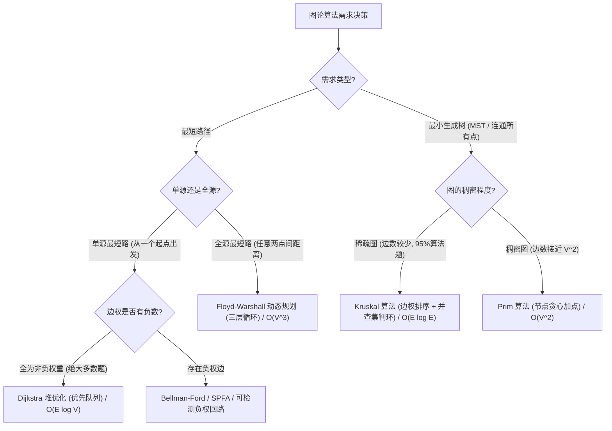

# 14 · 图论最短路径与最小生成树：Dijkstra、Floyd 与 Kruskal 并查集

> [!abstract] 一句话第一性原理
> **图论算法**的本质是**在点与边的拓扑网络上进行受限状态转移**。
> - **最短路径**：基于“**三角不等式松弛（Relaxation）**”，若经过中间中继点 $k$ 能使起点到终点的距离更短，即 $dist[u] + w(u, v) < dist[v]$，则贪心或动态规划更新最优路径；
> - **最小生成树（MST）**：基于“**切分定理与贪心选择**”，用最小的边权代价连通全部 $V$ 个节点且不产生任何环路（恰好选取 $V - 1$ 条边）。

---

## 知识全景与算法选型决策树



---

## 一、 单源最短路径：Dijkstra 堆优化算法

### 1. 核心运行机制
1. **距离数组 `dist[]` 初始化**：起点 `dist[start] = 0`，其余所有点初始为无穷大 $\infty$；
2. **小顶堆优先弹出**：维护一个小顶堆 `PriorityQueue<int[]>`（存储 `[节点编号, 当前最短距离]`）。每次弹出**当前全局距离最近且未被最终确定的节点 `u`**；
3. **邻居松弛（Relaxation）**：遍历 `u` 的所有出边 $(u, v, w)$：
   $$\text{若 } dist[u] + w < dist[v] \implies dist[v] = dist[u] + w, \quad \text{并将 } (v, dist[v]) \text{ 压入堆中}$$
4. **懒惰删除（Lazy Deletion）**：若从堆中弹出的距离已经大于 `dist[u]`，说明该记录是过去产生的过期脏数据，直接 `continue` 跳过。

> [!danger] 核心面试追问：Dijkstra 为什么不能处理包含“负权边”的图？
> Dijkstra 依赖于一个根本贪心假设：“**当前距离起点最近的未确定节点，未来绝不可能通过其他路径被更新得更短**”。但如果存在负权边，未来走一条包含负权的漫长路径反而可能让总距离变小，彻底颠覆了贪心确定性的物理基础，导致结果错误！包含负权边必须使用 Bellman-Ford 或 SPFA 算法。

---

### 2. Dijkstra 标准代码骨架

```java
import java.util.*;

public class DijkstraTemplate {
    public int[] dijkstra(int n, List<List<int[]>> graph, int start) {
        int[] dist = new int[n];
        Arrays.fill(dist, Integer.MAX_VALUE);
        dist[start] = 0;

        // 堆中存 [节点编号, 距离起点开销]，按距离从小到大排
        PriorityQueue<int[]> pq = new PriorityQueue<>((a, b) -> Integer.compare(a[1], b[1]));
        pq.offer(new int[]{start, 0});

        while (!pq.isEmpty()) {
            int[] cur = pq.poll();
            int u = cur[0], d = cur[1];

            // 懒惰删除：若堆中弹出的距离比当前记录的还大，直接跳过
            if (d > dist[u]) continue;

            for (int[] edge : graph.get(u)) {
                int v = edge[0], weight = edge[1];
                if (dist[u] + weight < dist[v]) {
                    dist[v] = dist[u] + weight;
                    pq.offer(new int[]{v, dist[v]});
                }
            }
        }
        return dist;
    }
}
```

---

## 二、 全源最短路径：Floyd-Warshall 极简 DP

当需要求图中**任意两点之间的最短路径**，且节点数 $V \le 400$ 时，Floyd 是代码最少（仅 5 行核心循环）的算法。

### 核心状态转移
令 $dp[k][i][j]$ 表示“**只允许经过前 $k$ 个节点作为中继点时，$i$ 到 $j$ 的最短路径**”：
$$dp[i][j] = \min(dp[i][j], dp[i][k] + dp[k][j])$$

```java
public void floyd(int n, int[][] dist) {
    // 关键铁律：中继点 k 必须放在最外层循环！
    for (int k = 0; k < n; k++) {
        for (int i = 0; i < n; i++) {
            for (int j = 0; j < n; j++) {
                if (dist[i][k] != Integer.MAX_VALUE && dist[k][j] != Integer.MAX_VALUE) {
                    dist[i][j] = Math.min(dist[i][j], dist[i][k] + dist[k][j]);
                }
            }
        }
    }
}
```

---

## 三、 最小生成树（MST）：Kruskal 算法（并查集贪心选边）

### 核心第一性原理
1. 将图中的所有边按**权值从小到大升序排序**；
2. 从最小的边开始遍历：
   - 使用**并查集（Union-Find）**检验该边的两个端点 $u$ 和 $v$ 是否已经连通；
   - 若未连通，说明加入该边**不会产生环**，将该边纳入生成树，并将 $u$ 与 $v$ 合并；
   - 若已经连通，直接抛弃（否则必然成环）；
3. 当选中的边数达到 $V - 1$ 条时，最小生成树构建完毕！

---

## 四、 经典真题实战

### 1. LC 743. 网络延迟时间（Dijkstra 堆优化）

> 🔗 **LeetCode 题目直通车**：[LeetCode 743. 网络延迟时间 ↗](https://leetcode.cn/problems/network-delay-time/)
- **题目描述**：有 `n` 个网络节点，标记为 `1` 到 `n`。给你一个列表 `times`，表示信号经过有向边的传递时间 `times[i] = (ui, vi, wi)`。现在我们从某个节点 `k` 发出一个信号。需要多久才能使所有节点都收到信号？如果不能使所有节点收到信号，返回 `-1`。
- **输入输出示例**：输入 `times = [[2,1,1],[2,3,1],[3,4,1]], n = 4, k = 2` $\to$ 输出 `2`。
- **核心考点**：求从单源起点 `k` 到其余所有节点的最短路中的**最大值**（所有节点全部到达所需的时间即为最慢到达的那个时间）。

```java
class Solution743 {
    public int networkDelayTime(int[][] times, int n, int k) {
        // 1. 建邻接表 (节点编号 1 到 n)
        List<List<int[]>> graph = new ArrayList<>();
        for (int i = 0; i <= n; i++) graph.add(new ArrayList<>());
        for (int[] t : times) {
            graph.get(t[0]).add(new int[]{t[1], t[2]}); // u -> (v, w)
        }

        // 2. 初始化最短距离数组
        int[] dist = new int[n + 1];
        Arrays.fill(dist, Integer.MAX_VALUE);
        dist[k] = 0;

        PriorityQueue<int[]> pq = new PriorityQueue<>((a, b) -> Integer.compare(a[1], b[1]));
        pq.offer(new int[]{k, 0});

        while (!pq.isEmpty()) {
            int[] cur = pq.poll();
            int u = cur[0], d = cur[1];

            if (d > dist[u]) continue; // 懒惰跳过

            for (int[] edge : graph.get(u)) {
                int v = edge[0], w = edge[1];
                if (dist[u] + w < dist[v]) {
                    dist[v] = dist[u] + w;
                    pq.offer(new int[]{v, dist[v]});
                }
            }
        }

        // 3. 统计到达所有节点的最长耗时
        int maxTime = 0;
        for (int i = 1; i <= n; i++) {
            if (dist[i] == Integer.MAX_VALUE) return -1; // 有节点不可达
            maxTime = Math.max(maxTime, dist[i]);
        }
        return maxTime;
    }
}
```

---

### 2. LC 1584. 连接所有点的最小费用（Kruskal 最小生成树实战）

> 🔗 **LeetCode 题目直通车**：[LeetCode 1584. 连接所有点的最小费用 ↗](https://leetcode.cn/problems/min-cost-to-connect-all-points/)
- **题目描述**：给你一个 `points` 数组，表示 2D 平面上的一些点。连接两点 `[xi, yi]` 和 `[xj, yj]` 的开销为它们之间的曼哈顿距离：`|xi - xj| + |yi - yj|`。返回连通所有点所需的最小总费用（恰好使所有点之间存在路径且总费用最小）。
- **输入输出示例**：输入 `points = [[0,0],[2,2],[3,10],[5,2],[7,0]]` $\to$ 输出 `20`。
- **核心考点**：完全图的最小生成树。将所有点对计算边权，排序后利用并查集按权贪心合并。

```java
class Solution1584 {
    public int minCostConnectPoints(int[][] points) {
        int n = points.length;
        List<int[]> edges = new ArrayList<>();

        // 1. 构建所有点对之间的边权
        for (int i = 0; i < n; i++) {
            for (int j = i + 1; j < n; j++) {
                int cost = Math.abs(points[i][0] - points[j][0]) + Math.abs(points[i][1] - points[j][1]);
                edges.add(new int[]{i, j, cost});
            }
        }

        // 2. 按边权升序排序 (防溢出用 Integer.compare)
        edges.sort((a, b) -> Integer.compare(a[2], b[2]));

        // 3. 并查集贪心选边
        UnionFind uf = new UnionFind(n);
        int totalCost = 0;
        int edgeCount = 0;

        for (int[] e : edges) {
            int u = e[0], v = e[1], w = e[2];
            if (uf.union(u, v)) {
                totalCost += w;
                edgeCount++;
                if (edgeCount == n - 1) break; // 已形成生成树
            }
        }
        return totalCost;
    }

    private static class UnionFind {
        int[] parent;
        public UnionFind(int n) {
            parent = new int[n];
            for (int i = 0; i < n; i++) parent[i] = i;
        }
        public int find(int x) {
            if (parent[x] != x) parent[x] = find(parent[x]); // 路径压缩
            return parent[x];
        }
        public boolean union(int x, int y) {
            int rx = find(x), ry = find(y);
            if (rx == ry) return false; // 已在同一连通分量，会产生环
            parent[rx] = ry;
            return true;
        }
    }
}
```

---

## 五、 算法对比与复杂度速查表

| 算法名称 | 解决问题类型 | 边权约束 | 推荐数据结构 | 时间复杂度 | 空间复杂度 |
| :--- | :--- | :--- | :--- | :--- | :--- |
| **Dijkstra (堆优化)** | 单源最短路径 | **必须非负权** | 邻接表 + 优先队列 | $O(E \log V)$ | $O(V + E)$ |
| **Floyd-Warshall** | 全源最短路径 | 可带负权（无负环） | 二维数组 | $O(V^3)$ | $O(V^2)$ |
| **Bellman-Ford / SPFA** | 单源最短路径 | 可含负权，可检测负环 | 边列表 / 队列 | $O(V \times E)$ | $O(V)$ |
| **Kruskal** | 最小生成树 | 无约束 | 边数组排序 + 并查集 | $O(E \log E)$ | $O(V + E)$ |
| **Prim** | 最小生成树 | 无约束 | 邻接矩阵 / 优先队列 | $O(V^2)$ 或 $O(E \log V)$ | $O(V + E)$ |
