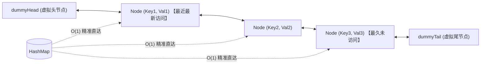

# LC0146-LRU 缓存机制：大厂面试手撕 No.1 标杆实现

> **题目链接**：[LeetCode 146. LRU 缓存](https://leetcode.cn/problems/lru-cache/)  
> **核心要求**：设计并实现一个满足 **LRU（最近最少使用）缓存约束**的数据结构，要求 `get` 和 `put` 的时间复杂度为平均 **$O(1)$**。本文选择手写哈希表与双向链表以学习其机制；原题没有禁止 `LinkedHashMap`，面试是否允许使用现成容器需确认。

---

## 1. 为什么必须是“哈希表 + 双向链表”？（第一性原理推导）

面试官最喜欢问：“你为什么不用数组？为什么单向链表不行？为什么节点里必须同时存 key 和 value？”

| 数据结构组合 | 查询性能 | 移动到头部性能 | 淘汰尾部性能 | 结论 |
| :--- | :--- | :--- | :--- | :--- |
| **数组（Array）** | $O(1)$（按下标） | $O(N)$（数组元素大量搬移） | $O(1)$ | 排除（写操作太慢） |
| **单向链表（Singly Linked List）** | $O(N)$（需线性遍历） | $O(N)$（需定位前驱才能摘除） | $O(N)$（删除尾节点需要找到前驱） | 排除（无法做到双 $O(1)$） |
| **哈希表 + 单向链表** | $O(1)$（通过 Map 定位） | $O(N)$（从链表中删除节点仍需前驱） | $O(N)$ | 排除 |
| **哈希表 + 双向链表 (Doubly Linked)** | **$O(1)$** | **$O(1)$（前驱后继指针秒解绑）** | **$O(1)$** | 常见且直接的实现 |

上述哈希表操作按平均常数时间分析。若哈希表额外维护前驱节点，单向链表也可实现 LRU，但移动时需同步更多映射；双向链表是更直接的选择，不是数学上唯一方案。

### 1.1 灵魂追问：双向链表节点内为什么必须同时存储 `key`？
> **致命细节**：哈希表里存了 `Key -> Node`，`Node` 存了 `value` 还不够吗？
> **答案**：当缓存容量达到上限，需要淘汰尾部节点 `removeTail()` 时，我们拿到了这个被淘汰的 `Node`。此时我们**必须同步将该键值对从 `HashMap` 中清除**！
> 如果 `Node` 内部没有保存 `key`，我们就无法通过 `node.key` 去执行 `map.remove(node.key)`，除非耗费 $O(N)$ 遍历整个 Map！因此 `Node` 内部必须同时保存 `key` 和 `value`！

---

## 2. 核心架构图解：双虚拟哨兵节点（Dummy Head & Tail）

引入虚拟头节点 `dummyHead` 和虚拟尾节点 `dummyTail`，彻底消灭所有 `null` 判断和边界特判！



---

## 3. 白板默写级 Bug-Free 源码实战

```java
class LRUCache {

    // 1. 自定义双向链表节点
    static class Node {
        int key;
        int value;
        Node prev;
        Node next;

        Node(int key, int value) {
            this.key = key;
            this.value = value;
        }
    }

    private final int capacity;
    // 哈希表：实现 O(1) 根据 key 定位链表节点
    private final Map<Integer, Node> map;
    // 虚拟头尾哨兵
    private final Node dummyHead;
    private final Node dummyTail;

    public LRUCache(int capacity) {
        this.capacity = capacity;
        this.map = new HashMap<>();
        
        this.dummyHead = new Node(-1, -1);
        this.dummyTail = new Node(-1, -1);
        // 初始化空链表：头尾互连
        dummyHead.next = dummyTail;
        dummyTail.prev = dummyHead;
    }

    /**
     * O(1) 读取：存在则刷新访问顺序，不存在返回 -1
     */
    public int get(int key) {
        Node node = map.get(key);
        if (node == null) {
            return -1;
        }
        // 访问命中：将其刷新移动到链表头部（表示最近刚被使用）
        moveToHead(node);
        return node.value;
    }

    /**
     * O(1) 写入：存在则修改并刷新，不存在则新增并检查容量淘汰
     */
    public void put(int key, int value) {
        Node node = map.get(key);

        if (node != null) {
            // Key 已存在：更新新值，并移动到头部
            node.value = value;
            moveToHead(node);
        } else {
            // Key 不存在：构建新节点
            Node newNode = new Node(key, value);
            map.put(key, newNode);
            addToHead(newNode);

            // 容量超出上限：淘汰最久未使用的尾部节点
            if (map.size() > capacity) {
                Node evictedNode = removeTail();
                // 关键动作：必须同步从哈希表中移除！
                map.remove(evictedNode.key);
            }
        }
    }

    // ================== 双向链表四驱基础原子操作 ==================

    /**
     * 将已有节点移动到链表头部：等价于【先删除该节点】+【再插到头部】
     */
    private void moveToHead(Node node) {
        removeNode(node);
        addToHead(node);
    }

    /**
     * 将新节点插入到 dummyHead 的紧邻后面（成为真正的数据头节点）
     */
    private void addToHead(Node node) {
        node.prev = dummyHead;
        node.next = dummyHead.next;

        dummyHead.next.prev = node;
        dummyHead.next = node;
    }

    /**
     * 从双向链表中解绑并删除指定节点 (O(1))
     */
    private void removeNode(Node node) {
        node.prev.next = node.next;
        node.next.prev = node.prev;
    }

    /**
     * 淘汰并返回链表最末尾的真实数据节点
     */
    private Node removeTail() {
        Node tailNode = dummyTail.prev;
        removeNode(tailNode);
        return tailNode;
    }
}
```

---

## 4. 大厂面试 30 秒绝杀（高频追问 2 连击）

### Q1：如果让你把这个 `LRUCache` 改造成高并发线程安全的，你怎么设计？
> **答题标杆**：
> 1. **粗粒度方案（性能差）**：直接在 `get` 和 `put` 方法上加 `synchronized` 关键字。缺点是所有读读、读写、写写全部串行化，多线程并发吞吐严重受限。
> 2. **读写锁的限制**：`ReentrantReadWriteLock` 不能直接让多个命中的 get 并发执行。
>    - **注意陷阱**：在 LRU 中，`get(key)` 表面上是“读操作”，但它内部执行了 `moveToHead`，**实际改变了双向链表的拓扑指针，因此在 LRU 中 `get` 本质上也是一个写操作**！不能直接加读锁！
>    - **读写锁破局**：对严格 LRU，查询与刷新顺序必须作为一个受保护操作完成；从读锁切换到写锁后需重新确认条目，不能直接升级锁并沿用可能过期的节点引用。通常先用互斥锁保证正确性，另设不刷新顺序的 peek 才能作为纯读操作。
> 3. **分段锁 / 条带化锁（Segmented Lock，极高并发解法）**：类似 1.7 的 `ConcurrentHashMap`，将整个缓存切分为 16 个独立的子 `LRUCache` 分段（Segment），按非负哈希下标路由到不同分段各自加锁，可降低竞争，但实际吞吐不保证提升 16 倍；各分段独立容量和顺序会改变全局严格 LRU 淘汰语义。

### Q2：Redis 中的淘汰策略也是 LRU，但为什么 Redis 没有采用这种“双向链表 + 哈希表”的严格实现？
> **答题标杆**：
> 1. **内存开销不可承受**：严格的双向链表每个节点需要额外维护两个 64 位物理指针（`prev` 和 `next`），至少多占 16 字节。在 Redis 存储数亿个 Key 的场景下，光是维护链表指针就要白白浪费数 GB 的昂贵内存！
> 2. **维护成本**：严格 LRU 每次命中都需要更新全局访问顺序；不能把 Redis 的选择简单归因于读命令之间的链表锁竞争。
> 3. **Redis 的极致妥协：近似 LRU 算法（Approximated LRU）**：
>    - Redis 在对象的元数据头中仅占用 24 位（bits）记录一个最后访问时间戳（`lru` 字段）。
>    - 当需要内存淘汰时，Redis 随机抽取 5 个 Key（样本池采样），从中剔除那个访问时间戳最老的 Key。Redis 3.0 起还维护淘汰候选池。官方示例中采样 10 个时接近严格 LRU，但不是对所有工作负载的等价保证；更多采样也会增加 CPU 成本。详见 [Redis 淘汰策略官方说明](https://redis.io/docs/latest/develop/reference/eviction/)。

---

## 5. 一分钟复盘记忆卡

```text
======================= LRU手撕算法通关口诀 =======================
LRU手撕面试王，哈希双向链表强。
定位查找O(1)秒，删插无需挪位防；
虚拟头尾双哨兵，消灭判空边界光；
访问节点移头部，超出容量尾部荒；
Node存Key莫大意，同步删Map凭此帮；
四驱方法拆细写，白板默写大厂狂！
======================================================================
```
