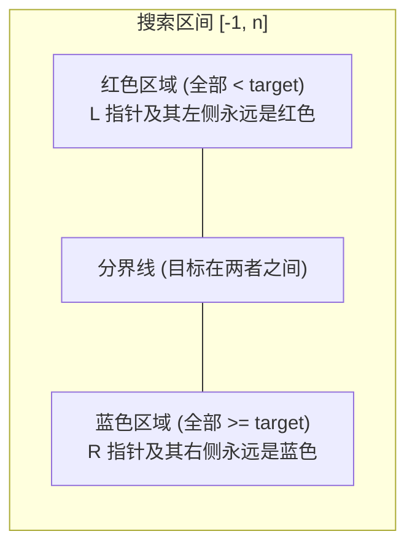
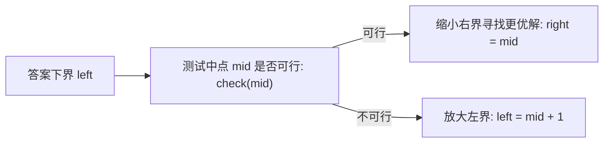

# 模板：二分查找与二分答案（红蓝染色法终结边界死循环）

> **心智模型**：二分的本质不是“单调性”，而是**“二段性”（Two-Phase Property）**——只要能在搜索空间中找到一个判定条件，使得左半部分全部不满足、右半部分全部满足（或者反之），就能用二分在 $O(\log N)$ 时间内锁定分界点！

---

## 1. 终结死循环心智模型：红蓝染色法（Red-Blue Coloring）

面试中写二分最容易陷入 `left = mid` 还是 `mid + 1`、`while` 是 `<` 还是 `<=`、返回 `left` 还是 `right` 的死循环噩梦。
**红蓝染色法是目前最优雅、永不越界、永不死循环的统一心智模型**：



### 1.1 红蓝染色三大铁律
1. **初始化开区间**：`int left = -1, right = nums.length;`
   - 保证区间之外所有的元素都是已染色的（$-1$ 之前全是红色，`nums.length` 之后全是蓝色）。
2. **循环条件永远是开区间相遇**：`while (left + 1 < right)`
   - 当 `left + 1 == right` 时，两者相邻，搜索终止，**永远不会死循环**！
3. **根据性质染色，不加减 1**：
   - 算中点：`int mid = left + (right - left) / 2;`
   - 若 `isBlue(nums[mid])` 为真：`right = mid;`（染成蓝色）
   - 若为假：`left = mid;`（染成红色）
4. **返回值定乾坤**：
   - 循环结束时，`left` 停在红色最右侧，`right` 停在蓝色最左侧！
   - **求第一个满足条件的位置**：直接返回 `right`！
   - **求最后一个不满足条件的位置**：直接返回 `left`！

---

## 2. 经典基础模板：查找等于 target 的左边界与右边界

```java
public class BinarySearchTemplate {

    /**
     * 查找第一个 >= target 的位置（经典 lower_bound）
     * 对应红蓝规则：蓝色的定义是 nums[i] >= target
     */
    public int lowerBound(int[] nums, int target) {
        int left = -1;
        int right = nums.length; // 开区间 (-1, nums.length)

        while (left + 1 < right) {
            int mid = left + (right - left) / 2;
            if (nums[mid] >= target) {
                right = mid; // 属于蓝色
            } else {
                left = mid;  // 属于红色
            }
        }
        // 循环结束：left 是最大的 < target 的下标，right 是最小的 >= target 的下标
        return right; 
    }

    /**
     * 查找第一个 > target 的位置（经典 upper_bound）
     * 对应红蓝规则：蓝色的定义是 nums[i] > target
     */
    public int upperBound(int[] nums, int target) {
        int left = -1;
        int right = nums.length;

        while (left + 1 < right) {
            int mid = left + (right - left) / 2;
            if (nums[mid] > target) {
                right = mid; // 属于蓝色
            } else {
                left = mid;  // 属于红色
            }
        }
        return right;
    }

    /**
     * 力扣 34 题：在排序数组中查找元素的第一个和最后一个位置
     */
    public int[] searchRange(int[] nums, int target) {
        int start = lowerBound(nums, target);
        // 如果越界或根本不等于 target，说明不存在
        if (start == nums.length || nums[start] != target) {
            return new int[]{-1, -1};
        }
        // 最后一个等于 target 的位置，等价于 (第一个大于 target 的位置) - 1
        int end = upperBound(nums, target) - 1;
        return new int[]{start, end};
    }
}
```

---

## 3. 高阶进阶模板：二分答案法（Binary Search on Answer）

在力扣中高级题目中，80% 的二分题**根本没有有序数组**！题目要求的是：“求满足某种条件下的**最小的最大值**，或**最大的最小值**”。

### 3.1 适用题型特征
- 答案存在明确的取值下界 `minVal` 和上界 `maxVal`；
- 答案具备**单调递增/递减的单向有效性**：若 $x$ 可行，则比 $x$ 更大（或更小）的值必定也都可行。



### 3.2 工业级二分答案框架与实战（LC 875 爱吃香蕉的珂珂）

```java
class Solution {
    /**
     * 求珂珂吃完所有香蕉的【最小速度 k】
     */
    public int minEatingSpeed(int[] piles, int h) {
        int left = 1; // 最小速度 1 根/小时
        int right = 1_000_000_000; // 最大速度（香蕉堆的最大值）

        int ans = right;
        while (left <= right) {
            int mid = left + (right - left) / 2;
            if (canFinish(piles, mid, h)) {
                ans = mid;        // 当前速度可行，尝试更小的速度（往左找）
                right = mid - 1;
            } else {
                left = mid + 1;   // 吃不完，必须提速（往右找）
            }
        }
        return ans;
    }

    // 判定函数 check：速度为 speed 时，能否在 h 小时内吃完？
    private boolean canFinish(int[] piles, int speed, int h) {
        long totalHours = 0;
        for (int pile : piles) {
            // 向上取整计算耗时：(pile + speed - 1) / speed
            totalHours += (pile + speed - 1) / speed;
        }
        return totalHours <= h;
    }
}
```

---

## 4. 大厂面试 30 秒绝杀（二分高频考点）

### Q1：二分计算中点为什么必须写成 `mid = left + (right - left) / 2`？写成 `(left + right) / 2` 为什么是大厂零分操作？
> **答题标杆**：
> 1. **整数溢出漏洞（Integer Overflow Bug）**：在 Java 中，`int` 的最大值为 $2^{31} - 1 \approx 21$ 亿。当搜索空间很大时（例如 `left = 15` 亿，`right = 20` 亿），两者直接相加结果为 35 亿，**发生有符号整型溢出，瞬间变成负数**！导致 `mid` 为负数并抛出 `ArrayIndexOutOfBoundsException`。
> 2. **优化写法**：`left + (right - left) / 2` 在数学上等价，但在计算机中保证了两个正数相减绝不溢出；更高性能写法可使用无符号右移：`mid = (left + right) >>> 1`。

### Q2：旋转排序数组（LC 33）中存在断崖，为什么仍然可以用二分？
> **答题标杆**：
> 1. **二分的本质是二段性，不是整体单调性**！
> 2. 将旋转数组从中点 `mid` 一分为二，**必定有一半是严格单调有序的，另一半是旋转数组**！
> 3. 我们只需先通过 `nums[left] <= nums[mid]` 判断左半段是否有序：
>    - 若左半段有序且 `target` 落在 `[nums[left], nums[mid]]` 之间，则目标必在左侧，收缩 `right = mid - 1`；
>    - 否则目标必在右侧，收缩 `left = mid + 1`。每次依然能够稳定排除一半的搜索区间，保持 $O(\log N)$ 复杂度。

---

## 5. 一分钟复盘记忆卡

```text
======================= 二分查找通关口诀 =======================
二分本质二段性，排除一半定乾坤。
中点相加防溢出，left加上减除二；
红蓝染色最优雅，left负一右length；
相邻结束永不死，right收网蓝色根；
二分答案单调判，向上取整算时辰；
旋转数组切两截，必有一侧单调真；
心中有图边界准，白板手撕秒解纷！
======================================================================
```
