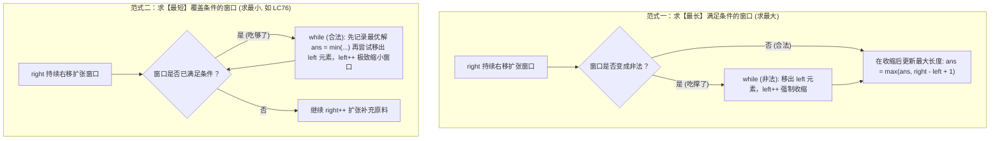

# 模板：滑动窗口双指针（寸取虫爬行心智与双模范式）

> **心智模型**：滑动窗口（Sliding Window）如同**毛毛虫爬行（Inchworm Algorithm）**——头部（右指针 `right`）不断向前伸展吞入元素；当窗口条件被破坏或已经满足时，尾部（左指针 `left`）向前收缩吐出元素。左右指针均**单向递增、绝不回头**，将暴力的 $O(N^2)$ 嵌套循环瞬间降维至 $O(N)$！

---

## 1. 滑动窗口两大核心题型与状态转移图



---

## 2. 范式一实战：求最长无重复子串（LC 3 无重复字符的最长子串）

```java
class Solution {
    /**
     * 求字符串 s 中不含重复字符的最长子串长度
     * 核心逻辑：出现重复时，left 持续收缩直到消除该重复字符
     */
    public int lengthOfLongestSubstring(String s) {
        int[] window = new int[128]; // ASCII 字符频次统计桶
        int left = 0, maxLen = 0;

        for (int right = 0; right < s.length(); right++) {
            char c = s.charAt(right);
            window[c]++;

            // 窗口非法：当前字符频次 > 1，说明出现了重复！
            while (window[c] > 1) {
                char leftChar = s.charAt(left);
                window[leftChar]--;
                left++; // 左指针收缩
            }

            // 窗口恢复合法：在合法状态下更新最大长度
            maxLen = Math.max(maxLen, right - left + 1);
        }
        return maxLen;
    }
}
```

---

## 3. 范式二实战：求最小覆盖子串（LC 76 Hard 终极模版）

这是大厂手撕算法中最常考的 Hard 级神题。掌握了 `valid` 计数器的思想，所有字符串窗口题皆可秒杀：

```java
class Solution {
    /**
     * 在字符串 s 中寻找包含 t 中所有字符的【最小子串】
     */
    public String minWindow(String s, String t) {
        // 目标字符统计与窗口内字符统计
        int[] need = new int[128];
        int[] window = new int[128];
        int needTypes = 0; // t 中包含的不同字符种类数

        for (char c : t.toCharArray()) {
            if (need[c] == 0) needTypes++;
            need[c]++;
        }

        int left = 0, right = 0;
        int valid = 0; // 当前窗口内已经完全满足 need 数量要求的字符种类数
        int start = 0, minLen = Integer.MAX_VALUE;

        while (right < s.length()) {
            char c = s.charAt(right);
            right++; // 1. 移入窗口

            if (need[c] > 0) {
                window[c]++;
                if (window[c] == need[c]) {
                    valid++; // 该字符种类达标！
                }
            }

            // 2. 判定窗口是否已满足全部条件：吃够了，开始尝试从左侧最小化
            while (valid == needTypes) {
                // 更新最小覆盖子串的起始位置与长度
                if (right - left < minLen) {
                    start = left;
                    minLen = right - left;
                }

                char d = s.charAt(left);
                left++; // 移出窗口

                if (need[d] > 0) {
                    if (window[d] == need[d]) {
                        valid--; // 移出后该字符不再达标
                    }
                    window[d]--;
                }
            }
        }

        return minLen == Integer.MAX_VALUE ? "" : s.substring(start, start + minLen);
    }
}
```

---

## 4. 大厂面试 30 秒绝杀（滑动窗口深水区）

### Q1：为什么“和为 K 的子数组”（LC 560）不能用滑动窗口，而必须用“前缀和 + 哈希表”？
> **答题标杆**：
> 1. **破局前提：滑动窗口必须依赖“单调性”（Monotonicity）**！
>    - 当数组元素**全为正整数**时，`right` 右移，窗口和**必定单调递增**；`left` 右移，窗口和**必定单调递减**。这种严格单调性保证了指针移动方向的唯一确定性。
> 2. **负数打破单调性**：LC 560 的数组中包含**负数**！如果窗口和大于 $K$，右移 `left` 可能会因为移出了一个负数反而让和变得更大；右移 `right` 也可能因为遇到了负数让和变小。左右指针移动无法判断贪心方向，滑动窗口彻底失效！
> 3. **替代方案**：含有负数的区间和问题，必须使用 **前缀和 + 哈希表（`Map<PrefixSum, Count>`）**，在 $O(N)$ 内通过数学差值寻找历史前缀。

### Q2：固定长度窗口（Fixed Window）与变长窗口（Variable Window）在代码结构上有何区别？
> **答题标杆**：
> - **变长窗口**：使用 `while` 循环动态收缩 `left` 指针（`while (invalid) left++;`），窗口大小随数据弹性伸缩。
> - **固定长度窗口（如长度为 $k$）**：不需要复杂的 `while`，直接利用 `if (right >= k)`，每次进入一个新元素的同时，以步进方式 `if (right >= k) { remove(left); left++; }` 恒定吐出一个旧元素，保持窗口宽度严格为 $k$。

---

## 5. 一分钟复盘记忆卡

```text
======================= 滑动窗口通关口诀 =======================
双指针同向单调滑，毛毛虫爬复杂度降。
求最长时吃撑缩，非法while left逐出亡；
求最短时吃够敛，合规while记录先；
valid计数对不同，ASCII数组百二八；
正数单调方能滑，若有负数前缀踏；
进一退一控状态，左右单向秒全刷！
======================================================================
```
