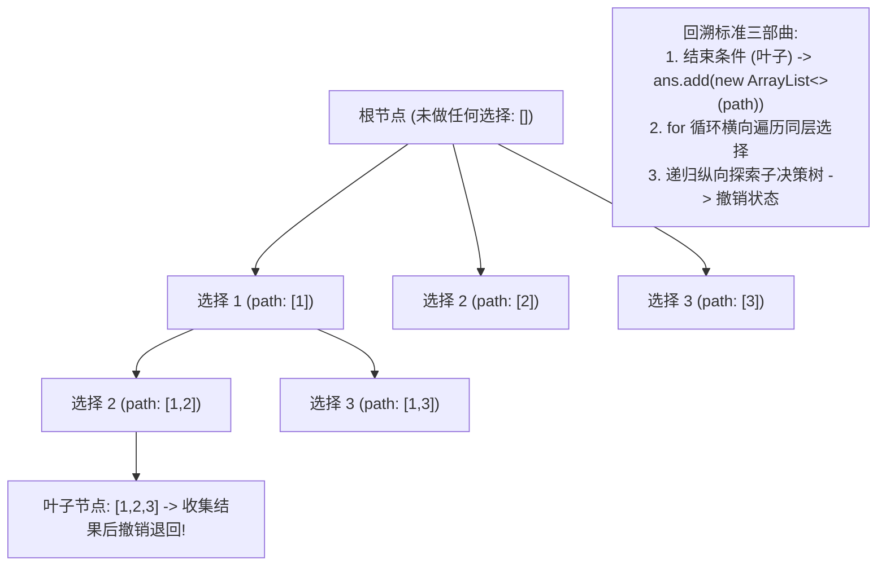

# 模板：回溯算法框架与去重剪枝（多叉决策树心智模型）

> **心智模型**：回溯算法的本质是**在一棵“多叉决策树”上进行纯粹的深度优先遍历（DFS）**。它只干三件事：
> 1. **做选择（Choose）**：在当前节点挑选一个分支进入，将状态加入 `path`；
> 2. **递归（Recurse）**：向更深一层的决策空间推进；
> 3. **撤销选择（Backtrack）**：从叶子节点回退时，必须将状态完美恢复原样（还原现场），以便尝试同层的其他可能！

---

## 1. 回溯决策树与通用代码骨架



```java
// 回溯算法全局通用模板伪代码
void backtrack(参数, 状态标记, List<Integer> path, List<List<Integer>> ans) {
    if (满足终止条件) {
        ans.add(new ArrayList<>(path)); // 必须深拷贝！
        return;
    }

    for (当前层的所有可用候选 : 选择列表) {
        if (剪枝条件) continue; // 剪枝，跳过无效分支

        做选择: 记录状态, path.add(候选);
        backtrack(下一层参数, 更新标记, path, ans); // 纵向递归
        撤销选择: 恢复状态, path.remove(path.size() - 1); // 必须对称还原！
    }
}
```

---

## 2. 回溯三大分支经典实战

### 2.1 分支一：子集与组合问题（无重复不可复选）
- **特点**：元素无顺序之分，`[1, 2]` 和 `[2, 1]` 算同一个集合。
- **解法关键**：使用 `startIndex` 参数控制**“永远只往后选，绝不回头”**！

```java
class SubsetSolution {
    public List<List<Integer>> subsets(int[] nums) {
        List<List<Integer>> ans = new ArrayList<>();
        backtrack(nums, 0, new ArrayList<>(), ans);
        return ans;
    }

    private void backtrack(int[] nums, int startIndex, List<Integer> path, List<List<Integer>> ans) {
        // 子集问题：决策树的每一个节点都是一个合法子集！
        ans.add(new ArrayList<>(path));

        for (int i = startIndex; i < nums.length; i++) {
            path.add(nums[i]);                     // 1. 做选择
            backtrack(nums, i + 1, path, ans);     // 2. 递归 (i + 1 保证不回头)
            path.remove(path.size() - 1);          // 3. 撤销选择
        }
    }
}
```

---

### 2.2 分支二：组合去重（含重复元素不可复选，LC 90 / LC 40）
- **痛点**：输入包含重复数字（如 `[1, 2, 2]`），如果不去重会生成两个 `[1, 2]`。
- **神级去重铁律：【先排序 + 树层去重】**！
  - 同一条树枝（纵向递归）允许相同元素（如选第一个 2，再选第二个 2，得到 `[2, 2]`）；
  - 同一层（横向 for 循环）**绝对禁止重复选择相同数值**！

```java
class CombinationUniqueSolution {
    public List<List<Integer>> subsetsWithDup(int[] nums) {
        List<List<Integer>> ans = new ArrayList<>();
        Arrays.sort(nums); // 1. 去重第一步：必须先排序，让相同元素紧挨着！
        backtrack(nums, 0, new ArrayList<>(), ans);
        return ans;
    }

    private void backtrack(int[] nums, int startIndex, List<Integer> path, List<List<Integer>> ans) {
        ans.add(new ArrayList<>(path));

        for (int i = startIndex; i < nums.length; i++) {
            // 2. 核心同层去重逻辑：如果当前元素与前一个相同，且不是本层的第一个元素，直接跳过！
            if (i > startIndex && nums[i] == nums[i - 1]) {
                continue; // 剪枝同层重复
            }

            path.add(nums[i]);
            backtrack(nums, i + 1, path, ans);
            path.remove(path.size() - 1);
        }
    }
}
```

---

### 2.3 分支三：全排列（含重复元素，LC 47）
- **特点**：顺序相关，`[1, 2]` 与 `[2, 1]` 是不同排列。每次循环都从 `0` 开始遍历，通过 `used[i]` 数组记录当前哪些数字已被占用。

```java
class PermuteUniqueSolution {
    public List<List<Integer>> permuteUnique(int[] nums) {
        List<List<Integer>> ans = new ArrayList<>();
        Arrays.sort(nums); // 先排序
        boolean[] used = new boolean[nums.length];
        backtrack(nums, used, new ArrayList<>(), ans);
        return ans;
    }

    private void backtrack(int[] nums, boolean[] used, List<Integer> path, List<List<Integer>> ans) {
        if (path.size() == nums.length) {
            ans.add(new ArrayList<>(path));
            return;
        }

        for (int i = 0; i < nums.length; i++) {
            if (used[i]) continue;

            // 排列去重精髓：nums[i] == nums[i-1] 且 !used[i-1]
            // 说明同一层的上一分支刚刚回溯结束，释放了 used[i-1]！此时再选 nums[i] 必重复！
            if (i > 0 && nums[i] == nums[i - 1] && !used[i - 1]) {
                continue;
            }

            used[i] = true;
            path.add(nums[i]);
            backtrack(nums, used, path, ans);
            path.remove(path.size() - 1);
            used[i] = false;
        }
    }
}
```

---

## 3. 大厂面试 30 秒绝杀（回溯高频陷阱）

### Q1：为什么收集结果时必须写 `ans.add(new ArrayList<>(path))`？直接写 `ans.add(path)` 会发生什么？
> **答题标杆**：
> 1. **引用传递陷阱**：`path` 是一个内存中的对象引用（堆指针）。如果直接执行 `ans.add(path)`，添加到结果集里的全都是指向**同一个物理对象**的引用。
> 2. **灾难结果**：随着回溯不断执行，`path` 在不断执行 `path.remove()` 最终退回根节点，`path` 会被清空为空列表 `[]`。最终打印 `ans` 时，**所有收集的结果全部变成了空列表 `[[], [], []...]`**！
> 3. 必须通过 `new ArrayList<>(path)` 执行**浅拷贝快照克隆**，将当前状态固化保存。

### Q2：在排列去重中，为什么写 `!used[i - 1]` 比写 `used[i - 1]` 效率更高？
> **答题标杆**：
> - `nums[i] == nums[i-1] && !used[i-1]`：判定的是**树层重复（横向同层）**。`!used[i-1]` 为真，说明刚刚完成了对前一个相同数值分支的探索与回溯，前一个数值已经被释放，现在正在尝试当前同层的第二个相同数值，**剪枝发生在决策树的最高层，剪掉了整棵子树，效率最高**！
> - 若写成 `used[i-1]`，判定的是树枝去重（纵向递归），虽然最终也能去重，但会产生大量无效的纵向深入探索，计算开销大得多。

---

## 4. 一分钟复盘记忆卡

```text
======================= 回溯算法通关口诀 =======================
多叉决策树上走，深度优先纵横游。
终止条件叶子判，拷贝快照放开头；
横向循环同层选，纵向递归树枝收；
状态还原记心中，进一退一对称留；
组合不回头用start，排列used标志扣；
去重必须先排序，同层重复枝剪透！
======================================================================
```
