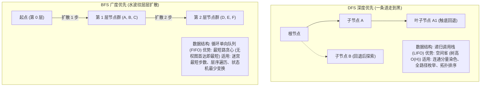

# 模板：DFS 与 BFS 搜索全解（水波扩散与一条道走到黑）

> **心智模型**：
> - **DFS（深度优先）**：如同**独行侠探险**，不撞南墙不回头，底层依赖**栈（函数调用栈）**，天然适合遍历连通块、路径搜索与递归回溯。
> - **BFS（广度优先）**：如同**水波荡漾向外扩散**，齐头并进，底层依赖**队列（Queue）**，**天然具备“首次到达终点即为全局无权最短路径”的贪心数学性质**！

---

## 1. DFS 与 BFS 核心特征与场景对决



---

## 2. DFS 经典实战：网格图连通块“沉没算法”（LC 200 岛屿数量）

在二维网格的 DFS 中，利用原数组直接修改（原地沉没）来代替额外的 `boolean[][] visited` 数组，空间复杂度直接优化到 $O(1)$（不计栈开销）：

```java
class IslandSolution {
    // 四个方向的坐标偏移量：上、下、左、右
    private static final int[][] DIRS = {{-1, 0}, {1, 0}, {0, -1}, {0, 1}};

    public int numIslands(char[][] grid) {
        if (grid == null || grid.length == 0) return 0;
        int m = grid.length, n = grid[0].length;
        int islandCount = 0;

        for (int i = 0; i < m; i++) {
            for (int j = 0; j < n; j++) {
                if (grid[i][j] == '1') {
                    islandCount++;
                    // 核心沉没动作：用 DFS 将与 (i, j) 相连的所有陆地全部置为 '0'
                    dfsSink(grid, i, j);
                }
            }
        }
        return islandCount;
    }

    private void dfsSink(char[][] grid, int r, int c) {
        // 越界检查与终止条件：出界或者是水（'0'）
        if (r < 0 || r >= grid.length || c < 0 || c >= grid[0].length || grid[r][c] != '1') {
            return;
        }

        // 关键动作：原地沉没（访问过标记为 '0'），彻底杜绝死循环！
        grid[r][c] = '0';

        // 沿着四个方向深入递归
        for (int[] dir : DIRS) {
            dfsSink(grid, r + dir[0], c + dir[1]);
        }
    }
}
```

---

## 3. BFS 经典实战：无权最短路径分层扩散模板

在求最短步数时，必须使用**按层剥离的 `int size = queue.size()` 结构**：

```java
class ShortestPathBfsTemplate {

    private static final int[][] DIRS = {{-1, 0}, {1, 0}, {0, -1}, {0, 1}};

    /**
     * 求从起点 (sr, sc) 到终点 (tr, tc) 的最少移动步数
     */
    public int shortestPath(char[][] grid, int sr, int sc, int tr, int tc) {
        int m = grid.length, n = grid[0].length;
        boolean[][] visited = new boolean[m][n];
        Queue<int[]> queue = new ArrayDeque<>();

        // 1. 起点入队，并【立即标记为已访问】！
        queue.offer(new int[]{sr, sc});
        visited[sr][sc] = true;
        int step = 0;

        while (!queue.isEmpty()) {
            int currentLevelSize = queue.size(); // 必须固定当前层的节点数量！

            // 批量处理当前层的所有节点
            for (int i = 0; i < currentLevelSize; i++) {
                int[] curr = queue.poll();
                int r = curr[0], c = curr[1];

                // 首次到达终点，必定是最短路径！
                if (r == tr && c == tc) {
                    return step;
                }

                // 扩散下一层邻居
                for (int[] dir : DIRS) {
                    int nr = r + dir[0];
                    int nc = c + dir[1];

                    // 合法性校验：在界内、非障碍物、且未曾访问过
                    if (nr >= 0 && nr < m && nc >= 0 && nc < n 
                            && grid[nr][nc] != '#' && !visited[nr][nc]) {
                        
                        // 致命铁律：入队时必须【立即标记 visited = true】！
                        visited[nr][nc] = true;
                        queue.offer(new int[]{nr, nc});
                    }
                }
            }
            step++; // 当前层全部处理完，步数加 1
        }

        return -1; // 终点不可达
    }
}
```

---

## 4. 高阶进阶：双向 BFS（Bidirectional BFS）空间降维

当搜索树的展开分支度（Branching Factor）较大时，单向 BFS 会发生内存爆炸。
- **单向 BFS 节点数**：$O(B^D)$（$B$ 为分支因子，$D$ 为终点深度）。
- **双向 BFS 节点数**：从起点和终点同时用两个 `Set` 向中间对撞，节点数降为 $O(2 \times B^{D/2})$！
- 比如 $B = 10, D = 8$：单向需搜索 $10^8 = 1$ 亿个节点；双向只需搜索 $2 \times 10^4 = 2$ 万个节点，**提速 5,000 倍**！

```java
// 双向 BFS 经典轮换框架
Set<String> startSet = new HashSet<>();
Set<String> endSet = new HashSet<>();
startSet.add(startNode);
endSet.add(endNode);

while (!startSet.isEmpty() && !endSet.isEmpty()) {
    // 贪心优化：永远优先扩散节点数量较少的那一端！
    if (startSet.size() > endSet.size()) {
        Set<String> temp = startSet;
        startSet = endSet;
        endSet = temp;
    }

    Set<String> nextLevel = new HashSet<>();
    for (String curr : startSet) {
        // 生成所有下一跳可能 nextNode
        if (endSet.contains(nextNode)) {
            return step + 1; // 两端对撞成功！找到最短路！
        }
        if (合法且未访问) {
            nextLevel.add(nextNode);
            visited.add(nextNode);
        }
    }
    startSet = nextLevel;
    step++;
}
```

---

## 5. 大厂面试 30 秒绝杀（BFS 致命踩坑）

### Q1：在 BFS 写法中，为什么必须在“入队那一瞬间”就标记 `visited = true`？如果写在“出队 `poll()` 时”标记会有什么后果？
> **答题标杆**：
> 1. **致命后果：同一个节点被重复放入队列成千上万次，导致内存 OOM 崩溃**！
> 2. **原理解剖**：假设节点 A 有 4 个邻居 B、C、D、E，而这 4 个邻居都可以走向节点 F。
>    - 如果在出队时才标记 `visited`：当 B、C、D、E 还在队列中排队未出队时，它们在扩散时都发现 F 没有被标记访问过，**于是 B、C、D、E 都会将 F 重复添加到队列中**！
>    - 随着层数加深，这种重复入队会呈指数级爆炸（$4^N$），导致队列迅速膨胀数百万个无用节点，JVM 当场 OOM 内存溢出。
> 3. **铁律**：**只要一发现合法邻居准备加入队列，必须在 `queue.offer()` 的同时立即将其标记为已访问**，彻底阻断其他同层邻居的重复加入！

---

## 6. 一分钟复盘记忆卡

```text
======================= DFS与BFS搜索通关口诀 =======================
深度优先一条道，递归栈里回溯跑。
连通分量原数组沉，不撞南墙不回头；
广度优先波浪涌，队列FIFO分层求；
首次达终即最短，贪心数学无锁留；
size锁层步数准，入队立即标记走；
两头对撞双向扩，指数降维大厂吼！
======================================================================
```
