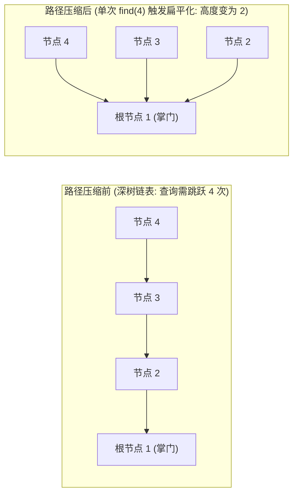

# 模板：并查集算法与路径压缩（江湖帮派认老大的心智模型）

> **心智模型**：并查集（Disjoint Set Union, DSU）的本质是**“江湖帮派寻根体系”**：
> - 每个人都有一个直接上级 `parent[x]`；
> - 帮派的总掌门人（代表元/根节点）的上级是他自己：`parent[root] == root`；
> - 要判断两人是不是同门（`isConnected(a, b)`），只需要看他们各自顺着上级找到的最高掌门人是否相同（`find(a) == find(b)`）；
> - 两个帮派联姻合并（`union(a, b)`），只需让其中一个掌门人拜另一个掌门人为师！

---

## 1. 终极性能奥秘：路径压缩与按秩合并

普通树形合并在极端情况下（如依次合并 1-2, 2-3, 3-4）会退化成一条细长的单向链表，`find` 耗时退化为 $O(N)$。并查集通过两大黑科技实现神级降维：



1. **路径压缩（Path Compression）**：在执行 `find(x)` 递归向根节点查找时，回溯时将沿途经过的所有子节点**直接强行挂接到最高根节点下**（瞬间扁平化为高度为 2 的菊花图）！
2. **按秩/大小合并（Union by Rank/Size）**：小帮派并入大帮派，避免把高树挂在矮树下面增加总高度。
3. **数学证明**：两者结合后，单次操作的均摊时间复杂度为反阿克曼函数：
   $$T_{\text{amortized}}(N) = O(\alpha(N))$$
   现实规模下反阿克曼函数极小，可近似按常数理解，但不能把大 O 记号与数字 5 比较，也不能把均摊界写成每次操作严格 $O(1)$。

---

## 2. 工业级标准泛用模板代码

```java
public class UnionFind {
    private final int[] parent; // parent[i] 表示节点 i 的父节点
    private final int[] size;   // size[i] 表示以 i 为根节点的连通分量包含的节点数
    private int count;          // 当前图中剩余的独立连通分量总数

    /**
     * 初始化：每个节点各自独立成派，自己是自己的掌门
     */
    public UnionFind(int n) {
        this.count = n;
        this.parent = new int[n];
        this.size = new int[n];
        for (int i = 0; i < n; i++) {
            parent[i] = i;
            size[i] = 1;
        }
    }

    /**
     * 核心操作：查找节点 x 所在集合的根节点（带极致递归路径压缩）
     */
    public int find(int x) {
        if (parent[x] != x) {
            // 路径压缩：回溯时将父节点直接更新为根节点
            parent[x] = find(parent[x]);
        }
        return parent[x];
    }

    /**
     * 核心操作：将节点 p 和节点 q 所在的集合合并
     * @return 若原本已连通返回 false；若本次成功合并返回 true
     */
    public boolean union(int p, int q) {
        int rootP = find(p);
        int rootQ = find(q);

        // 如果根节点相同，说明本来就属于同一个帮派，无需合并
        if (rootP == rootQ) {
            return false;
        }

        // 按大小合并：将较小的集合挂在较大的集合下面（维持树的矮平）
        if (size[rootP] < size[rootQ]) {
            parent[rootP] = rootQ;
            size[rootQ] += size[rootP];
        } else {
            parent[rootQ] = rootP;
            size[rootP] += size[rootQ];
        }

        count--; // 两个帮派合二为一，总连通分量数减 1
        return true;
    }

    /**
     * 判断节点 p 和 q 是否连通
     */
    public boolean isConnected(int p, int q) {
        return find(p) == find(q);
    }

    /**
     * 获取当前独立的连通分量数量
     */
    public int getCount() {
        return count;
    }

    /**
     * 获取节点 x 所在连通块的总节点数量
     */
    public int getComponentSize(int x) {
        return size[find(x)];
    }
}
```

---

## 3. 并查集必杀场景：无向图环路检测（LC 684 冗余连接）

题目：在无向树中多加了一条边，导致图中出现了环，找出导致环出现的最后一条冗余边。

```java
class RedundantConnectionSolution {
    public int[] findRedundantConnection(int[][] edges) {
        int n = edges.length;
        // 节点编号为 1 ~ n，数组开 n + 1
        UnionFind uf = new UnionFind(n + 1);

        for (int[] edge : edges) {
            int u = edge[0];
            int v = edge[1];

            // 核心心智：如果添加 edge[u, v] 之前，u 和 v 竟然已经连通了！
            // 说明图中原本就已经存在一条从 u 到 v 的路径，当前这条边必定是闭合成环的“真凶”！
            if (!uf.union(u, v)) {
                return edge; // 命中冗余环边，直接返回！
            }
        }
        return new int[0];
    }
}
```

---

## 4. 大厂面试 30 秒绝杀（并查集边界问题）

### Q1：并查集能够动态添加边并实时判断连通性，那它支持“动态删除一条边”吗？为什么？
> **答题标杆**：
> 1. **标准并查集不支持高效动态删边**！
> 2. **根本原因**：由于路径压缩机制的存在，原先的树形从属结构被直接“拍扁”挂载到了根节点上。树的原生拓扑历史信息已经丢失，如果删掉某一条物理边，我们无法在均摊 $O(1)$ 内反向推导哪些节点应该从当前帮派剥离分裂。
> 3. **面试破局方案**：
>    - **离线逆向加边法（Offline Reverse Union）**：如果题目给出了固定的“删边操作序列”，我们可以将操作**倒序处理**！把“从有到无的删边”，逆转为“从无到有的倒序加边”，依然用标准并查集高效解决！
>    - **可撤销并查集（Rollback Union-Find）**：不使用路径压缩（仅用按秩合并），用一个栈记录每次合并前修改的变量历史，支持按时间戳撤销最近的操作。

---

## 5. 一分钟复盘记忆卡

```text
======================= 并查集算法通关口诀 =======================
江湖帮派认掌门，上级直指自己身。
find寻根递归探，路径压缩拍扁深；
判断连通看根点，union合并连通分；
按秩合并小并大，反阿克曼常数均；
无向判环立奇功，已通再加环必生；
删边不可逆向加，大厂图论秒点明！
======================================================================
```
