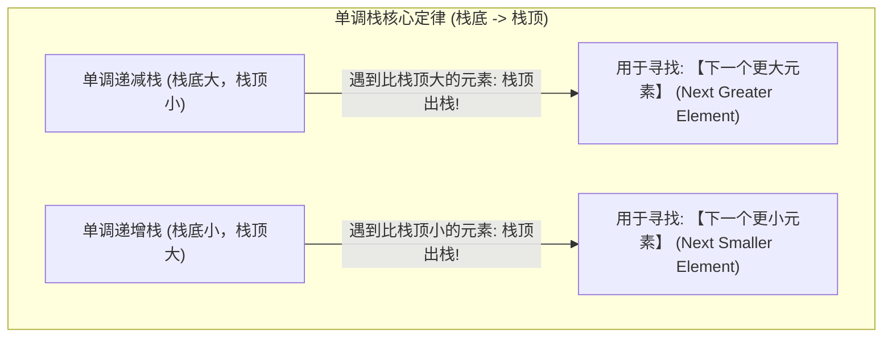

# 模板：单调栈算法与实战（视野阻挡心智模型与两大神题）

> **心智模型**：单调栈（Monotonic Stack）本质是**“排队高个子视野阻挡法则”**：
> - 一群人从左到右站成一排，当你从左往右看时，一个**超级高个子（当前遍历到的更大元素）**站了进来；
> - 前面所有**比他矮的人的视线被全部彻底挡死**！对于这群被挡住的矮个子来说，他们人生中右侧看到的**第一个比自己高的人，就是这个新来的高个子**！
> - 那些矮个子带着他们的答案“光荣出栈”，高个子入栈继续镇守！

---

## 1. 单调栈两大分类与四向查找定律

单调栈用于在 **$O(N)$ 线性时间内**，一次性求出数组中**每一个元素在左侧或右侧的第一个更大（或更小）元素**！



| 目标需求 | 维护的栈类型 | 出栈判定条件 |
| :--- | :--- | :--- |
| **右侧第一个更大** | 单调递减栈（栈底到栈顶单调减） | `while (!stack.isEmpty() && nums[stack.peek()] < nums[i])` |
| **右侧第一个更小** | 单调递增栈（栈底到栈顶单调增） | `while (!stack.isEmpty() && nums[stack.peek()] > nums[i])` |
| **左侧第一个更大** | 从右向左倒序遍历，或者从左到右维护单调减栈查看前驱 | 从左到右时先弹出 `<= 当前值` 的候选，再读取栈顶；从右到左结算被弹出者时条件为 `< 当前值` |

---

## 2. 基础标准模板：每日温度（LC 739）

题目：计算每一天需要等待多少天才能等到更温暖的温度。若不存在则为 0。

```java
class DailyTemperaturesSolution {
    public int[] dailyTemperatures(int[] temperatures) {
        int n = temperatures.length;
        int[] ans = new int[n];
        // 栈内永远存储【数组下标】！(便于直接计算距离 i - prevIndex)
        Deque<Integer> stack = new ArrayDeque<>();

        for (int i = 0; i < n; i++) {
            // 当前温度比栈顶温度高：说明栈顶那一天的等待结束了！
            while (!stack.isEmpty() && temperatures[i] > temperatures[stack.peek()]) {
                int prevIndex = stack.pop();
                ans[prevIndex] = i - prevIndex; // 计算天数差
            }
            stack.push(i); // 当前天入栈等待后续更高的温度
        }

        // 栈内剩余的元素说明右侧没有比它更高的温度，数组默认值即为 0，无需处理
        return ans;
    }
}
```

---

## 3. Hard 级神题实战：柱状图中最大的矩形（LC 84 哨兵技巧）

题目：给定 $n$ 个非负整数表示柱子高度，求能够勾勒出的最大矩形面积。

### 3.1 第一性解法：以当前柱子为高的最大向两侧延展
- 要以柱子 $i$ 为矩形的高，矩形的左右边界就是：**左侧第一个矮于它的柱子**，和**右侧第一个矮于它的柱子**！
- 这正是**单调递增栈**的统治领地！
- **哨兵黑科技（Sentinel Technique）**：在原数组首尾各添加一个高度为 `0` 的虚拟哨兵柱子：
  - 首部加 0：防止栈空，免去复杂的 `isEmpty()` 特判；
  - 尾部加 0：让仍在栈中的正高度柱子出栈计算面积；相等的零柱和哨兵可保留。

```java
class LargestRectangleSolution {
    public int largestRectangleArea(int[] heights) {
        int n = heights.length;
        // 1. 构建加了首尾哨兵的新数组
        int[] newHeights = new int[n + 2];
        System.arraycopy(heights, 0, newHeights, 1, n);
        newHeights[0] = 0;     // 左哨兵
        newHeights[n + 1] = 0; // 右哨兵

        int maxArea = 0;
        // 单调递增栈（存储下标）
        Deque<Integer> stack = new ArrayDeque<>();
        stack.push(0); // 左哨兵先入栈

        for (int i = 1; i < newHeights.length; i++) {
            // 发现当前柱子比栈顶矮：栈顶柱子的右边界已确定（就是 i）！
            while (newHeights[i] < newHeights[stack.peek()]) {
                int curHeight = newHeights[stack.pop()]; // 当前矩形的高
                int leftBound = stack.peek();            // 弹出后的新栈顶即为左边界！
                int width = i - leftBound - 1;           // 宽度 = 右边界 - 左边界 - 1
                maxArea = Math.max(maxArea, curHeight * width);
            }
            stack.push(i);
        }

        return maxArea;
    }
}
```

---

代码遇相等高度时不弹出，因此某根被弹出柱子的左边界可能是同高柱，而不是严格更矮柱。较早的同高柱之后会获得完整跨度，最大面积仍正确；不能把每次弹出的边界都解释成两侧第一个严格更小值。

## 4. 大厂面试 30 秒绝杀（单调栈深度考点）

### Q1：单调栈代码中存在 `for` 循环内部嵌套 `while` 循环，为什么它的时间复杂度依然是绝对的 $O(N)$？
> **答题标杆**：
> 1. **摊还分析法（Amortized Analysis）**：不能简单地通过循环层数机械相乘。
> 2. **元素的生命周期分析**：对于输入数组中的任意一个元素，它在整个算法的运行周期中，**只会被执行严格的最多 1 次入栈（`push`）操作，以及最多 1 次出栈（`pop`）操作**！
> 3. 无论内部的 `while` 循环在某一次看似执行了多少次弹出，全数组 $N$ 个元素总共发生出栈的总次数绝对不会超过 $N$ 次。
> 4. 因此整个算法的实际总操作步数上限为 $2N$，**时间复杂度在数学上是严格线性的 $O(N)$**！

---

## 5. 一分钟复盘记忆卡

```text
======================= 单调栈算法通关口诀 =======================
高个阻挡视线断，单调栈里下标准。
栈内永远存下标，距离差值微秒存；
求大用减求小增，新入打破栈顶滚；
出栈瞬间算答案，一次遍历全部清；
柱状矩形首尾零，左右哨兵免特判；
每个元素进出一，线性O(N)大厂赞！
======================================================================
```
