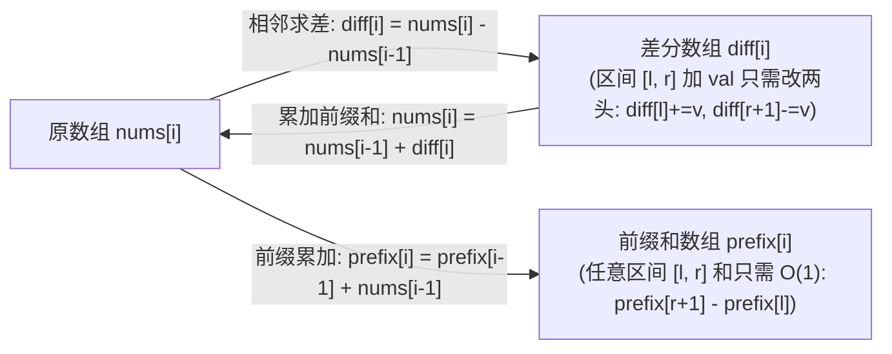
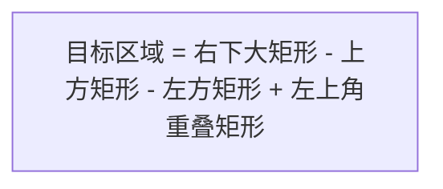

# 模板：前缀和与差分数组（离散微积分孪生双子星）

> **心智模型**：
> - **前缀和（Prefix Sum）**：相当于离散数学中的**“积分”**——预先计算累加和，将任意区间的静态求和查询从 $O(N)$ 降维到 **$O(1)$ 瞬时计算**！
> - **差分数组（Difference Array）**：相当于离散数学中的**“求导”**——记录相邻元素的斜率差，将频繁的区间增减修改从 $O(N)$ 降维到 **$O(1)$ 打标**！
> - **逆运算关系**：对差分数组求一次前缀和，就能瞬间 100% 还原原始数组！

---

## 1. 前缀和与差分核心对称性体系



---

## 2. 必考高频题：前缀和 + 哈希表（LC 560 和为 K 的子数组）

题目：求和为 $K$ 的连续子数组总个数（数组中含有负数）。

### 2.1 降维转化：子数组和转为两数之差
- 任意子数组 `nums[i..j]` 的元素和，可以表达为前缀和之差：
  $$\text{sum}(i, j) = \text{prefix}[j + 1] - \text{prefix}[i] = k$$
- 移项可得：
  $$\text{prefix}[i] = \text{prefix}[j + 1] - k$$
- **神级转化**：当遍历到位置 $j$ 时，问题瞬间变成了——**“在过去的历史记录中，有多少个前缀和恰好等于 $\text{prefix}[j + 1] - k$？”**
- 使用 `HashMap<Integer, Integer>`（`Key`: 前缀和数值，`Value`: 出现频次），时间复杂度降至 $O(N)$！

```java
class SubarraySumSolution {
    public int subarraySum(int[] nums, int k) {
        // Map 记录: <前缀和数值, 该前缀和出现的次数>
        Map<Integer, Integer> prefixCount = new HashMap<>();
        
        // 关键初始化：前缀和为 0 的情况预先出现过 1 次 (代表空前缀)
        // 作用：解决从下标 0 开始的子数组自身和恰好等于 k 的情况 (prefix - k == 0)
        prefixCount.put(0, 1);

        int currentPrefixSum = 0;
        int count = 0;

        for (int x : nums) {
            currentPrefixSum += x;

            // 寻找历史中有没有前缀和为 (currentPrefixSum - k)
            int targetPrefix = currentPrefixSum - k;
            if (prefixCount.containsKey(targetPrefix)) {
                count += prefixCount.get(targetPrefix);
            }

            // 将当前前缀和记入哈希表
            prefixCount.put(currentPrefixSum, prefixCount.getOrDefault(currentPrefixSum, 0) + 1);
        }

        return count;
    }
}
```

---

## 3. 几何容斥原理：二维前缀和（LC 304）

求矩阵子区域 `(row1, col1)` 到 `(row2, col2)` 的矩形面积和。



```java
class NumMatrix {
    private final int[][] preSum;

    public NumMatrix(int[][] matrix) {
        int m = matrix.length, n = matrix[0].length;
        // preSum[i][j] 表示从 (0, 0) 到 (i - 1, j - 1) 的矩形和
        preSum = new int[m + 1][n + 1];

        for (int i = 0; i < m; i++) {
            for (int j = 0; j < n; j++) {
                preSum[i + 1][j + 1] = preSum[i][j + 1] + preSum[i + 1][j] 
                                     - preSum[i][j] + matrix[i][j];
            }
        }
    }

    public int sumRegion(int r1, int c1, int r2, int c2) {
        // O(1) 容斥原理求子矩形和
        return preSum[r2 + 1][c2 + 1] - preSum[r1][c2 + 1] 
             - preSum[r2 + 1][c1] + preSum[r1][c1];
    }
}
```

---

## 4. 区间增减神技：一维差分数组（LC 1109 航班预订 / LC 1094 拼车）

场景：对长度为 $N$ 的数组频繁进行区间操作，比如将区间 `[left, right]` 内的所有元素全部加上 `val`。重复执行 $M$ 次，最后输出最终数组。
- 暴力循环耗时：$O(M \times N)$
- **差分打标法**：每次修改只需 $O(1)$ 修改两个边界端点！
  $$\text{diff}[\text{left}] \mathrel{+}= \text{val}, \quad \text{diff}[\text{right} + 1] \mathrel{-}= \text{val}$$
- 最后从头到尾扫一遍求前缀和，单次 $O(N)$ 搞定，**总耗时降为 $O(M + N)$**！

```java
class DifferenceArraySolution {
    public int[] corpFlightBookings(int[][] bookings, int n) {
        // 差分数组长度设为 n + 2，防止 right + 1 越界
        int[] diff = new int[n + 2];

        for (int[] booking : bookings) {
            int l = booking[0];
            int r = booking[1];
            int seats = booking[2];

            // 区间 [l, r] 加 seats：只需打标两端
            diff[l] += seats;
            diff[r + 1] -= seats;
        }

        // 还原原数组：前缀和累加
        int[] ans = new int[n];
        int curr = 0;
        for (int i = 1; i <= n; i++) {
            curr += diff[i];
            ans[i - 1] = curr;
        }
        return ans;
    }
}
```

---

## 5. 大厂面试 30 秒绝杀（前缀和避坑考点）

### Q1：为什么前缀和数组长度必须开成 `n + 1`，且下标从 1 开始对应原数组的 0？
> **答题标杆**：
> 1. **消除边界特判（Sentinel 哨兵机制）**：令 `prefix[0] = 0`，代表“空前缀”。
> 2. **统一数学公式**：计算区间 `[l, r]` 的和，公式统一为 `prefix[r + 1] - prefix[l]`。
> 3. 如果不开 `n + 1` 而是开 `n`：当计算从下标 0 开始的区间 `[0, r]` 时，公式必须写成 `prefix[r] - prefix[-1]`，由于 `prefix[-1]` 发生数组越界，代码中必须到处充斥着丑陋的 `if (l == 0) return prefix[r];` 特判。开 `n + 1` 使代码具备数学上的自洽性与优雅性。

---

## 6. 一分钟复盘记忆卡

```text
======================= 前缀和与差分通关口诀 =======================
前缀求和似积分，差分相邻若求导。
开大一位防越界，prefix零为哨兵保；
静态区间查总和，后减前差微秒到；
频繁增减走差分，左加右减两头挑；
最后累加还原态，线性时间O(N)高；
和为K值哈希存，put(0,1)莫忘掉！
======================================================================
```
