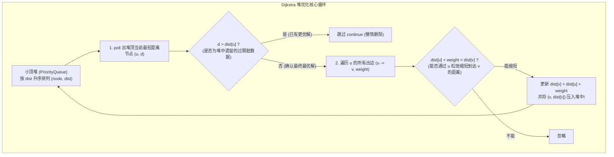

# 模板：Dijkstra 最短路径算法（堆优化与松弛心智模型）

> **心智模型**：Dijkstra 算法本质是**“基于贪心与优先队列的带权水波扩散”**：
> - 从源点出发，水流沿着各条道路向外蔓延；
> - 每次利用**小顶堆（PriorityQueue）**抓出当前所有未确定节点中**距离源点最近的那个节点**；
> - 基于“所有边权均为非负数”的物理公理：**既然当前这个节点已经是离源点最近的，未来绝不可能再通过绕道其他更远的分支反超它！因此该节点的最短距离就此盖棺定论！**
> - 以该节点为跳板，去“松弛（Relax）”更新它的所有邻居。

---

## 1. Dijkstra 核心原理与算法状态转移



---

## 2. 工业级标准模板：网络延迟时间（LC 743 实战）

题目：有 $n$ 个网络节点，从源节点 $k$ 发送信号，求所有节点都收到信号的最短时间。若有节点不可达返回 -1。

```java
class NetworkDelaySolution {

    // 邻接表边对象
    static class Edge {
        int to;
        int weight;

        Edge(int to, int weight) {
            this.to = to;
            this.weight = weight;
        }
    }

    public int networkDelayTime(int[][] times, int n, int k) {
        // 1. 构建邻接表图 (节点编号为 1 ~ n)
        List<Edge>[] graph = new ArrayList[n + 1];
        for (int i = 1; i <= n; i++) {
            graph[i] = new ArrayList<>();
        }
        for (int[] edge : times) {
            int u = edge[0], v = edge[1], w = edge[2];
            graph[u].add(new Edge(v, w));
        }

        // 2. 距离数组 dist，初始化为无穷大
        int[] dist = new int[n + 1];
        Arrays.fill(dist, Integer.MAX_VALUE);
        dist[k] = 0; // 起点到自身的距离为 0

        // 3. 小顶堆优化：按照【距离 source 的耗时】升序排列
        // 数组元素：int[] {节点编号, 当前累加距离}
        PriorityQueue<int[]> pq = new PriorityQueue<>(Comparator.comparingInt(a -> a[1]));
        pq.offer(new int[]{k, 0});

        while (!pq.isEmpty()) {
            int[] curr = pq.poll();
            int u = curr[0];
            int currentDist = curr[1];

            // 核心剪枝（懒惰删除）：如果当前弹出的距离已经比已记录的最短距离大，说明是旧无效数据！
            if (currentDist > dist[u]) {
                continue;
            }

            // 松弛所有邻居节点
            for (Edge edge : graph[u]) {
                int v = edge.to;
                int weight = edge.weight;

                // 松弛条件判断 (Relaxation)
                if (dist[u] + weight < dist[v]) {
                    dist[v] = dist[u] + weight;
                    pq.offer(new int[]{v, dist[v]});
                }
            }
        }

        // 4. 统计结果：求所有节点中收到信号的最晚时间
        int maxTime = 0;
        for (int i = 1; i <= n; i++) {
            if (dist[i] == Integer.MAX_VALUE) {
                return -1; // 存在无法到达的孤岛节点
            }
            maxTime = Math.max(maxTime, dist[i]);
        }

        return maxTime;
    }
}
```

---

## 3. 朴素版 vs 堆优化版 Dijkstra 选型指南

| 模式 | 适用图类型 | 时间复杂度 | 空间复杂度 | 核心数据结构 |
| :--- | :--- | :--- | :--- | :--- |
| **朴素版 (Dense)** | **稠密图**（边数 $E \approx V^2$） | $O(V^2)$ | $O(V^2)$ (邻接矩阵) | 普通循环遍历找最小值 |
| **堆优化版 (Sparse)** | **稀疏图**（边数 $E \ll V^2$） | $O(E \log V)$ | $O(V + E)$ (邻接表) | `PriorityQueue` 最小堆 |

---

## 4. 大厂面试 30 秒绝杀（最短路核心考点）

### Q1：为什么 Dijkstra 算法绝对不能处理带有“负权边”（Negative Weight Edge）的图？
> **答题标杆**：
> 1. **贪心基石被推翻**：Dijkstra 的核心贪心假设是——“当前堆顶弹出的节点 $u$，其距离 `dist[u]` 必定已经是全局最短的，后续绝不可能被别的路径反超更新”。
> 2. **负权反超致命死结**：如果图中存在负权边，即使 $u$ 当前是最近的，后面可能存在一条先走很远的节点、但后续经过一个**极大负权边（例如 $-100$）**绕回 $u$ 的路径，使得到达 $u$ 的距离变得更小！这彻底推翻了 Dijkstra 的贪心有效性，导致算法产生错误答案，或者在负权环（Negative Cycle）中陷入死循环！
> 3. **解决方案**：若图中存在负权边，必须换用 **Bellman-Ford 算法** 或 **SPFA 算法（队列优化版 Bellman-Ford）**。

### Q2：在 Java 的 `PriorityQueue` 中，为什么我们不直接使用 `pq.remove()` 来更新距离，而是采用 `currentDist > dist[u]` 懒惰跳过？
> **答题标杆**：
> 1. Java 原生 `PriorityQueue` 的 `remove(Object o)` 操作底层需要先遍历数组找到该对象，**耗时为 $O(N)$**，这会直接把整个算法拖慢到 $O(E \times V)$，完全失去了堆优化的意义！
> 2. 采用**懒惰删除（Lazy Deletion）**策略：每次松弛成功直接向堆中无脑 `offer` 新的更小距离记录（耗时仅 $O(\log V)$）；当老的、距离较大的记录后续出堆时，通过 `if (currentDist > dist[u]) continue;` 极其廉价地将其秒丢弃，既简单又达到了纯粹的 $O(E \log V)$ 最优理论复杂度。

---

## 5. 一分钟复盘记忆卡

```text
======================= Dijkstra算法通关口诀 =======================
非负权图最短路，优先队列建奇功。
源点初始置为零，其余无穷占位通；
堆顶弹出最小者，懒惰判断旧据空；
邻接遍历查出边，松弛更新压堆中；
贪心假设非负权，负权必须换Ford；
稀疏堆优ELogV，图论手撕稳若钟！
======================================================================
```
