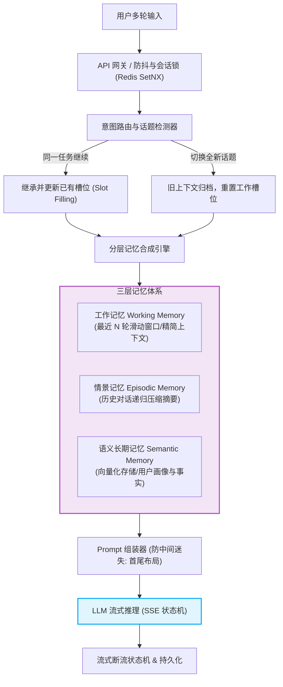
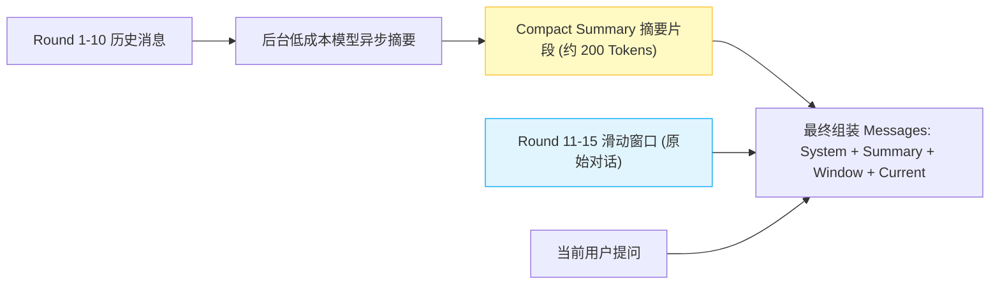
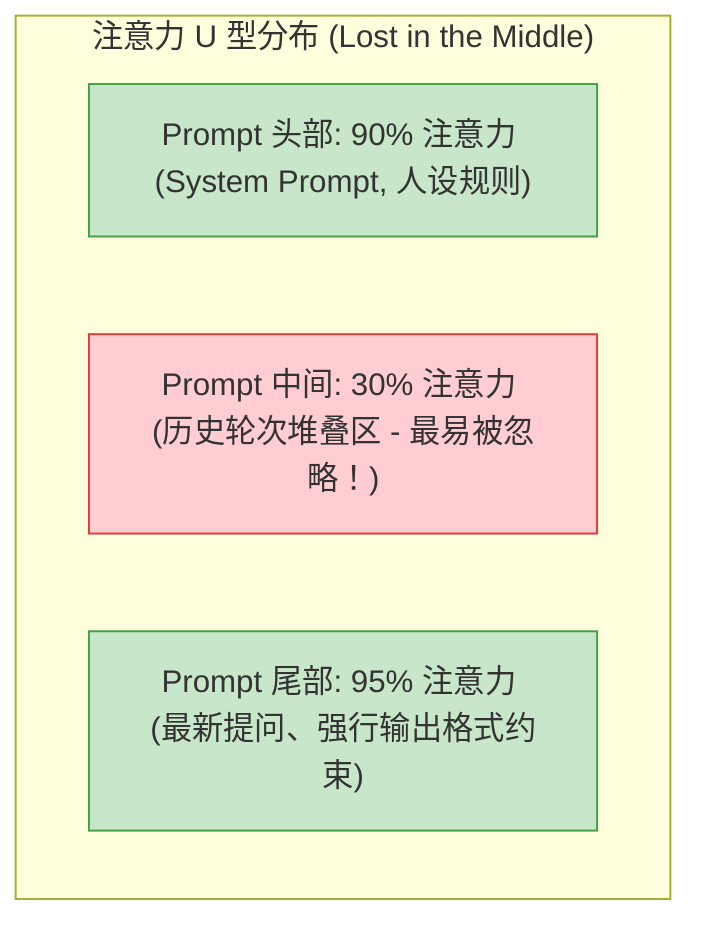
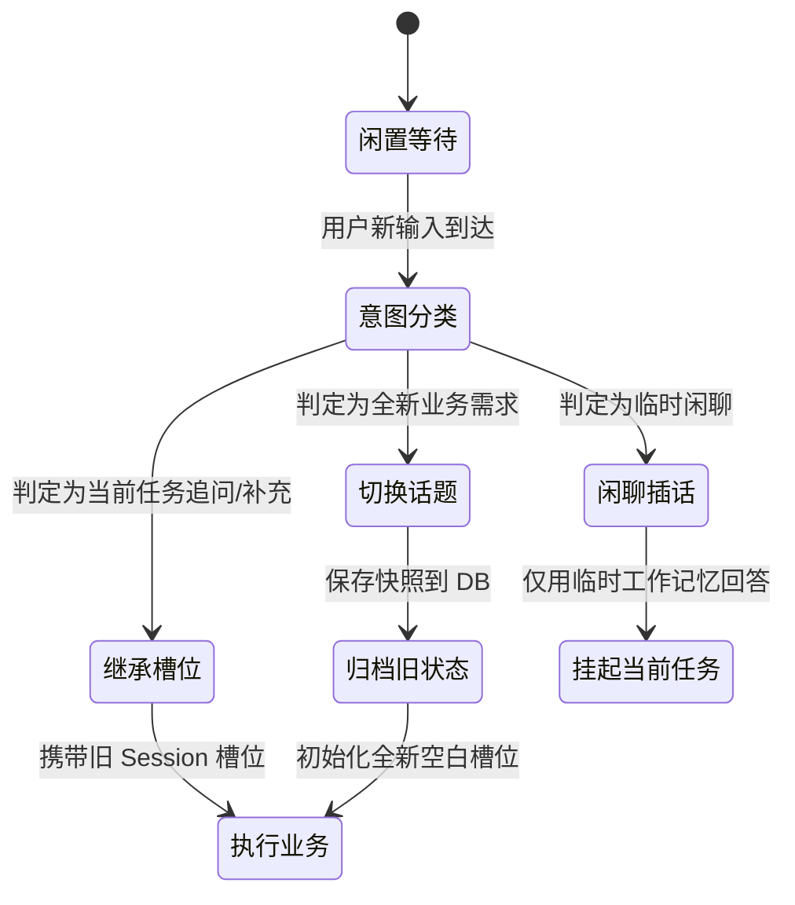
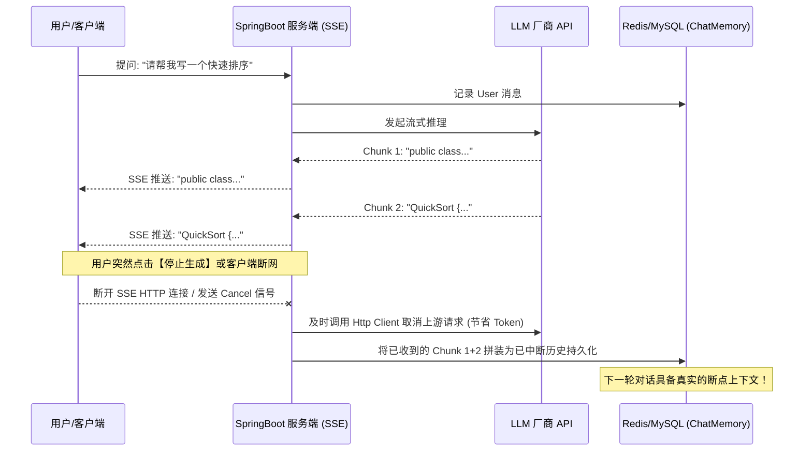

# 面试-多轮对话与会话工程（大厂核心十问十答）

> [!abstract] 一句话技术本质
> 多轮对话系统的核心挑战是：**大语言模型本身是无状态的（Stateless），必须通过应用层的上下文编排（Context Orchestration）、分层记忆管理（Layered Memory）与并发状态机，在有限的 Token 预算和极低的延迟要求下，模拟出连续、一致且具备长期认知能力的对话体验**。



---

## 目录

1. [[#Q1：大模型本身无状态，多轮对话系统的“记忆”究竟是如何实现的？]]
2. [[#Q2：直接把全部历史对话追加到 Prompt 中会有什么灾难性后果？如何优雅解决？]]
3. [[#Q3：什么是“中间迷失（Lost in the Middle）”现象？在多轮对话中如何规避？]]
4. [[#Q4：生产环境中如何构建“工作记忆、情景记忆、语义长期记忆”三层体系？]]
5. [[#Q5：用户在多轮对话中频繁跳出或切换话题，系统如何做到槽位准确继承或重置？]]
6. [[#Q6：用户连续快速发送两条消息，前一条推理尚未结束，服务端如何做并发会话隔离？]]
7. [[#Q7：流式输出（SSE）过程中，客户端断网或用户点击“停止生成”，历史记录如何一致性持久化？]]
8. [[#Q8：多轮对话中的“指代消解（Coreference Resolution）”在 RAG 场景中如何解决？]]
9. [[#Q9：基于 Spring AI / LangChain4j 实现分布式 ChatMemory 的生产陷阱与选型考量？]]
10. [[#Q10：如何设计多轮对话系统防“幻觉扩散与死循环”的熔断防护机制？]]
11. [[#🎯 一分钟复盘记忆卡]]

---

### Q1：大模型本身无状态，多轮对话系统的“记忆”究竟是如何实现的？

> **30 秒绝杀**：
> LLM 每次 HTTP 请求都是独立的单次前向推理。多轮对话的所谓“记忆”，完全是**客户端或服务端应用层在每次发起新一轮推理前，将过往历史轮次的消息（User 与 Assistant）按时间顺序拼接到当前请求的 Messages 数组中**，欺骗模型让它产生“连贯对话”的错觉。

#### 2 分钟深度展开
在 API 底层，无论 OpenAI 规范还是 Spring AI，多轮交互本质上都是发送一个消息数组：
```json
[
  {"role": "system", "content": "你是一个资深理财顾问..."},
  {"role": "user", "content": "我想了解稳健理财"},
  {"role": "assistant", "content": "推荐配置国债或货币基金..."},
  {"role": "user", "content": "那国债目前的年化利率是多少？"} // LLM 基于前文理解“那”指代“国债”
]
```
- **核心挑战**：随着对话轮数线性增加，输入 Token 量呈平方级（$O(N^2)$）暴增，带来**成本激增、推理首字延迟（TTFT）恶化、上下文窗口溢出、信息噪声稀释**四大瓶颈。
- **架构责任**：多轮工程的核心是**在有限的 Token 预算内，保留最关键、与当前意图最相关的上下文信息**。

---

### Q2：直接把全部历史对话追加到 Prompt 中会有什么灾难性后果？如何优雅解决？

> **30 秒绝杀**：
> 全量追加会导致三大灾难：**Token 费用爆炸、TTFT 严重变慢、上下文窗口被爆**。工业界标准解法是**混合窗口压缩策略**：保留固定最近 $K$ 轮原汁原味对话，对更早的历史采用后台异步大模型进行**增量递归摘要（Summary）**，形成“静态摘要 + 滑动窗口”的紧凑上下文。

#### 2 分钟深度展开

1. **滑动窗口缓冲（Sliding Window Buffer）**：按轮数或 Token 数保留最近 $N$ 轮（如最近 5 轮）。保证最近对话的语调、细节和格式完全保真。
2. **递归增量摘要（Recursive Incremental Summary）**：
   - 当历史超出窗口阈值时，不直接扔掉，而是触发后台任务，调用小参数量（如 Qwen-Turbo / DeepSeek-V3）将旧历史压缩为两三百字事实摘要。
   - 下次会话将此摘要作为 System/Developer 消息的背景补充。
3. **关键实体与槽位提取（Structured State Tracking）**：对客服、订票等任务型对话，抽离出 JSON 格式的业务槽位（如 `{destination: "上海", date: "2026-10-01"}`），直接替代冗长的闲聊历史。

---

### Q3：什么是“中间迷失（Lost in the Middle）”现象？在多轮对话中如何规避？

> **30 秒绝杀**：
> 斯坦福研究表明，长上下文大模型对输入内容的**注意力呈现典型的 U 型曲线（关注首部与尾部，严重忽视中间位置）**。若关键历史事实沉睡在长长上下文的中间段，模型极易发生视而不见或产生幻觉。规避方式是**重构 Prompt 物理布局**：将系统人设与关键指令放最前，当前用户提问与强约束放最末，中间仅放参考对话。

#### 2 分钟深度展开

- **生产规避落地实战**：
  1. **首尾夹逼法**：在 System 消息声明规则后，在输入给模型的最后一个 User 消息尾部，**重复声明关键约束**（例如：`请严格根据前文提到的用户手机号办理，严禁杜撰`）。
  2. **动态提权**：如果上一轮检索到的核心事实必须在当前轮被调用，将其从历史消息中拎出，直接作为当前轮的附加证据（Context Citation）注入到最新 User 输入下方。

---

### Q4：生产环境中如何构建“工作记忆、情景记忆、语义长期记忆”三层体系？

> **30 秒绝杀**：
> 仿人类认知构建三级存储：
> 1. **工作记忆（Working Memory）**：毫秒级，存放当前 Session 最近几轮原始对话，存 Redis 内存；
> 2. **情景记忆（Episodic Memory）**：秒级，存放特定历史事件的对话摘要与交互历程，存关系型库/文档库；
> 3. **语义长期记忆（Semantic Memory）**：跨会话持久，存向量库，记录用户画像、偏好事实与知识。

#### 2 分钟深度展开
| 记忆层级 | 对应人脑 | 存储介质 | 生命周期 | 典型内容 | 检索/注入方式 |
| :--- | :--- | :--- | :--- | :--- | :--- |
| **工作记忆 (Working)** | 瞬时注意力 | Redis String / List | 单个 Session（小时级） | 最近 3-5 轮原汁原味多轮上下文 | 顺序加载，组装成 Messages |
| **情景记忆 (Episodic)** | 事件记忆 | MySQL / MongoDB | 永久保存 | "用户在2026年3月退换了商品A" 的摘要 | 关联 Session ID，按需归档 |
| **语义记忆 (Semantic)** | 知识与偏好 | 向量数据库 (PgVector / Milvus) | 用户维度永久 | "用户对花生过敏"、"偏好简明代码" | 提问时 Embedding 相似度检索召回 Top-K |

- **三层协同流水线**：用户发来提问 -> 查 Redis 获取工作记忆 -> 向量检索抽取用户的语义长期偏好（Top-2） -> 拼装为一体输入 LLM。

---

### Q5：用户在多轮对话中频繁跳出或切换话题，系统如何做到槽位准确继承或重置？

> **30 秒绝杀**：
> 必须引入**轻量级意图路由（Intent Router）与话题边界状态机**。不要直接让生成大模型兼职做判断，而是通过 Fast Model 或规则引擎在入口判定用户属于：**继续推进（Inherit）、补充澄清（Clarify）、还是话题跳跃（Topic Switching）**。一旦检测到话题跳跃，立即冻结并归档旧任务槽位，开辟全新局部上下文。

#### 2 分钟深度展开

- **落地黄金法则**：
  - **显式确认（Human-in-the-loop）**：当模型置信度处于临界值（如 0.4~0.7）时，向用户抛出澄清选项：“您刚才正在办理退款，请问是想重新查询商品，还是继续完成退款？”
  - **槽位栈（Slot Stack）**：借鉴函数调用栈，把未完成的主任务压入栈底，临时插入子话题处理完毕后，弹栈恢复原任务槽位。

---

### Q6：用户连续快速发送两条消息，前一条推理尚未结束，服务端如何做并发会话隔离？

> **30 秒绝杀**：
> 核心策略是**会话级分布式排他锁（Redis SetNX）+ 请求队列削峰缓冲**。当客户端在上一条请求流式输出期间再次提交输入时，服务端不可并行执行，否则会导致历史时序错乱与上下文断层。必须根据业务选型：**“直接拦截防抖报错”或“消息入队顺序等待”**。

#### 2 分钟深度展开
- **方案 A：快速失败防抖（Fast Fail / Debounce）**：
  - Redis 写入锁 `session:lock:{sessionId}`，设置 TTL（如 60 秒）。
  - 若已存在锁，直接返回 HTTP 429 或给客户端提示：“AI 正在思考中，请稍候...”。适合交互型聊天界面。
- **方案 B：会话串行化排队（Queue-based Serialization）**：
  - 每个 Session 绑定一个轻量级内存/Redis 队列。后来的消息推入队列。
  - Worker 消费完前一轮完整的流式结果并将 Assistant 消息落库后，才从队列中 pop 出下一条消息拼接新上下文推进。
- **死锁防护**：必须将锁与 LLM 推理的超时机制（`timeout = 45s`）绑定，利用 `try-finally` 确保无论 LLM 报错、超时还是断流，锁必定在 finally 中被释放。

---

### Q7：流式输出（SSE）过程中，客户端断网或用户点击“停止生成”，历史记录如何一致性持久化？

> **30 秒绝杀**：
> 采用**流式断流状态机与双重写入机制**：服务端内存中维护 `StringBuilder` 实时收集已推流的 Chunk。若监听到客户端断开连接（`ClientAbortException`）或收到停止信号，**立刻截断当前生成内容，将已生成的有效文本加上 `[用户终止生成]` 标记落库为最终 Assistant 回复**；绝不能完全丢弃，否则用户看到的半句话与服务端记录脱节，下一轮多轮对话必崩！

#### 2 分钟深度展开


---

### Q8：多轮对话中的“指代消解（Coreference Resolution）”在 RAG 场景中如何解决？

> **30 秒绝杀**：
> 在多轮 RAG 中，用户常问“那它的售价呢？”、“第二款性能怎么样？”，若直接将当前句拿去检索向量库，Recall 率几乎为 0。解法是**提问改写前置模块（Query Rewriting / Condense Question）**：先调用小模型结合最近 2 轮历史，将歧义问句重写为语义独立的完整句子（如“问界 M9 的官方售价是多少？”），再拿改写句去命中检索。

#### 2 分钟深度展开
- **Prompt 模板工程**：
  ```
  [System]
  结合下述历史对话，将用户的最新问题改写为一个独立的、包含所有指代实体的完整搜索词。
  禁止回答问题，只输出改写后的独立问题。若本身已独立，保持原样。
  [历史]
  User: 华为今天发布了哪些新手机？
  Assistant: 发布了 Mate 70 系列和 Mate X6 折叠屏。
  [当前输入]
  User: 那它的电池容量多大？
  [改写输出]
  华为 Mate 70 系列和 Mate X6 的电池容量是多少？
  ```
- **延迟优化**：改写会引入一次额外 LLM 调用的 TTFT 开销（约 200~400ms）。可通过**规则先行**：若提问包含“它/这/那/第二种”等典型代词才触发改写；若已经包含完备主谓宾则绕过改写，直连检索。

---

### Q9：基于 Spring AI / LangChain4j 实现分布式 ChatMemory 的生产陷阱与选型考量？

> **30 秒绝杀**：
> 默认提供的内存型实现（`InMemoryChatMemory`）在单机多实例部署下必然导致**会话丢失与路由穿透**。生产环境必须定制**基于 Redis 的持久化 ChatMemory**。核心陷阱是**序列化破坏（Message 类可能包含复杂 Metadata）与未设 TTL 导致 Redis 内存泄露爆满**。

#### 2 分钟深度展开
1. **TTL 自动过期机制**：
   - 生产 Redis Key 必须绑定生存时间（如设置 `EXPIRE 7200` 2小时无新交互自动过期回收）。
   - 永久历史异步落库 MySQL/ClickHouse 用于合规审计与冷备份。
2. **结构序列化适配**：
   - Spring AI 的 `Message`（System/User/Assistant/ToolResponse）底层包含枚举与元数据 Map。若直接用默认 Jackson 序列化可能丢失具体实现类类型。
   - 建议在 Redis 中存储标准化的 DTO（包含 `role`、`content`、`timestamp`、`tokens`），在从 Redis 读取还原时由 Factory 构造成对应 Message 实例。

---

### Q10：如何设计多轮对话系统防“幻觉扩散与死循环”的熔断防护机制？

> **30 秒绝杀**：
> 多轮对话中，一旦某轮模型产生幻觉，该错误回答会进入历史并被下一轮作为事实依据，导致“滚雪球式错误”；或用户与模型陷入“对不起-没关系-对不起”的死循环。必须建立**两重安全防护盾**：
> 1. **相似度哈希去重熔断（Detect Repeating Loops）**：检测最近 3 轮输出的编辑距离或 Jaccard 相似度，超标立即熔断并换用兜底回复；
> 2. **历史事实标记修正与一键重置会话**。

#### 2 分钟深度展开
- **死循环检测器（Loop Detector）**：
  - 维护最近 5 个生成 Chunk 的 N-gram 重复率。大模型在 Temperature 极低或惩罚不足时可能不断输出相同短语，检测到连续 3 次重复立即强制中断流式连接并注入随机退避。
- **会话“软切断（Soft Reset）”功能**：
  - 在前端提供“清除上下文，重新开始”按钮。
  - 在 Prompt 中增加强心剂引导：“如果你发现先前的回答与用户给出的新事实矛盾，以用户最新提供的纠正为唯一最高真理，承认纠错”。

---

## 🎯 一分钟复盘记忆卡

| 面试高频问题 | 核心第一性原理 | 工业级关键落地点 |
| :--- | :--- | :--- |
| **记忆实现机制** | LLM 本身无状态 | 每次请求前应用层在 Messages 数组前缀拼接历史轮次 |
| **上下文防膨胀** | $O(N^2)$ 成本与窗口限制 | **滑动窗口（保最近细节） + 递归摘要（压远期事实）** |
| **中间迷失现象** | U 型注意力分布曲线 | 关键系统人设放最前，强约束与输入放最后，前后夹逼 |
| **三层记忆架构** | 拟人脑认知分层 | Redis 瞬时工作记忆 + DB 情景摘要 + 向量库语义偏好 |
| **话题跳跃识别** | 避免旧槽位污染新任务 | 意图路由分类判定：继承、澄清或跳跃；归档快照并重置槽位 |
| **并发会话竞争** | 时序错乱与上下文穿透 | **Redis SetNX 会话排他分布式锁** + 请求防抖降级 |
| **流式中断一致性** | 避免客户端与服务端脱节 | 服务端累积 Chunk，断流后以已接收内容加中断标记持久化 |
| **多轮指代消解** | 缺少主谓宾导致 RAG 失效 | 提问前置**独立句改写（Query Rewriting）**，恢复完整实体 |

---

## 🔗 关联阅读与权威索引

- [[../10-AI应用开发/04-多轮对话与上下文工程/_index|多轮对话与上下文工程核心专区]]
- [[../10-AI应用开发/04-多轮对话与上下文工程/07-会话隔离与并发安全|会话隔离与并发安全深度落地]]
- [[../10-AI应用开发/02-框架-SpringAI与LangChain4j/SpringAI/08-ChatMemory记忆|Spring AI ChatMemory 生产实践]]
- [[04-面试-RAG知识库|面试-RAG 知识库检索与生成]]
- [[_index|求职准备全景导航]]
