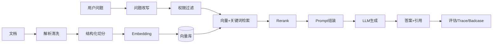
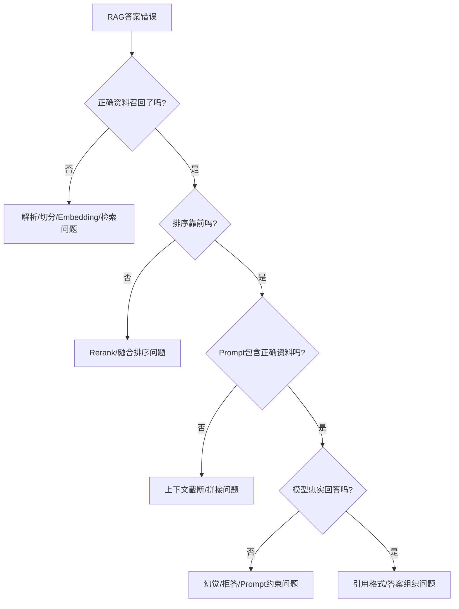

# 面试-RAG知识库

> [!abstract] 一句话总结
> RAG 面试不能只背“检索增强生成”，要能讲清离线入库、在线检索、权限过滤、引用溯源、评估指标和 badcase 排查闭环。

## 🎯 回答框架

1. **先给结论**：RAG 是先检索证据，再让模型基于证据回答。
2. **展开链路**：解析、切分、Embedding、检索、Rerank、Prompt、生成、引用、评估。
3. **结合项目**：落到 [[../10-AI应用开发/08-项目实战/03-项目-企业知识库RAG系统]]。
4. **补充取舍**：Chunk、TopK、Hybrid Search、Rerank、Long Context、权限和成本。

## 🧭 RAG 全链路

## 🔍 线上排障树

## ⚖️ 参数取舍

| 参数 | 调大收益 | 调大风险 | 面试表达 |
| ---- | -------- | -------- | -------- |
| Chunk size | 上下文更完整 | 召回不精准、token 增加 | 制度类可按标题，FAQ 可短块 |
| Overlap | 降低切断语义 | 存储和重复召回增加 | 只在跨段语义明显时加 |
| TopK | 提高召回概率 | 噪声、成本、延迟增加 | 初召回可大，最终上下文要控 |
| Rerank TopN | 提高上下文质量 | 增加模型/服务延迟 | 候选相似、多文档时更值 |
| Hybrid 权重 | 兼顾语义和关键词 | 调参复杂 | 编号/错误码必须靠关键词兜底 |

## 🔐 权限过滤与引用溯源

- 权限过滤必须在检索前或检索阶段完成，不能先把无权 chunk 放进 Prompt。
- metadata 至少包含 `tenant_id`、`space_id`、`acl_tags`、`doc_id`、`title_path`、`page_no`。
- 引用要能回到文档、章节、页码或 chunk id。
- 如果引用资料冲突，回答应指出冲突并建议人工确认。

## 📈 评估指标

| 指标 | 看什么 |
| ---- | ------ |
| Recall@K | 正确资料是否被召回 |
| MRR | 正确资料是否排在前面 |
| Context Precision | 上下文噪声是否少 |
| Faithfulness | 答案是否忠于资料 |
| Answer Relevancy | 答案是否回答问题 |
| Refusal Accuracy | 资料不足时是否拒答 |
| P95 Latency | 端到端体验 |
| Token Cost | 单次问答成本 |

## 🎤 2 分钟项目回答稿

我做企业知识库 RAG 时，会把链路拆成离线和在线两部分。离线侧负责文档解析、清洗、按标题或语义切分、生成 Embedding，并把 chunk 的标题路径、页码、租户和权限标签一起入库。在线侧先做问题改写和权限过滤，然后用向量检索 + BM25 做混合召回，Rerank 后选 TopN 拼 Prompt，要求模型只基于资料回答并附引用。

如果答案错了，我不会只改 Prompt，而是按 badcase 树排查：正确资料是否召回、排序是否靠前、上下文是否被截断、模型是否忠实回答。效果上用 Recall@K、Faithfulness、拒答准确率、P95 延迟和 Token 成本做评估，并用 Langfuse 记录每次 query、chunks、prompt 和 answer。

## 高频问题

### Q1: RAG 全链路是什么？

> 离线是解析、切分、Embedding、入库；在线是问题改写、权限过滤、检索、Rerank、Prompt、生成、引用和评估。

### Q2: Rerank 为什么有用？

> 向量召回负责找候选，Rerank 用更强相关性模型重新排序，提高上下文质量。候选多、文档相似、质量要求高时更值得加。

### Q3: RAG 怎么评估？

> 检索看 Recall@K、MRR、Context Precision；生成看 Faithfulness、Answer Relevancy、拒答准确率；工程看 P95、成本和 badcase 收敛。

### Q4: 为什么要 Hybrid Search？

> 向量适合语义相似，关键词适合编号、错误码、专有名词。企业知识库两类问题都有，混合检索更稳定。

### Q5: Long Context 能不能替代 RAG？

> 小规模、低更新、权限简单、需要完整上下文时 Long Context 可以；企业多租户、大规模、频繁更新、需引用和权限时 RAG 更可控。

## 🔗 关联笔记

- [[40-求职准备/_index|求职准备索引]]
- [[../10-AI应用开发/03-知识库技术-RAG/01-RAG基础与全链路]]
- [[../10-AI应用开发/08-项目实战/03-项目-企业知识库RAG系统]]
- [[18-简历-AI方向]]

## 📚 参考资料

- [[../10-AI应用开发/03-知识库技术-RAG/_index]]
- [[../10-AI应用开发/06-平台与工程化/07-Ragas评估实践]]
- [[../10-AI应用开发/06-平台与工程化/06-Langfuse接入]]
