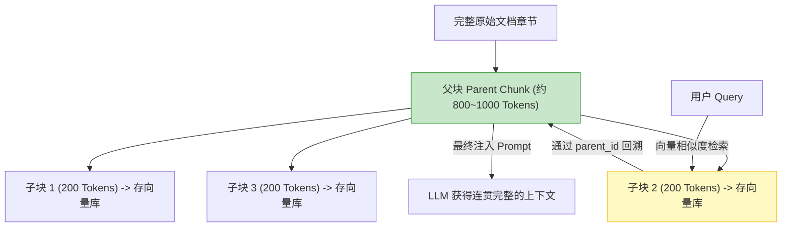
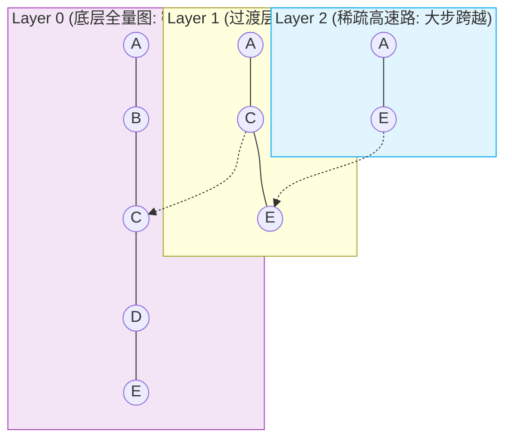
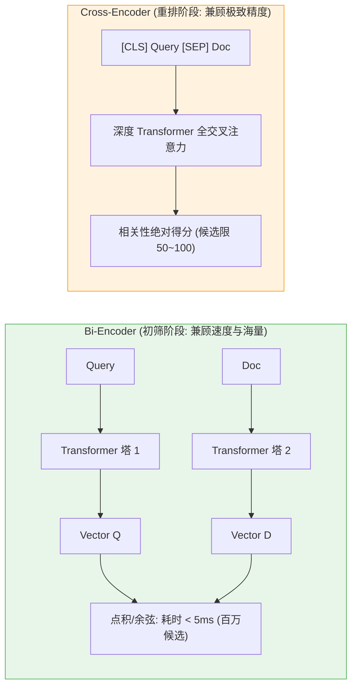
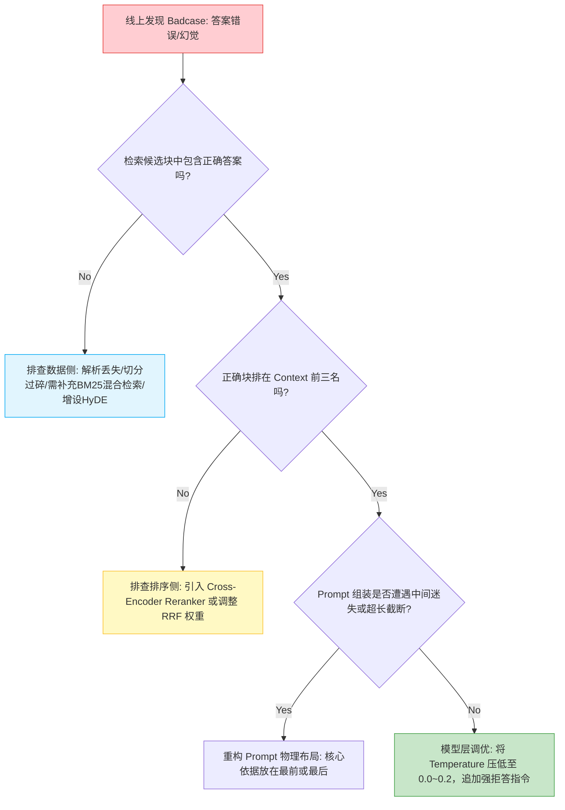
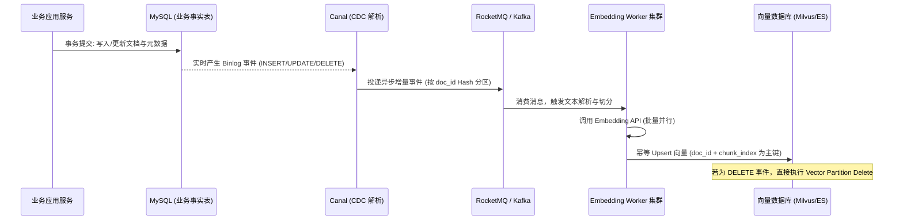

# 面试-RAG知识库深度专栏（大厂核心十问十答）

> [!abstract] 一句话技术本质
> RAG（检索增强生成）并非简单的“向量库 + 拼 Prompt”，其实质是**在海量非结构化企业私有数据与大模型生成能力之间，构建一条高召回、高精准、具备多租户权限隔离与确定性溯源的分布式认知流水线**。

```mermaid
flowchart TB
    subgraph Offline["离线数据处理流水线 (Data Pipeline)"]
        D[企业多源文档] --> Parse[结构化解析与清洗]
        Parse --> Chunk[高级分块: 父子块/句子窗口]
        Chunk --> Embed[Embedding 向量化 (Bi-Encoder)]
        Embed --> VDB[("向量库 (HNSW 索引 + 元数据索引)")]
    end

    subgraph Online["在线检索生成闭环 (Online Pipeline)"]
        Q[用户 Query] --> Rewrite[Query 改写与多路扩展]
        Rewrite --> PreFilter[Metadata 预过滤 (租户/RBAC 权限)]
        PreFilter --> Dense[向量密集检索 (Cosine/IP)]
        PreFilter --> Sparse[BM25 稀疏检索 (精确关键词)]
        Dense & Sparse --> Fusion[RRF 倒数排名融合]
        Fusion --> Rerank[Cross-Encoder 重排模型]
        Rerank --> ContextPack[Prompt 组装 (防中间迷失)]
        ContextPack --> LLM[LLM 推理生成 (带溯源标注)]
        LLM --> Eval[Ragas 指标评估与 Langfuse 观测]
    end

    VDB -.-> Dense
    style Offline fill:#f9fbe7,stroke:#c0ca33,stroke-width:2px
    style Online fill:#e1f5fe,stroke:#03a9f4,stroke-width:2px
```

---

## 目录

1. [[#Q1：请详细拆解 RAG 全链路，离线建库与在线检索的核心瓶颈分别在哪？]]
2. [[#Q2：Chunk 切分太小或太大分别有何后果？父子块（Parent-Child）如何破局？]]
3. [[#Q3：HNSW 向量索引的底层数学原理是什么？为什么比 IVF 更受大厂青睐？]]
4. [[#Q4：为什么生产环境必须做 Hybrid Search（混合检索）？RRF 融合算法原理是什么？]]
5. [[#Q5：Cross-Encoder 与 Bi-Encoder 有何本质区别？为什么 Rerank 不能直接替代向量检索？]]
6. [[#Q6：企业多租户权限（RBAC）如何在 RAG 检索中实现？预过滤与后过滤有何致命区别？]]
7. [[#Q7：RAG 系统答案出现严重“幻觉”或“胡说八道”，你的系统化排障 SOP 是什么？]]
8. [[#Q8：Ragas 自动化评估框架的四大核心指标是如何量化计算的？]]
9. [[#Q9：大模型上下文窗口已经扩充到 1M/2M（如 Gemini/DeepSeek），RAG 还有存在必要吗？]]
10. [[#Q10：百万级文档知识库实时更新（增删改），如何保证向量库与关系库的一致性与低延迟？]]
11. [[#🎯 一分钟复盘记忆卡]]

---

### Q1：请详细拆解 RAG 全链路，离线建库与在线检索的核心瓶颈分别在哪？

> **30 秒绝杀**：
> RAG 分为**离线构建**（解析 -> 清洗 -> 语义切分 -> 向量化 -> 索引写入）与**在线检索**（问题改写 -> 权限预过滤 -> 向量+BM25 混合召回 -> Rerank 精排 -> 提示词注入 -> 生成溯源）。
> **离线瓶颈**在复杂 PDF 表格/版面还原与大规模向量计算耗时；**在线瓶颈**在检索召回准确率、Cross-Encoder 重排的 P95 延迟与多文档噪声稀释。

#### 2 分钟深度展开
- **离线侧核心难点**：
  - PDF 复杂排版（多栏、跨页表格、流程图）如果直接文本抽取，表格会变成错乱的一维文字流。解决方案是引入版面分析（LayoutLM / MinerU / OCR）先解析为结构化 Markdown。
- **在线侧核心难点**：
  - 用户输入口语化、含代词、缺主语。若直接拿 `query` 算 Embedding，与标准文档的余弦相似度极低。必须前置执行**Query Rewrite（查询改写与 HyDE 假设文档嵌入）**。

---

### Q2：Chunk 切分太小或太大分别有何后果？父子块（Parent-Child）如何破局？

> **30 秒绝杀**：
> - **切太小（如 100 字符）**：语义严重碎片化，虽然检索匹配度极高，但 LLM 拿到上下文后缺乏因果逻辑，回答断章取义；
> - **切太大（如 2000 字符）**：单块包含多个子主题，Embedding 向量被均值稀释失去区分度，召回精度暴跌且挤占 Token 预算。
> - **父子块（Parent-Child）破局法**：**“小块检索，大块投喂”**！用 200 字的小子块（Child）计算向量保证精准匹配，召回后顺着元数据回溯读取对应的 1000 字大父块（Parent）送入大模型，兼顾定位精度与上下文完整性。

#### 2 分钟深度展开

- **句子窗口检索（Sentence Window Retrieval）**：
  - 粒度细化到单句。将单句生成 Embedding 存库。召回该句子后，动态从原文档中向左向右滑动取前后各 $N$ 句（Window Buffer）拼接，同样达到精准定位与语义保真。

---

### Q3：HNSW 向量索引的底层数学原理是什么？为什么比 IVF 更受大厂青睐？

> **30 秒绝杀**：
> HNSW（Hierarchical Navigable Small World）利用了**跳表（Skip-List）的多层分层思想与小世界图理论**。最顶层边长、跨度极大，实现对高维空间的跨区域粗暴跳跃；层数越低图越密集；底层包含全量数据。时间复杂度从暴力遍历的 $O(N)$ 降至 $O(\log N)$。相比 IVF（倒排聚类中心），HNSW 具有**召回率极高（>98%）、无须预先聚类训练（可实时动态增量插入更新）**的压倒性优势。

#### 2 分钟深度展开

- **核心超参数调优**：
  - `M`：每个节点的最大出度连边数（通常设为 16~64）。$M$ 越大，图连通性越强，召回率越高，但内存占用线性增加。
  - `efConstruction`：构建索引时的贪婪搜索候选队列深度。值越大建索引越慢，图质量越高。
  - `efSearch`：在线查询时的搜索深度。生产环境按业务要求在 P95 延迟（如 < 15ms）与召回率（> 95%）之间动态调整。

---

### Q4：为什么生产环境必须做 Hybrid Search（混合检索）？RRF 融合算法原理是什么？

> **30 秒绝杀**：
> 向量检索（Dense Retrieval）基于语义抽象，擅长理解同义词和泛化意图，但在**专有名词、产品型号、错误码（如 `NullPointerException`、`GB3100-2024`）**面前常因未包含在预训练词表中而发生严重误判；BM25（Sparse Retrieval）基于倒排索引精准匹配关键词，但无法理解同义替换。**混合检索（Dense + Sparse）二者取长补短**，通过 RRF（倒数排名融合）消除量纲差异，兼收并蓄。

#### 2 分钟深度展开
- **为什么不能直接用加权相加（Score Fusion）？**
  - 余弦相似度分数通常在 $[0, 1]$ 之间，而 BM25 得分是基于 TF-IDF 计算的无界正实数（如 0~35）。两者数学分布和方差完全不同，直接线性加权极其脆弱。
- **RRF（Reciprocal Rank Fusion）数学公式**：
  $$RRF\_Score(d \in D) = \sum_{m \in M} \frac{1}{k + r_m(d)}$$
  - 其中 $r_m(d)$ 是文档 $d$ 在检索系统 $m$ 中的**排位名次（Rank，1-indexed）**，而非绝对分值！
  - 常数 $k$（业界惯例通常取 $60$），其平滑效应确保排名前列的文档得分贡献呈倒数衰减，抹平不同算法分值量纲，鲁棒性极强。

---

### Q5：Cross-Encoder 与 Bi-Encoder 有何本质区别？为什么 Rerank 不能直接替代向量检索？

> **30 秒绝杀**：
> - **Bi-Encoder（双塔，如 BGE-large-zh）**：Query 和 Doc 分别独立经过神经网络编码为定长向量。可以预先为千万级文档离线建库，在线时仅计算点积/余弦，耗时毫秒级，但缺乏 Query 与 Doc 字符级深层交叉注意力；
> - **Cross-Encoder（单塔重排，如 BGE-Reranker）**：将 `Query` 与 `Doc` 拼接为单一文本对 `[CLS] Query [SEP] Doc [SEP]`，全部 Token 在多层 Transformer 中进行全连接交叉注意力计算，语义精度登峰造极，但**算力开销暴增 $O(N)$ 倍**。
> - 因此必须采用**漏斗模型**：先用 Bi-Encoder 毫秒级海选 Top-100，再用 Cross-Encoder 精密重排选出 Top-5 送入 LLM。

#### 2 分钟深度展开


---

### Q6：企业多租户权限（RBAC）如何在 RAG 检索中实现？预过滤与后过滤有何致命区别？

> **30 秒绝杀**：
> - **后过滤（Post-filtering）是生产灾难**：先让向量库召回 Top-10，在应用层校验用户是否有权限，无权则剔除。一旦这 10 条全部属于机密文档，应用层过滤后**召回结果直接为空**！
> - **正确做法是预过滤（Pre-filtering / Single-stage Filtering）**：文档入库时在向量元数据中打上 `tenant_id`、`department_id`、`acl_roles` 等标量标签。检索时将权限作为 SQL 表达式直接下推至向量数据库引擎（如 Milvus / PgVector），在图遍历或候选收拢时**只在用户有权访问的子空间中寻找最相似向量**，确保稳妥返回 Top-K。

#### 2 分钟深度展开
- **存储设计规范**：
  ```sql
  -- PgVector 示例: 标量索引与向量索引联合下推
  CREATE INDEX idx_docs_tenant ON doc_chunks(tenant_id, department_id);
  CREATE INDEX idx_docs_embedding ON doc_chunks USING hnsw (embedding vector_cosine_ops);
  
  -- 查询时强制联合执行
  SELECT content, 1 - (embedding <=> :query_vec) AS score
  FROM doc_chunks
  WHERE tenant_id = 'T_001' AND acl_role IN ('DEPT_TECH', 'PUBLIC')
  ORDER BY embedding <=> :query_vec
  LIMIT 5;
  ```

---

### Q7：RAG 系统答案出现严重“幻觉”或“胡说八道”，你的系统化排障 SOP 是什么？

> **30 秒绝杀**：
> 坚决杜绝无脑修改 Prompt！建立**因果排障决策树**，沿着数据流从源头依次向后推查：
> 1. **召回率排查**：检索到的 Chunks 里究竟有没有包含正确答案的知识？若无，是切分断裂、关键词缺失还是 Embedding 偏差；
> 2. **排序排查**：核心 Chunk 是否被挤出 Top-N 或掉入中间迷失区？
> 3. **Prompt 污染排查**：是否上下文塞入过多无意义噪音扰乱了注意机制？
> 4. **模型指令依从排查**：Temperature 是否过高？System Prompt 强约束是否不足？

#### 2 分钟深度展开


---

### Q8：Ragas 自动化评估框架的四大核心指标是如何量化计算的？

> **30 秒绝杀**：
> Ragas 构筑了无须人工标注的自动化评估闭环：
> 1. **检索相关性（Context Precision）**：衡量真正有用的上下文片段在检索结果中是否排在最前面；
> 2. **检索召回率（Context Recall）**：衡量参考标准答案所依赖的全部事实是否已被上下文完全覆盖；
> 3. **忠实度（Faithfulness）**：利用大模型将生成的答案拆解为单点陈述（Claims），检测每一条能否由上下文严密推导（防幻觉核心）；
> 4. **答案相关性（Answer Relevance）**：不看参考答案，根据生成的回答反推生成若干个伪问题，计算伪问题与原 Query 的语义相似度。

#### 2 分钟深度展开
| 指标名称 | 评估环节 | 计算本质 | 是否需要 Ground Truth |
| :--- | :--- | :--- | :--- |
| **Faithfulness (忠实度)** | 生成侧 (Generation) | 答案断言由上下文推导的比例 $\frac{\text{推导成立的陈述数}}{\text{总陈述数}}$ | ❌ 不需要 |
| **Answer Relevance** | 生成侧 (Generation) | 回答是否切题，用反向生成问句的 Embedding 相似度均值衡量 | ❌ 不需要 |
| **Context Recall** | 检索侧 (Retrieval) | 标准答案中的事实要点被上下文召回包含的百分比 | ✅ **必须提供** |
| **Context Precision** | 检索侧 (Retrieval) | 加权平均精度（MAP），惩罚有用 Chunk 排序靠后的场景 | ✅ **必须提供** |

---

### Q9：大模型上下文窗口已经扩充到 1M/2M（如 Gemini/DeepSeek），RAG 还有存在必要吗？

> **30 秒绝杀**：
> **不仅依然必要，而且不可或缺！**
> 1. **成本经济学（Cost）**：百万 Token 的单次输入费用是 RAG 的百倍以上，企业级高频问答在财务上不可接受；
> 2. **延迟物理限制（Latency）**：百万 Token 的首字延迟（TTFT）往往高达数十秒，无法满足交互式体验；
> 3. **数据实时性与权限隔离**：大模型无法感知毫秒级新增或修改的企业数据，更无法在模型内部实现精确到行级、租户级的 RBAC 权限切分。

#### 2 分钟深度展开
- **两者的最佳结合模式**：**RAG 负责动态粗筛，Long Context 负责精细吸收**。
  - 用 RAG 检索把百万文档收缩为几万 Token 的高浓度核心资料包，再利用长窗口模型的强大理解力进行深度交叉推理，达成成本、时延与精度的黄金平衡。

---

### Q10：百万级文档知识库实时更新（增删改），如何保证向量库与关系库的一致性与低延迟？

> **30 秒绝杀**：
> 借鉴微服务双写一致性经典架构，采用**“MySQL 作为事实单一数据源 + Binlog 异步 CDC（如 Canal/Debezium） + 消息队列削峰解耦 + 向量库幂等写入/软删除”**。

#### 2 分钟深度展开

- **删除与更新的幂等性设计**：
  - 更新文档时，切块数量可能发生变化（原来切了 5 块，修改后变成 3 块）。如果只覆盖前 3 块，后 2 块脏数据将永久残留！
  - **规范做法**：利用向量库的 Partition 或 Tag 机制，更新时先根据 `doc_id` 批量物理删除旧向量块，再插入全量新向量块；或采用逻辑版本号（`version`）过滤查询。

---

## 🎯 一分钟复盘记忆卡

| 面试核心考点 | 核心第一性原理 | 工业级关键落地点 |
| :--- | :--- | :--- |
| **切块策略取舍** | 上下文因果链与区分度权衡 | 采用**父子块（Parent-Child）**，小子块精准检索，大父块投喂模型 |
| **HNSW 索引原理** | 跳表思想分层高维图 | 上层跨步跳跃，底层密集寻路；$O(\log N)$ 耗时，支持实时动态插入 |
| **混合检索必要性** | 语义抽象 vs 专有名词/错误码 | Dense (向量) + Sparse (BM25)，采用 **RRF 倒数排名融合**消除量纲 |
| **Rerank 模型定位** | Cross-Encoder 算力极其昂贵 | 漏斗模型：Bi-Encoder 海选 Top-100，Cross-Encoder 精排选 Top-5 |
| **企业权限隔离** | 后过滤导致召回结果直接为空 | 必须采用**元数据预过滤（Pre-filtering）**，标量索引协同下推至引擎 |
| **线上幻觉排查** | 建立可落地的系统化决策树 | 先查召回是否有资料，再查排序，再查 Prompt 布局，最后调模型参数 |
| **Ragas 四大指标** | 无须全量人工标注的自动化评估 | Faithfulness（推导断言）、Context Recall（GT 覆盖率）、Precision（MAP） |
| **实时数据一致性** | 避免双写事务不一致与残留 | **CDC (Canal) + MQ 异步解耦**；更新时根据 `doc_id` 全量重构切块防脏读 |

---

## 🔗 关联阅读与权威索引

- [[../10-AI应用开发/03-知识库技术-RAG/01-RAG基础与全链路|RAG 基础与架构全链路]]
- [[../10-AI应用开发/03-知识库技术-RAG/05-混合检索与重排-Rerank|混合检索与 Rerank 落地]]
- [[../10-AI应用开发/06-平台与工程化/07-Ragas评估实践|Ragas 知识库量化评估实战]]
- [[../10-AI应用开发/08-项目实战/03-项目-企业知识库RAG系统|企业级知识库实战案例]]
- [[40-求职准备/_index|求职准备全景导航]]
