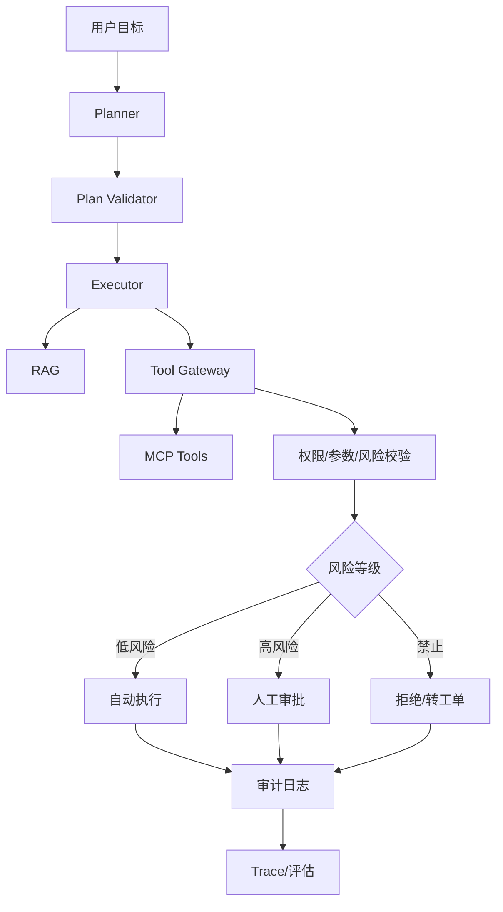

# 面试-Agent与MCP

> [!abstract] 一句话总结
> Agent 面试重点不是“模型会调用工具”，而是能讲清 Agent、Workflow、Tool、MCP、Skill 的边界，以及权限、审批、幂等、重试、审计和可观测。

## 🎯 回答框架

1. **先给结论**：Agent 适合动态决策，Workflow 适合固定流程，MCP 是工具/数据连接协议。
2. **展开边界**：Tool、MCP、Skill、Memory、Planner、Executor 各自职责。
3. **结合项目**：落到 [[../10-AI应用开发/08-项目实战/07-项目-业务Agent系统]]。
4. **补充治理**：权限、风险分级、人工审批、失败补偿、审计和评估。

## 🧩 对比表

| 概念 | 解决什么 | 适合场景 | 风险 |
| ---- | -------- | -------- | ---- |
| Workflow | 固定流程编排 | 审批、订单、确定性任务 | 灵活性低 |
| Agent | 根据目标动态规划和调用工具 | 客服助手、运维助手、复杂问答 | 不可控、成本高、误操作 |
| Tool / Function Calling | 应用内函数调用 | 查订单、查天气、生成报表 | 参数幻觉、越权 |
| MCP | 标准化暴露工具/资源 | 多客户端复用工具能力 | 鉴权、网络、安全边界 |
| Skill | 描述怎么完成任务的程序化知识 | 固定操作 SOP、编码规范 | 过时、与工具能力不一致 |
| Memory | 保存上下文和偏好 | 多轮任务、长期偏好 | 污染、泄露、不可删除 |

## 🏗️ 生产级 Agent 架构

## 🔐 权限治理与审批流

| 风险等级 | 示例 | 控制 |
| -------- | ---- | ---- |
| L0 只读 | 查知识库、查订单状态 | 权限过滤、引用溯源 |
| L1 草稿 | 生成回复、生成 SQL 草稿 | 人工确认后使用 |
| L2 低风险自动执行 | 打标签、创建待办 | 幂等、限流、审计 |
| L3 高风险需审批 | 退款、发券、改地址 | 审批流、二次确认、回滚 |
| L4 禁止自治 | 转账、删库、改权限 | 拒绝或转人工工单 |

核心表达：模型不是安全主体。模型只能提出工具调用意图，真正的权限裁决必须在服务端完成。

## 🔁 工具失败处理

| 问题 | 方案 |
| ---- | ---- |
| 工具超时 | 每个工具独立 timeout，返回可解释错误 |
| 临时失败 | 低风险动作可退避重试 |
| 高风险失败 | 不自动重试，转人工处理 |
| 重复调用 | idempotency key + 状态机 |
| 参数错误 | Schema 校验 + 服务端二次校验 |
| 下游不可用 | 降级为草稿/建议/工单 |
| 部分成功 | 记录步骤状态，执行补偿或人工介入 |

## 🎤 项目版回答模板

我做业务 Agent 时不会让模型直接操作所有系统，而是把 Agent 放进一个受控状态机。Planner 负责生成计划，Validator 检查风险，Executor 调用 RAG 和工具。所有工具调用都经过 Tool Gateway，做工具白名单、租户权限、参数校验、风险分级和审计。查订单这类只读动作可以自动执行，退款发券这类高风险动作必须人工确认，删库改权限这类禁止自治。这样既保留 Agent 的灵活性，也能满足生产系统的安全和可追溯要求。

## 高频问题

### Q1: Workflow 和 Agent 怎么选？

> 流程固定、风险高、需要强确定性的任务优先 Workflow；目标开放、需要动态规划和工具选择时才用 Agent。生产里常用 Workflow/状态机约束 Agent。

### Q2: Function Calling 与 MCP 有什么关系？

> Function Calling 是应用内工具调用机制；MCP 是把工具和资源用标准协议暴露给多个 AI 客户端。MCP Server 内部仍可调用本地函数或业务服务。

### Q3: Skills 和 MCP 有什么区别？

> Skills 描述“怎么做事”的程序化知识，MCP 提供“能用什么工具/数据”的连接协议。企业里常用 Skill 指挥流程，再通过 MCP 调系统。

### Q4: 如何防止 Agent 越权？

> 工具白名单、服务端鉴权、参数级校验、风险分级、人工审批和审计日志。不能只靠 Prompt 说“不要越权”。

### Q5: 工具调用失败怎么办？

> 区分低风险和高风险。低风险临时失败可退避重试，高风险失败转人工；所有工具调用要有幂等键、状态记录和审计日志。

### Q6: Agent 怎么评估？

> 看任务完成率、工具调用成功率、人工接管率、错误率、平均步骤数、P95 延迟、Token 成本和高风险审批通过率。

### Q7: MCP Server 如何做安全？

> HTTP 模式做 OAuth/鉴权，本地 stdio 控制权限和运行用户；工具参数服务端校验，敏感操作审批，所有调用记录审计。

### Q8: 为什么 Agent 不能完全自治？

> 因为 LLM 输出不稳定，且工具调用可能产生真实副作用。生产系统必须按风险分级，明确哪些能自动执行、哪些需审批、哪些禁止执行。

## 🔗 关联笔记

- [[40-求职准备/_index|求职准备索引]]
- [[../10-AI应用开发/05-Agent-MCP-Skills/01-Agent设计模式详解]]
- [[../10-AI应用开发/05-Agent-MCP-Skills/09-MCP协议详解]]
- [[../10-AI应用开发/05-Agent-MCP-Skills/21-Agent权限治理与分级自治]]
- [[../10-AI应用开发/08-项目实战/07-项目-业务Agent系统]]
- [[18-简历-AI方向]]

## 📚 参考资料

- [Model Context Protocol Documentation](https://modelcontextprotocol.io/docs)
- [OWASP Top 10 for LLM Applications](https://owasp.org/www-project-top-10-for-large-language-applications/)
- [Spring AI Reference](https://docs.spring.io/spring-ai/reference/)
