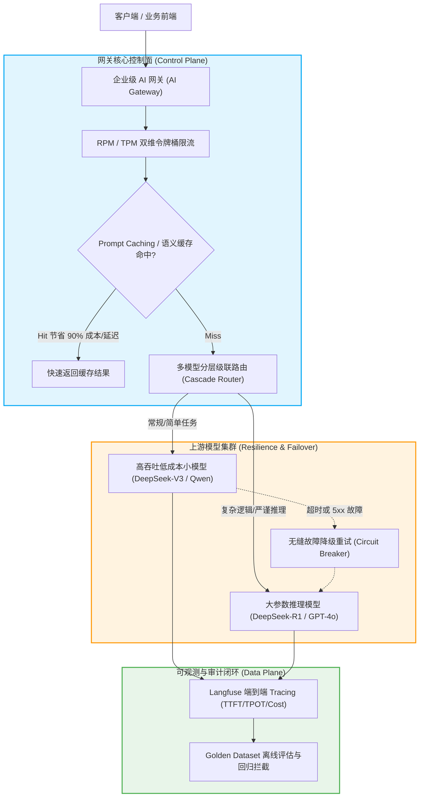
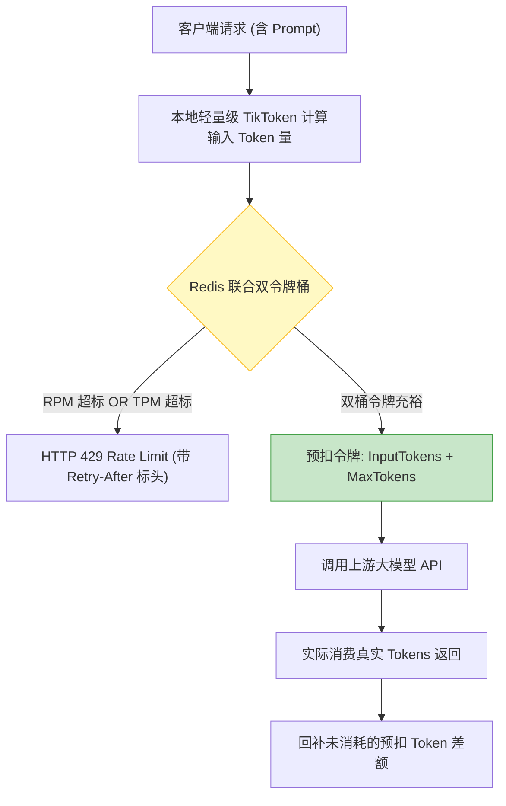

# 面试-AI工程化与生产治理深度专栏（大厂核心十问十答）

> [!abstract] 一句话技术本质
> AI 工程化的终极命题是：**如何将底层随机波动、高昂单次调用成本、长延迟且缺乏确定性的概率型大模型推理（Probabilistic Inference），通过工程网关、分层降级、结构化约束、可观测流水线与防抖状态机，包装为符合金融/电商高可用 SLA（99.99%）的确定性企业级工业服务**。



---

## 目录

1. [[#Q1：大模型调用与传统 RPC 有何本质不同？AI 网关的核心职能是什么？]]
2. [[#Q2：如何设计针对 LLM 的限流策略？为什么单纯按 QPS 限流在生产中必死无疑？]]
3. [[#Q3：流式输出（SSE）的时延指标 TTFT 与 TPOT 是什么？如何系统性优化？]]
4. [[#Q4：如何保证大模型输出 100% 严格符合业务系统的 JSON 规范？]]
5. [[#Q5：Prompt Caching（提示词缓存）的底层原理是什么？在工程中如何提升命中率？]]
6. [[#Q6：如何构建模型分层级联路由（Cascade Routing），在质量不下降的前提下降低 70% 成本？]]
7. [[#Q7：当主力大模型厂商遭遇全网宕机或严重限流（HTTP 429/503），网关如何做到用户无感容灾？]]
8. [[#Q8：Prompt 迭代上线如何做科学的灰度发布（Canary）与自动化回归评估？]]
9. [[#Q9：语义缓存（Semantic Cache）在生产中究竟能不能用？存在哪些致命隐患？]]
10. [[#Q10：如何设计覆盖全链路的 LLM 可观测性体系（Tracing、Tokens 与 Cost）？]]
11. [[#🎯 一分钟复盘记忆卡]]

---

### Q1：大模型调用与传统 RPC 有何本质不同？AI 网关的核心职能是什么？

> **30 秒绝杀**：
> 传统 RPC（Dubbo/gRPC）是**低延迟（<50ms）、确定性计算、无状态、几乎零边际成本**；而 LLM 调用是**超长延迟（秒级至数十秒）、概率性输出、长连接流式推送（SSE）、按 Token 计费极度昂贵**。
> 因此，传统 API 网关（如 Kong/Spring Cloud Gateway）无法胜任，必须构建专门的 **AI Gateway**，承担：**TPM/RPM 动态限流、多 Provider 故障无缝漂移、Prompt Caching 命中优化、流式 SSE 协议转换与精细化账单核算**。

---

### Q2：如何设计针对 LLM 的限流策略？为什么单纯按 QPS 限流在生产中必死无疑？

> **30 秒绝杀**：
> 如果只按 QPS（每秒请求数）限流，一个并发请求可能只消耗 50 个 Token，而另一个并发长文档总结请求可能瞬间吞吐 128k Token。单次超长请求即可把上游厂商分配的租户配额打爆，或瞬间榨干本地 GPU 显存！
> 生产环境必须采用**双维度令牌桶算法（RPM + TPM 联合限流）**：
> 1. **RPM（Requests Per Minute）**：限制请求频次，防突发网络冲击；
> 2. **TPM（Tokens Per Minute）**：依据预估的输入 Token 与最大输出 MaxTokens 预扣减令牌，完成推理后按实际消费回补多扣的令牌。

#### 2 分钟深度展开


---

### Q3：流式输出（SSE）的时延指标 TTFT 与 TPOT 是什么？如何系统性优化？

> **30 秒绝杀**：
> - **TTFT（Time To First Token，首字延迟）**：从用户点击发送到前端打出第一个字的耗时。直接决定用户的“心理等待卡顿感”；
> - **TPOT（Time Per Output Token，单字生成耗时）**：流式打字机后续每个 Token 生成的平均间隔（通常需 $< 50\text{ms}$ 保证阅读流畅）。
> - **优化 TTFT**：缩减 System Prompt 长度、利用 Prompt Caching 复用前缀 KV Cache、混合检索阶段并行化；
> - **优化 TPOT**：选用小参数量生成模型、采用 FP8/INT4 量化推理、开启推测解码（Speculative Decoding）。

---

### Q4：如何保证大模型输出 100% 严格符合业务系统的 JSON 规范？

> **30 秒绝杀**：
> 依赖 Prompt 写“请只输出合法 JSON”在生产是纯靠运气的灾难！工业界存在两重防御梯队：
> 1. **引擎层硬约束（Constrained Decoding / BNF Grammar）**：OpenAI 的 `Structured Outputs` 或开源 vLLM 的 `outlines`。在 Transformer 自回归采样生成下一个 Token 的 Logits 阶段，**直接通过词表掩码（Logit Bias Mask）将所有不符合 JSON 语法树的 Token 概率置为 $-\infty$**，从数学上实现 100% 语法正确；
> 2. **应用层补偿修复（Fallback Parser）**：若使用不支持语法约束的模型，通过 Spring AI 的 `BeanOutputConverter` 进行 Jackson 反射反序列化，若解析失败触发一次“自动纠错补丁调用（Repair Prompt）”。

#### 2 分钟深度展开
```java
// Spring AI 结构化输出规范
public record OrderExtraction(String orderId, BigDecimal amount, List<String> items) {}

BeanOutputConverter<OrderExtraction> converter = new BeanOutputConverter<>(OrderExtraction.class);
Prompt prompt = new Prompt(
    "从用户对话中提取订单数据：" + userInput + "\n" + converter.getFormat()
);

ChatResponse response = chatModel.call(prompt);
try {
    // 强类型映射，若大模型未遵循则进入捕获重试逻辑
    OrderExtraction result = converter.convert(response.getResult().getOutput().getContent());
} catch (Exception e) {
    // 降级策略：触发小参数量模型进行 JSON 语法纠错重试
}
```

---

### Q5：Prompt Caching（提示词缓存）的底层原理是什么？在工程中如何提升命中率？

> **30 秒绝杀**：
> 大模型推理分为 **Prefill（预填充，耗费显存与算力计算全部输入注意力的 KV Cache）** 与 **Decode（单步自回归解码）**。Prompt Caching 的本质是：**若多个请求的前缀文本完全一致，直接复用显存中已经算好的 KV Cache，跳过预填充阶段！**
> 成本最高直降 90%，TTFT 缩减 80%！
> **工程规范**：严格执行“静态前缀前置，动态变量沉底”。

#### 2 分钟深度展开
```markdown
# ❌ 错误示范：动态时间戳放最前，导致缓存命中率永远为 0%！
当前系统时间：2026-09-12 00:54:12 (每次都变，KV Cache 无法复用)
[超长企业制度文档 50,000 字]
请回答用户问题：如何报销差旅？

# ✅ 工业级规范：静态公共前缀严格对齐，动态部分放置末尾
[超长企业制度文档 50,000 字] (固定不变，命中 Prompt Caching，享受 1折 计费与毫秒级预充)
---
当前系统时间：2026-09-12 00:54:12
用户提问：如何报销差旅？
```

---

### Q6：如何构建模型分层级联路由（Cascade Routing），在质量不下降的前提下降低 70% 成本？

> **30 秒绝杀**：
> 现实中 80% 的用户请求属于简单问候、常规分类或信息抽取，根本不需要调用顶级的耗费昂贵的超大推理模型（如 DeepSeek-R1 / GPT-4o）。
> **级联路由架构**：
> 1. 入口由极速小模型（如 Qwen-7B / DeepSeek-V3）先生成答案并给出自洽置信度（Confidence Score）；
> 2. 若置信度高于阈值（如 $>0.85$），直接响应用户；
> 3. 若模型拒答或置信度偏低，无缝转交（Escalate）给大模型兜底。

---

### Q7：当主力大模型厂商遭遇全网宕机或严重限流（HTTP 429/503），网关如何做到用户无感容灾？

> **30 秒绝杀**：
> 实施**断路器（Circuit Breaker）与多 Provider 动态故障漂移（Multi-Provider Failover）**：
> 网关维护一个健康探测状态机。当主通道（如供应商 A）在连续 10 秒内 5xx 错误率超过 30% 或出现网络超时，断路器进入 `OPEN` 状态，后续流量瞬间自动秒级切换至备用提供商（供应商 B 或本地私有化部署模型），并对客户端完全透明。

---

### Q8：Prompt 迭代上线如何做科学的灰度发布（Canary）与自动化回归评估？

> **30 秒绝杀**：
> 严禁直接修改线上 Prompt 字符串！必须推行 **Prompt GitOps 化与金丝雀灰度 SOP**：
> 1. **版本化元数据**：每个 Prompt 包含语义版本号（如 `prompt:v2.1.0`）；
> 2. **离线黄金评估集（Golden Dataset）门禁**：合并代码前，自动化流水线用该 Prompt 在 500 个带标注的 Badcase/测试用例上手跑，Ragas 评分不得出现负向波动；
> 3. **在线灰度切流**：先将 5% 流量切至新版本 Prompt，实时比对满意度与人工接管率，验证平稳后阶梯式放量至 100%。

---

### Q9：语义缓存（Semantic Cache）在生产中究竟能不能用？存在哪些致命隐患？

> **30 秒绝杀**：
> 语义缓存（将用户提问做 Embedding，查询相似度 $>0.95$ 的旧提问并直接返回旧答案）**在严肃企业生产场景必须极度克制，甚至默认关闭**！
> **三大致命隐患**：
> 1. **语义反转漏洞**：`我想买理财产品` 与 `我不想买理财产品` 向量余弦相似度极高（>0.92），若直接命中缓存会导致灾难性误答；
> 2. **数据时效过期**：缓存了旧的“目前最新价格”，当商品调价后用户依然拿到旧价格；
> 3. **权限穿透**：用户 A 问的问题答案涉及特定权限，用户 B 提问类似问题若命中该缓存将直接导致隐私越权泄露。

---

### Q10：如何设计覆盖全链路的 LLM 可观测性体系（Tracing、Tokens 与 Cost）？

> **30 秒绝杀**：
> 传统分布式链路追踪（如 TraceId/SpanId）仅记录 RPC 调用时间。LLM 系统必须建立包含三维一体的可观测中枢：
> 1. **执行树（Trace Tree）**：将单次交互拆分为 `Prompt Compile -> Embedding -> Retrieval -> Rerank -> LLM Generation` 分段耗时与输入输出 Dump；
> 2. **计量矩阵**：记录每一次调用细化到 `Prompt Tokens`、`Completion Tokens`、`Cached Tokens` 与对应美元/人民币换算；
> 3. **用户反馈闭环**：前端点赞（Thumbs-up）/点踩（Thumbs-down）关联特定 `TraceId`，点踩数据实时自动推入 Badcase 缺陷流转库。

---

## 🎯 一分钟复盘记忆卡

| 面试核心考点 | 核心第一性原理 | 工业级关键落地点 |
| :--- | :--- | :--- |
| **限流策略选型** | 单次请求计算量差异达千倍 | 必须采用 **RPM（频次）+ TPM（Token 量）双重令牌桶** |
| **时延指标拆解** | 交互感知 vs 阅读流畅度 | **TTFT（首字延迟）** 靠缓存与小前缀；**TPOT（单字生成）** 靠量化与模型选型 |
| **确定性 JSON 输出** | 语法树阶段数学掩码约束 | 优先使用引擎层 **Constrained Decoding**；应用层补齐反射重试 |
| **Prompt Caching** | 复用预充阶段的 KV Cache | **公共静态长文本放最前，易变动态变量放最后**，成本直降 90% |
| **模型分层级联** | 80% 请求无需大模型 | 小模型先行抽取分类，置信度不足时无缝 Escalate 大模型 |
| **故障无缝容灾** | 单一供应商存在宕机断网风险 | 网关集成 **Circuit Breaker 断路器**，秒级多 Provider 故障转移 |
| **灰度发布准则** | 避免 Prompt 盲改引发蝴蝶效应 | **版本号管理 + 离线 Golden Dataset 门禁测试 + 5% 金丝雀切流** |
| **可观测性闭环** | 概率系统需要确定性证据溯源 | 接入 **Langfuse / Phoenix**，Trace 关联点踩，构建 Badcase 修复闭环 |

---

## 🔗 关联阅读与权威索引

- [[../10-AI应用开发/06-平台与工程化/_index|平台与工程化核心专区]]
- [[../10-AI应用开发/06-平台与工程化/06-Langfuse接入|Langfuse 全链路观测接入]]
- [[../10-AI应用开发/06-平台与工程化/09-AI应用评估数据集与回归测试|回归测试与离线评估落地]]
- [[05-面试-Agent与MCP|面试-Agent 与 MCP 协议深度专栏]]
- [[_index|求职准备全景导航]]
