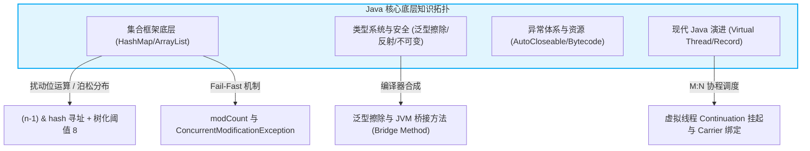
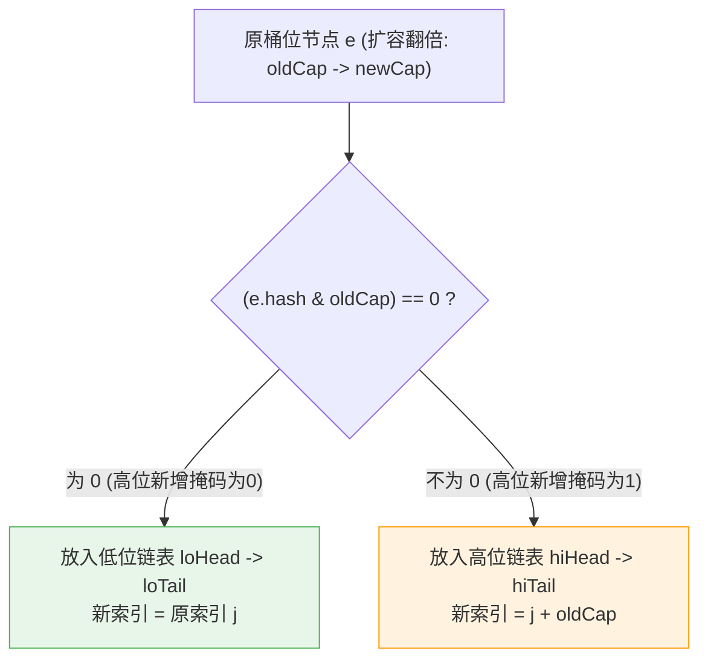

# 面试-Java核心深度专栏（大厂核心十问十答）

> [!abstract] 一句话技术本质
> Java 核心基础不是教条的 API 背诵，而是**从字节码指令、CPU 缓存局部性、位运算数学推导与操作系统的系统调用（Syscall）视角，彻底看清 JVM 语言的设计取舍与工业级避坑规范**。



---

## 目录

1. [[#Q1：HashMap 的底层寻址与扰动函数为什么要这样设计？位运算推导？]]
2. [[#Q2：HashMap 为什么树化阈值是 8，退化阈值是 6？为什么容量必须是 2 的幂？]]
3. [[#Q3：JDK 1.7 头插法为什么会导致死循环？JDK 1.8 尾插法如何通过高低位指针巧妙迁移？]]
4. [[#Q4：ArrayList 的 1.5 倍扩容与 Fail-Fast 机制是如何运作的？如何安全删除元素？]]
5. [[#Q5：String 为什么设计为不可变？JDK 7 后字符串常量池做了什么重大迁移？]]
6. [[#Q6：Java 泛型的“类型擦除”本质是什么？JVM 为什么会自动生成桥接方法（Bridge Method）？]]
7. [[#Q7：Java 反射调用究竟为什么慢？框架层是如何进行性能优化的？]]
8. [[#Q8：try-with-resources 的字节码本质是什么？finally 块中的 return 会引发什么灾难？]]
9. [[#Q9：Java 21 虚拟线程（Virtual Thread）底层实现原理是什么？什么是 Pinning（钉住）陷阱？]]
10. [[#Q10：BigDecimal 的使用存在哪些致命陷阱？金融高精度计算最佳实践？]]
11. [[#🎯 一分钟复盘记忆卡]]

---

### Q1：HashMap 的底层寻址与扰动函数为什么要这样设计？位运算推导？

> **30 秒绝杀**：
> 1. **寻址优化**：通过 `(n - 1) & hash` 代替取模运算 `%`。在 CPU 硬件层面，除法取模耗费数十个 CPU 周期，而按位与仅需 1 个周期，性能飙升数十倍；
> 2. **扰动函数**：`hash = (h = key.hashCode()) ^ (h >>> 16)`。将 32 位哈希值的高 16 位右移并与低 16 位异或，**强行让高位参与低位的寻址运算**，极大降低在数组容量较小时（如 $n=16$，只看低 4 位）的哈希碰撞率！

#### 2 分钟深度展开
```
原 hashCode (32位): 1111 0000 1010 1100 0011 0101 0110 1111
右移 16 位 (>>>16): 0000 0000 0000 0000 1111 0000 1010 1100
异或结果 (扰动hash): 1111 0000 1010 1100 1100 0101 1100 0011

数组长度 n = 16, (n - 1) = 15:
0000 0000 0000 0000 0000 0000 0000 1111  (掩码)
& 1100 0011 (扰动后的低8位)
= 0011 (槽位索引为 3)
```
- 如果不做扰动，只要对象的低 4 位相同，无论高位怎么变，都会发生 100% 的哈希冲突，散列表退化为长链表。

---

### Q2：HashMap 为什么树化阈值是 8，退化阈值是 6？为什么容量必须是 2 的幂？

> **30 秒绝杀**：
> - **为什么容量必为 2 的幂**：只有 $n$ 是 2 的幂时，$(n-1)$ 的二进制低位才全是 1（如 $16-1=15 \to 01111_2$），按位与才能等价于取模；且能保证哈希分布的每一位都有机会落入，防止某些桶永远为空；
> - **树化阈值 8 的数理来源**：根据泊松分布（Poisson Distribution），在哈希函数良好的理想状态下，单个桶发生 8 次碰撞的概率约为千万分之六（$0.00000006$），几乎不可能发生。一旦超过 8，说明遇到了严重的哈希碰撞攻击，必须引入红黑树将查询从 $O(N)$ 降到 $O(\log N)$；
> - **退化阈值 6 的防抖设计**：防止链表长度在 7 和 8 之间频繁颠簸，导致红黑树与单向链表剧烈转换引发性能雪崩。

---

### Q3：JDK 1.7 头插法为什么会导致死循环？JDK 1.8 尾插法如何通过高低位指针巧妙迁移？

> **30 秒绝杀**：
> - **JDK 1.7 环形死锁**：1.7 在并发 `resize()` 扩容时采用**头插法**，将链表节点的指向逆序。多线程并发重哈希时，线程 A 记录了 `next` 指针后被挂起，线程 B 完成了链表倒序，线程 A 恢复执行时将指向已经被调转方向的节点，形成 `A -> B -> A` 的环形链表！下次调用 `get()` 将导致 CPU 100% 死循环！
> - **JDK 1.8 尾插法彻底杜绝死循环**：采用**尾插法**保持原链表顺序；同时发明了**高低位双指针拆分法**：通过 `(e.hash & oldCap) == 0` 判断。为 0 则保留在原索引 `j`，不为 0 则平移到 `j + oldCap`，免去重新计算哈希的高额开销！

#### 2 分钟深度展开


---

### Q4：ArrayList 的 1.5 倍扩容与 Fail-Fast 机制是如何运作的？如何安全删除元素？

> **30 秒绝杀**：
> 1. **扩容本质**：当容量不足时，触发 `int newCapacity = oldCapacity + (oldCapacity >> 1)`（1.5 倍），调用底层的 `Arrays.copyOf`（内部调用 C++ 实现的 `System.arraycopy` 进行 CPU 连续内存块拷贝）；
> 2. **Fail-Fast 机制**：内部维护 `modCount`（结构修改计数器）。在 `Iterator` 遍历期间，若检测到 `expectedModCount != modCount`，说明存在并发修改或外部 `list.remove()`，立即抛出 `ConcurrentModificationException`；
> 3. **安全删除**：必须使用 `Iterator.remove()`（内部同步更新了 `expectedModCount = modCount`）或 Java 8 的 `list.removeIf(predicate)`。严禁在普通 `for-each` 循环中直接调用 `list.remove()`！

---

### Q5：String 为什么设计为不可变？JDK 7 后字符串常量池做了什么重大迁移？

> **30 秒绝杀**：
> 1. **不可变（Immutable）四大第一性原理**：
>    - **字符串常量池（String Pool）共享复用**：只有不可变，多个变量引用同一对象才绝对安全；
>    - **HashCode 缓存高效**：创建时计算一次 hash 缓存在字段中，放入 Map 无须重复计算；
>    - **多线程天然安全**：无须加锁即可在多线程间自由传递；
>    - **安全与类加载基石**：文件路径、网络连接参数、JVM 类加载名称皆依赖 String，若可变易遭反射或外部恶意串改。
> 2. **常量池迁移**：JDK 6 时位于**永久代（PermGen）**，GC 效率极低，极易引发 `OOM: PermGen space`；JDK 7 起彻底迁移至**Java 堆（Heap）**，与普通对象享受同等的 GC 垃圾回收！

---

### Q6：Java 泛型的“类型擦除”本质是什么？JVM 为什么会自动生成桥接方法（Bridge Method）？

> **30 秒绝杀**：
> Java 泛型是**伪泛型（编译期泛型）**。为了向下兼容 JDK 1.4，编译器在编译后将类型参数全部擦除为其上界（无边界则擦除为 `Object`），并在调用处插入强制类型转换（`checkcast`）指令。
> **桥接方法（Bridge Method）**：当子类重写父类的泛型方法时，父类方法被擦除为 `Object`，导致子类的特定签名无法满足多态虚方法表分派，**编译器会自动在子类字节码中生成一个参数为 `Object` 的桥接方法（打上 `ACC_BRIDGE` 标记），在内部调用子类的具体方法**。

#### 2 分钟深度展开
```java
public class Node<T> {
    public void setData(T data) { ... }
}
public class MyNode extends Node<Integer> {
    @Override
    public void setData(Integer data) { ... }
}

// 经过编译器编译后，MyNode 字节码实际上存在两个 setData 方法：
// 1. 业务写的: void setData(Integer data)
// 2. 编译器自动生成的桥接方法:
// public void setData(Object data) {
//     setData((Integer) data); // 内部强转调用具体方法
// }
```

---

### Q7：Java 反射调用究竟为什么慢？框架层是如何进行性能优化的？

> **30 秒绝杀**：
> 反射慢的四大真因：
> 1. **无法享受 JIT 编译器内联优化（Inlining）**；
> 2. **每次调用都需要做安全检查（Security Check）与参数装箱/拆箱**；
> 3. **按字符串名反复在类元数据中线性查找方法**。
> **框架优化（Spring/MyBatis）**：
> - 预解析并缓存 `Method` 实例到 ConcurrentHashMap；
> - 强制调用 `method.setAccessible(true)` 关闭运行期安全检查（提速数倍）；
> - 利用 JVM 的 **Inflation 膨胀机制**（默认调用 15 次后由 JNI 转为动态生成字节码执行）或采用 **MethodHandle / ByteBuddy**。

---

### Q8：try-with-resources 的字节码本质是什么？finally 块中的 return 会引发什么灾难？

> **30 秒绝杀**：
> 1. **try-with-resources 本质**：编译器语法糖。编译后自动展开为标准的 `try-catch-finally`，在 finally 中安全调用 `AutoCloseable.close()`。若业务抛出异常且 `close()` 也抛出异常，编译器会调用 `e.addSuppressed(closeException)` 将关闭异常作为**被抑制异常**附加在主异常上，**确保主业务异常绝不丢失**；
> 2. **finally 中 return 的灾难**：在 JVM 规范中，finally 块最后执行。如果 finally 中包含 `return` 或重新抛出新异常，**它会无情直接覆盖并吞噬 try 块抛出的原始致命异常（如 OOM 或 NPE）**，导致日志里报错消失，生产排障陷入绝境！

---

### Q9：Java 21 虚拟线程（Virtual Thread）底层实现原理是什么？什么是 Pinning（钉住）陷阱？

> **30 秒绝杀**：
> 虚拟线程是 JVM 级别的用户态协程，采用 **M:N 调度模型**：
> - 百万个虚拟线程运行在少量（等于 CPU 核心数）的**平台载体线程（Carrier Thread）**之上；
> - 当虚拟线程遇到阻塞 I/O（如 Socket 读写、Redis 查询），底层触发 `Continuation.yield()`，保存当前的调用栈帧至堆内存，并将载体线程立即释放给其他虚拟线程使用；I/O 就绪后重新挂载唤醒。
> - **Pinning 钉住陷阱**：在 JDK 21 中，若在 **`synchronized` 块内或调用本地方法（JNI）** 期间发生阻塞，虚拟线程将无法从载体线程上卸载（Unmount），导致载体线程被死死钉住无法调度其他任务，退化为传统阻塞线程！**破局：全面将 `synchronized` 替换为 `ReentrantLock`！**

---

### Q10：BigDecimal 的使用存在哪些致命陷阱？金融高精度计算最佳实践？

> **30 秒绝杀**：
> 金融资损三大必死陷阱：
> 1. **严禁使用 `new BigDecimal(0.1)` 传入 double**：0.1 无法用二进制浮点精确表示，其实际值为 `0.100000000000000005551...`！必须使用 `BigDecimal.valueOf(0.1)` 或 `new BigDecimal("0.1")`；
> 2. **除法未指定舍入模式（RoundingMode）**：在遇到无限循环小数（如 $10 \div 3$）时直接抛出 `ArithmeticException: Non-terminating decimal expansion`；
> 3. **数值比较误用 `equals()`**：`new BigDecimal("1.0").equals(new BigDecimal("1.00"))` 返回 `false`（因为 scale 精度不同）；**必须使用 `compareTo()` 进行数值大小比较**！

---

## 🎯 一分钟复盘记忆卡

| 面试核心考点 | 核心第一性原理 | 工业级关键落地点 |
| :--- | :--- | :--- |
| **HashMap 寻址** | 按位与替代取模，扰动混合高低位 | `(n - 1) & (h ^ (h >>> 16))` 抹平高位冲突 |
| **树化与容量** | 泊松分布极端小概率 + 防抖 | 8 树化，6 退化，容量必为 2 的幂保证二进制全 1 掩码 |
| **扩容无锁迁移** | 1.7 头插死循环，1.8 尾插安全 | `hash & oldCap == 0` 决定留原位还是 `j + oldCap` |
| **ArrayList 删除** | modCount 计数器校验并发修改 | 严禁 for-each 删除，必须使用 `Iterator.remove()` |
| **String 不可变** | 常量池复用、散列缓存与安全性 | JDK 7 常量池迁入 Java 堆享受全量 GC |
| **泛型类型擦除** | 兼容早期 JDK，运行期全强转 | 编译器生成 `ACC_BRIDGE` 桥接方法保障多态分派 |
| **反射性能调优** | 无法内联且存在安全检查 | 预缓存 Method，强制 `setAccessible(true)` 关闭安全检查 |
| **虚拟线程 Pinning** | M:N 调度遇到 synchronized 钉住 | 严禁在虚拟线程中使用 `synchronized`，全面换用 `ReentrantLock` |
| **BigDecimal 陷阱** | 二进制浮点无法精确表达 0.1 | 必须传入 String；必须声明 RoundingMode；比较用 `compareTo` |

---

## 🔗 关联阅读与权威索引

- [[../20-Java后端/01-Java核心/04-集合框架/04-HashMap原理与扩容|HashMap 原理与扩容源码剖析]]
- [[../20-Java后端/01-Java核心/01-泛型与类型擦除|泛型与类型擦除底层实现]]
- [[../20-Java后端/03-并发编程/01-线程基础与生命周期|线程基础与虚拟线程演进]]
- [[10-面试-并发编程|面试-并发编程深度专栏]]
- [[_index|求职准备全景导航]]
