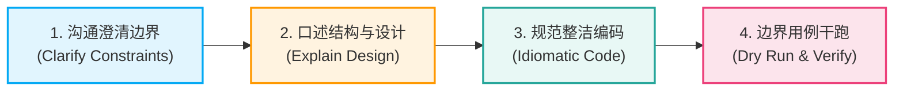
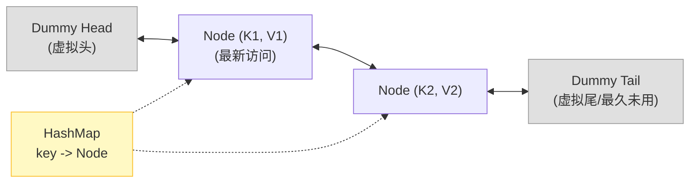
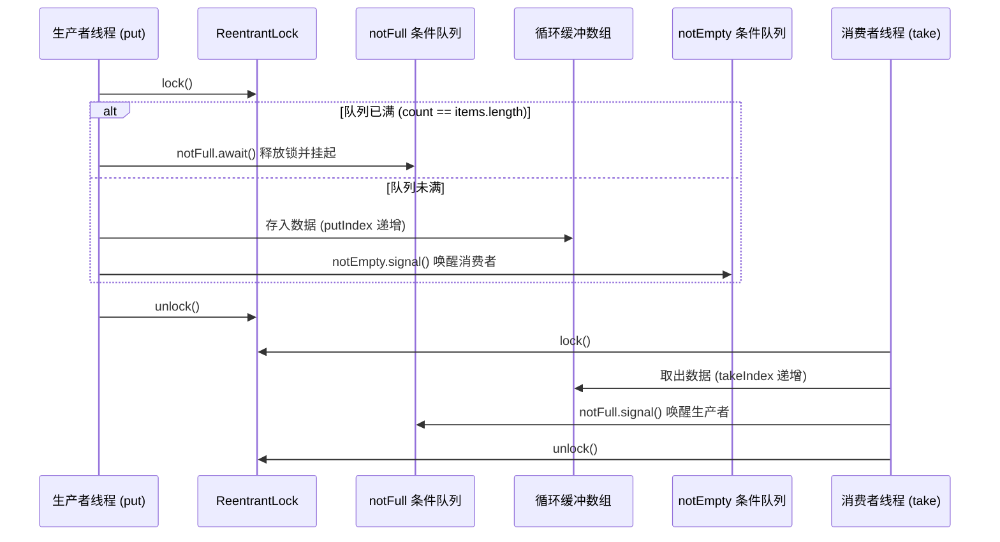
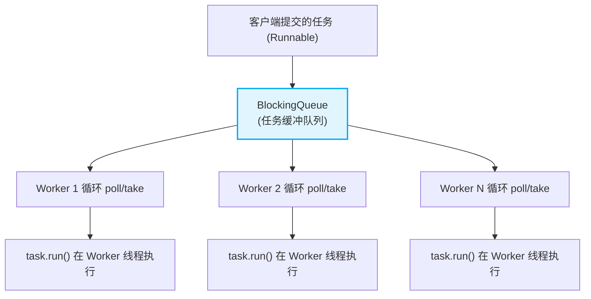

# 面试-手撕代码（大厂白板高频八绝）

> [!abstract] 核心心智模型
> 大厂技术面试中的“手撕代码”（Live Coding / Whiteboard）考查的不仅是算法熟练度，更是**工程素养、并发感知、边界防御与白板沟通能力**。
> 严禁拿到题目一言不发立刻狂敲代码！遵循**白板手撕 SOP 黄金四步法**：
> 1. **沟通澄清（Clarify）**：主动澄清输入输出边界、并发线程安全要求、异常与空指针处理；
> 2. **阐述设计（Design）**：向面试官口述数据结构与状态转移，确认思路符合预期；
> 3. **精准默写（Code）**：代码命名规范，利用哨兵节点消除特判，杜绝死循环；
> 4. **边界干跑（Dry Run）**：主动选取边界 Case（空集、单元素、并发满队列）口头推演验证。



---

## 目录（大厂八大必考白板代码）

1. [[#手撕 1：LRU Cache 缓存机制（双向链表 + 哈希表）]]
2. [[#手撕 2：双重检查锁定单例（DCL）与防止指令重排]]
3. [[#手撕 3：阻塞队列与生产者消费者模型（ReentrantLock + 双 Condition）]]
4. [[#手撕 4：快速排序 QuickSort（随机化基准 + 双指针分区）]]
5. [[#手撕 5：死锁场景模拟与 JStack 排查验证]]
6. [[#手撕 6：基于 CAS 手写自旋锁与可重入扩展]]
7. [[#手撕 7：手写简易版自定义线程池（核心工作线程 + 阻塞队列）]]
8. [[#手撕 8：基于 AQS 实现简易不可重入互斥锁]]

---

## 手撕 1：LRU Cache 缓存机制（双向链表 + 哈希表）

### 1. 第一性原理与设计心智
- **考点**：LeetCode 146 原题，全大厂出现率第一手撕题。考察 $O(1)$ 查找与 $O(1)$ 节点挪移能力。
- **设计**：
  - **哈希表**：`Map<Integer, Node>` 提供 $O(1)$ 寻址。
  - **双向链表**：提供 $O(1)$ 节点删除与头部/尾部插入。
  - **伪头尾哨兵（Dummy Head & Tail）**：消除头节点插入与尾节点删除时判空（`node.prev == null`）的防御性特判。



### 2. 标准手撕源码（可直接白板默写）
```java
import java.util.HashMap;
import java.util.Map;

public class LRUCache {
    // 双向链表节点
    private static class Node {
        int key, value;
        Node prev, next;
        Node() {}
        Node(int key, int value) {
            this.key = key;
            this.value = value;
        }
    }

    private final int capacity;
    private int size;
    private final Map<Integer, Node> cache = new HashMap<>();
    private final Node head = new Node(); // 虚拟头哨兵：最新节点插在 head.next
    private final Node tail = new Node(); // 虚拟尾哨兵：最久未访问节点在 tail.prev

    public LRUCache(int capacity) {
        this.capacity = capacity;
        this.size = 0;
        head.next = tail;
        tail.prev = head;
    }

    public int get(int key) {
        Node node = cache.get(key);
        if (node == null) {
            return -1;
        }
        // 访问后刷新为最新
        moveToHead(node);
        return node.value;
    }

    public void put(int key, int value) {
        Node node = cache.get(key);
        if (node != null) {
            node.value = value;
            moveToHead(node);
        } else {
            Node newNode = new Node(key, value);
            cache.put(key, newNode);
            addToHead(newNode);
            size++;
            if (size > capacity) {
                // 淘汰末尾最久未使用的实际节点
                Node removed = removeTail();
                cache.remove(removed.key);
                size--;
            }
        }
    }

    // --- 内部双向链表原子操作 ---
    private void addToHead(Node node) {
        node.prev = head;
        node.next = head.next;
        head.next.prev = node;
        head.next = node;
    }

    private void removeNode(Node node) {
        node.prev.next = node.next;
        node.next.prev = node.prev;
    }

    private void moveToHead(Node node) {
        removeNode(node);
        addToHead(node);
    }

    private Node removeTail() {
        Node res = tail.prev;
        removeNode(res);
        return res;
    }
}
```

---

## 手撕 2：双重检查锁定单例（DCL）与防止指令重排

### 1. 第一性原理与设计心智
- **为什么需要两次判空？**
  - **外层判空**：避免实例已经创建好后，每次调用 `getInstance()` 都进入同步块获取锁，严重拖垮并发吞吐。
  - **内层判空**：防止多个线程同时突破外层判空后，在锁外排队依次进入时重复创建对象。
- **为什么必须加 `volatile`？**
  - `instance = new Singleton()` 在 JVM 内部包含三步指令：
    1. `memory = allocate()`（分配堆内存空间）；
    2. `ctorInstance(memory)`（执行构造函数初始化实例）；
    3. `instance = memory`（将引用赋值给变量）。
  - JVM/JIT 编译器与 CPU 乱序执行可能将重排序为 `1 -> 3 -> 2`。若未加 `volatile`，线程 A 执行完 1 和 3 尚未执行 2 时，线程 B 进来发现 `instance != null`，便直接拿走了一个**尚未完成初始化的半成品对象**，随后调用其方法抛出 NPE 或不可预知的业务灾难！
  - `volatile` 通过插入**内存屏障（StoreStore / StoreLoad）**禁止写操作重排，并保证立即可见性。

### 2. 标准手撕源码（DCL 与枚举单例对比）
```java
public class DclSingleton {
    // 1. volatile 严禁指令重排序，保证内存可见性
    private static volatile DclSingleton instance;

    // 2. 私有构造器防止外部 new
    private DclSingleton() {
        // 防反射暴力破解攻击（防御性设计）
        if (instance != null) {
            throw new IllegalStateException("单例对象已存在，禁止反射创建！");
        }
    }

    // 3. 全局唯一访问入口
    public static DclSingleton getInstance() {
        if (instance == null) { // 第一次检查：过滤绝大部分无锁读
            synchronized (DclSingleton.class) {
                if (instance == null) { // 第二次检查：防止并发排队重复实例化
                    instance = new DclSingleton();
                }
            }
        }
        return instance;
    }
}

// 终极工业级防御：枚举单例（天然防反射、防序列化破坏）
enum EnumSingleton {
    INSTANCE;
    public void businessMethod() {
        // 业务逻辑
    }
}
```

---

## 手撕 3：阻塞队列与生产者消费者模型（ReentrantLock + 双 Condition）

### 1. 第一性原理与设计心智
- **考点**：手写 `ArrayBlockingQueue` 核心骨架。考察条件队列挂起与唤醒、锁的精确控制。
- **为什么用 `while` 而不是 `if` 检查条件？**
  - **虚假唤醒（Spurious Wakeup）**：底层 OS 或 POSIX 线程库可能在没有显式 signal 的情况下被操作系统信号随机唤醒。
  - **并发竞争抢夺**：当一个元素被放入触发 `notEmpty.signal()`，若唤醒了多个排队消费线程，只有一个线程能真正抢到锁并消费，其他线程被唤醒后队列可能又变空了。如果使用 `if`，线程不会重新判断条件，直接向下执行取元素就会抛出异常或越界。



### 2. 标准手撕源码
```java
import java.util.concurrent.locks.Condition;
import java.util.concurrent.locks.ReentrantLock;

public class MyBlockingQueue<T> {
    private final Object[] items;
    private int putIndex;
    private int takeIndex;
    private int count;

    private final ReentrantLock lock = new ReentrantLock();
    private final Condition notFull = lock.newCondition();  // 队列未满条件（生产者等待）
    private final Condition notEmpty = lock.newCondition(); // 队列不空条件（消费者等待）

    public MyBlockingQueue(int capacity) {
        if (capacity <= 0) throw new IllegalArgumentException("容量必须大于0");
        this.items = new Object[capacity];
    }

    public void put(T item) throws InterruptedException {
        lock.lockInterruptibly();
        try {
            // 严禁使用 if！必须用 while 循环防御虚假唤醒与并发抢夺
            while (count == items.length) {
                notFull.await();
            }
            // 存入环形队列
            items[putIndex] = item;
            if (++putIndex == items.length) {
                putIndex = 0;
            }
            count++;
            // 唤醒挂起的消费者
            notEmpty.signal();
        } finally {
            lock.unlock();
        }
    }

    @SuppressWarnings("unchecked")
    public T take() throws InterruptedException {
        lock.lockInterruptibly();
        try {
            while (count == 0) {
                notEmpty.await();
            }
            // 从环形队列取出
            T item = (T) items[takeIndex];
            items[takeIndex] = null; // 帮助 GC 回收
            if (++takeIndex == items.length) {
                takeIndex = 0;
            }
            count--;
            // 唤醒挂起的生产者
            notFull.signal();
            return item;
        } finally {
            lock.unlock();
        }
    }

    public int size() {
        lock.lock();
        try {
            return count;
        } finally {
            lock.unlock();
        }
    }
}
```

---

## 手撕 4：快速排序 QuickSort（随机化基准 + 双指针分区）

### 1. 第一性原理与设计心智
- **考点**：分治法（Divide and Conquer）。平均复杂度 $O(N \log N)$，原址排序空间复杂度 $O(\log N)$。
- **面试避坑点**：
  - 如果固定选择第一个元素作为 Pivot，在数组**已经有序或全部相同**时，快速排序将退化为冒泡排序，递归深度达到 $O(N)$，时间复杂度暴增为 $O(N^2)$，引发 StackOverflowError。
  - **破局**：在当前区间 `[left, right]` 中**随机选择一个索引**与 `left` 交换，抹平最坏边界。

### 2. 标准手撕源码
```java
import java.util.Random;

public class QuickSort {
    private static final Random RAND = new Random();

    public static void sort(int[] nums) {
        if (nums == null || nums.length <= 1) return;
        quickSort(nums, 0, nums.length - 1);
    }

    private static void quickSort(int[] nums, int left, int right) {
        if (left >= right) return;

        int pIndex = partition(nums, left, right);
        quickSort(nums, left, pIndex - 1);
        quickSort(nums, pIndex + 1, right);
    }

    private static int partition(int[] nums, int left, int right) {
        // 1. 随机化 pivot，防止极端有序场景退化为 O(N^2)
        int randomIndex = left + RAND.nextInt(right - left + 1);
        swap(nums, left, randomIndex);

        int pivot = nums[left];
        int i = left;
        int j = right;

        // 2. 双指针向中间收缩
        while (i < j) {
            // 右指针从后往前找第一个严格小于 pivot 的数
            while (i < j && nums[j] >= pivot) {
                j--;
            }
            // 左指针从前往后找第一个严格大于 pivot 的数
            while (i < j && nums[i] <= pivot) {
                i++;
            }
            if (i < j) {
                swap(nums, i, j);
            }
        }
        // 将 pivot 放置到相遇点 i
        swap(nums, left, i);
        return i;
    }

    private static void swap(int[] nums, int i, int j) {
        int temp = nums[i];
        nums[i] = nums[j];
        nums[j] = temp;
    }
}
```

---

## 手撕 5：死锁场景模拟与 JStack 排查验证

### 1. 第一性原理与设计心智
- **死锁四大必要条件**：
  1. 互斥条件；
  2. 请求与保持条件；
  3. 不剥夺条件；
  4. 循环等待条件（打破循环等待是破局关键：固定锁获取顺序）。
- **实战排查指令**：
  - `jps -l`：定位 Java 进程 ID。
  - `jstack <pid>`：查看线程堆栈，末尾直接打印 `Found 1 deadlock`。

### 2. 标准手撕源码
```java
public class DeadlockDemo {
    private static final Object RESOURCE_A = new Object();
    private static final Object RESOURCE_B = new Object();

    public static void main(String[] args) {
        // 线程 1：先抢 A，再抢 B
        new Thread(() -> {
            synchronized (RESOURCE_A) {
                System.out.println(Thread.currentThread().getName() + " 持有资源 A，尝试获取资源 B...");
                try {
                    Thread.sleep(100); // 放大时序并发窗口，确保线程 2 已拿到 B
                } catch (InterruptedException e) {
                    Thread.currentThread().interrupt();
                }
                synchronized (RESOURCE_B) {
                    System.out.println(Thread.currentThread().getName() + " 成功获取资源 B！");
                }
            }
        }, "Deadlock-Thread-1").start();

        // 线程 2：先抢 B，再抢 A（相反顺序，形成循环等待依赖链）
        new Thread(() -> {
            synchronized (RESOURCE_B) {
                System.out.println(Thread.currentThread().getName() + " 持有资源 B，尝试获取资源 A...");
                try {
                    Thread.sleep(100);
                } catch (InterruptedException e) {
                    Thread.currentThread().interrupt();
                }
                synchronized (RESOURCE_A) {
                    System.out.println(Thread.currentThread().getName() + " 成功获取资源 A！");
                }
            }
        }, "Deadlock-Thread-2").start();
    }
}
```

---

## 手撕 6：基于 CAS 手写自旋锁与可重入扩展

### 1. 第一性原理与设计心智
- **自旋锁本质**：不让出 CPU 时间片，依靠循环 CAS 尝试修改状态位。适用于锁保护的临界区极小、等待时间极短的场景，省去内核态线程挂起与上下文切换成本。
- **可重入性（Reentrant）支持**：
  - 维护一个 `owner` 记录当前持有锁的线程。
  - 维护一个 `state` 计数器记录重入深度。

### 2. 标准手撕源码
```java
import java.util.concurrent.atomic.AtomicReference;

public class ReentrantSpinLock {
    // 记录持有锁的线程
    private final AtomicReference<Thread> owner = new AtomicReference<>();
    // 重入计数器（只有当前持有线程才会读写，无需额外加锁）
    private int count = 0;

    public void lock() {
        Thread current = Thread.currentThread();
        // 1. 如果当前线程已持有锁，支持可重入，直接累加计数
        if (current == owner.get()) {
            count++;
            return;
        }

        // 2. 未持有锁：CAS 自旋尝试将 owner 从 null 设置为 current
        while (!owner.compareAndSet(null, current)) {
            // CPU 自旋提示（JDK 9+ 可用 Thread.onSpinWait() 优化流水线能耗）
            Thread.yield(); // 或短暂退让，防止 100% 跑满单个 CPU 核心
        }
        count = 1;
    }

    public void unlock() {
        Thread current = Thread.currentThread();
        if (current != owner.get()) {
            throw new IllegalMonitorStateException("非锁持有者无权释放锁！");
        }

        count--;
        if (count == 0) {
            // 所有重入完全释放，清空 owner，唤醒其他 CAS 自旋竞争者
            owner.set(null);
        }
    }
}
```

---

## 手撕 7：手写简易版自定义线程池（核心工作线程 + 阻塞队列）

### 1. 第一性原理与设计心智
- **面试痛点**：很多候选人只会背诵 `ThreadPoolExecutor` 的七大参数，让写一个简易线程池当场发懵。
- **线程池本质**：一组常驻的 Worker 工作线程，在一个 `while(isRunning)` 循环中不断从 `BlockingQueue` 中 `take()` 取任务并执行 `run()`。



### 2. 标准手撕源码
```java
import java.util.ArrayList;
import java.util.List;
import java.util.concurrent.BlockingQueue;
import java.util.concurrent.LinkedBlockingQueue;

public class SimpleThreadPool {
    private final BlockingQueue<Runnable> taskQueue;
    private final List<Worker> workers;
    private volatile boolean isShutdown = false;

    public SimpleThreadPool(int corePoolSize, int queueCapacity) {
        this.taskQueue = new LinkedBlockingQueue<>(queueCapacity);
        this.workers = new ArrayList<>(corePoolSize);

        // 预热启动所有核心 Worker 线程
        for (int i = 0; i < corePoolSize; i++) {
            Worker worker = new Worker("SimplePool-Worker-" + i);
            workers.add(worker);
            worker.start();
        }
    }

    public void execute(Runnable command) {
        if (isShutdown) {
            throw new IllegalStateException("线程池已关闭，拒绝新任务！");
        }
        // 将任务推入阻塞队列
        if (!taskQueue.offer(command)) {
            // 队列满时的拒绝策略
            throw new RuntimeException("队列已满，触发简易拒绝策略！");
        }
    }

    public void shutdown() {
        isShutdown = true;
        for (Worker worker : workers) {
            worker.interrupt(); // 中断阻塞中的工作线程
        }
    }

    // 内部工作线程 Worker
    private class Worker extends Thread {
        public Worker(String name) {
            super(name);
        }

        @Override
        public void run() {
            // 核心工作循环：不断从阻塞队列中拉取任务
            while (!isShutdown || !taskQueue.isEmpty()) {
                try {
                    Runnable task = taskQueue.take();
                    task.run(); // 注意：调用的是 run() 而不是 start()！在当前工作线程执行！
                } catch (InterruptedException e) {
                    if (isShutdown) {
                        break; // 收到中断且已关闭，优雅退出
                    }
                } catch (Throwable t) {
                    t.printStackTrace(); // 兜底防止用户任务抛异常直接干死 Worker 线程
                }
            }
        }
    }
}
```

---

## 手撕 8：基于 AQS 实现简易不可重入互斥锁

### 1. 第一性原理与设计心智
- **考点**：深入考察对 J.U.C 核心框架 `AbstractQueuedSynchronizer` 的定制能力。
- **模板方法设计模式**：继承 `AbstractQueuedSynchronizer`，重写 `tryAcquire(int)` 与 `tryRelease(int)`，状态 `state = 0` 代表空闲，`state = 1` 代表被锁定。

### 2. 标准手撕源码
```java
import java.util.concurrent.locks.AbstractQueuedSynchronizer;
import java.util.concurrent.locks.Condition;
import java.util.concurrent.locks.Lock;
import java.util.concurrent.TimeUnit;

public class SimpleMutexLock implements Lock {
    // 静态内部同步器
    private static class Sync extends AbstractQueuedSynchronizer {
        // 尝试获取锁：state 从 0 CAS 到 1
        @Override
        protected boolean tryAcquire(int acquires) {
            assert acquires == 1; // 独占锁只支持 1
            if (compareAndSetState(0, 1)) {
                setExclusiveOwnerThread(Thread.currentThread());
                return true;
            }
            return false;
        }

        // 尝试释放锁：state 从 1 置为 0
        @Override
        protected boolean tryRelease(int releases) {
            assert releases == 1;
            if (getState() == 0) {
                throw new IllegalMonitorStateException("锁未被占用，不可重复释放！");
            }
            setExclusiveOwnerThread(null);
            setState(0);
            return true;
        }

        @Override
        protected boolean isHeldExclusively() {
            return getState() == 1 && getExclusiveOwnerThread() == Thread.currentThread();
        }

        Condition newCondition() {
            return new ConditionObject();
        }
    }

    private final Sync sync = new Sync();

    @Override
    public void lock() {
        sync.acquire(1);
    }

    @Override
    public void lockInterruptibly() throws InterruptedException {
        sync.acquireInterruptibly(1);
    }

    @Override
    public boolean tryLock() {
        return sync.tryAcquire(1);
    }

    @Override
    public boolean tryLock(long time, TimeUnit unit) throws InterruptedException {
        return sync.tryAcquireNanos(1, unit.toNanos(time));
    }

    @Override
    public void unlock() {
        sync.release(1);
    }

    @Override
    public Condition newCondition() {
        return sync.newCondition();
    }
}
```

---

## 🎯 一分钟复盘记忆卡

| 手撕题目 | 核心考点 | 工业级关键防御细节 |
| :--- | :--- | :--- |
| **LRU Cache** | 双向链表 + Map 寻址 | 引入 `head/tail` **虚拟哨兵节点**，消除头尾插入删除的 NPE 特判 |
| **DCL 单例** | 双重判空 + 指令重排 | 变量必须使用 `volatile` 防止对象半初始化逸出；构造函数防御反射 |
| **阻塞队列** | Lock + 双 Condition | 等待条件必须使用 `while` 循环判定，防御操作系统**虚假唤醒**与并发争抢 |
| **快速排序** | 双指针分区 + 分治 | 必须采用**随机化基准元素**，防止近乎有序数组退化至 $O(N^2)$ 导致栈溢出 |
| **死锁模拟** | 循环等待资源依赖 | 用 `Thread.sleep` 放大并发时序窗口；生产环境熟练使用 `jstack` 排查 |
| **自旋锁** | CAS 状态迁移 | 维护 `owner` 记录持有线程；通过 `count` 计数器支持**可重入** |
| **简易线程池** | 工作线程与任务解耦 | Worker 线程内部 `while` 循环调用 `task.run()` 而非 `start()`；捕获 Throwable 防线程猝死 |
| **基于 AQS 互斥锁** | 同步器状态控制 | 继承 AQS 重写 `tryAcquire/tryRelease`；CAS 变更 `state=1` 并绑定持有者线程 |

---

## 🔗 关联阅读与权威索引

- [[15-面试-高频算法题|面试-高频算法题（三数之和/环形链表/合并K个链表）]]
- [[../20-Java后端/03-并发编程/05-AQS原理|AQS 原理与 CLH 变体队列]]
- [[../20-Java后端/03-并发编程/07-线程池原理与参数|线程池状态生命周期与拒绝策略]]
- [[../30-算法与数据结构/03-刷题记录/14-LC0146-LRU缓存|LC0146-LRU 缓存经典原题解析]]
- [[_index|求职准备全景导航]]
