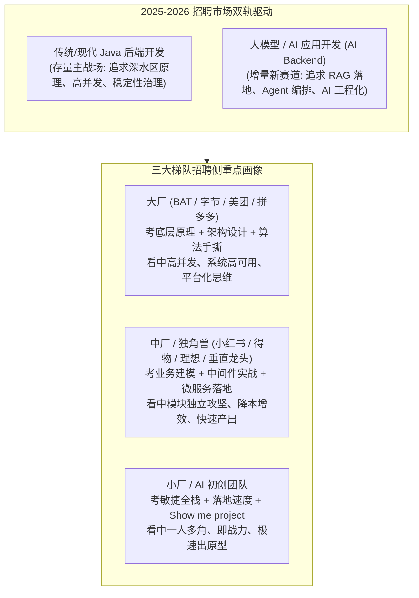
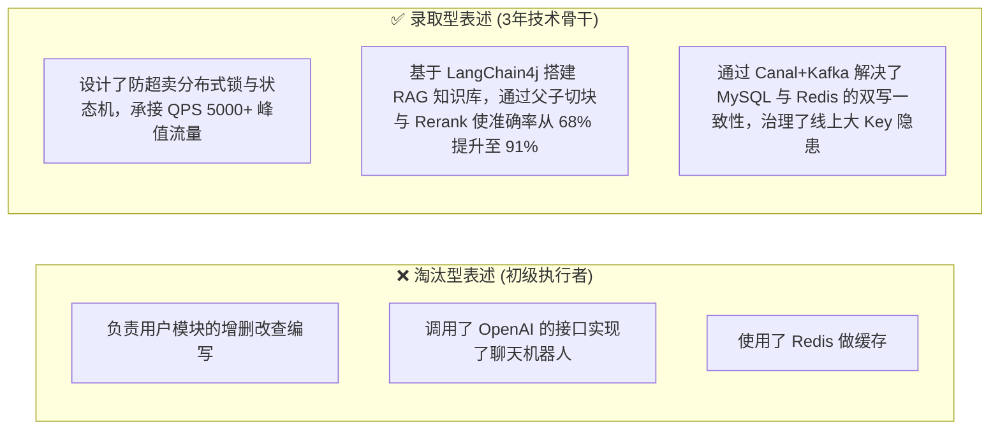

# 22 · 3年经验 Java 后端与 AI 应用岗位画像与招聘需求调研

> [!abstract] 一句话第一性原理
> **3 年经验是技术人员从“被动执行的 CRUD 小工”向“能独立负责系统模块与业务闭环的骨干（Contributor）”蜕变的生死分水岭。**
> 招聘市场的核心诉求不是看你“干了 3 年”，而是看你**是否具备了 3 年该有的技术深度（底层机制、架构思维）与工程交付确定性**。在当前技术周期中，**“扎实的 Java 后端工业级底座 + 大模型（RAG/Agent）工程化落地能力”** 是斩获高溢价 Offer 的绝对王牌。

---

## 调研全景图谱

---

## 一、 3 年经验 Java 后端开发岗位对比（大厂 vs 中厂 vs 小厂）

在 BOSS 直聘、拉勾、猎聘等主流招聘平台上，3 年经验的 Java 后端开发岗位呈现出极强的“阶梯分化”：

### 1. 核心维度横向对比总表

| 维度 | 大厂（一线头部） | 中厂 / 行业独角兽 | 小厂 / 中小型民企 |
| :--- | :--- | :--- | :--- |
| **典型企业** | 字节跳动、阿里巴巴、腾讯、美团、拼多多、快手、蚂蚁集团 | 小红书、得物、哔哩哔哩、理想汽车、商汤、微盟、深信服、广联达 | 垂直行业软件商、区域外包/外企研发中心、成长期初创公司 |
| **薪资区间 (一线)** | **25K ~ 35K+**（15~16 薪，年总包 40W ~ 60W+） | **18K ~ 28K**（13~15 薪，年总包 25W ~ 42W） | **10K ~ 18K**（12~13 薪，年总包 12W ~ 23W） |
| **学历门槛** | 统招全日制本科（双一流/985/211 优先），部分核心要求硕士 | 统招本科起步，部分看重实际对口项目经验 | 大专或普通本科，以项目匹配和直接干活为主 |
| **考核重心** | **底层机制深度、高并发高可用设计、白板算法** | **业务抽象建模、中间件熟练度、微服务稳定性治理** | **开发速度、全栈广度、即用即活、框架熟练度** |
| **Java 核心考核** | JVM 内部机理（GC 调优、内存泄漏排查）、JUC 并发底层（AQS、CAS、锁升级）、源码熟练度 | Spring 体系扩展点、常用注解原理、多线程并发工具实操、线程池调优 | SpringBoot 基础配置、CRUD 接口编写、常用第三方 SDK 快速对接 |
| **数据与存储** | MySQL 亿级分库分表、B+ 树深度原理、MVCC 隔离机制、锁冲突分析；Redis 集群高可用、大 Key/热 Key 治理、Canal 数据最终一致性 | MySQL 慢查询诊断、索引失效规避、事务死锁分析；Redis 穿透/击穿/雪崩防范、分布式锁应用 | 熟悉常见 SQL 编写、连接池配置、常规 Redis 缓存读写操作 |
| **微服务与架构** | 自研或云原生微服务框架、Service Mesh、全链路灰度发布、高并发秒杀防超卖、异地多活 | Spring Cloud Alibaba / Dubbo、Sentinel 熔断限流、Seata 分布式事务、SkyWalking 链路追踪 | 单体架构或基础微服务拆分、Nacos 配置读取、网关路由转发 |
| **算法考核要求** | **LeetCode Medium ~ Hard 手撕**（动态规划、图论、单调栈、复杂树结构） | **LeetCode Medium（Hot 100）**，侧重双指针、哈希、二分、二叉树 | 基本不考白板手撕，偶考简单冒泡、反转链表、字符串处理 |

---

### 2. 各梯队高频真实 JD 拆解

#### ① 大厂 JD 典型特征（以美团/阿里 3 年后端开发为例）
> **岗位职责**：
> 1. 负责核心交易/营销/履约链路的高并发后台设计与开发，保障系统 99.99% 高可用；
> 2. 参与系统容量规划、性能瓶颈分析与架构治理，攻克高并发、低延迟系统难题；
> 3. 深入理解业务，推动复杂业务模型沉淀与领域驱动设计（DDD）。
>
> **任职要求**：
> - 计算机相关专业本科以上学历，3 年左右 Java 实际开发经验；
> - 深刻理解 Java 虚拟机内存模型、垃圾收集算法，有线上 JVM 性能调优和内存泄漏排障经验；
> - 深刻理解 MySQL 内部原理，熟悉分库分表方案与底层锁机制；
> - 精通 Kafka/RocketMQ 等主流消息中间件，深刻理解消息可靠性传递、防丢失、防重复及消费堆积处理；
> - 具备大型高并发、分布式系统研发经验，对系统稳定性保障有成体系的认知。

#### ② 中厂 JD 典型特征（以小红书/得物 3 年后端开发为例）
> **岗位职责**：
> 1. 负责社区内容互动/电商交易等垂直业务域的需求拆解、技术方案设计与代码编写；
> 2. 推进模块重构与技术演进，定位并解决生产环境出现的慢接口、偶发死锁等稳定性问题；
> 3. 编写高质量的单元测试与技术设计文档，保障交付质量。
>
> **任职要求**：
> - 本科及以上学历，2~4 年 Java 研发经验，具备扎实的编程基础；
> - 熟练掌握 Spring Boot、Spring Cloud、MyBatis 等主流框架及底层核心机制；
> - 熟练掌握 Redis 常见数据结构及其生产应用，掌握分布式锁、缓存一致性解决方案；
> - 具备独立负责端到端复杂业务模块交付的经验，善于跨团队沟通协作。

#### ③ 小厂/初创公司 JD 典型特征
> **岗位职责**：
> 1. 负责公司 SaaS 平台/管理系统的全流程功能开发与维护；
> 2. 负责与前端联调接口，负责应用在生产 Linux 服务器（Docker）上的打包发布与日常运维。
>
> **任职要求**：
> - 大专或本科以上学历，3 年以上 Java 开发经验；
> - 精通 SpringBoot、MySQL、MyBatis-Plus，熟悉常见后台管理系统开发；
> - 熟悉 Linux 基本命令，熟练使用 Docker、Nginx 进行项目部署与配置；
> - 学习能力强，能抗压，可快速上手多项工作。

---

## 二、 3 年经验 AI 应用开发岗位对比（大厂 vs 中厂 vs 初创）

随着大模型从“底座军备竞赛”全面进入“应用落地与工程化变现”阶段，市场上针对“具备后端工程功底的 AI 应用开发工程师（AI Application / AI Backend Engineer）”的需求呈井喷态势。

### 1. 核心维度横向对比总表

| 维度 | 大厂（AI 平台 / 核心业务线） | 中厂（垂直行业 + AI 赋能） | AI 初创团队 / 独立出海工作室 |
| :--- | :--- | :--- | :--- |
| **典型企业** | 字节跳动（豆包/Coze）、阿里（通义实验室/钉钉AI）、腾讯、百度（文心）、美团 AI | 行业龙头企业（金融、跨境电商、企服SaaS、游戏、医疗数智化）、科大讯飞、商汤 | 专注 AI Agent 的初创公司、AI 工具出海团队、大模型方案集成商 |
| **薪资区间 (一线)** | **30K ~ 50K+**（15~16 薪，年总包 50W ~ 80W+） | **22K ~ 35K**（13~15 薪，年总包 30W ~ 55W） | **15K ~ 28K**（常配以早期股权/期权池激励） |
| **定位定位** | **AI 平台基础设施、高可用 AI 网关、大规模 Agent 平台** | **企业私域知识库落地、智能客服/分析助手、业务降本** | **极速交付 AI 原型、探索新奇玩法、一人抵一个研发组** |
| **核心工程技术栈** | Java / Go / Python；高并发流式网关（SSE/WebSocket）、分布式向量数据库集群（Milvus/Qdrant）、模型调用限流熔断降级（RPM/TPM 双令牌桶）、Prompt Caching 对齐治理 | Java（Spring AI / LangChain4j）或 Python（LangChain/LlamaIndex）；SpringBoot 微服务、PostgreSQL (pgvector) / ES、Redis 会话排他锁 | Python (FastAPI) / Node.js；Dify、FastGPT、Langflow、Supabase、Vercel 敏捷工具链 |
| **RAG 考查深度** | **高级检索全链路**：父子分块、Dense+Sparse 混合检索、RRF 排序倒数融合、Cross-Encoder 语义重排、Ragas 自动化指标评估（忠实度/答案相关度） | **业务知识库落地**：长文档清洗切分、表格与多模态解析提取、向量化检索调优、消除模型幻觉、文档权限级别隔离 | 熟练使用现有知识库平台（Dify/FastGPT），配合向量库搭建可用原型，调整分块参数与 Top-K |
| **Agent / 智能体** | **企业级 Agent 架构**：Function Calling 协议深水区、MCP（Model Context Protocol）规范落地、沙箱代码安全执行、L0~L3 风险拦截、多 Agent 协作拓扑 | **特定场景业务 Agent**：自动化审批助手、报表数据自动取数（Text-to-SQL）、营销物料批量生成工作流 | 基于提示词与工作流引擎组装工作流，快速接入第三方 API 实现业务闭环 |
| **性能与成本考量** | 首字延迟 TTFT、生成吞吐 TPOT 毫秒级优化、多 Provider 智能路由比价与故障转移（Failover） | 控制 API 调用 Token 成本、长上下文滑动窗口压缩、冷热会话分层存储 | 只要功能跑通、调用便宜（如采用 DeepSeek、通义等高性价比模型）即可 |

---

### 2. 各梯队高频真实 JD 拆解

#### ① 大厂 JD 典型特征（以字节/阿里大模型工程化岗位为例）
> **岗位职责**：
> 1. 负责大模型应用服务底座的设计与研发，构建高可用、高并发、低延迟的 AI 模型调用网关；
> 2. 深入设计企业级 RAG 检索链路与 Agent 执行引擎，优化召回精度与生成一致性；
> 3. 负责大模型推理成本治理、Token 消耗管控以及流式通信（SSE）性能优化。
>
> **任职要求**：
> - 本科及以上学历，3 年左右服务端开发经验，具备扎实的 Java 或 Go/Python 工程功底；
> - 深入理解 LLM 交互范式（Function Calling、Tool Use、结构化输出、上下文管理）；
> - 熟悉常用向量数据库（Milvus、Chroma 等），对 Embedding 召回、混合检索与 Rerank 策略有生产级调优经验；
> - 具备微服务高并发经验，熟悉流式长连接维护与限流降级方案者优先。

#### ② 中厂/垂直龙头 JD 典型特征（以企服/跨境电商 AI 落地为例）
> **岗位职责**：
> 1. 负责将大模型技术深度融入公司核心业务，主导内部企业知识库（RAG）与智能业务 Agent 的研发；
> 2. 负责跨系统工具调用（ERP/CRM 数据对接），实现复杂业务流程的智能化协同；
> 3. 持续优化模型 Prompt 表现，评测并解决实际业务问答中的幻觉问题。
>
> **任职要求**：
> - 统招本科，3 年左右软件开发经验，精通 Java 或 Python；
> - 熟悉 LangChain4j / Spring AI / LlamaIndex 等主流应用开发框架；
> - 熟悉向量检索技术，有基于私域文档构建精准问答系统的实际落地经验；
> - 具备敏锐的技术嗅觉，能够主动挖掘业务痛点并通过 AI 工具实现降本增效。

#### ③ 初创公司 JD 典型特征
> **岗位职责**：
> 1. 快速实现 AI 创新产品的后端架构与核心功能，包括对话、图像、智能体工作流等；
> 2. 负责集成最新的国内外大模型 API，探索 Agent 新玩法并极速推向市场验证。
>
> **任职要求**：
> - 具备端到端独立交付完整项目的能力（“Show me your live demo or GitHub”）；
> - 熟练使用 Cursor、Claude Code 等 AI 编程工具，具备极高的开发与自学效率；
> - 熟悉主流大模型特性与 Prompt 调优，有 Dify/FastGPT 或完整 Agent 落地经验者优先。

---

## 三、 3 年经验求职者的破局核心与简历映射指南

### 1. 3 年经验面试官的潜台词

面试官面对 3 年经验的候选人，最恐惧两件事：
1. **“表面 3 年，实际上是 1 年的 CRUD 重复了 3 次”**；
2. **“只会调接口（不管是调 Spring 还是调 OpenAI），对底层原理与容灾一问三不知”**。

因此，你的回答与简历必须体现出**“确定性与深度”**：

---

### 2. 如何利用本知识库快速对齐高薪 JD？

本知识库的内容体系已经高度契合上述大中厂的核心考核指标，你可以按如下路径将知识库沉淀转化为求职战斗力：

#### 路径 A：冲击 Java 资深/高并发岗位（20K ~ 35K）
1. **底层深度建立**：
   - 翻阅 [[08-面试-Java核心]]、[[09-面试-JVM]]、[[10-面试-并发编程]]，背熟 HashMap 扰动函数、三色标记并发漏标、AQS 双向队列底层，面试实现“吊打式”作答；
   - 翻阅 [[30-算法与数据结构/01-数据结构/04-哈希表]]、[[30-算法与数据结构/01-数据结构/08-堆与优先队列]]，讲清建堆 $O(N)$ 错位相减证明、红蓝染色二分；
2. **系统设计与架构**：
   - 翻阅 [[12-面试-MySQL与Redis]]、[[13-面试-分布式与微服务]]、[[14-面试-系统设计]]，掌握秒杀锁模型、分布式事务 Seata、两阶段半消息；
3. **简历定制**：
   - 参考 [[19-简历-Java后端方向]]，将知识库中的高并发与性能优化项目按 STAR 原则量化移植。

#### 路径 B：冲击 AI 应用开发 / AI 后端岗位（25K ~ 45K）
1. **大模型工程化核心**：
   - 精读 [[04-面试-RAG知识库]]：向面试官讲透文档分块策略、HNSW 向量检索、混合检索与重排（这是 80% 面试必考的主战场）；
   - 精读 [[05-面试-Agent与MCP]] 与 [[06-面试-Skills与AGENTS]]：讲透 Function Calling 底层协议、MCP 三大原语、长短期记忆与工具上下文裁剪；
   - 精读 [[07-面试-AI工程化]]：讲透流式 SSE 传输、TTFT 延迟治理、RPM/TPM 限流与成本控制；
2. **简历定制**：
   - 参考 [[18-简历-AI方向]]，突出“Java 工业级工程底座 + AI 智能体/知识库全链路交付”的复合型壁垒。

---

## 关联与后续行动

- [[21-公司调研]] —— 具体目标公司与投递策略清单
- [[18-简历-AI方向]] —— 针对大模型应用岗位的简历深度优化
- [[19-简历-Java后端方向]] —— 针对 Java 高并发中高级岗位的简历优化
- [[17-面试-项目类问题]] —— 如何运用 STAR 原则讲好生产级项目故事
