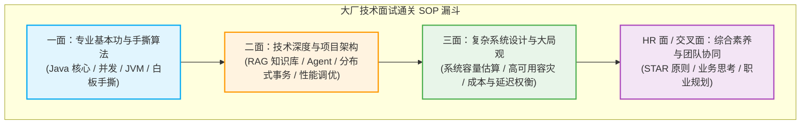
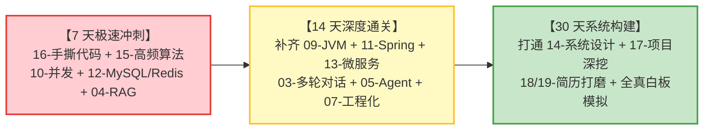

# 🎯 求职准备全景导航（跨技术栈王牌决胜）

> [!abstract] 一句话定位
> 本专区是打通 **AI 应用开发（LLM/RAG/Agent）**、**Java 后端工业级底座（JVM/并发/Spring/分布式/系统设计）** 与 **算法手撕** 的大厂面试终极决胜库。
> 所有面试篇目均贯彻：**“30 秒绝杀结论 + 2 分钟第一性原理深度展开 + 追问踩坑与生产指标 + 一分钟复盘记忆卡”**。

---

## 📚 权威面试专栏矩阵

### 🤖 一、AI 应用开发方向（前沿先锋）

| 序号 | 专栏篇目 | 核心考点与工业级深度 | 状态 |
| :--- | :--- | :--- | :---: |
| **01** | [[01-面试-LLM基础\|01-面试-LLM基础]] | Transformer 自注意力机制、RoPE 旋转位置编码、KV Cache 显存占用推导 | `⭐⭐⭐⭐⭐` |
| **02** | [[02-面试-Prompt与上下文工程\|02-面试-Prompt与上下文工程]] | Few-Shot 示例构造、CoT 思维链引导、提示词防注入与结构化输出 | `⭐⭐⭐⭐⭐` |
| **03** | [[03-面试-多轮对话\|03-面试-多轮对话]] | 三层记忆架构（工作/情景/语义）、滑动窗口递归摘要、Redis 会话排他锁、SSE 流式断流恢复 | `⭐⭐⭐⭐⭐` |
| **04** | [[04-面试-RAG知识库\|04-面试-RAG知识库]] | 父子块切分、HNSW 分层小世界图、Dense+Sparse 混合检索、RRF 融合算法、Cross-Encoder 重排、Ragas 评估 | `⭐⭐⭐⭐⭐` |
| **05** | [[05-面试-Agent与MCP\|05-面试-Agent与MCP]] | Function Calling 三步协议、ReAct 闭环、MCP 三大原语（Tools/Resources/Prompts）、L0~L3 风险分级管控、Saga 补偿 | `⭐⭐⭐⭐⭐` |
| **06** | [[06-面试-Skills与AGENTS\|06-面试-Skills与AGENTS]] | 程序化知识 SOP、AGENTS.md 规范落地、工具上下文裁剪 | `⭐⭐⭐⭐⭐` |
| **07** | [[07-面试-AI工程化\|07-面试-AI工程化]] | RPM/TPM 双重令牌桶限流、TTFT/TPOT 流式拆解、Prompt Caching 命中对齐、多 Provider 故障转移网关 | `⭐⭐⭐⭐⭐` |

---

### ☕ 二、Java 后端技术栈（工业基石）

| 序号 | 专栏篇目 | 核心考点与工业级深度 | 状态 |
| :--- | :--- | :--- | :---: |
| **08** | [[08-面试-Java核心\|08-面试-Java核心]] | HashMap 扰动函数推导、树化阈值 8 与泊松分布、尾插高低位指针迁移、泛型桥接方法、虚拟线程 Pinning 陷阱 | `⭐⭐⭐⭐⭐` |
| **09** | [[09-面试-JVM\|09-面试-JVM]] | 内存区域模型、类加载双亲委派破坏、三色标记与并发漏标（增量更新/原始快照）、线上 OOM/CPU 100% 盲打排查 | `⭐⭐⭐⭐⭐` |
| **10** | [[10-面试-并发编程\|10-面试-并发编程]] | JMM 缓存一致性与 Lock 前缀汇编、锁升级膨胀路径、AQS 双向队列、ThreadLocal 弱引用内存泄漏真因、LongAdder 分段累加 | `⭐⭐⭐⭐⭐` |
| **11** | [[11-面试-Spring\|11-面试-Spring]] | Bean 生命周期底层流程、三级缓存破循环依赖、JDK/CGLIB 代理本质、声明式事务八大失效场景、SpringBoot 自动装配 SPI | `⭐⭐⭐⭐⭐` |
| **12** | [[12-面试-MySQL与Redis\|12-面试-MySQL与Redis]] | 3层 B+ 树容纳 2190 万行推导、MVCC 与 ReadView 四步匹配、Redis 线程模型演进、穿透/击穿/雪崩与 Canal 最终一致性 | `⭐⭐⭐⭐⭐` |
| **13** | [[13-面试-分布式与微服务\|13-面试-分布式与微服务]] | CAP/BASE 物理权衡、Redisson 看门狗续期与 Redlock 争议、雪花算法时钟回拨、Seata 分布式事务模式、Nacos 双模架构 | `⭐⭐⭐⭐⭐` |
| **14** | [[14-面试-系统设计\|14-面试-系统设计]] | 秒杀系统防超卖、订单履约状态机、短链系统 Base62 算法、即时通讯千万级长连接架构 | `⭐⭐⭐⭐⭐` |

---

### 🧮 三、算法高频与白板手撕（面试必考）

| 序号 | 专栏篇目 | 核心考点与工业级深度 | 状态 |
| :--- | :--- | :--- | :---: |
| **15** | [[15-面试-高频算法题\|15-面试-高频算法题]] | 三数之和双重去重、环形链表 II 数学推导、二叉树最近公共祖先 LCA、合并 K 个升序链表小顶堆、股票买卖状态机 | `⭐⭐⭐⭐⭐` |
| **16** | [[16-面试-手撕代码\|16-面试-手撕代码]] | **大厂白板高频八绝**：LRU Cache、DCL 双重检查单例、阻塞队列生产者消费者、快速排序随机分区、死锁模拟、CAS 可重入自旋锁、简易线程池、AQS 互斥锁 | `⭐⭐⭐⭐⭐` |

---

### 💼 四、综合与实战沉淀

| 序号 | 篇目 | 说明 |
| :--- | :--- | :--- |
| **17** | [[17-面试-项目类问题\|17-面试-项目类问题]] | STAR 原则表达模板、难点深水区挖掘、线上故障复盘与度量指标 |
| **18** | [[18-简历-AI方向\|18-简历-AI方向]] | 企业知识库 RAG、业务 Agent 落地、MCP 规范等重点项目包装与撰写 |
| **19** | [[19-简历-Java后端方向\|19-简历-Java后端方向]] | 高并发秒杀、微服务治理、订单履约与 JVM 排障项目履历定制 |
| **20** | [[20-投递记录\|20-投递记录]] | 目标企业投递看板、面试轮次追踪与复盘跟踪 |
| **21** | [[21-公司调研\|21-公司调研]] | 目标大厂业务线、核心技术栈、组织架构与面经前置调研 |

---

## 🧭 复习备考作战策略

---

## 🔗 全知识库交叉直通车

- **AI 应用核心底座**：[[../10-AI应用开发/00-总览/AI应用开发学习路径|AI应用开发学习路径]]
- **Java 后端核心底座**：[[../20-Java后端/00-总览/学习仪表盘|Java后端技术学习总览]]
- **算法与数据结构底座**：[[../30-算法与数据结构/00-总览/学习仪表盘|算法学习仪表盘]]
- **全站中枢总览**：[[../00-总览/总仪表盘|总仪表盘]]
