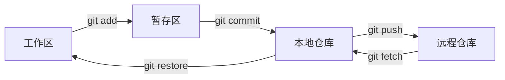

# Git 全流程实战手册

> [!info] 本文目标
> 按“首次拉取代码 -> 日常开发 -> 团队协作 -> 发布打标 -> 线上回滚 -> 误操作恢复”的顺序，建立一套可直接执行、可以验证的 Git 工作流。

> [!important] 先记住三条边界
> 1. 团队的分支保护和 MR/PR 规则优先于本文示例。
> 2. 私有分支可以整理历史，公共分支不要改写已经共享的历史。
> 3. 线上回滚优先恢复已验证的旧制品；`git revert` 解决的是仓库历史，不等于部署动作已经完成。

## 1. Git 到底在管理什么

Git 日常操作涉及四个位置：



| 位置 | 存放内容 | 常用检查命令 |
| --- | --- | --- |
| 工作区 | 当前正在编辑、尚未暂存的文件 | `git status`、`git diff` |
| 暂存区 | 准备进入下一次提交的变更快照 | `git diff --cached` |
| 本地仓库 | 已提交的 commit、branch、tag | `git log --oneline --graph` |
| 远程仓库 | 团队共享的引用和提交 | `git fetch`、`git branch -vv` |

Commit 不是“文件差异包”，而是一个项目快照及其元数据。它的 ID 由 tree、父提交、作者、提交者、时间和提交说明等内容共同决定。父提交改变后，即使代码结果相同，commit ID 通常也会改变。

## 2. 第一次拉取和初始化

### 2.1 配置身份

```bash
git config --global user.name "Your Name"
git config --global user.email "you@example.com"
git config --global init.defaultBranch main
git config --global pull.ff only
```

`pull.ff only` 会拒绝隐式生成 merge commit。发生分叉时，先看清历史，再明确选择 merge 或 rebase。

检查最终生效值及来源：

```bash
git config --list --show-origin
```

### 2.2 克隆仓库

```bash
git clone <repository-url>
cd <repository-directory>
git remote -v
git branch -vv
git status
```

验证点：

- `origin` 指向正确的仓库地址。
- 当前分支跟踪正确的远程分支。
- 工作区是 clean 状态。

### 2.3 获取远程最新状态

`git fetch` 只更新 `origin/main` 等远程跟踪引用，不会直接改工作区，适合先观察再决策：

```bash
git fetch --prune origin
git log --oneline --graph --decorate --all -20
```

如果本地分支没有自己的新提交，可快进：

```bash
git switch develop
git pull --ff-only origin develop
```

## 3. 日常开发的标准闭环

下面以从 `develop` 开发登录功能为例。

### 3.1 从最新主干创建分支

```bash
git switch develop
git pull --ff-only origin develop
git switch -c feature/user-login
```

不要基于一个几天没更新的本地 `develop` 直接开分支。

### 3.2 检查并精确暂存

```bash
git status --short
git diff
git add src/login.ts tests/login.test.ts
git diff --cached
```

优先精确列出文件。`git add .` 会把当前目录下所有变更一起暂存，工作区有实验文件或配置文件时容易误提交。

常用撤销方式：

```bash
# 取消暂存，保留工作区修改
git restore --staged src/login.ts

# 丢弃某个文件尚未暂存的修改
git restore src/login.ts
```

### 3.3 提交前验证

```bash
# 按项目实际命令执行
npm test
npm run build

git diff --check
git diff --cached
git status
```

一次 commit 应表达一个完整意图。提交说明写清“做了什么”，必要时在正文解释“为什么”：

```bash
git commit -m "feat: add user login validation"
```

### 3.4 推送并建立跟踪关系

```bash
git push -u origin feature/user-login
```

首次使用 `-u` 后，后续可直接执行 `git push`。随后创建 MR/PR，让 CI 和评审决定能否进入主干。

### 3.5 提交 MR/PR 前同步主干

如果这是自己独占的功能分支，可以把本地提交 rebase 到最新 `develop`：

```bash
git fetch origin
git rebase origin/develop
git push --force-with-lease
```

如果分支已由多人共同开发，则不要改写历史，使用 merge：

```bash
git fetch origin
git merge origin/develop
git push
```

`--force-with-lease` 会在远端分支已被别人更新时拒绝覆盖，比 `--force` 安全；但它仍会改写远程历史，只应用于明确由自己独占的分支。

## 4. 分支模型：先服从团队约定

不存在适合所有团队的唯一分支模型。

| 模型 | 特征 | 适用场景 |
| --- | --- | --- |
| Trunk-Based Development | 小批量、短分支、频繁合入 `main`，未完成功能靠 feature flag 隔离 | CI/CD 成熟、发布频繁 |
| GitHub Flow | `main` + 短期功能分支 + PR | 流程较轻、可持续部署 |
| Git Flow | `main` + `develop` + feature/release/hotfix | 版本发布窗口明确、需要长期维护发布线 |

附件中的分支体系属于 Git Flow。若项目采用这套模型，各分支职责如下：

| 分支 | 从哪里创建 | 合并到哪里 | 说明 |
| --- | --- | --- | --- |
| `main` | 长期分支 | - | 生产基线，通常禁止直接提交 |
| `develop` | 长期分支 | - | 下一版本集成分支 |
| `feature/*` | `develop` | `develop` | 新功能或功能优化 |
| `fix/*` | `develop` | `develop` | 未发布代码的问题修复 |
| `release/*` | **`develop`** | `main` 和 `develop` | 冻结版本、只做发布修复 |
| `hotfix/*` | `main` | `main` 和 `develop` | 已上线版本的紧急修复 |

> [!warning] Release 分支不能从 `main` 拉
> 新版本功能已经汇集在 `develop`，所以 `release/v1.2.0` 必须从待发布的 `develop` 创建。从 `main` 创建会缺失本次准备上线的新功能。

### 4.1 Feature 流程

```bash
git switch develop
git pull --ff-only origin develop
git switch -c feature/user-login

# 开发、测试、提交
git push -u origin feature/user-login
# 创建 MR/PR，合入 develop
```

合并完成并确认无需保留后再删除分支：

```bash
git branch -d feature/user-login
git push origin --delete feature/user-login
```

### 4.2 Release 流程

```bash
git switch develop
git pull --ff-only origin develop
git switch -c release/v1.2.0
git push -u origin release/v1.2.0
```

在 release 分支只处理版本号、发布配置和阻断上线的缺陷，不再加入新功能。验证通过后通过受保护分支的 MR/PR 完成：

1. `release/v1.2.0` 合入 `main`。
2. 在 `main` 的发布提交上创建 `v1.2.0` 标签。
3. 将 release 上的修复同步回 `develop`。标准 Git Flow 是将 release 合入 `develop`；团队也可约定将已包含这些改动的 `main` 合回 `develop`，但只能固定采用一种规则。
4. 删除 release 分支。

### 4.3 Hotfix 流程

```bash
git switch main
git pull --ff-only origin main
git switch -c hotfix/payment-crash
```

修复并验证后：

1. 合入 `main` 并发布补丁版本。
2. 同步到 `develop`，避免下一版本重新引入旧问题。
3. 如果还有存续的 release 分支，也要评估是否同步进去。

## 5. Merge 与 Rebase

假设 `feature` 和 `develop` 从提交 `A` 分开：

```text
      B---C  feature
     /
A---D---E    develop
```

### 5.1 Merge：保留真实分叉

```bash
git switch feature
git merge develop
```

会生成合并提交 `M`：

```text
      B---C---M  feature
     /       /
A---D---E---/    develop
```

- 不改写 `B`、`C`，适合公共分支。
- 分支关系完整，但频繁合并会增加 merge commit。
- `--no-ff` 即使能快进也保留一个 merge commit，适合需要明确发布或功能边界的团队。

### 5.2 Rebase：复制提交形成线性历史

```bash
git switch feature
git rebase develop
```

结果类似：

```text
A---D---E---B'---C'  feature
```

Git 把 `B`、`C` 的变更依次重放到 `E` 后，生成新的 `B'`、`C'`。因为父提交和提交时间等元数据变化，新提交 ID 与原提交不同。

### 5.3 为什么共享分支上 rebase 会造成问题

假设旧的 `B`、`C` 已推送，同事也基于它们继续工作。你 rebase 后强推，远端引用改为 `B'`、`C'`：

- 同事本地仍保存旧提交，双方历史已经分叉。
- 同事普通 push 会被拒绝；错误地 merge 或强推可能引入重复提交或覆盖他人工作。
- 旧提交对象通常仍可能在本地 reflog 中找回，并非强推后立刻从磁盘“物理删除”，但远程分支已不再指向它们。

判断规则：

| 场景 | 是否适合 rebase |
| --- | --- |
| 尚未推送的本地提交 | 可以 |
| 自己独占、团队允许改写的远程功能分支 | 可以，推送用 `--force-with-lease` |
| 多人共同开发的分支 | 不要改写，使用 merge |
| `main`、`develop` 等受保护公共分支 | 不要改写 |

### 5.4 交互式 Rebase

```bash
git rebase -i HEAD~4
```

常用动作：

| 动作 | 用途 |
| --- | --- |
| `pick` | 保留提交 |
| `reword` | 修改提交说明 |
| `squash` | 合并到前一个提交并编辑说明 |
| `fixup` | 合并到前一个提交并丢弃当前说明 |
| `drop` | 删除提交 |

它适合整理尚未共享的本地历史。如果平台支持 Squash and Merge，通常可让平台在合并 MR/PR 时压缩，减少开发者手动改写远程分支的需要。

## 6. 冲突处理

### 6.1 Merge 冲突

```bash
git status
# 编辑冲突文件，删除冲突标记并保留正确结果
git add <resolved-files>
git commit
```

不想继续本次合并：

```bash
git merge --abort
```

### 6.2 Rebase 冲突

```bash
git status
# 编辑并验证
git add <resolved-files>
git rebase --continue
```

其他选择：

```bash
git rebase --abort  # 回到 rebase 前
git rebase --skip   # 跳过当前提交，确认其变更确实不再需要时才用
```

Rebase 可能在重放每个提交时分别冲突。解决后要重新运行测试，因为“冲突标记已清除”不代表业务语义正确。

## 7. Tag 与上线

Tag 是对某个 commit 的命名引用，不会合并代码，也不会自动部署。

### 7.1 创建带说明的发布标签

先确认本地 `main` 与远程一致，并确认当前 commit 正是通过验收的发布点：

```bash
git switch main
git pull --ff-only origin main
git status
git log -1 --oneline --decorate

git tag -a v1.2.0 -m "release: v1.2.0"
git show v1.2.0
git push origin v1.2.0
```

也可以一次推送全部本地标签，但容易把实验标签一起推上去，因此发布时优先精确推送单个标签。

```bash
git push origin --tags
```

### 7.2 Tag 的常见用途

- CI/CD 监听 `v*` 标签，构建并发布不可变制品。
- 快速定位某个发布版本对应的源码。
- 对比两个版本：`git diff v1.1.0..v1.2.0`。

检查旧版本时使用 detached HEAD：

```bash
git switch --detach v1.1.0
```

如果要基于旧版本修复，创建新分支，而不是直接在 detached HEAD 上工作：

```bash
git switch -c hotfix/from-v1.1.0 v1.1.0
```

已发布标签应视为不可变。标签打错时要先查明是否已触发构建或部署，不要静默移动同名标签。

## 8. 撤销与回滚：先判断改动在哪里

| 目标 | 推荐命令 | 是否改写公共历史 |
| --- | --- | --- |
| 丢弃未暂存的文件修改 | `git restore <file>` | 否 |
| 取消暂存但保留修改 | `git restore --staged <file>` | 否 |
| 修改最后一次本地提交 | `git commit --amend` | 是 |
| 回退未推送的本地提交 | `git reset` | 是 |
| 撤销已共享提交 | `git revert` | 否，新增反向提交 |
| 找回误删分支或提交 | `git reflog` | 否，先定位再恢复 |

### 8.1 Reset：移动当前分支指针

```bash
git reset --soft HEAD~1
git reset --mixed HEAD~1
git reset --hard HEAD~1
```

| 模式 | 当前分支 | 暂存区 | 工作区 | 典型用途 |
| --- | --- | --- | --- | --- |
| `--soft` | 回退 | 保留 | 保留 | 重新组织最后一次本地提交 |
| `--mixed` | 回退 | 重置 | 保留 | 撤销提交后重新选择暂存内容 |
| `--hard` | 回退 | 重置 | 重置 | 确认不要所有相关本地改动 |

`reset --hard` 会丢弃工作区和暂存区的修改。它只适用于明确知道要丢弃什么的本地场景，不应用来重写已经共享的 `main` 或 `develop`。

### 8.2 Revert：用新提交抵消旧提交

撤销普通提交：

```bash
git revert <bad-commit>
git push origin main
```

撤销 merge commit 时必须说明保留哪条父线。典型的“功能分支合入 main”通常保留第一父提交：

```bash
git revert -m 1 <merge-commit>
```

`-m 1` 的含义是把第一个父提交当作主线，不是固定口诀。执行前先确认父提交：

```bash
git show --no-patch --pretty=raw <merge-commit>
```

撤销多个普通提交时，可先生成变更但不立即提交，检查后再统一提交：

```bash
git revert --no-commit <oldest-commit>^..<newest-commit>
git diff --cached
git commit -m "revert: roll back faulty release changes"
```

如果 revert 冲突：

```bash
git status
# 解决冲突并测试
git add <resolved-files>
git revert --continue

# 放弃本次 revert
git revert --abort
```

> [!warning] `git revert v1.2.0` 不等于“把系统回滚到 v1.1.0”
> 它只尝试反做 `v1.2.0` 标签所指向的那一个 commit。若标签指向 merge commit，需要 `-m`；若一个版本由多个提交组成，需要明确提交范围或回滚该发布 merge。执行 revert 也不会自动创建 `v1.2.1` 标签，更不会自动部署。

### 8.3 线上回滚与源码回退不是一件事

生产故障时优先按发布系统的能力决策：

1. **恢复服务**：重新部署上一个已验证、不可变的制品，例如 `v1.1.0` 对应镜像。
2. **修正仓库**：在受保护分支上 revert 错误变更，走评审和 CI。
3. **形成新版本**：验证通过后创建补丁标签，例如 `v1.2.1`，再部署新制品。

直接在生产服务器执行 `git checkout <tag>` 不是通用发布方案。成熟流程应从标签构建制品，并记录“源码 commit -> 制品摘要 -> 部署环境”的对应关系。

## 9. Reflog：误操作后的恢复入口

`reflog` 记录本地引用曾经指向过的位置，常用于找回误 reset、误 rebase 或误删分支前的提交：

```bash
git reflog --date=local
```

找到目标提交后，先创建恢复分支保护现场：

```bash
git switch -c recovery/accidental-reset <commit-id>
```

验证内容无误后，再决定 cherry-pick、merge 或移动原分支。不要看到一个看似正确的 ID 就立刻再次 `reset --hard`。

## 10. 完整实战：开发、发布、回滚

### 10.1 功能开发

```bash
git switch develop
git pull --ff-only origin develop
git switch -c feature/payment

# 修改代码并运行测试
git add <exact-files>
git diff --cached
git commit -m "feat: add payment flow"
git push -u origin feature/payment
```

创建 MR/PR，CI 通过、评审完成后合入 `develop`。

### 10.2 准备发布

```bash
git switch develop
git pull --ff-only origin develop
git switch -c release/v1.2.0
git push -u origin release/v1.2.0
```

完成冻结测试和必要修复，通过 MR/PR 合入 `main`，确认发布 commit 后打标签：

```bash
git switch main
git pull --ff-only origin main
git tag -a v1.2.0 -m "release: v1.2.0"
git push origin v1.2.0
```

等待 CI 构建并验证部署结果，然后把 release 修复同步回 `develop`。

### 10.3 发布后发现严重问题

先记录以下信息：

- 当前生产制品版本和摘要。
- `v1.2.0` 对应的 commit。
- 上一个已验证制品 `v1.1.0` 是否仍可部署。
- 数据库变更是否向前/向后兼容，是否允许只回应用。

恢复流程：

1. 通过发布平台重新部署 `v1.1.0` 的已验证制品，先恢复服务。
2. 确认 `v1.2.0` 的合入方式：merge、squash、fast-forward 或多个提交。
3. 在新分支中对正确的提交或提交范围执行 revert。
4. 运行测试并通过 MR/PR 合回 `main`。
5. 创建 `v1.2.1` 标签，构建并部署新制品。
6. 根据下一版本是否也应移除该功能，决定如何同步 `develop`，不要机械地合并。

数据库已经执行不可逆迁移时，应用制品可能无法单独回滚。发布前必须准备向前修复、兼容性迁移或经演练的数据恢复方案。

## 11. 操作前后的验证清单

### 提交前

- [ ] `git status --short` 中只有本任务文件。
- [ ] `git diff` 和 `git diff --cached` 已逐项检查。
- [ ] 测试、构建和 `git diff --check` 通过。
- [ ] 没有凭据、环境文件、大文件或临时产物被暂存。

### 推送前

- [ ] 当前分支和 upstream 正确：`git branch -vv`。
- [ ] 已获取远端最新引用：`git fetch --prune origin`。
- [ ] 需要强推时使用 `--force-with-lease`，且确认分支由自己独占。

### 发布前

- [ ] Tag 指向已验收的准确 commit。
- [ ] CI 产物可追溯到 commit 和制品摘要。
- [ ] 上一个稳定制品仍可获取并已验证回滚路径。
- [ ] 数据库、配置和消息格式具备兼容或恢复方案。

### 操作后

```bash
git status
git log --oneline --graph --decorate -20
git branch -vv
git ls-remote --heads --tags origin
```

命令没有报错只是第一层验证；最终要确认本地引用、远端引用、代码内容、CI 和部署状态都符合预期。

## 12. 一页速记

> 开发从正确主干拉短分支，提交前先看 diff；
> 私有历史可 rebase，公共历史只追加不改写；
> 发布先确认 commit，再打不可变 tag；
> 本地撤回分层用 restore/reset，公共撤销用 revert；
> 生产先回已验证制品，仓库再走反向提交和补丁发布；
> 误操作先查 reflog，恢复时先建保护分支。

## 相关

- 上级：[[_index|Git 与工程协作索引]]
- 项目级规则：[[../10-AI应用开发/05-Agent-MCP-Skills/16-AGENTS规范详解|AGENTS 规范详解]]

