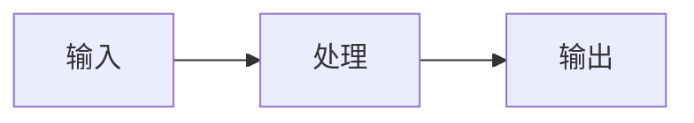

# <笔记标题>

> [!abstract] 一句话总结
> 用一句话说清楚这个知识点是什么、解决什么问题。（要求：不看下文也能凭这句话向别人转述）

## 🗣️ 白话版（先建立直觉，仅限专区类比）

> 💡 **举例规约**：遵循 [[../00-总览/知识库内容编写与表达规范]]，生活化/工业化类比必须收纳在专属类比段落中，**后续正文技术推导全程严禁随意穿插例子**。
> 提倡工整严谨的工程与社会模型类比（如流水线装配、交通红绿灯、银行窗口排队），坚决杜绝低俗不雅比喻。
> 用大白话把这个概念讲给"完全不懂的朋友"听，2~4 句。
> 例：Rerank 就像招聘——简历初筛（向量检索）快但粗，面试官逐个面（Rerank）慢但准，所以先筛 50 个再精面 5 个。

## 📌 这是什么

<用自己的话解释，避免直接抄定义>

## 🤔 解决什么问题 / 为什么需要

<这个技术出现的背景、它替代或改进了什么。关键：写清"没有它会发生什么坏事">

## 🧩 核心概念

| 概念 | 含义 | 备注 |
| ---- | ---- | ---- |
|      |      |      |

## ⚙️ 工作原理 / 流程



<分步骤讲清楚。每一步都回答"为什么是这样"，不要只给结论。
推荐写法：先给一个具体的小例子（带具体数字/数据），跟着例子走一遍流程>

## 🆚 从坏到好（对比案例）

> 一个"错误/朴素做法"的例子 → 它为什么不行 → 改成正确做法后长什么样。
> 这是最容易记住的部分，尽量写。

## 💻 代码实践

```java
// 关键代码片段（Spring AI / LangChain4j）
// 要求：能独立运行或明确标注省略了什么，不写"伪装成代码的伪代码"
```

> 完整代码见：[[项目-XXX]]

## 🧪 最小验证（做一遍才算学会）

> 一个 10 分钟内能完成的动手实验：改什么参数、跑什么命令、预期看到什么。
> 例：把 chunk_size 从 500 改成 2000，观察同一问题的召回质量变化。

## ⚠️ 踩坑与注意事项

- 坑 1：<现象 → 原因 → 怎么避免>
- 坑 2：

## 🧠 自测题（先自己答，再展开对答案）

> 复习时只看题目，口头/纸上回答后再展开。答不上来 → mastery 降一星。

> [!question]- Q1: <一道"为什么"类问题>
> 参考答案：

> [!question]- Q2: <一道"场景应用"类问题：给场景，问怎么选/怎么排查>
> 参考答案：

> [!question]- Q3: <一道"边界/对比"类问题：X 和 Y 的区别、什么时候不该用>
> 参考答案：

## 🎯 面试问题（折叠自测卡片）

> 遵循 [[../00-总览/知识库内容编写与表达规范]]：面试题强制使用 `> [!question]-` 默认折叠，题干写在标题栏，杜绝答案平铺。

> [!question]- Q1: <完整面试题干？>
> **30 秒核心结论**：<先给最直接的结论与核心依据，面试第一句话说什么>
> 
> **2 分钟深度展开**：<底层原理、关键机制流转、对比与取舍>
> 
> **生产踩坑与避坑策略**：<生产实践中的典型事故、配置调优或最佳实践>

> [!question]- Q2: <高频追问/对比题干？>
> 核心解答...

## 🪝 记忆钩子

> 一句口诀 / 一个数字锚点 / 一张脑内画面，帮你半年后还能想起来。
> 例："粗召回管多，Rerank 管准"；"先 core → 队列 → max → 拒绝"。

## 🔗 关联笔记

- [[相关笔记1]]（和本篇的关系：<一句话>）
- [[相关笔记2]]

## 📚 参考资料

- [标题](url)
