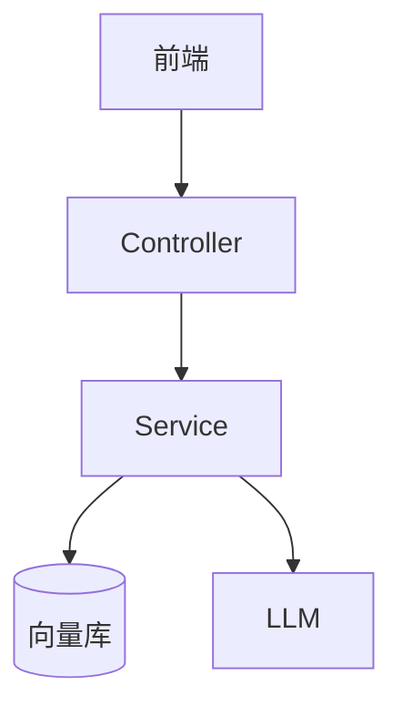

# <项目名>

> [!info] 项目简介
> 一句话说清这个项目做什么、用到哪些核心技术。

## 🎯 项目目标

- [ ] 目标 1
- [ ] 目标 2

## 🛠️ 技术栈

| 类别 | 选型 |
| ---- | ---- |
| 语言/框架 | Spring Boot 3 + Spring AI |
| 模型 | DeepSeek / 通义 |
| 向量库 | Milvus / pgvector |
| 可观测 | Langfuse |

## 🏗️ 架构设计

## 📋 开发任务拆解

- [ ] 任务 1
- [ ] 任务 2
- [ ] 任务 3

## 🧠 关键技术点

<本项目用到的核心知识点，链接到对应知识笔记>

- [[RAG基础]]
- [[Spring-AI-ChatClient]]

## 🐛 问题记录

| 日期 | 问题 | 解决方案 |
| ---- | ---- | -------- |
|      |      |          |

## 📊 成果与复盘

- 截图 / 演示：
- 性能数据：
- 复盘心得：

## 🔗 关联笔记

- [[../40-求职准备/17-面试-项目类问题]]
