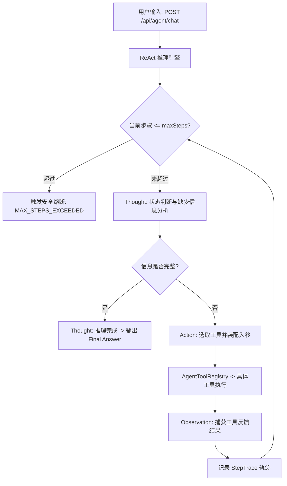

# Project ReAct Agent (通用业务 ReAct 智能体工程)

## 📖 项目简介

本项目为《10-AI应用开发/08-项目实战》中的通用业务 ReAct 智能体工程。基于 **Thought - Action - Observation** 认知推理闭环，实现自主分解复杂业务目标、动态调度多业务工具、自动提取中间状态并最终完成目标推理，具备**最大步数熔断保护**与**可审计执行轨迹追踪**能力。

## 🏗️ 核心架构与设计

## 🚀 核心组件说明

- **`AgentTool` 与 `AgentToolRegistry`**：
  - 工具统一契约规范（`getName`、`getDescription`、`execute`）；
  - 自动扫描并注册 Spring 容器中所有的业务工具 Bean。
- **业务工具集 (`com.knowledge.agent.tools`)**：
  - `OrderQueryTool`：根据订单号查询商品名称、关联物流单号与下单信息；
  - `LogisticsTool`：根据物流单号查询当前轨迹节点、发货日期与物流状态；
  - `CalculatorTool`：支持日期天数差计算（`DAYS_BETWEEN`）与四则基础运算。
- **`ReActEngine`**：
  - 受控的 ReAct 认知推导引擎；
  - 执行保护机制：最大轮次保护（默认 6 步），超时与死循环熔断；
  - 审计轨迹：记录每一步的 `step`、`thought`、`action`、`actionInput`、`observation`。
- **`AgentController`**：
  - `POST /api/agent/chat`：接收用户自然语言指令，触发智能体循环推导并返回最终答复与完整步骤轨迹。

## 🧪 自动化测试验证

集成测试类 `ReactAgentApplicationTest` 覆盖以下场景：
1. **工具自动装配验证**：验证所有工具 Bean 在启动时均成功装配至注册中心；
2. **多步推理全链路闭环**：输入“查询订单 1001 的物流状态并计算距今已发货多少天”，验证自动依次经历：
   - 步骤 1: `OrderQueryTool(1001)` -> 获取物流单号 `LOG-9527`
   - 步骤 2: `LogisticsTool(LOG-9527)` -> 获取发货日期 `2026-10-30` 与状态 `已发货`
   - 步骤 3: `CalculatorTool(2026-10-30 至 2026-11-03)` -> 计算得出 `4 天`
   - 步骤 4: `FINISH` -> 最终答案明确包含订单 1001、已发货与 4 天。
3. **最大步数安全熔断机制**：限制最大步数为 2 步时，智能体在达到限制后立即安全中止，状态标记为 `MAX_STEPS_EXCEEDED`。
